#+TITLE: 59.63 MRR Storage Admission and Final Use
#+LANGUAGE: en
#+OPTIONS: toc:2

* Contract owner

[[file:../../../Project.sysml][Project]] and
=ControlActivation.GovernancePolicyProjection= own this refinement of
[[file:59.62-burn-exposure-recovery.org][retained admission]]. MRR Data supplies
the storage adapter; Weaver supplies the original execution domain and final
transport owner. SPEC retains semantic ownership. This review introduces no
database backend, balance algorithm or alternative Lean authorization model.

#+CAPTION: A durable historical decision is input to recovery, not a new execution permit.
#+ATTR_ORG: :width 1600
#+ATTR_HTML: :width 100% :alt MRR admission storage and Rust final use

* Reuse and required Host constraints

The source baseline is [[https://github.com/tao3k/mrr-data/pull/12][MRR Data PR 12]],
commit =8e3384c7f2a257b37319927206d756d989e08dac=. Its main branch is not an
adequate description of this backend. =mrr-data-backend= already provides optional
Turso storage, bounded admission, transaction-owned authority comparisons, exact
operation recovery and an atomic metadata/outbox decision. Its public
=turso_driver= reexport also supports Host-owned schemas. Reuse these mechanisms.

| Existing mechanism | Weaver obligation that remains |
|--------------------+--------------------------------|
| =Backend= / =ProfilePort= | Bind the original canonical profile, namespace and scope before use; reconnect cannot select another coordination home |
| =with_authorities= / =advance_authority= | Enroll every mutable deciding authority; do not acknowledge an external Policy/history change while its storage authority remains stale |
| Opaque content CID and durable content publication | Authenticate the original body, domain commitments and actual durability acknowledgment; a client-supplied public receipt is insufficient |
| Exact operation outcome and outbox | Reconcile by the original key and CID; historical replay and delivery acknowledgment mint no send ticket |
| Transaction callback | Pure admission validation only; never send, reserve in another store or advance a Scheme Session from this callback |
| Generic provider transaction | Rust must still qualify current owner, fence, Policy and affine ticket at actual release |

The callback observes a head while the provider transaction is held. This can
serialize authorities enrolled in that same transaction; it does not lock an
external Policy service or hold exclusion through an arbitrary socket write.
A validation return value cached across rollback or authority handoff cannot
replace final admission. Rust =FnOnce= does not enforce absence of side effects.

Burn and original reservation/exposure must form one admitted root transition.
The body can reference authenticated immutable subobjects; it need not be a large
flat JSON document. Two unrelated successful writes do not establish that
transition. Missing body, ambiguous commit, unavailable authority or restored
~held=0~ keeps the original unknown obligation reserved and readiness closed.
MRR Commerce's payment mandates and dispatch replay refusal are useful design
evidence, not an interchangeable LLM token accounting model.

* Temporal refinement and existing proof semantics

The existing =PublicationRecovery.qnt= owner now separates capture of a storage
approval, burn commit, historical replay, content availability and actual use.
Commit/use call the existing retained-cut and one-use guards again. The model
does not reproduce SQL, CID semantics, SPEC authorization or budget arithmetic.

Seven witnesses cover projection rollback after validation, source handoff,
lost commit response, missing content during repair and use, a deliberately
unsafe cached-approval admission, and content publication without admission.
The unsafe action is confined to its counterexample and excluded from the
guarded sampling relation. These are finite temporal witnesses, not a proof of
arbitrary storage deployments or an authenticated content service.

Reuse SPEC =ZeroTrust.Framework= continuous authorization, committed consumption
and unknown retention, together with the existing Gateway/LeanPoo composition.
No new Lean definitions are needed for the storage scheduling gap. The Host
still owes the deciding-transaction refinement, independent retained-root custody,
canonical-home binding, content durability and Rust final-use mediation.

* Native consumer evidence

[[https://github.com/tao3k/mrr-data/blob/55cd3d893cf1bf71b622611d3cd77cb22ccac994/crates/mrr-data-backend/tests/integration/exposure.rs][MRR Data's native exposure integration suite]]
owns these storage experiments. Run its normal =backend_exposure= Cargo test
target in the MRR workspace. It uses the real Turso provider, Backend and immutable
filesystem content store. Its private typed Host-obligation fixture is opaque
storage data, not another budget or authorization model. The acknowledged-file
adapter is a same-host experiment, not independent anti-rollback storage.
Weaver consumes that contract and keeps its actual ledger/transport tests; it
does not maintain a second MRR package or external-manifest runner.

| Runtime scenario | Observed boundary |
|-----------------+-------------------|
| Lost response, reopen, exact replay | Original unknown receipt and reservation survive; replay skips validation; substituted body is refused |
| Remove content but retain metadata | Historical decision remains readable, while obligation recovery fails; metadata alone cannot certify readiness |
| Callback side effect followed by refusal | Side effect occurs without metadata commit: purity is an explicit Host premise |
| Same original operation under another home | Two homes can commit independently: canonical registry binding is a Host premise |

The latter two cases intentionally reproduce trusted-Host misuse. They do not
demonstrate an unauthenticated network exploit or actual duplicate Gateway send.
The previous SQLite Floor controls continue to own actual ledger callback and
rollback experiments; the new consumer does not replace them.

* Turso upgrade qualification and concurrency limits

The historical isolated control and candidate selected exact Turso =0.8.1= and =0.8.3= against
the same original backend source. Both passed the original 18 consumer cases and
the four cases above. Initial consumer builds failed because the test treated
=Option<ContentRead>= as =ContentRead=; corrected consumer builds pass on both
versions. Those failed logs remain temporary evidence, not an upstream regression.

MRR PR 12 now carries commit =aecbeb06815805bbcfc4122ef8702504bcbe47ed=,
upgrading its workspace pin and nine Turso-family lock entries to =0.8.3=.
Other dependency versions and edges remain unchanged. Weaver's dependencies and
production code remain unchanged. [[https://github.com/tursodatabase/turso/releases/tag/v0.8.3][The upstream release]]
is the version source; passing these checks alone does not establish a throughput
gain or compatibility of every optional extension or platform.

Current =TursoProvider= uses a writer mutex, =BEGIN IMMEDIATE= and its durability
barrier. Raising Host worker counts does not create additional writer connections.
The existing sustained-load test retains its fixed two-runtime-worker, eight
writer-lane and four-reader profile; it is a bounded regression workload, not
maximum-machine scalability. Do not silently enable MVCC or remove serialization
as part of a dependency bump. Any future sharding must preserve the original
shared-budget coordination scope.

Historical raw logs remain under =/private/tmp=. Current executable acceptance
uses MRR Data's own manifest and standard test targets, not a temporary package.
Neither a shared dependency build cache nor paired successful tests constitutes
a cold-start or performance comparison. Production artifacts belong in =prod=;
production code must not import this consumer, proof assets or =dev=.

The actual upgraded MRR workspace passes 41 backend tests and 57 Commerce
tests, backend Clippy with warnings denied, and the combined FTS/sync feature
compile. Its sustained-load control passes all three original rounds and reopen
assertions; overlapping qualification compilation excludes its latency samples
from performance comparisons. Optional GraphAr query execution, live sync and
FTS queries are outside this qualification. Remote CI was queued after push and
is not claimed as passing.

Weaver's existing architecture check and full Rust/ASP gate pass. An initial
restricted-sandbox Rust run could not bind loopback sockets; the unchanged
TCP/TLS suite passes with local-network permission. The new verification source
was also moved from a nonstandard test directory into the existing ASP-approved
=tests/integration= layout without weakening that gate. The 158 publication
recovery witnesses, 70 existing composition witnesses and 1,000 seeded temporal
samples pass. Lean/SPEC owners and dependency pins are unchanged.

* Remaining acceptance obligations

The target MRR adapter is not yet integrated into Weaver production. Before that
change, qualify original-home assignment, authentic durable-body acknowledgments,
external authority publication ordering, independent root/prefix recovery and
the final owner gate under cancellation/restart. A database receipt alone cannot
close the interval between durable consumption and transport release. Preserve
the existing at-most-once burn rule even if a crash sacrifices progress, and keep
unknown exposure until the domain's definitive settlement evidence arrives.
