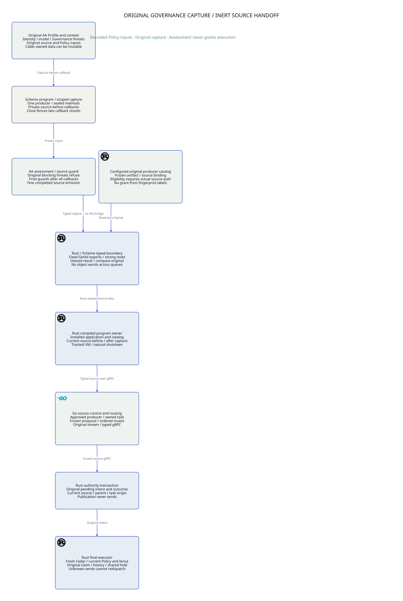

#+TITLE: 59.64 Original Governance Capture and Mutable Alias Refusal
#+LANGUAGE: en

* Call-scoped source capture for the in-process handoff

The Gateway scope now exposes =capture= with a specific native Function contract:
it accepts a zero-argument Boolean producer and returns one independent =GatewayArtifact= Record. The public
=capture-governed-gateway= facade uses the same admitted Yuanxu view, AA/Governor
selection, native Governance assessment, Cedar preflight and currentness checks
as =emit-governed-gateway=. Only the delivery mode changes. There is no additional
DSL or evaluator. File delivery returns the emitter's Boolean; memory delivery
returns the captured native Record after the final currentness check. Emission completion
is not the admission evidence object.

=scheme/gateway/capture.ss= owns a private thread-local sink. Its mutex serializes
active state, the first image and an irreversible duplicate-attempt fuse. A
producer must return exactly true and emit exactly once. Validation/copy failure
consumes the call's emission slot as well: catching it cannot admit a replacement
image in that call. Catching a duplicate exception cannot clear the fuse. Normal return and exceptional unwinding close
the sink and discard its private image. An inherited old sink refuses even while
a new capture is active. No lock is held while arbitrary producer code runs.
Inputs must remain stable during native copying; the mutex does not make an
arbitrarily mutable Profile graph atomic or sandbox operator IO. Closing a sink
does not certify all producer threads have stopped.

The memory carrier validates the native =GatewayArtifact= contract and deep-copies
its data leaves. It bounds aggregate UTF-8 string bytes to eight MiB, traversal
to 16384 values and nesting to 64. It neither encodes nor parses a JSON blob.
The file adapter explicitly serializes the resulting Record for its existing
Go configuration-file entry; this legacy adapter is separate from native interop.
Internal Governance context commitments still use canonical JSON for comparison;
that local commitment format is not the Scheme-to-Rust object transport.

| Owner | Delivered or remaining responsibility |
|-------+---------------------------------------|
| Scheme | Typed scope, actual governed producer, bounded single completed output, duplicate fuse and late-sink fence |
| Rust host / pinned upstream SDK | Assemble the admitted VM/program graph, bind its actual export, retain a strong result root, copy/validate into Rust-owned values before await/queue and release roots on the owner thread |
| Go | Existing typed publication/routing and reconciliation; the current integration still uses its compiler/artifact adapter after capture |
| Quint | Existing boundary evidence now requires one emission, completion and an unpoisoned capture; existing borrow/VM restart and source/fence schedules remain shared |
| Lean | Three conditional refusal laws strengthen the existing BoundaryContext; they do not prove Gambit mutexes, native ABI provenance, allocation or durability |

The fixed gerbil-scheme-rust source exposes LinkedGerbilProgram and owner-thread
LinkedObjectExport with strong-root transfer. Those interfaces
are used by the qualification crate; production Rust server assembly remains open.
A compiler-owned initialized graph and actual AA producer export remain necessary;
a synthetic root carrier or echoed JSON would not qualify their composition.

The integration fixture checks that no output artifact exists after the governed
capture returns, then serializes the captured Record outside that scope for today's Go
adapter. Source-assets and module loading may still read files. This is not a
file-free application, replacement of compileScheme, or production VM embedding.
The core diagram describes source-to-authority semantics; it does not establish
that every native transport/materialization stage has been delivered.

Native PBT uses the inherited framework (seed 293, 128 cases, finite shrinking)
with required zero/one/two/three-emission and completed/incomplete coverage. It
also requires clean/invalid-first coverage. It preserves the original image despite
caller mutation, and rejects caught invalid/duplicate attempts and incomplete
producers. Native thread tests join every worker and
check concurrent duplicates, exceptional cleanup and old-sink resumption during
a fresh capture. Separate tests exercise exact byte limits. No script-based
generator, shrinker or parallel state-machine implementation is added.

The first real capture invocation failed: the former governed emitter returned
the final module-admission result, which is not Boolean producer completion. The
capture guard refused it naturally; no artifact could activate control. The
whole invocation failed in 157.492 seconds, although all twenty refusal controls
passed independently. The corrected common producer returns its actual typed
emission result and still checks currentness before returning; the guard remains
strict. The corrected captured partial-send/revoke/dual-restart test passed in
23.01 seconds, retained the original hold, and the captured alias-mutation refusal
passed naturally in 5.66 seconds (whole focused invocation 31.826 seconds).

The first new Quint witness incorrectly chained a second action after =fail()=,
leaving its state unset: 168 witnesses passed and one failed. Splitting zero and
duplicate rejection into independent initialized witnesses corrected the harness,
without weakening boundaryValid. All 170 named witnesses and the existing
1000-sample/60-step boundary schedule then passed. The actual fixed-SPEC Lean
bridge built all three new laws without sorryAx. These remain conditional
composition evidence, not complete higher-order Governance or native embedding
acceptance. Earlier startup/exit failures remain separate and unresolved.

Final standard Gerbil testing passed five modules and 29 cases, including three
128-trial properties. Exact source-size, caught duplicate, failed producer and
old-sink/new-capture controls passed. This is installed-prefix native evidence;
it is not an in-process Rust/AA VM qualification or a runtime speedup measurement.
After the failed-slot refinement, the actual captured streaming/revocation and
dual-restart test passed again in 23.08 seconds (whole command 26.373 seconds).
The earlier corrected pair and retained failed invocation remain separate receipts.

* Architecture and implemented boundary

#+ATTR_HTML: :width 1500

The existing Scheme Governance owner now captures independent canonical data
before invoking an Agentic AI Lab assessment method. It compares that original
image with the actual post-call Profile, context and returned assessment context.
Two live aliases that mutate together cannot substitute for the original image.
This guard reuses native POO Record contracts and actual AA assessment dispatch;
it does not add a governance DSL or another evaluator.

The gap was concrete: original Profile identity and assessment-context identity
could share one mutable string. An override could change that string, return an
otherwise ready assessment, and satisfy the old live-to-live equality checks.
An isolated copy of the prior function returned =accepted= for this stimulus.
The fixed owner retains an independent pre-call string and refuses the change.

* Capture and responsibility allocation

| Owner | Responsibility |
|-------+----------------|
| Scheme Governance capture helper | Build typed original metadata/threat projections and private canonical JSON; compare data and local method references around one callback |
| AA Profile / ThreatModel | Existing generic assessment dispatch and native threat semantics; blocking original threats refuse before an override executes |
| Scheme Gateway / Policy owners | Existing exact task/Governor source binding and original Policy/source-assets projection checks; a successful local assessment remains inert |
| Go control | Decode source data, stage/reconcile original publication and propose routes; no assessment result authorizes an external effect |
| Rust ledger / executor | Current source identity, original publication CAS, claim, budget, history/fence and actual send/release guards |
| Native PBT / Quint / Lean | Framework-owned implementation generation/replay, bounded protocol witnesses and conditional binding laws, respectively |

The capture helper lives in =scheme/governance/capture.ss=. Native Record
descriptors remain in =types.ss=; =func.ss= owns AA dispatch and refusal. The
root package, public module selection and FFI library boundary are unchanged.
There is no new direct Yuanxu dependency: the existing AA dependency provides
the native contracts and property-testing framework.

The selected data image includes Profile identity/revision/owner, ThreatModel
identity, every native threat's identity/severity/phase, all preconditions and
their observed/evidence values, mitigations and acceptance authority. A separate
typed context image includes the original source, Policy inputs and all existing
context coordinates. Policies and source-assets retain the Gateway's separate
before/after projection checks. Unsupported ontology remains unsupported.

Canonical strings are newly allocated inside the owner before the callback and
are not passed to it. They are bounded by the existing eight-MiB source limit.
They are byte snapshots, not a general cryptographic identity or portable grant.
Method comparison pins the actual selected procedure objects locally; it does
not hash closures, authenticate source code or prove captured ambient state pure.

* Native property framework and concrete integration

The Scheme suite now uses =:clan/poo/testing/property=, its public generators and
its standard =property/test= assertion adapter. No application PRNG, shrink loop
or script-based property engine is introduced. The framework owns reports,
counterexamples, shrinking and replay; every non-passing status fails a normal
=:std/test= assertion.

The generated property uses seed 293, 128 cases and a finite shrink budget of 64.
It varies the field, character position, replacement character and whether to
mutate. Eight field classes include nested precondition evidence and threat
identity, alongside Profile/model/context coordinates. Required classification
coverage includes every field plus mutated and stable cases. Stable cases must
still return acceptance, so denying every call cannot satisfy the property.
Mutated cases require the exact source-change refusal, not an arbitrary exception.

The integration fixture adds an AA override that mutates the shared Profile
identity before constructing its assessment. The real Go/Rust harness requires
natural Scheme refusal, no emitted artifact and zero provider calls. Its original
fifteen-second deadline and cleanup semantics are unchanged. The existing normal
Scheme publication/restart scenario remains the positive cross-language control.

Standard =gerbil build= rebuilt the changed libraries, and =gerbil test= owns
native suite discovery and execution. This SDK's test command can return process
zero even after a TestError: actual case/module/harness verdicts must be inspected.
The maintained Go gate also checks the SDK's returned test verdict explicitly.
An exit code or isolated success marker alone is not native acceptance.

* Quint and Lean correspondence

The existing =LlmPolicyContinuation= owner already requires the original Profile,
captured environment and source image at the boundary. New witnesses cover
coordinated live labels and the expected unsafe omitted-snapshot path. The latter
is an executable counterexample, not a deployed guard. An identical nested-value
witness was removed in favor of reusing the existing environment-change check.
The standard Policy plan now executes this owner and samples its existing
=boundaryStep= relation; no parallel lifecycle/CAS model is added.

The fixed-SPEC Lean bridge reuses =BoundaryContext=, =CaptureDependency= and its
existing changed-capture law. Its assessment-snapshot corollary rejects a changed
captured environment against the independently retained expected environment.
Native refinement must map the canonical selected data and admitted source/method
context into that reference. The proof does not make a live pointer immutable,
prove the JSON encoder or establish external fact truth.

* Failure evidence and limits

The isolated baseline retains the previous =assess-governance!= body, changing
only its import path and exported function name. It accepted the shared-string
mutation. The new regression requires the exact changed-source refusal. An early
fixture accidentally shadowed a POO slot and produced CyclicSlot; a generic
exception assertion also lacked causal precision. Neither qualified the alias
guard. The corrected baseline and framework property use precise outcomes.

The first real new negative integration printed the correct refusal but exceeded
its original fifteen-second natural-exit deadline and was killed by the test
watchdog. It remains a failed trial. A paired run with the old assessment-revision
refusal passed: the old case exited naturally in 6.20 seconds and the new one in
5.85 seconds. That later pass does not explain the first process's delayed exit
or establish that host jitter caused it. No timeout or exit path was changed.

These are selected-data, single-callback guards. They do not prove an atomic
snapshot against concurrent writers, detect a fully restored A-B-A mutation,
sandbox arbitrary Scheme code or detach every returned Gateway object from every
caller alias. The admitted Scheme runtime remains trusted. Durable Rust-owned
capture, authenticated callback/producer issuance, general Profile/configuration
schema admission and external source-cut recovery remain required.

The inherited JsonSchema public scope was inspected: contract admission rejects
unsupported constraints, while its default object schema is unconstrained. It
cannot be selected as Gateway admission by default. This change uses the existing
native Record schema for selected metadata; it does not claim to implement the
full dual JSON/Scheme configuration-schema pipeline. Higher-order Governance's
thirteen complete acceptance scenarios remain unqualified.

* Verification receipt

Focused native PBT and complete standard native suites passed before the final
source freeze. The semantic-boundary owner passed 165 named Quint witnesses and
1000 sampled 60-step runs with seed 293. The actual fixed-SPEC Lean bridge built
its new corollary with only the existing logical assumptions and no sorryAx.
Final committed-source gate and integration results are recorded after execution.
No dependency pin, source limit, ASP deny rule or resource cleanup is relaxed.

The first merged clean-source gates at =c8e4a83= failed the architecture trace
because the new witness regular expression omitted escaping its literal opening
parenthesis. Go's ordinary suite failed for the same trace error. Runtime Rust
tests, Clippy, real provider integration and all formal stages passed, but those
whole gate receipts remain failed. The trace expression was corrected without
changing its intended definition match or weakening the checker. The original
blocking-threat fixture now also requires zero callback invocations.

After correcting the trace, the focused architecture test passed and the complete
Governance suite passed, including the 128-case framework property and the zero
callback assertion. The combined real Scheme integration invocation remained
failed (240.858 seconds): the publication/reply-loss/restart case observed zero
source calls before its bootstrap deadline; the existing deny and assessment-threats
negative cases printed refusals but exceeded their fifteen-second natural-exit
deadlines. These are retained failures, not evidence of successful restart or
complete Scheme integration. Their causes remain unclosed; neither the timeout
nor the exit behavior was relaxed. Framework PBT acceptance is a separate receipt.

At committed source =d6a9c25=, the corrected standard clean-source gates passed:
Rust 10/10 stages, Go 21/21 stages and Policy 46/46 stages. This includes the real
Go/Rust mTLS provider integration and the semantic-boundary Quint tests/sampling.
It excludes the separately failed Scheme cross-language invocation above. The
native Governance suite passed through standard Gerbil testing. Concurrent MRR
admission changes from PR1 are retained; their architecture links and focused
tests are checked after merging, rather than relabeling the earlier gate source.

At merged source =f3050a6=, the standard clean-source architecture gate passed;
standard =gerbil test -g -v 5 t= passed all five modules and 21 cases, including
the framework's 128 generated trials. The changed =PublicationRecovery= owner
passed all 158 named witnesses (seed 293). An attempted ordinary workspace
=cargo test -p weaver-ledger mrr_admission= selected zero tests; it is not native
MRR qualification. That consumer intentionally uses an isolated research manifest,
as documented by its owning chapter; no runtime dependency was added here.

* Package-built fixture qualification

The integration source previously imported =t/fixtures/governed-control= by an
absolute source path. The root =gerbil build= now compiles that existing test-only
library, and generated inert test data imports its canonical package module.
The fixture itself imports the package Gateway library. No executable target,
alternate Governance evaluator, dependency pin or production capability is added.
Yuanxu still owns actual module selection and currentness. Go's source compiler
process remains a separately open embedding boundary; compiling the fixture does
not implement the required production in-process Scheme/Rust bridge.

On the same host, the original source-import pair passed with natural refusal in
6.01 seconds (deny) and 6.05 seconds (assessment-threats). After standard library
compilation, the package-import pair passed in 6.61 and 6.01 seconds. These are
fresh child-process observations with already installed dependencies, not an
evicted-cache or cold-build experiment. They show no established runtime speedup
and do not explain the earlier fifteen-second failures. The first invocation also
rebuilt Rust dependencies (17.24 seconds), whereas the second did not (0.21
seconds); total Go command times cannot attribute that difference to this change.

The existing native PBT suite passed again under the standard Gerbil entrypoint.
The original-capture Quint witnesses and conditional Lean law are unchanged:
module import identity supplies no new authorization, atomic-snapshot theorem or
execution permit. Complete cross-language results are recorded separately below.

The package-built invocation passed both actual integration owners in 149.269
seconds: publication reply-loss/restart took 33.57 seconds, and all nineteen
negative controls passed in 113.00 seconds. Each refusal exited naturally in
5.60--6.40 seconds, retained the expected diagnostic, emitted no artifact and
made zero provider calls. Standard Gerbil build/test and the focused SysML/module
ownership tests passed. This qualifies that invocation at the installed prefix;
it does not erase the retained failed invocation, identify the historic timeout
cause, prove cold qualification or implement production runtime embedding.

* Bounded Policy encoding at the actual foreign boundary

The production Scheme predicate and C FFI previously called =string->utf8= on
arbitrary strings before Rust rejected an overlong region. Rust's byte-length
guard could not bound that earlier allocation. Both Scheme paths now reuse
=scheme/policy/source-bytes.ss=: reject wrong-type, empty or overlong character
inputs before encoding, then check the actual encoded byte count. Each accepted
Policy/schema region remains nonempty and at most 65536 bytes. The character
precheck bounds encoding input; valid Unicode scalars can still need up to four
bytes each, so character count alone is insufficient. An admitted intermediate
encoding can exceed the final byte limit and is refused before any C ABI call.
This change is not a general allocator/Unicode-runtime correctness theorem.

The shared encoder returns an inert bytevector or false. Native Cedar source
Record contracts and the actual compiled FFI use the same function. Type errors
retain their diagnostic; size errors now name the Scheme source boundary rather
than claiming Rust performed a check that was never called. Rust independently
retains its original null/length/UTF-8 guards, valid-region lifetime premise,
panic containment and typed Cedar validation. No pointer crosses an await or a
queue, and successful preflight remains independent of execution authorization.

The inherited Scheme property framework runs 128 cases with seed 293 and finite
shrinking. It covers one-, two-, three- and four-byte scalars, empty/small values,
values below and at the largest fitting character count, and the first overflow.
Required coverage includes every width and size class. An independent arithmetic
oracle predicts acceptance; successful bytes must round-trip to the original
string. Direct entry tests require the precise early refusal for oversized
Policy and schema, including strings whose character count fits but UTF-8 bytes
do not. Existing actual valid Cedar remains a positive control.

Rust's actual C ABI has a separate workspace =proptest= property with 128 cases.
It constructs valid Cedar comments containing those Unicode widths and a valid
schema, varies byte-boundary position and schema overflow, and requires status
zero for valid bounded pairs or status two for an oversized region. All borrowed
buffers are real owned live immutable inputs; no invalid address is tested. The
lockfile change adds only the already selected framework's development edge;
existing package versions and revisions are unchanged.

SysML and the native trace map name these owners. Existing Quint boundary
schedules and Lean borrow/context laws retain their scope, with explicit native
encoding premises. No duplicate temporal model or tautological encoding proof
is introduced. Their results do not prove allocation bounds or resolve production
Scheme VM embedding, producer authentication or the historic exit timeout cause.

Focused implementation evidence: standard Gerbil build and the four native Policy
tests passed, including the 128-case Unicode property and actual FFI early-refusal
controls. Rust's package suite passed five tests, including its separate 128-case
ABI property and ASP deny gate; all-target Clippy with warnings-as-errors passed.
The focused architecture/requirement tests passed. Existing Quint semantic-boundary
witnesses passed 165 cases and the actual fixed-SPEC Lean bridge rebuilt without
sorryAx. The D2 output was rendered and visually checked.

The three-owner real Scheme integration invocation failed overall (62.547
seconds). The inert-FFI authorization case did not reach control readiness before
its existing deadline; the watchdog killed startup and natural-exit checks failed
(17.61 seconds). No timing cause is established. The separate partial-write,
revocation and dual-restart scenario passed in 30.89 seconds with the original
hold retained; shared-budget concurrency and SDK retry refusal passed in 10.53
seconds. Those successes qualify their scenarios only, not the failed owner or
the whole invocation. No timeout, cleanup or dependency pin was relaxed.

The final complete standard =gerbil test -g -v 5 t= invocation passed all five
modules and 23 cases, including both native framework properties (128 trials
each). This receipt remains separate from the failed Go integration invocation.

* Native type conversion and ownership refinement

=crates/governance= owns concrete =SourceSelection=, =SourceData= and =OwnedSource=.
The approved Scheme export returns native symbol-keyed field tables, string-keyed
identifier maps, vectors, strings, Booleans and exact integers through the existing
SDK strong-root API. Weaver uses those SDK conversions directly to deserialize
into its concrete Rust contracts. No =serde_json::Value=, whole-record string,
raw Scheme object word or foreign pointer is used as the interop carrier.
Serde's =deserialize_any= is a required dispatcher method, not an application
=Any= type: the accepted application result is always =SourceData=.

Field tables require symbol keys; declared identifier maps require string keys.
Unknown fields, duplicate normalized keys, wrong key kinds, floats, negative
unsigned values, procedures and unsupported object shapes refuse. Integers use
the SDK sign/magnitude conversion and checked =u64= reconstruction, never =f64=
or decimal text. False, zero, absent fields and explicit nil are distinct; nil
is admitted only where the destination type permits absence. No schema validation
result authenticates the producer or supplies a current publication/send permit.

The Scheme native snapshot precedes root transfer. During Rust traversal the
source must remain stable and the host must authenticate the compiled export,
program graph and owner thread. SDK table snapshots are shallow, not atomic deep
snapshots. Traversal bounds do not constrain arbitrary hostile VM allocation;
the trusted typed producer and its bounds remain explicit premises. Rust-owned
strings, maps and records survive root release and VM cleanup; no VM object may
cross an await, queue, worker or Go gRPC boundary.

=crates/governance-build= owns build-time graph staging through the pinned SDK's
compiler/archive API. The qualification fixture is a returning linked library
initializer, not a runtime CLI or evaluator service. The production converter
forbids unsafe code; only the integration test admits documented linker/export
binding. Root package =gerbil build/test= remains the Scheme validation entry.
The existing Go process/file adapter is not removed or silently presented as the
native production host. Server embedding and replacement of that adapter require
separate actual authority/publication/executor qualification.

| Representation | Owner and purpose |
|----------------+-------------------|
| Native Record, table/vector and strong roots | Scheme/Rust in-process ownership transfer |
| JSON/YAML configuration files | Explicit file decoding, not an FFI carrier |
| Exact LLM request body bytes | Provider protocol payload and original body commitment |
| Cedar JSON schema/entities | Cedar-defined document representation |
| Protobuf over authenticated gRPC | Go/Rust process boundary |

The existing Quint boundary slice now requires =nativeTyped=, =exactIntegers=
and =keyKinds= alongside original capture, current source and one completed
emission. Rejected schedules cover encoded blobs, rounded budget integers and
symbol/string coercion; an unsafe blob witness demonstrates why ownership labels
alone are insufficient. Lean adds three conditional refusal laws to the existing
Cedar-linked =BoundaryContext=. These are refinement premises, not a proof of
Gambit GC, the SDK implementation, ABI provenance or atomic snapshots. Existing
final-use Cedar and source/fence laws remain the authorization owner.

The package benchmark measures cloning/validation of concrete source records,
including existing body/profile commitments. It excludes VM startup, AA execution,
root traversal, gRPC and provider sends; no throughput improvement is claimed.

** Retained failed qualification attempts

The initial JSON-string materializer was rejected as the wrong native boundary
and replaced before qualification. Early native graph attempts failed for stale
fixture exports and misplaced static compiler outputs. Subsequent compilation
caught a collection length API mismatch and an integration-only linker lint
scope mismatch. These were failures, not native acceptance. Scheme initially
rejected an unavailable SRFI import; using its existing list primitives corrected
that package build. Raw command logs stay temporary; these normalized diagnostics
retain the failure history without checking generated compiler output into Git.

** Evidence boundaries for the native conversion change

Standard =gerbil build -g= and =gerbil test -g -v 5 t= passed all five test modules
and 29 cases, including the three inherited 128-trial properties. Native capture
now tests Record ownership and keeps JSON only in the explicit file adapter.
The concrete Rust contract suite passed four tests including its 128-trial PBT
and ASP deny gate. Focused Go file-boundary, benchmark-inventory and SysML SDK
requirement-trace checks passed. Quint passed 174 witnesses and its separate
1000-by-60 boundary schedule sample; this is bounded sampling, not exhaustive
verification. The actual fixed-SPEC Lean bridge rebuilt with the three new
conditional laws, without =sorryAx=. D2 was rendered and visually inspected.

The actual captured Scheme / Go authority / Rust partial-send, revocation and
both-process restart scenario passed in 26.49 seconds. The complete Go command
was 97.672 seconds including Rust rebuilding. Neither value is a cold-build or
comparative runtime benchmark. This scenario still uses the named legacy file
adapter and does not by itself qualify in-process VM embedding.

Native SDK tests exercised exact integers, including zero, 2^53+1 and the
maximum admitted credit value, before the AA composition refusal. This partial
progress must not be reported as a passing complete native integration test.
The first unqualified C-defined fixture used an unqualified Scheme name; moving
the body into an ordinary compiled procedure and binding its full namespace
allowed execution to reach actual AA/Yuanxu source compilation. A later refusal
identified =SyntaxError::t= in that composition. The SDK's existing runtime
metadata facility is the selected remedy; it does not replace Yuanxu loading.

The isolated compiler prefix also contained stale SDK dynamic helper code: its
loaded staging function accepted two arguments while the unchanged fixed source
accepts three. Rebuilding only interface/static files did not update that loaded
code. The qualification builder now explicitly rebuilds the UTF-8/runtime modules
and both compiler helpers from the same fixed source, including dynamic outputs, before
using the SDK's runtime-metadata registration. This is a build-time operation.
No runtime source evaluator or alternate Governance interpreter is introduced.

The host reports 12 logical CPUs. The selected linked SDK reports capability
flags 1, maximum processors 1 and one active processor. A strict request for the
host population failed initialization with SDK status 4 and diagnostic
=[2, 1, 0, 0]=. That is retained failed SMP evidence. The converter test keeps the
SDK's existing scheduling policy and applies no fixed processor override; any
passing conversion result would qualify type/ownership behavior only. Twelve
active native VM processors and throughput remain unqualified. Go/Rust host
worker capacity does not establish native Scheme SMP capability.

Apple's linker also failed with =Bus error: 10= on two native-link invocations.
One used the default deployment target, another used the discovered Xcode linker
and installed SDK deployment target. Intervening links succeeded. Therefore the
target adjustment is not an established fix, and no compiler/host root cause or
reproducible-link qualification is claimed. Dependency versions, Git revisions,
existing lockfile dependency edges and runtime cleanup rules remain unchanged.

** Actual AA rooted-SDK qualification

The identified module-read failure was a missing =:gerbil/core= prelude while
reading Yuanxu's installed interface. An embedded Rust executable does not have
gxi's executable-relative SDK home. Supplying the selected SDK's explicit
=GERBIL_HOME= closed that failure. The builder and linked fixture now require
this standard environment input and check for the core interface before entering
the graph. File existence is an early compatibility check, not authentication;
the approved SDK home, compiler/module graph and captured environment remain
host admission premises and part of the original semantic binding.

The actual native integration then passed in 4.93 seconds and exited naturally.
It constructed typed SDK input objects, ran 128 seeded integer cases (seed 293),
checked explicit zero/2^53+1/maximum-credit boundaries, and refused false/nil/float
counters, string field keys, unknown fields and encoded top-level blobs. The
same initialized VM invoked the compiled AA/Governor/Cedar producer through its
qualified C export and Yuanxu-selected scope. Its returned Record was converted
through rooted table/vector/integer APIs into concrete Rust contracts. Input
roots and the VM were released; original task, plan/body and publication data
remained usable afterward. No whole-source JSON string participated in that
native call. This success closes this composition refusal; the failed preceding
invocations and the separate SDK one-processor limit remain recorded above.

This is an installed-prefix functional qualification with build caches. It is
not a comparative latency claim, a 12-processor qualification, production server
embedding or removal of the Go compiler/file adapter. The package benchmark and
formal models keep their separate scopes. The reviewed ABI bindings live
in a test-only module; production conversion continues to forbid unsafe code.

** Production and qualification feature ownership

=scheme-vm= enables the rooted converter and SDK dependency only. It does not
assemble the AA test graph. =scheme-qualification= additionally opts into the
linked fixture and its compiled module metadata. Production host construction
must supply its own approved graph/export and source credentials; it must not
adopt a qualification fixture as that authority. The workspace build dependency
has separate path/staging, helper-compilation and archive responsibilities with
its own ASP deny gate. All-target, all-feature Clippy passed with warnings denied.

The final Scheme key-kind refinement passed 30 cases under the standard package
entrypoint. SDK inputs also require symbol field keys and string identifier-map
keys; different kinds cannot collapse into one POO field. Duplicate canonical
names refuse. Nil omission is restricted to declared optional fields, so an
unknown nil-valued field remains visible to closed Record validation. The runtime
and UTF-8 bridge modules are rebuilt from the same pinned checkout as their Rust
bindings; a shared ABI number or same module name alone is not source provenance.

The temporary Rust whole-source JSON/file decoder was removed rather than kept
as a parallel configuration owner. Go owns JSON/YAML file decoding; Rust's source
API accepts concrete records or an SDK strong root. Existing contract JSON codecs
remain unchanged for their provider/Cedar document purposes. The native crate has
no direct =serde_json= dependency. The explicit Go eight-MiB source-file decoder
also fixes its previous mismatch with the ordinary two-MiB message decoder.

The existing Go =check-scheme= owner now runs the rooted-SDK qualification after
standard package tests. Preparation obtains =GERBIL_HOME= from an explicit
inherited value or the selected compiler's public SDK-home query, then checks
its core interface. An invalid explicit value refuses without fallback. This
query is build-time tool discovery, not runtime process communication. Rust
runtime checks and benchmarks explicitly enable both runtime options (Arrow and
the converter) while leaving the test graph to the prepared Scheme owner.
No verification owner or alternate runner is added, and runtime feature coverage
is retained. The native crate's latest suite contains six tests: three source/ASP,
one actual SDK composition with 128 integer trials, and two build-owner tests.

Final same-source SDK qualification passed all six Rust tests, including both
ASP deny gates and the 128-trial native property; the actual AA composition and
natural VM cleanup completed in 6.39 seconds. Final all-target/all-feature Clippy
passed with warnings denied. The runtime-only converter compiled successfully
with all Scheme qualification environment variables removed. Both Criterion
entries executed successfully in test mode; this is executable benchmark coverage,
not measured release-profile latency or throughput evidence. Go's actual selected
compiler home discovery and explicit-invalid-home refusal passed independently.
