# SPDX-FileCopyrightText: 2026 hardenedlinux Linux Team and Contributors
#
# SPDX-License-Identifier: LGPL-2.1-or-later AND Apache-2.0

#+TITLE: 59.66 Bounded Turso Writer Reuse
#+LANGUAGE: en
#+OPTIONS: toc:2

* SysML review before implementation

[[file:../../../Project.sysml][Project]] and the existing
=ControlActivation.GovernancePolicyProjection= own this execution-resource
refinement. Preserve the existing SPEC semantics, home sequence, original
operation identity and final-use contract. No new Lean authorization definition,
Quint ledger, database backend or qualification package is introduced.

#+CAPTION: Private writer reuse preserves a fresh transaction and current final-use checks.
#+ATTR_ORG: :width 1600
#+ATTR_HTML: :width 100% :alt Exclusive writer lease, discard on uncertainty and bounded healthy reuse

The current MVCC path creates a connection, sets busy timeout, writes FULL and
reads FULL on every attempt. The WAL control retains a configured connection.
Measure these components separately before attributing the hot-domain regression
to native MVCC. Keep the fresh-MVCC path as a direct control.

* Reviewed resource protocol

The candidate is an explicit bounded reusable-writer option on the existing
provider. The trusted Host supplies a positive capacity matching its worker
budget. Active plus idle writers stay within that bound; capacity exhaustion
refuses before callback and does not create another queue or detached connection.
Connection setup and FULL verification occur once per newly created private
connection. The transaction interface exposes no raw connection or PRAGMA setter.

A writer lease has exclusive ownership. It starts non-reusable and becomes
eligible only after successful COMMIT and confirmed autocommit. Any error,
driver Unknown outcome, failed cleanup or panic discards it after rollback/drop; only
then is capacity released. Historical result replay still supplies no new send
ticket. Reuse retains physical configuration, not snapshots, authorizations,
original reservations or a completed transaction.

Close first prevents new leases. Outstanding leases make close fail rather than
acknowledge shutdown or clear their owner. Returned leases cannot enter a closed
idle set. Closing is terminal for that object; recovery constructs a fresh provider
over the original database, as refined in [[file:59.67-writer-owner-lifecycle.org][the writer lifecycle review]]. Normal Backend
shutdown continues to drain first. Pool readiness is not an execution fence or
an independent anti-rollback root.

* Acceptance and measurement obligations

Before activation, test strict capacity, one-owner checkout, FULL persistence
across reuse, successful reuse, validation refusal, COMMIT failure, unwinding,
close with a live lease and restart. Run the existing same-home/revocation races,
partial-tuple/process-death recovery and typed original exposure cases through
the reusable mode. Keep every failure receipt in temporary storage.

MRR Data owns the existing Cargo integration and benchmark targets. Compare WAL,
fresh MVCC and reusable MVCC using the same CPU-derived Host and operation count.
The new representative workload must execute actual bounded content integrity
verification, typed obligation decoding/binding and enrolled authority checks;
sleep-based hold times remain historical calibration only. Measure independent
homes and the original hot home without changing its sequencing or retry rule.
Preserve the 30-second collection bound, full worker cleanup and all samples.
Separate actual body verification from unmeasured object publication and from
LLM/provider/final-send performance. Keep the opt-in decision evidence-based.

* Implemented contract and refinement evidence

MRR Data PR 12 commit =f68a3b9d3201c0fc652602e7d493f9af16df9b1f= implements the
explicit reusable-writer option in the existing provider. Its
[[https://github.com/tao3k/mrr-data/blob/f68a3b9d3201c0fc652602e7d493f9af16df9b1f/docs/benchmarks/shared-backend-writer-reuse.org][canonical benchmark and recovery record]]
owns full methodology and standard Cargo entrypoints. No production Weaver module,
dependency version, default mode, schema or independent authority topology changes.

The resource owner stores only a database handle, private sessions, count/capacity
and acceptance state. It retains neither validator closures nor authorization
results. Every checkout starts a new transaction; the existing engine rereads
the head, mandatory authority and common home sequence. FULL is configured and
verified only when creating a private session. The metadata transaction interface
cannot alter its PRAGMAs.

The resource bound follows from the owner's mutex and exclusive lease: checkout
from idle preserves idle+active; allocation occurs only when idle is empty and
active is below capacity; healthy return preserves the total; discard decreases
it after physical cleanup. Close disables checkout and refuses live leases;
recovery uses a new provider after complete closure. The existing bootstrap and historical reader
are two additional connections in the Host budget. This is a Rust resource
refinement argument, not a new Lean accounting or authority theorem.

Successful drained close certifies resource closure. A failed close does not
cancel an already running transaction or establish effective domain revocation.
Existing authority/final-use fences remain required. A free connection slot must
never be interpreted as a released reservation or zero unknown exposure.

Four new native ownership controls cover exclusive capacity, actual session/FULL
reuse, refusal/partial-write rollback, Unknown COMMIT, unwinding, close with a
live lease and reopen. Existing same-home conflicts, revocation during validation,
original operation/outbox crash recovery and typed original unknown-exposure
controls run through the reusable factory. WAL, fresh MVCC and reusable MVCC
standard suite configurations at that revision each passed 54 tests; Clippy and the unchanged ASP
deny gate pass. Initial layout/cycle failures were repaired by an interface-only
mod.rs and acyclic configuration/provider/resource leaves, not exceptions.

* Measured lifecycle cause

The empty-session diagnostic measures creation about 5 microseconds, FULL setup
and readback about 3.5--4 microseconds, and the full setup/drop cycle about 10--11
microseconds. It cannot explain the earlier millisecond-scale regression alone.
The physical hot-row diagnostic adds real FULL write transactions:

| Median phase, microseconds | Fresh session | Reused session |
|----------------------------+---------------+----------------|
| BEGIN CONCURRENT | 452.041 | 2.625 |
| FULL COMMIT | 67.667 | 31.167 |
| Post-write release | 134.250 | Below timer resolution for local handle return |

The major measured lifecycle cost is fresh-session first-transaction initialization
and disposal after a write. FULL remains enabled. This is a native call-level
diagnosis, not attribution to an unmeasured pager/fsync/allocator implementation.
The ordinary query/execute API is unchanged; no statement cache was introduced.
The real paired target includes the actual bounded owner and its lock costs.

* Real-validation paired evidence

The new workload verifies durable local content using the production CID/bounded
read API, strictly decodes an 8 KiB-payload typed obligation, compares the frozen
original fields and uses a persistent mandatory authority guard. It has no sleep
or fabricated validation delay. Publication and enrollment happen before timing.
This is actual content/authority validation, not Cedar or LLM/provider throughput.

Independent homes have distinct original claims, reservations and history domains;
the hot case retains one original identity and the same predecessor sequencer.
No runtime namespace split is used to avoid a shared budget. A first failed run
omitted the original authority vector from recovery and was correctly rejected
with OperationConflict. The recording harness now retains that vector; the
library's recovery comparison is unchanged. Unsafe caller-selected new-home
counterexamples remain in the standard native suite.

All modes use 12 available CPUs, 12 write/shared workers, 16 blocking threads,
64 operations per lane, FULL and zero retries. Three rounds rotate all three
execution orders. The unchanged 30-second per-case collection bound remains;
accepted jobs always drain before close. All 18 final cases pass: 13,824 commits
and exact recoveries, zero refusals/unknowns/errors, 10.08 seconds total.

| Original domain workload | Reuse/fresh pair ratios | Median | Reuse/WAL pair ratios | Median |
|--------------------------+-------------------------+--------+-----------------------+--------|
| Independent homes | 3.29, 4.56, 4.43 | 4.43 | 3.75, 4.60, 3.88 | 3.88 |
| One hot home | 2.84, 3.18, 3.34 | 3.18 | 1.06, 1.06, 0.94 | 1.06 |

Test-only shared-seam timing cross-checks the hot-domain result: median mean
transaction envelope outside the engine body is about 815 microseconds for fresh
MVCC and 87 for reuse, versus 109 for WAL. Gets/puts and other body work stay in
the same general range. The envelope includes native transaction management and
resource release; direct physical-phase tests distinguish those costs further.
Summed per-worker timings are not parallel wall-time fractions.

An earlier successful run with repeated textual labels in separately scoped test
bodies is retained: 13,824 operations, 12.03 seconds, median reuse/fresh ratios
2.62/2.27 and reuse/WAL 3.70/1.05 for independent/hot workloads. The final fixture
makes original identity separation explicit. No additional runtime optimization
occurred between those runs; Host variation and fixture differences are not a
new speedup claim. Raw failed and successful evidence remains temporary.

* Activation and outstanding premises

Keep reuse opt-in. It substantially improves the measured workload against fresh
MVCC but does not consistently beat WAL for one ordered hot domain. Measure the
real domain mix before selection. CI adds explicit reuse recovery at MSRV and
Ubuntu/Darwin; remote results are separate and never block this local delivery.
Seven ignored measurements are not counted in the standard correctness suite.

Existing SPEC/Lean semantics and Quint schedules retain their SysML allocations.
No duplicate proof owner or budget algorithm is added. Independent retained-prefix
custody, external authority synchronization, canonical-domain enrollment and Rust
final transport admission remain explicit Host/executor obligations. Scheme
Session/Workflow/Governor and Go protocol/cloud-native roles are unchanged.
