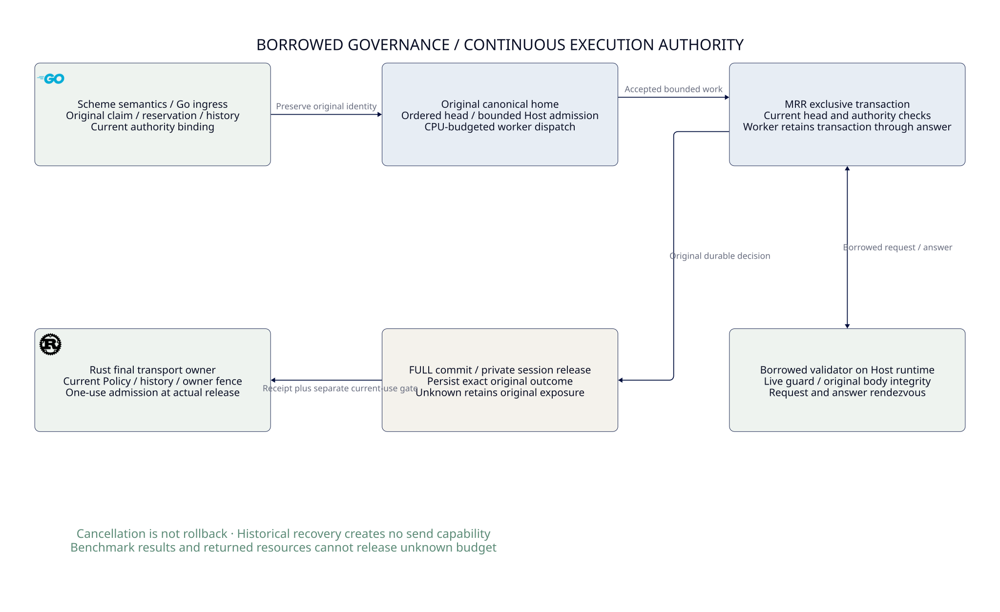

#+TITLE: 59.73 Borrowed Bridge, Commit CPU and CI Recovery
#+LANGUAGE: en
#+OPTIONS: toc:2

* SysML review before measurement

=ControlActivation.GovernancePolicyProjection= owns this refinement of
[[file:59.72-turso-read-stage-attribution.org][native-read attribution]]. Reuse the fixed safe POSIX dependency as a backend
dev-dependency; do not add a package, production authority API or dependency pin.
Proceed directly on the shared Host with max(4, available CPUs). Keep the
30-second case bound, FULL, zero retries, original claim/reservation/history,
borrowed caller guard, accepted-work drain and exact restart recovery.

* Clocks and causal limits

Worker bridge, transaction body/post-body, caller validation and COMMIT future
records join only within one case's original scope/operation; the workload's
profile and namespace are checked explicitly. Synchronous thread CPU spans never
cross await or task migration. The caller retains its actual borrowed callback.
Per-thread collector slots merge after drain; record cardinality and causal joins
must match each original operation. Observation supplies no execution capability.

| Boundary | Observable meaning | Remaining ambiguity |
|----------+--------------------+---------------------|
| Worker bridge wall/CPU | Native worker waiting for the original caller answer | Includes callback time on another thread |
| Bridge start to caller start | Request delivery, notification and runtime resumption | Channel/glue versus runnable scheduler time |
| Caller validation wall/CPU | Original synchronous body/CID/type/authority checks | Its blocking I/O versus preemption |
| Caller end to bridge end | Answer publication, wakeup and worker resumption | Channel/glue versus runnable scheduler time |
| Post-body wall/CPU | COMMIT and private writer release plus wrapper bookkeeping | Pure persistence versus pool/glue |
| COMMIT poll CPU/wall and Pending gap | Driver execution/I/O processing and completion/resumption intervals | Device I/O versus scheduler delay |
| Worker end to receipt | Final worker return and caller receipt resumption | Does not establish another authorization |

Wall minus CPU is an off-CPU residual, not pure scheduler or device time. Preserve
signed residuals and clock resolution effects; do not clamp negative samples.
Pending is a driver state, not a durable commit receipt. SDK I/O on other threads
is outside the original worker's CPU. Process-wide I/O counters cannot be assigned
to an individual operation. Later probes cannot retrospectively identify the
historical uninstrumented bad request.

Declare a fixed serialized A/AV/AV/A block with three rotated WAL/fresh/reuse
rounds and independent/hot domains. A is ready admission; AV adds Condvar.
Sampling profiles are separate additional legs because sampling can suspend
threads. No compilation or second workload may overlap a primary timed leg.
Retain every observation, poor sample, profiler failure and source/binary identity.

Kernel fs_usage preflight refuses without a sudo credential. That failure is
retained, never a reason to stop measurement or call wall-minus-CPU fsync time.
Owned-process stack sampling can locate waits, but cannot certify exact syscall
durations or rule out unsampled functions. No Host-load admission blockade is added.

* CI recovery contract

Retain failed logs and fix the actual owner. Preserve workload/corpus, ASan,
coverage, watchdog thresholds and immutable Cargo/SPEC sources. Actual compiler
output/artifact progress differs from a periodic heartbeat. A compiler-specific
failure requires an exact toolchain comparison, not a production semantic edit.
Remote CI receipts remain distinct from local focused checks.

* Workspace and property ownership

Versions and the POSIX time/resource feature inventory belong to the MRR Data
workspace root; the backend dev-dependency inherits them without a member pin.
The fuzz job's compiler is a separate CI toolchain contract, not a Cargo/SPEC
revision change. Its sanitizer and byte-corpus bounds remain unchanged.

Model-driven PBT is the primary semantic counterexample loop for AI-assisted
changes: operation sequences should preserve original identity, once-only
consumption, pending/unknown exposure, revocation and recovery. Reuse Weaver's
existing proptest owner and SPEC/Quint contracts. The inspected MRR backend
currently owns deterministic concurrent/fault tests; this review does not call
them a new PBT framework. Byte fuzzing remains a bounded robustness check for IPC
and parsers, and CPU/wall measurements provide neither kind of semantic proof.

* Measured diagnosis and retained failures

MRR Data owns the [[https://github.com/tao3k/mrr-data/blob/feat/mrr-property-source-port/docs/benchmarks/shared-backend-bridge-commit-cpu.org][full Rust-native benchmark receipt]], including all mode/domain
triplets, phase means, frozen source/executable identities and unresolved
attribution. Its private COMMIT hook is cfg(test), using the existing unit-test
owner and standard concurrency workload, not a Python benchmark or new package.
This does not promote either runtime candidate or qualify production throughput.

Pre-proxy and forwarding-proxy campaigns each complete a fixed A/AV/AV/A block:
72 cases, 55296 commits and exact recoveries, 165888 phase records, zero unexpected
refusal/error/Unknown and natural exits. Both use 12 runtime/write/shared workers,
reuse capacity 12, 16 blocking threads, FULL and zero retries. Libtest serializes
scenarios only. Raw samples, profiler failures and earlier build failures remain
under /private/tmp, never production inputs or tracked logs.

The forwarding campaign localizes independent/reuse variation within the same A4
binary. Round 0 to 2 changes TPS 8862 to 3058 and P95 2.358 to 12.585 ms.
Caller CPU changes 54.9 to 60.3 us; worker bridge CPU 7.4 to 7.1 us. COMMIT
wall changes 237.6 to 1142.9 us, but thread CPU 78.1 to 94.2 us. Pending gaps
change 139.7 to 829.6 us: pre-notification 60.9 to 364.1 us, notification-to-repoll
78.8 to 465.5 us per original operation. Both intervals contribute material
excess; neither pure validator CPU nor pure fsync explains these wall gaps.

Across all forwarding cases, 11076 Pending windows include 11 early notifications
and 1335 unsplit windows with no observed notification in the window. Observation
overflow and unpublished slots are zero. Unsplit windows are retained, not
reported as zero I/O or failed commits. Notifications remain hints, not durable
receipts. A1's Host snapshot was taken after startup; no missing preflight is
invented. All mode/domain/request samples remain retained despite poor results.

The pre-proxy same-A-binary comparison similarly places about 96-99% of excess
bridge wall outside caller validation and 80-90% of excess COMMIT wall in Pending
gaps. Conditional AV/A ratios change direction with order/round. These observations
do not retrospectively identify the historical 0.200 TPS / 11.105 P95 request,
erase that failure, or establish an intrinsic fixed validator penalty.

A separate A process stack sample finds pinned Turso COMMIT -> durable sync ->
fsync/WAL paths, but also setup content-store sync and idle/hot-domain workers.
Whole-profile waits cannot be charged to measured COMMIT. The AV sampler exits
255 because its benchmark target has already exited; retain the failed profile
and successful benchmark separately. Sampling can suspend threads, so its
throughput is excluded from the primary paired campaign.

Still missing are operation-correlated syscall durations, device versus runnable
time, unsplit notification provenance, matched Linux attribution and a distinct
O/A admission comparison with the same probes. No inference relaxes borrowed
guards, cancellation/restart, burn or retained unknown exposure. SPEC/Lean owns
semantics and Quint owns interleavings as already specified; clocks add no
duplicate authority model. Real backend tests remain required independently.

* CI repair and host configuration

Tool discovery is explicit MRR_DATA_LSOF/MRR_DATA_PGREP, then PATH. Invalid explicit
paths refuse; source contains no system-directory tool fallback. Existing Python
glue observes only compiler-owned writable artifacts and descendants. Inherited
diagnostics cannot feed back as progress. CPU/timers are not progress events.
No benchmark workload or semantic assertion is delegated to that glue.

The preserved 6483f1fb Linux property failure is PermissionError while listing
/proc/207074/fd after descendant discovery. Snapshot listing now handles the
same OSError boundary as descriptor reads: no observation creates no progress,
and compiler exit status is preserved. Permission-denied/disappeared-directory
controls pass; the existing framework has 63 passing local tests, Ruff checks
and formatting pass. Build/test watchdogs remain 1200/30 and 120/5 seconds.

At 6483f1fb, remote MSRV, Arrow ASan fuzz, Python and both S3 jobs pass. The
property failure remains a failed receipt; its cfae659b repair has been pushed
to PR 12 and requires separate remote confirmation. The compiler-specific fuzz
repair keeps its original corpus, sanitizer and 10000-run bound. Pending jobs
are never reported as successful and do not block continued design work.

* Core execution design

