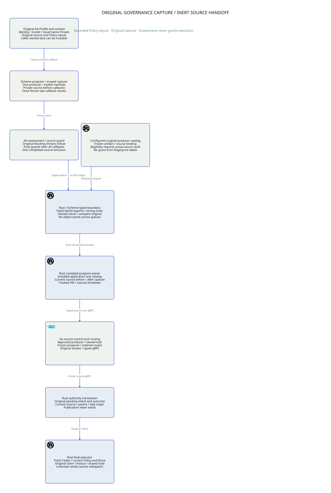

# SPDX-FileCopyrightText: 2026 hardenedlinux Linux Team and Contributors
#
# SPDX-License-Identifier: LGPL-2.1-or-later AND Apache-2.0

#+TITLE: 59.74 Commit IO, Driver Wait and Notification Origin
#+LANGUAGE: en
#+OPTIONS: toc:2

* Predeclared SysML contract

=ControlActivation.GovernancePolicyProjection= owns this refinement of
[[file:59.73-bridge-commit-cpu-and-ci.org][the retained bridge/commit CPU evidence]]. SPEC/Lean retains semantics and
Quint retains interleavings; this measurement introduces no authority model.

Use the pinned public Rust =turso::core= re-export and =Builder.with_io_impl=
only under cfg(test). No dependency, production feature or pin is introduced.
Delegate the original PlatformIO, completion objects, clocks, lock/shared-WAL,
cancellation/drain and error behavior. Collect synchronous selected file-call
wall/thread CPU only within the original COMMIT. A group leader's sync belongs
to that executing context; do not charge one shared sync to every waiter.

Keep original claim/reservation/history, borrowed guard, FULL, zero retries,
accepted-work drain, terminal old owners, exact restart recovery and unknown
exposure. Observation supplies no refund, permission, completion or durability
certificate. Native checks reject missing identity joins, IO spans outside polls,
probe overflow and disconnected enabled probes. Notification publication may
lag forwarding and remains explicit rather than blocking or fabricating evidence.

* Source-grounded causal distinctions

| Boundary | Pinned source behavior | Consequence |
|----------+------------------------+-------------|
| Turso step_inner | IO, Yield and Sleep all map to Turso Io | Pending does not identify physical I/O |
| Default Darwin PlatformIO | UnixIO pread/pwrite/sync are synchronous; step is a no-op | Own file-call time is inside poll, not its later Pending gap |
| MVCC group park | Register a completion while another transaction holds commit lock | A waiter can depend on another commit's progress |
| Group unlock/wake | Complete parked waiters after shared progress changes | Context correlation is not new send authority |
| Host block_on | Forward notification before OS/runtime resumption | After-notify is not pure scheduler time |

Capture notifying context and forwarding wall/CPU as diagnostic origin, not a
causal group identifier. Spurious/yield/early notifications, incomplete detail
publication and unavailable origin remain separate. A waiter-to-notifier join
does not prove which fsync released it. File-call wall includes syscall and
preemption overhead; it is not device-only latency or an anti-rollback proof.

* Fixed paired validation

One frozen original-runtime binary, wrapper-off/on/on/off. Each leg reuses the
standard Rust unit benchmark: three rotated WAL/fresh/reuse rounds, independent
and hot original domains, 64 operations per lane. Use max(4, available CPUs),
the original 30-second case bound and existing safety/resource contracts.
No task-owned compilation or second workload overlaps timing. Keep all raw
request/IO/notification/CPU samples outside Git. Do not pool with older probes
or claim a runtime benefit from observer-on/off differences.

Rust owns loads, clocks, causal/cardinality/probe checks and recovery. Python
remains existing CI process/artifact glue. Tools use explicit env/PATH. ASP deny
gate owns module responsibilities: clock/collector, IO scope, forwarding and
native validation are distinct test modules. No gate waiver.

* Measured separation

The [[https://github.com/tao3k/mrr-data/blob/feat/mrr-property-source-port/docs/benchmarks/shared-backend-commit-io.org][MRR Data Rust benchmark receipt]] retains every mode/domain triplet, source/binary
identity and raw-data provenance. One frozen binary completes wrapper-off/on/on/off:
72 cases, 55296 commits/exact recoveries and 165888 joined phase records, zero
unexpected refusal/error/Unknown and natural exits. Actual/runtime/write/shared
workers are 12, reuse capacity 12, blocking threads 16. The original bound holds.

In enabled independent/reuse I2 round 2 versus I3 round 2, COMMIT wall changes
1563.7 to 225.8 us while thread CPU changes 94.0 to 85.9 us. Own sync wall is
188.2 to 37.7 us; Pending gaps 1230.6 to 132.3 us, about 82% of excess wall.
The gap splits into pre-notification 589.2 to 95.9 us per original operation
and post-notification 641.4 to 36.4 us. A pure own-fsync explanation is insufficient.

Matched detailed non-early independent/reuse notifications originate in another
original operation's active COMMIT context. The slow round's split pre-notify
intervals overlap that context's sync for about 71% of their duration. This is
temporal/context evidence, not a group-ticket or causal device attribution.
Only 442-563 sync calls serve 768 operations per enabled case; do not duplicate
leader IO cost for every waiter.

In the slow round, forwarding averages 2.66 us per detailed window (CPU 2.34 us),
followed by 842.3 us to repoll. Pinned Tokio Handle.block_on uses the original
thread's CachedParkThread notification/mutex/Condvar loop, not requeueing a task
on the multi-thread executor. The remaining boundary is park/unpark/OS resumption
and loop bookkeeping, with observer overhead. Kernel runnable versus mutex wait
is still missing; do not claim pure scheduler delay.

Of 9959 Pending windows, 26 are early, 6 have no in-window notification, and 20
forwarding details are unpublished at snapshot. Timestamp unpublished slots and
notification/window overflows are zero. Keep all incomplete observations; no
timestamp, notification, profile or resource return permits a send/refund.
The first on leg overlaps presentation parsing of a completed off leg; disclose
that interference. Off/on ratios change direction. All samples remain diagnostic.

The combined-helper ASP responsibility failure is retained; modular clock,
IO-scope, forwarding and validation owners fix it without a waiver. Real standard
integration cancellation/restart/exposure tests remain independent production-path
gates, not misreported decorator-specific coverage. Still missing: original-operation
kernel-clock binding, pure device/callback separation, group tickets, matched Linux
evidence and controlled replication. No runtime candidate or weakened FULL mode
is promoted, and SPEC/Quint responsibilities remain unchanged.

* Independent kernel scope

A separate five-second System Trace attaches to the owned Rust benchmark PID.
That benchmark naturally completes all 18 cases and 13824 commits/exact recoveries.
No profiled throughput is pooled into the main pairs. Raw trace and exports remain
outside Git; sandbox initialization and initial presentation-conversion failures
are retained rather than called accepted evidence.

All 102150 syscall rows resolve to that PID. The thread-state export includes
130348 owned, 2614 foreign and 5785 unresolved rows. Only owned PID/TID intervals
on the shared trace clock participate; censored zero-time prefixes are excluded.
For 1047 fsync calls with recognized COMMIT-function stacks, syscall time totals
91.428163 ms, mean 87.324 us, P95 178.500 us, maximum 5.880 ms. Matched kernel
states cover the total exactly, with no overcoverage: Running 43.490666 ms,
Blocked 29.548792 ms, Preempted 13.058208 ms, Runnable 4.578048 ms and Interrupted
0.752449 ms. Scheduling residence therefore appears within fsync wall time too:
Preempted/Runnable is about 19.3%, Blocked about 32.3%.

Blocked does not prove pure device service; filesystem/locking wait remains.
Function-stack recognition is not a timed original-operation identifier, and
block_on ancestry is not enough to call a sample COMMIT or setup. The native
benchmark has no exported kernel-TID/cross-clock anchor, so these trace intervals
cannot be assigned directly to the main campaign's slow request or notification.
They refine Host evidence without weakening currentAtUse, commit-floor, unknown
exposure, final admission or SPEC/Quint responsibilities.

* CI observation repair

At 30856fb1, 13 of 14 remote checks pass; macOS source qualification hits the
unchanged 1200-second build wall. At 3a552e2e, macOS repeats that wall failure
and Ubuntu hits 30 seconds without output after the graphar-rs artifact.
Generic property tests/lint pass. The macOS log is about 80 MB of ongoing
compiler work; these are build-observation failures, not recovery assertions.

The repair removes global per-inference/coercion and inline-decision diagnostics.
Normal compiler observations use coarse phase/function boundaries and owned
artifacts; detailed LLVM ordinals are selected for actual application tails,
mrr_data_datafusion and mrr_data_graphar. Explicit Host logging remains authoritative.
No heartbeat, test omission, timeout extension or pin change is introduced.
The revised local observer controls pass 13 focused cases. The full local Python
receipt retains two five-second native cold-launch failures, including unchanged
C++ and unwrapped Rust controls; it is not a full pass. The separate local source
build fails on missing :asp-gerbil-scheme/building-api in its Gerbil cohort;
it does not qualify the hosted immutable source environment. Complete remote
gates remain required independently of focused checks and benchmark success.

The generic application build subsequently completes in 5m44s under the same
1200/30 policy, with Cargo's successful build-finished receipt and both test
executables. It uses the existing cache and different generic features: it is
neither a cold-build result nor acceptance of the missing local source cohort.

* Core execution design

[[file:59.69-hot-path-cost-boundaries.svg]]

* Remaining source compiler owner

The 6f839950 source jobs still fail. On Ubuntu the quiet owner is the mrr-gerbil
archive build script after a roughly 59 MB program_link.i, with Rust compilation
artifacts already complete. The Gerbil toolchain already applies -fno-gcse-lm to the linker
object. The next candidate preserves the selected Gerbil toolchain's public
CORCXXFLAGS_GAMBUILD defaults and adds only -ftrack-macro-expansion=0; it changes
neither O2, ABI flags, immutable release, dependency pins nor 1200/30 watchdogs.
Eight focused controls and a real installed Gerbil toolchain query pass. The local newer Gerbil toolchain
is not hosted cold-source acceptance. Native source CI must verify the candidate;
previous failures and kernel/paired samples stay outside Git without deletion.
The SysML diagnostic contract records this boundary; the core diagram remains
about authority and retained outcomes, with its SVG embedded above.

At 19844e9c, both complete immutable Scheme packages build and remote Python
passes all 71 tests. Darwin reaches final Rust linking after native archive
compilation, then fails on ssl discovery: the Gerbil toolchain's recorded build-host Cellar
path is absent. The next host-only correction retains existing RUSTFLAGS and
adds a native search directory from brew --prefix openssl. It does not replace
the Gerbil toolchain, alter ABI flags or weaken any recovery test. Reaching this new failure
is not a controlled compiler-speedup measurement or full source acceptance.

* Acceptance versus diagnostic workload

At 6a2fb69d Ubuntu passes the complete original-source property, physical-query,
recovery and resource gate. Darwin again reaches the original 1200-second wall:
the native archive completes about 82 seconds before expiry and Rust application
compilation starts with almost no budget remaining. Its completed linker C
preprocessing reports 16 MB GGC; this is not a controlled compiler speedup or
Darwin link acceptance. That failure remains preserved.

The 7c79d914 quiet-mode experiment disables native verbosity and explicit LLVM
pass diagnostics, but fails Ubuntu's original idle bound. The Gerbil toolchain invokes its
observer; the pinned MRR adapter suppresses the callbacks at level zero. Runtime
MRR_NATIVE_PROGRESS does not enable build observations. This corrects the earlier
incomplete claim that Gerbil toolchain callbacks alone preserve Cargo-visible progress.
O2, ABI, original source graph, feature/test/resource
matrix and 1200/30 limits remain unchanged. Silence still fails at the original
bound. Detailed compiler tracing is an opt-in diagnostic workload, not a source
of invented progress or a substitute for complete recovery acceptance.

The 788ffe02 experiment keeps numeric native verbosity 1, leaves LLVM pass/assembly
diagnostics opt-in and uses the supported GCC diagnostic destination solely to
suppress optional optimizer notes. Real native events, collector output, errors
and compiler-written artifacts remain enabled. A real paired compiler control
produces identical objects with and without note suppression and preserves a
syntax-error negative control; ten focused option controls pass. Initial Gerbil toolchain
home-mapping and runtime-option control failures remain retained separately.
No controlled speedup or full hosted source pass is inferred. Native allocation
dumps remain coupled in the pinned implementation; a fully independent native
diagnostic control remains an upstream API gap. See
[[https://gcc.gnu.org/onlinedocs/gcc/Developer-Options.html][GCC diagnostic output options]].

Focused native-observer validation retains the inspection precondition explicitly.
The first restricted PATH run yields 17 passes, four failures and one deselection;
restoring the Host's getconf PATH yields 20 passes, one failure and the same
deselection. A separate owned-child probe confirms pgrep exit 3, no child list,
and an unavailable sysmond service in the restricted process context. With native
inspection authorized, the unchanged focused suite passes 21 cases, with the
compiler-output cold-build case still explicitly outside that focused scope.
These are separate environment receipts, not an erased failure or a complete
local Python pass. The existing local cold-launch failures remain retained;
remote Python on 6a2fb69d passes all 71 cases. No timeout, assertion or inspection
fallback is changed, and absence of inspection never becomes progress.

* Received progress is a separate contract

At 788ffe02 Darwin completes the original-source, link and recovery gate.
Ubuntu fails idle30 after the linker preprocessed artifact reaches 59716516
bytes. That failure does not independently timestamp GCC's internal pipe, so
it cannot fully distinguish compiler silence from delayed forwarding.

A real isolated Rust/Cargo control makes the framing boundary explicit: a
flushed fragment followed by a one-second wait reaches the receiver together
with its terminating newline; the received marker gap is zero. A newline-first
control yields a 1.005142-second received gap. Gerbil toolchain callback invocation, emitted
bytes, Cargo-visible records and final process completion are distinct facts.
The earlier note-suppression controls prove object equality, not progress
protocol equivalence; their failed acceptance experiments remain retained.

The current correction restores GCC notes by default and compacts them only
at the existing receiver. Exact received native lines and failure tails remain
in temporary files, uploaded by the source CI even on failure. Actual errors,
phases, artifact growth and Cargo build identities remain visible. Existing
raw-input wall/idle policy is unchanged; counters require real received data,
not a timer or CPU/input-read heartbeat. No diagnostic is execution authority.

The updated existing process/artifact suite passes 76 local cases, followed
by a separate real Rust/Cargo integration control for success, exact raw
retention and failed-build identity refusal. One retained-tail static replay
reduces display bytes to 46.477% while keeping all native lines separately;
this is neither whole-log coverage nor a compiler/runtime speedup claim.
Full hosted acceptance remains an independent gate. Benchmark samples,
unknown-exposure constraints, dependency pins and the embedded core SVG remain
unchanged.

* Exact failed-input evidence remains required

At ef3a9f57 the Linux gate still refuses idle30 after the linker preprocessed
input reaches 59703296 bytes. The receiver successfully retains about 72 MB
native stderr and 1.9 MB native stdout; compaction does not establish upstream
liveness. This is a retained failure, not a completed CI fix.

The next diagnostic retains generated linker inputs and the manifest, then
replays exactly one confined preprocessed input through the Gerbil toolchain-declared compiler
outside Cargo, only after the standard gate has failed. It preserves declared
ABI/O2 options and the same 1200/30 limits, writes separate outputs and records
actual chunk times, bytes and newlines plus compiler identity and input digests.
No timer, input read or CPU activity becomes progress; no replay result replaces
the original acceptance. Before/after digest matches are observations rather
than hostile-host immutability proof. Pins and all original test/resource cases
remain unchanged. The added diagnostic glue passes the complete 81-case Python
suite and a real selected-Gerbil toolchain tiny-input plumbing control. The exact Linux
compiler/forwarding attribution is still unresolved pending failed-input replay.
The four-leg Rust benchmark and its clock/kernel-join limitations are unchanged.

* Consumer versus compiler ownership

Consumer Python compiler policy was an architectural mistake. The MRR Data
Gambit flag/replay modules, their compiler-policy tests and CI hooks are removed.
MRR owns the Scheme module graph in build.ss; gerbil-scheme-rust owns generic
GSC/C compilation, optimization, ABI, linking, source-side observations and
compiler replay. MRR's build.rs is the adapter. MRR Data's Python retains only
process/artifact orchestration, with correctness and performance in Rust.

Base MRR Data storage has no Scheme application. Its optional source-handoff
path nevertheless pulls embedded Scheme transitively through mrr-property-source
and mrr-frontends' pinned default embedded-runtime to mrr-gerbil. This is an MRR
runtime dependency, not a separate MRR Data Scheme package. Feature isolation is
an explicit architecture obligation; existing semantics are not disabled here.
The duplicate consumer gerbil build is removed because MRR's build adapter
already invokes its canonical build.ss into isolated Cargo output. Dependencies
are still prepared, and all original Cargo source/recovery checks remain.
Source pins, benchmark samples and failure evidence remain unchanged. Compiler
progress failures are still open at their actual Gerbil toolchain/MRR owner. No consumer
workaround or diagnostic result is treated as a completed CI fix. The embedded
core diagram remains free of compiler options, versions and acceptance metrics.

* Build protocol review and precise ownership

The architecture owner is =ControlActivation::GovernancePolicyProjection=.
Gerbil Scheme is a language implementation and toolchain; gerbil-scheme-rust
owns Scheme/Rust integration and compiler build support. Names describe the
boundary rather than an unspecified "Native" subsystem.

| Owner | Responsibility | Excluded authority |
|-------+----------------+--------------------|
| MRR =build.ss= | PackageSpec, Scheme module closure, real build entry/return | Compiler optimization and final process-exit claims |
| gerbil-scheme-rust AOT builder | Selected Gambit compiler, C flags, ABI, archive, output framing | Application module selection and runtime admission |
| MRR =build.rs= and =mrr-gerbil-build= | Canonical package invocation, Cargo observations and output identity | Consumer compiler overrides and synthetic progress |
| MRR Data | Typed source handoff, Rust storage tests and benchmarks | A second Scheme application or Python compiler strategy |
| Weaver | Source admission, current Policy/fence, one-use final execution | Permission derived from a compiler receipt |

MRR phase summaries must remain visible when detailed diagnostics are disabled.
Package entry and return are genuine phase events, not successful natural exit.
The Scheme build returns normally; the caller still requires actual child status
and complete artifact identity. Per-module detail remains verbosity-controlled.

Cargo line framing is a separate boundary from flushing a child pipe. The AOT
builder delimits actual received compiler chunks when they lack a trailing
newline. Existing complete records are unchanged. Added delimiters are protocol
framing, so a framed transcript is not a byte-identical original compiler stream.
An empty read emits nothing. A completely silent compiler cannot acquire progress
from a clock, input read, cached file or elapsed CPU time.

Detailed optimizer notes and allocation dumps are explicit diagnostics. They must
not be enabled merely to obtain ordinary progress. The selected compiler,
optimization and ABI stay fixed. Source changes are tested at their upstream
owners; unchanged consumer pins do not automatically acquire this repair.

The source-handoff feature path is intentional and explicit: MRR Data delegates
to mrr-property-source, which uses mrr-frontends and its embedded Scheme grammar.
The MRR workspace now selects =embedded-runtime= explicitly while disabling
implicit defaults on that dependency. This preserves the prior module/runtime
closure; it does not make source parsing compiler-free. Native inference is a
separate optional semantic capability. Base storage remains independent of that
optional source adapter.

The core [[file:59.64-governance-capture-ownership.d2][Scheme object bridge view]] uses concrete owners; compiler switches,
versions and acceptance records belong in this narrative rather than the graph.

#+CAPTION: Scheme source capture, typed object bridge and independent execution authority.

* Owner-level verification and remaining integration boundary

| Check | Observed result | Limit |
|-------+-----------------+-------|
| gerbil-scheme-rust AOT builder | 25 library tests and 19 integration tests pass; strict all-target Clippy passes | Seven ignored environment/long-running controls are not counted as passed |
| Actual paired Gambit/GCC | Explicit ignored control passes; baseline/progress/detailed modes produce identical object bytes | Tiny compilation control, not the hosted giant-linker performance gate |
| MRR build adapter | Seven tests and strict all-target Clippy pass; one ignored live supervisor case remains distinct | No claim of a complete application rebuild |
| MRR source feature closure | Locked Cargo tree confirms explicit frontend embedded-runtime reaches mrr-gerbil | Base MRR Data storage remains a different feature graph |
| Existing Lean composition | 33 modules checked with the declared toolchain after namespace changes | Host compiler, transport and persistence premises remain separate |
| Existing Quint temporal controls | 24 exit, 15 import, 15 locator and 214 Scheme-boundary continuation tests pass with the existing seed | No duplicate policy model or new execution authority |
| Weaver Rust boundary | Locked offline scheme-vm all-target check and 22 library tests pass | Compiled application integration is a separate gate |
| Diagrams | 108 source-bound SVG/PNG views generated using 12 host lanes | Full diagram test gate still records its original five-second hook failure |

The naming audit exposed an existing stale conjunction projection in
=DynamicPairedEvidence.whole_process_gate_composes=. Qualification had acquired
a required package-entry condition. The composition now uses the named
=GerbilExitQualification.qualification_preserves_deadline= theorem, retaining
the same 15-second bound and cleanup obligation; no proposition is weakened.
The failed Lean attempt remains outside Git alongside the corrected check.

The diagram suite's first failure was Chromium process permission denial. With
that permission restored, the existing D2 compilation hook still exceeded five
seconds. Neither failure is relabeled a pass, and no timeout is changed. The
separate standard renderer completed all views; current D2 source digests match
the generated SVG receipt. Rendering is not the failed test gate's acceptance.

The source fixes are published to gerbil-scheme-rust PR 18 and MRR PR 9. Their
new CI runs were queued at the audit checkpoint. MRR Data PR 12 retains its
existing dependency pins and does not yet consume these upstream source fixes.
Do not infer a repaired MRR Data hosted build merely from owner-level tests.
Historical failure receipts, compiler inputs and benchmark samples are preserved;
new logs and temporary verification tools remain outside the repository.

The unchanged-pin MRR Data source run at =224bc440= still fails Ubuntu with
=ProgressTimeout: no output progress: cargo=. Its exact failed log tail is
retained outside Git. The later consumer head and both repaired upstream heads
have separate queued/pending runs. A passing compiler framing handshake does
not establish whether the large Linux linker ever emits bytes during every
quiet interval; that hosted build obligation remains open.
