#+TITLE: Complete Entry, Output Progress and Compiler Drain
#+LANGUAGE: en

* Architectural contract

=ControlActivation::GovernancePolicyProjection= owns the build observation
contract. MRR =build.ss= selects its Scheme PackageSpec; gerbil-scheme-rust owns
generic compilation, ABI and diagnostic framing. MRR's Cargo adapter delegates.
Python remains existing process/artifact glue; no compiler policy is added.

The original diagram hook includes both real D2 captures, topology compilation,
SVG production and owner cleanup. Neither prewarming nor splitting the hook
qualifies its five-second requirement. Diagnostic probes were removed before
all paired complete-entry checks. Existing compiler-process recycling and actual
host image lanes remain unchanged.

Closing the diagram owner fences new requests, drains its accepted queue and
shares one terminal close result. An exited child cannot receive another close
message. A failed child remains failure; it cannot become successful cleanup.
Disconnect requires observing actual exit, not assuming success from IPC closure.

#+CAPTION: Development compiler ownership and terminal drain; no runtime execution authority.

* Full-entry paired evidence

The predeclared order was original A1, candidate B2, candidate B3, original A4.
Each used a fresh process and the full Go-owned =check-diagrams= entry, including
108 SVG/PNG exports and source binding. Dependency and OS caches were not claimed
cold. Every sample and the previous failures remain outside Git.

| Sample | Tests | Suite time | Complete exports | Result |
|--------+-------+------------+------------------+--------|
| A1 | 16 | 3.49 s | 108 | PASS |
| B2 | 18 | 6.30 s | 108 | PASS |
| B3 | 18 | 7.44 s | 108 | PASS |
| A4 | 16 | 6.73 s | 108 | PASS |

Suite time is not hook duration. The candidate includes two additional actual
child-process regression cases. The diagnostic run measured the original two
captures at about 0.96 seconds including delivery. Both frozen controls pass;
therefore the earlier five-second failure is not deterministically reproduced,
and no speedup or host-only attribution is admitted. The independently reproduced
post-exit IPC error and non-idempotent close have a concrete lifecycle repair.

* CI evidence must match the observation policy

MRR's reviewed Linux CI completed its Scheme package, Rust workspace compile/test
and source-bound property integration. Its existing process supervisor accepts
measured CPU work as well as output. That is not MRR Data's strict output-only
30-second contract. CPU-only records must be excluded when comparing these gates.
Cargo without =-vv= can suppress successful build-script diagnostics; a quiet
Cargo log alone does not identify a silent GCC invocation. Source emission,
Cargo delivery, collector batching and receiver observation remain separate.

The unchanged-pin MRR Data failure is still an output idle refusal. A passing
MRR workflow under its different supervisor cannot close that obligation. Local
dependency-bootstrap refusals are also not linker failures: the retained process
snapshot identifies =git fetch -q= and =index-pack= before C compilation. Exact
pins are prefetched through the maintained dependency entry before Cargo tests.
No failed bootstrap is represented as a completed application build.

* Reproduced CI repairs

| Failure | Source-grounded cause | Repair and boundary |
|---------+----------------------+---------------------|
| MRR Linux physical-roundtrip preparation | A local namespace rename changed a frozen upstream Cargo package name | Restore its exact upstream name; all version/source/checksum lines remain identical; locked offline metadata and existing graph check pass |
| MRR Darwin workspace link | Scheme archive completed, then ssl/crypto search failed | Declare pkg-config-libs in the existing Scheme PackageSpec; Rust consumes its typed Cargo directives; remove global target linker flags |
| Scheme/Rust Quint shard 1 | Fifteen-minute job ended with commands unfinished; queue hard-coded three workers | Use actual host parallelism, minimum four; keep all 95 original commands across the same two shards, seeds and sample counts |

The full local shard-1 entry completed all 47 selected commands with 12 workers:
436.31 seconds for tests and about 8 minutes 46 seconds including Cargo. Strict
Rust lint passes. This is local complete-shard evidence, not a claim that the
corresponding remote check has passed.

* Formal ownership and open obligations

No additional policy model or duplicated Lean/Quint framework is introduced.
Existing Lean qualification composition still requires natural exit, cleanup
and the original fixed budget. It does not prove Bun IPC behavior or physical
compiler progress. Existing Quint scenarios and mutation controls remain the
same checklist; changing worker admission does not change the propositions.

The remaining strict linker obligation needs a complete Cargo entry with real
output observation and exact compiler/source identities. New compiler-source
fixes are not silently substituted for frozen consumers. Full recovery, unknown
budget and final execution contracts remain independent of compiler receipts.

* Package-managed linkage correction

#+CAPTION: PackageSpec and pkg-config feed the native Scheme and Rust build mechanisms.

The earlier CI =RUSTFLAGS= injection is withdrawn, including explicit linker
selection and injected library directories. MRR =build.ss= now declares OpenSSL
through the existing PackageSpec =pkg-config-libs= and options resolver. Its
existing host profile prepares pkg-config discovery. The same declaration emits
standard Cargo link inputs; the Rust adapter validates them using the existing
CargoDirective types before publication. No GCC-flag parser, dependency pin
change or second package manifest is introduced.

Default successful Cargo builds can hide child diagnostics. Excluding the 75
CPU-work messages from the reviewed Linux compile step reveals a 122.67-second
receiver-visible gap. That is a Cargo-output observation, not proof that GCC
emitted nothing for that interval. The native compile entry now requests =-vv=;
failed owner builds retain their own compiler inputs for exact replay. Neither
change supplies timer-based progress or completes the strict output-only gate.

Darwin's two Scheme/Rust deadline failures were before benchmark execution: the
observed unfinished work was generated module C compilation, including the actor
module. They must not be classified as a demonstrated program-linker stall.
No optimizer flag is changed without the actual generated input and paired proof.

The actual root =build.ss link-inputs= entry succeeds with the declared Scheme
package tag. Its atomic receipt contains the discovered OpenSSL directory and
=ssl= and =crypto= libraries. The Rust consumer reads the bounded complete
receipt and reuses the existing CargoDirective representation. Eight default
unit tests, the explicit actual-receipt test and strict all-target Clippy pass.
No global Rust flags or CI package-location injection remains in that workflow.

The local strict complete native benchmark attempt refused during Rust harness
compilation, before any generated actor/linker C was produced. That failed cold
entry is retained; it cannot serve as evidence of a GCC/linker fix. The earlier
Darwin CI module-C stalls and original MRR Data linker-output failure remain
separate unresolved compiler obligations.

* Acceptance boundaries

The pre-integration complete diagram gate passes 19 tests and exports 110 source-bound views
on 12 host lanes. Both new SVGs are embedded above. Visual review corrected
overlapping edge captions and moved the Rust mark clear of its node text;
the complete image export passes again. Original failed hooks, intermediate
diagram validation failures and the sandbox Chromium IPC refusal remain local
evidence, outside Git. None is counted as a passing sample.

Those paired and local receipts belong to the original =5b539944= source cohort.
Concurrent Weaver work changes the shared Library composition contract and keeps
gateway composition in a separate hook. That split is not evidence for the
original combined five-second obligation. Integration preserves a dedicated
test that creates a fresh compiler owner, queues both original real views before
close, checks their bound SVGs and waits for natural exit in one unchanged
five-second test. The two new views use the existing model-map composition,
with complete captured-word and relationship coverage; no legacy fallback or
second diagram engine is introduced. New integration receipts must be recorded
separately from the frozen paired experiment.

MRR commit =62ab925= removes the CI linker overrides and supplies the package
declaration and Cargo adapter. Bridge commit =d7bc448= changes only protocol-test
worker admission. Their new remote CI runs remain distinct from local acceptance.
The preceding MRR Darwin run also refused its standard Scheme test on the
unchanged five-second no-output gate before Rust linking. It emitted =HARNESS-OK=
and final =OK= but remained running; diagnostic markers do not prove natural
exit. Cleanup then reported a process-group permission error. The package-link
fix does not by itself close either independent failure.

* Public Library consumer integration

The compiler-pool implementation and its close-command helper are superseded
by the upstream Library allocation-domain contract. Each public compiler call
returns only after its owned process exits naturally. Weaver retains no pool,
close-command protocol, raw SVG fallback or copied compiler lifecycle engine.
Consumer interruption stops new scheduling and drains accepted exports before
closing the browser. Capture/resource decoding precedes browser acquisition.

The original complete two-source obligation remains in
=dev/d2/test/library-composition.test.ts=. Both real D2 captures, native model
compilation, measured SVG export and browser cleanup execute within one
unchanged standard five-second test. There is no prewarming or source capture
outside that test. All accepted tasks settle before browser cleanup, including
failure outcomes. Historical failed hooks above remain historical evidence;
upstream compiler lifetime tests and focused image checks are separate receipts.
