#+TITLE: Embedded Gerbil Tooling and Darwin I/O Ownership
#+LANGUAGE: en

* Required architecture

The public build/test boundary belongs to =gerbil-scheme-rust= and uses the
Gerbil/Gambit C ABI. =gerbil-scheme= exposes package operations on the existing
affine =GerbilRuntime=. =gerbil-scheme-sys= checks borrowed foreign values and
owns C ABI transport. =gerbil-scheme-aot-build= owns bootstrap and canonical
compiled artifacts. No additional tooling session or scheduler is required.
Weaver and MRR consume that library. They must not implement another compiler
driver, generic eval endpoint or command configuration language.

Use direct bridge-owned C exports on the existing VM owner to invoke the
official Scheme procedures: load the package's =build.ss= and call its =main=
for compilation; call =:gerbil/tools/gxtest='s =main= for tests. The bridge
does not assume official C symbols named =gerbil_build= or =gerbil_test=.
A =LinkedGerbilProgram= and =initialize_program= may provide an admitted image;
they do not create another lifecycle. No consumer environment switch selects
a replacement build/test implementation.

This tooling capability belongs to build/test hosts. It does not place a
compiler or test runner in the gateway request path. Runtime Scheme governance
uses the separately admitted production image and artifacts; production code
cannot import this repository's development models or evidence.

=build.ss= retains its PackageSpec, module and pkg-config declarations. Tokio
coordinates outer asynchronous work and I/O. Existing affine VM owners execute
foreign calls; a live VM does not migrate among arbitrary Tokio workers. One
serialized VM session does not lower the host's native compiler parallelism.

The upstream AOT owner injects =GERBIL_BUILD_CORES= when constructing each
Gerbil build child, using the executing host's available parallelism. The
native object pool and shared Tokio runtime use that same capacity. Neither a
CI-only setting nor a CPU count compiled into a reusable driver satisfies this
contract. The upstream root =build.ss= must not fix compilation to one worker.
The child-process regression rejects stale inherited capacity; this evidence
does not imply that remote CI, compiler I/O or final linking has passed.

The upstream SCM provenance includes =build.ss=. Its worker declaration is a
build input, so changing that declaration also requires the existing
=just bridge-regenerate= entry and the compiler-produced SCM plus external
receipts. The first CI run after the capacity change rejected the old input
receipt; this is a generated-artifact failure, not missing core propagation.
Keep that failure and verify an independent read-only check after regeneration.
Neither hand-edited hashes nor disabled provenance checks establish acceptance.

#+CAPTION: Required embedded tooling ownership; command-based bootstrap is not the public API.

* Source audit

The audited upstream =GerbilCompiler::compile_to_gambit= and package AOT helper
still launch command processes. Existing rooted exports, linked-program APIs
and instance export tables are useful mechanisms, but are not a completed
embedded build/test API. The minimal =scheme/runtime.ss= image explicitly omits
the complete compiler and standard module graph. A successful value-conversion
C ABI test cannot establish std/make, PackageSpec or gxtest availability.

The required tooling image must admit those actual module closures and bind the
existing package build and test procedures. The selected gxtest =main= returns
success/failure rather than requiring process exit. Calls need scoped context,
exception containment, immutable source identity and complete artifact/test
evidence. No unsupported capability silently falls back to spawning =gxi=.
The existing private image builder has a Darwin qualification boundary; portability
to Linux must be demonstrated, not inferred from the C ABI shape.

The upstream =docs/embedded-tooling-c-abi.org= records the session/ABI contract.
The new opt-in tooling implementation uses the existing affine =GerbilRuntime=
and linked strong-root exports. The separate Tokio subprocess refactor alone
does not implement it. A frozen Gerbil bridge consumer cannot be described as
consuming an unpublished or newer capability.

* Existing implementation and remaining admission

The published PR #18 revision and the unpublished package-tools draft have
separate evidence. The published revision's compiler facade still launches
bootstrap commands. The frozen working-tree draft adds =package-tools= with
=GerbilRuntime::build_package= and =test_package=. These call checked C exports;
Scheme loads =build.ss= in a scoped expander context and calls the official
GxTest entry. This is an implementation to audit and finish, not a reason to
invent =ToolingSession=, an alternate test harness or a consumer-owned protocol.
The source cut is retained under the persistent investigation directory; its
hashes identify unpublished source and do not establish runtime acceptance.

| Owner | Responsibility |
|-------+----------------|
| Existing GerbilRuntime | Live VM, owner-thread check, direct package operation and final cleanup |
| gerbil-scheme-sys | Checked UTF-8 spans, C transport status and call-scoped borrows |
| Scheme package adapter | Scoped expander context, build.ss main, official GxTest main and exception containment |
| Package build.ss | Modules, PackageSpec, pkg-config dependencies and compilation policy |
| AOT build owner | Complete tooling image, source provenance, paired compiler and canonical archive |
| Tokio coordination | Host I/O and owned backend work; cancellation cannot abandon an entered foreign call |
| MRR / Weaver | Call the upstream API and check actual artifacts and test evidence |

The public operation must execute in the existing host process, not wrap a
=Command= that launches =gerbil build=, =gerbil test= or =gxi=. One-time image
bootstrap and actual C compiler/linker subprocesses are separate, necessary
build work. This boundary alone is not evidence of lower wall-clock cost.
Keep cold image construction, warm calls and complete shutdown measurements
separate. Resolve parallelism from the executing machine rather than adding
consumer controls or compiling a fixed core count into the bridge.

The draft is not yet accepted. Its package-tools/external-program feature
combination must not expose operations without the matching linked module
closure. Generated-SCM provenance must remain checked on the tooling-image
path. An arbitrary initialized VM is not proof that package-tools exports are
available. The link-options extension must also preserve the existing
per-module host-layout declaration, rather than reinterpret its positional
argument. These are upstream image/build obligations, not new MRR flags.

Build completion requires the requested artifacts. A returned zero from GxTest
requires the expected nonempty inventory and failure detection; do not replace
GxTest semantics with another harness. Preserve errors, missing tests and
exceptions as failures. Freeze source and dependency inputs for the operation;
a canonical path alone does not prevent replacement or ABA. This is trusted
build-host tooling, not a sandbox for arbitrary Scheme package code.

Keep queue cancellation distinct from cancellation after foreign entry. An
entered call retains its live owner and borrowed inputs until actual return
and backend drain; dropping a Tokio waiter cannot acknowledge cleanup. Check
repeated calls, real pass/fail suites, descriptor/signal state, directory and
environment restoration, and natural process exit. A marker emitted before VM
destruction does not prove shutdown. Cross-platform acceptance and complete
MRR entry evidence remain separate from focused bridge tests.

Earlier session/backend-callback experiments are historical investigation,
not the authoritative API. A callback protocol or compiler-carrier rewrite is
not required by this architecture. Reuse official Scheme behavior first; any
necessary backend integration needs its own demonstrated gap and upstream
ownership. See [[file:59.79-quint-preparation-and-completion.org][current published CI and retained failures]].

* Authorized Agentic AI Lab source migration

The explicit follow-up authorizes MRR's former POO Flow source pin to move to
=tao3k/agentic-ai-lab= PR 34 at
=921e75f830a60c2ec42c384139846b05ba5d3317=. Gerbil and Lean manifests use the
same revision and the producer's =AgenticAILabCompositionProofs= package identity.
LeanPoo's revision and the Gerbil bridge revision remain unchanged. The existing
consumer SearchComposition build completes all 63 jobs against that producer;
this does not qualify a native Scheme build or the new tooling API.

Generic role syntax, functional utilities and Flow graph interfaces move to
the producer-owned Yuanxu Core APIs. Application Query/Search/temporal imports,
wire schema names and semantic C symbols use Agentic AI Lab's actual exported
names. MRR does not introduce a parallel Yuanxu pin. The source owner's native
dependency and build entrypoints own the transitive bootstrap and compiler
strategy; Python remains acquisition/process glue. The earlier local complete
MRR entry fails on the obsolete Core import and remains failure evidence.

MRR's standard Scheme suites and CI producer resolver also consume the renamed
APIs. Its =build.ss= uses Gerbil's own build-script and pkg-config APIs rather
than an undeclared ASP build helper. A fresh-prefix Agentic AI Lab bootstrap
completes naturally. The complete MRR Cargo entry then completes the package
build and staging but fails when the system kills the large POO table C
compilation with signal 9. The standard eight-module Scheme suite separately
exceeds its original 45-second batch limit during dependency loading. Neither
failure is native execution acceptance; all original limits remain unchanged.
Producer/consumer Lake builds share an output tree and are serialized. Explicit
root-directory checks use the subproject's declared Lean toolchain.
The consumer's pinned-toolchain build, Composition/Protocol/Reflection checks
and 1,726-declaration axiom audit pass. The first Ubuntu CI bootstrap exposes
the producer's case-sensitive =justfile= spelling; the acquisition entry is
corrected to that tracked filename. Corrective CI is pending, not acceptance.

* Darwin failure attribution

The large archive failure has a separate, source-grounded cause: POO's producer
=build.ss= bounds table host functions, while generic archive recompilation
does not inherit that gxc command-line option. Its retained C has 20,116 labels.
The approved upstream build-owner repair uses the paired Gambit header's own
optimized-module threshold to select multiple host functions for large GCC
modules, keeping O2 and the complete module graph. The exact failed C then
compiles naturally in 66.36 seconds with maximum RSS 1,756,725,248 bytes.
This is a focused compiler observation, not full concurrent-build or runtime
acceptance. MRR explicitly adopts only the repaired AOT build dependency;
its runtime Gerbil source and other dependency pins remain unchanged.

The unchanged eight-module Scheme inventory imports the Query core APIs it
actually tests instead of the Orgize-bearing facade. Provider class/lifecycle
imports also identify their existing owners. No assertion or rejection condition
is dropped. The original 45-second wall and five-second idle gate remain.
Package registration, compiler environment selection and natural child cleanup
are required independently of successful source acquisition or marker output.

The complete Scheme inventory now passes with eight module receipts, 147 case
receipts, =HARNESS-OK=, final =OK= and natural process exit within the original
wall/idle gates. Parser's existing stage trace reports real decompression,
verification and IR admission; it is not a timer heartbeat or evidence of
semantic success by itself. The earlier silent IR admission failure remains.

The first complete archive attempt after host splitting exposes a separate
upstream link-kind defect. The owner now accepts the shared dependency declared
by an ordinary linker input while continuing to reject a shared-only package
for an explicit static request. Its clean isolated Darwin unit suite passes 27 tests with
seven opt-in tests unchanged, and strict Clippy passes. CI uses that same build
owner's setup action: the previous separate action selected a Darwin release
without Ascent's required compile-output admission API. Runtime dependency pins
and the source-owned Ascent implementation are unchanged.

MRR's full linked workspace compile now returns zero naturally in 4 minutes
37 seconds. It stages 479 carriers and compiles 279 native objects using 12
workers; the native batch takes 135,581 milliseconds. Existing Rust dependency
artifacts and the admitted dependency prefix remain available, so this is not
a fully cold dependency-bootstrap benchmark. The following test entry reuses
the archive and exposes a missing declared Lean 4.31.0 installation; its real
kernel discovery budget remains unchanged. Execution acceptance requires the
complete test entry after that standard environment prerequisite is installed.

The following full confirmation returns zero naturally in 60.47 seconds with
291 Rust tests passing and all doctest phases retained. All three existing
opt-in resource controls pass separately, including the 12-worker Cargo
backpressure pair and complete 1,508,947-byte output comparison. The missing
kernel refusal and an intervening rustdoc I/O idle refusal are both retained;
one successful confirmation does not establish a latency distribution or erase
those observations. Watchdog tests and false-success controls retain their
original rejection thresholds. Upstream's later thread-receipt correction only
observes exact kernel baseline within that existing operation gate; it does not
alter the production API adopted by MRR.

The model-bound render produces the changed tooling SVG and updated model views.
The full render still refuses four pre-existing =d2-reference= sequence views
under the concurrently adopted renderer's =model-view= requirement. Its partial
107-view receipt is retained outside Git and is not a full rendering pass.

The original CI diagnostic is Cargo's bare =os error 35=. That message alone
does not identify a failed process spawn, thread creation or write. Source audit
shows =gxpkg= invokes its child with inherited stdin/stdout/stderr. Actual local
probes observe blocking native output descriptors and nonblocking descriptors
after =gerbil env=. Private output pipes through the standard process API retain
blocking child writer descriptors. No shared =F_SETFL= repair is required.

The native paired fixture uses actual Cargo, an actual slow pipe reader and the
host's 12 workers. The original inherited path truncates metadata to 65,536 bytes
despite returning zero; the direct native reference contains 1,508,947 bytes.
All 12 native instances match that complete reference byte for byte and leave
no owned process groups. A separate actual verbose-build pair refuses on the
inherited path with status 70 and a partial 69,613-byte output; native execution
before and after the refusal completes. The original 45-second total and
five-second idle policy remain unchanged. This establishes the unsafe I/O
boundary; it does not prove every historical error 35 had the same syscall.

The local resource snapshot observes 12 logical CPUs, 707 processes, no zombies,
and a per-user process limit of 5,333. These are local observations, not historical
CI measurements. They cannot establish CI process exhaustion or a performance
claim. Reducing worker count, raising process limits or extending timeouts is
not an admitted substitute for identifying the failed operation.

* Transitional hardening and actual evidence

Native Cargo stays outside a Gerbil parent. The existing upstream process API
owns its Gerbil compiler environment. Isolated Rust probes exercise standard
package-manager/build actions through this API without changing =build.ss= or
copying its environment policy. Those probes remain temporary investigation
evidence, not a new MRR command driver. Existing bootstrap commands are not
silently relabeled C ABI calls. No Python compiler policy is added. This is a
bootstrap boundary, not the future embedded tooling API.

The upstream process layer now uses Tokio process I/O, real artifact observation
and a scoped, host-sized runtime owner. Concurrent synchronous bootstrap callers
share a live runtime lease; the weak registry does not keep it alive after the
last lease. Forwarding failure kills and reaps the owned child before returning
refusal. The existing outer supervisor still owns the complete process group
on fatal termination; dropping a waiter is not a proof that all descendants
have stopped. Native process and complete workspace checks remain separate.

Partial dependency bootstrap exposed additional failures: missing local package
tag metadata, mixed compiler environments and incomplete generated module outputs.
The final dependency attempt runs for about 900.35 seconds and is refused at its
unchanged 900-second wall budget. The supervisor incorrectly labels a forwarding
refusal at that expired deadline as five-second backpressure. The diagnostic
repair distinguishes these causes without changing any admission threshold.
The standard dependency entry
and safe package clean/build actions retain their original pins. Failed logs
remain outside Git. A refused dependency entry cannot qualify a complete MRR
workspace or an embedded C ABI call.

* Embedded API acceptance obligations

| Obligation | Required evidence |
|------------+-------------------|
| Complete tooling image | Compiler, expander, package metadata and gxtest closure admitted before calls |
| Direct foreign invocation | Actual build plus passing/failing tests through bound C exports; no frontend command fallback |
| Root and owner identity | Repeated same-session calls; stale root, wrong owner, reentry and post-close rejection |
| Host-state safety | Descriptor, signal, directory/environment and unrelated-writer checks throughout setup/call/cleanup |
| Backend child notification | Gambit process-status and Tokio SIGCHLD observation coexist; compiler and unrelated host children are both reaped |
| Cancellation | Queued versus entered call; real foreign return, backend drain and unresolved-owner retention |
| Completion | Complete artifacts/test inventory plus drain; no success inferred from a marker or zero alone |
| Resource recovery | Actual host workers and kernel process/thread/fd observations; no orphaned work on acknowledged cleanup |
| Performance | Paired cold bootstrap and warm calls measured separately; native backend work and complete shutdown included |

These obligations refine the existing SysML owner contract. Lean keeps semantic
composition ownership; Quint keeps lifecycle/time ordering. Neither is duplicated
to claim that the missing compiler image or C ABI integration is already proved.
The gateway's claim, reservation, history and final-send contracts are unchanged.
