# SPDX-FileCopyrightText: 2026 hardenedlinux Linux Team and Contributors
#
# SPDX-License-Identifier: LGPL-2.1-or-later AND Apache-2.0

#+TITLE: 59.77 MRR Data Backend and Turso Admission Storage
#+LANGUAGE: en
#+OPTIONS: toc:2

* Decision and ownership

[[file:59.78-turso-mvcc-custody.org][Explicit MVCC admission and final-use custody]] now extends this initial WAL
profile. Earlier non-activation statements and receipts below describe the
original migration, not the new optional MVCC profile.

Weaver uses =mrr-data-backend::turso_driver= as its only physical database
implementation. The public MRR Data export explicitly supports hosts retaining
their own domain schema and transaction policy. Weaver does not route its SQL
schema through the generic Backend's opaque metadata-key protocol, add another
provider, or retain a rusqlite compatibility path. Production, recovery tools,
fault injection, PBT and benchmarks use the same Turso boundary.

| Owner | Responsibility |
|-------+----------------|
| Scheme / Agentic AI Lab | Original task/profile/Policy semantics and source commitments |
| Go | Authenticated control, routing and proposals; one development validation driver |
| MRR Data Backend | Public physical Turso dependency and its supported native interfaces |
| Weaver ledger | Original schema, typed manifests, shared exposure, Policy/fence and exact historical outcomes |
| Rust final broker | Current final-use checks and sole private transport custody |

The =persistence= module binds the existing domain code to native Turso rows,
parameters and transactions. Standard future driving adds no runtime, worker
pool, remote service or business-operation retry. This is a synchronous host
boundary for the Gateway's existing blocking execution workers, not a general
ORM or a second database implementation. Only the =turso= backend feature is
selected; Arrow query, DuckDB, graph publication and remote synchronization are
not admission defaults.

* Atomicity and final use

Each durable session reads back WAL journal mode, FULL synchronous behavior and
enabled foreign keys. Missing capabilities reject opening; there is no fallback
or automatic mode conversion. Local multiprocess WAL support is explicit.
Network-filesystem correctness and hardware power-loss behavior remain native
deployment premises, distinct from the process/restart tests.

=WriteScope= exclusively borrows its session and owns a native immediate write
transaction. Original member claims, reservation amounts, consumption, current
Policy/fence and result records remain in the same deciding database. The write
lock excludes authority changes while the final bounded callback runs.

| Event | Required result |
|-------+-----------------|
| Staging or metadata commit | No provider send |
| Range or release consumption commits | Original opportunity is spent before possible external bytes |
| Final guarded use | Rejoin exact scope, original claim/hold, current Policy/fence and owner under the write transaction |
| Statement failure or abandoned scope | Eager native rollback; no partial manifest, hold or authority outcome |
| Commit error | Keep an unknown outcome, poison the session, finish/attempt native rollback and refuse old-session reentry |
| Lost response | Recover the same canonical operation/outcome; do not reserve or dispatch again |
| Partial or uncertain external write | Keep the original hold; no automatic tail replay or refund |
| Restart | Reconstruct from committed records; volatile permits and old owner sessions do not become current |

Native commit can fail before or after its durable effect. Session poisoning does
not decide which occurred and cannot authorize settlement. A fresh session must
read the original operation's authoritative outcome. Cleanup releases an abandoned
writer where possible; an unresolved rollback still cannot report reusable
completion or create another send opportunity.

* Exact manifests and SQL dialect

Turso does not accept all of the former SQLite subquery positions. The profile
floor keeps two composite-index range seeks using two EXISTS expressions rather
than a compound SELECT inside EXISTS. Original-profile semantics and index-work
assertions remain required.

The shared-family check reads native rows under one immediate transaction and
compares typed finite manifests. Every retained request, stream message and
provider row must have exactly one original member with matching kind, key,
digest and ceiling; every original member must have its row. Projected amounts
must equal their original amounts, their checked sum must equal held exposure,
and the projected budget must equal the original task budget. Empty claims,
duplicate members, missing siblings, overflow and type/shape changes reject use.
Duplicate JSON keys are rejected while decoding; ordinary map normalization must
not discard a conflicting original member. These checks reuse the existing
manifest/budget laws, not another accounting model or governance DSL.

* Recovery images

A closed Turso database can retain committed frames in its WAL. Copying only the
main file does not model complete rollback. The shared Rust fault-image fixture
copies main file and WAL after all owners close, and removes derived destination
SHM. Missing source WAL removes a stale destination WAL. This is closed-store
fault injection, not a live backup API.

Ordinary restart must retain original publication, consumption, budget and fence.
The retained independent-floor tests still distinguish rollback of a local
projection from coherent rollback of both domains. Coherent rollback of all
authority remains a negative control requiring independent anti-rollback custody;
changing engines does not remove that premise. Old exported writable sockets
remain an explicit unsafe counterexample, which the real broker avoids.

* Models and executable verification

=WeaverExecution.TursoAdmissionAtomicity= allocates the persistence contract.
=TursoAdmission.qnt= imports the existing RuntimeAdmission model and adds native
write-scope visibility, commit acknowledgment loss, rollback/restart and fencing.
Its torn-commit counterexample drops a retained hold after consumption. The
original model's unsafe controls remain counterexamples, not accepted schedules.

=RuntimeAdmission.Persistence= in Lean reuses the existing =State=, =Step= and
=Safe= definitions. It proves guarded storage-step preservation, stale-parent
rejection, committed exposure retention through crash, no external send from
metadata commit and rejection of reconsumption after a committed-but-unacknowledged
consume. Atomic native visibility, FULL durability, exact decoding and transport
fidelity remain explicit refinement premises; compiler JSON is not proof of IO.

The existing Go development runner owns the complete storage lane:

#+begin_src text
go -C go run ./cmd/weaver-dev check-storage
#+end_src

It checks the actual Cargo dependency/feature graph, SysML and trace coverage,
Rust format/tests/ASP deny/Clippy, Lean JSON, Quint tests and bounded schedules,
then real multi-process gRPC/HTTPS integration with the race detector. Existing
provider tests cover concurrent consumption, SDK retry/fallback refusal,
publication/reply loss, restart, shared budgets, response backpressure and partial
writes. A green focused test is not a substitute for this complete lane.

Initial migration failures were captured outside Git: dependency-cohort conflict,
unported async test calls, unsupported compound/nested SQL, incomplete main-file
snapshots and model syntax/test-fixture errors. No timeout, budget invariant or
deny gate is relaxed to turn these failures into passes.

* Dependency and performance boundary

The storage dependency is pinned to MRR Data PR 12 at
=daa6487820f798f0583713de8d03110aeac5d1fd=, which owns Turso =0.8.3=.
Its exact Tokio =1.53.1= constraint requires the same cohort in Weaver; =full=
features remain enabled. Cedar, Scheme and Go pins are unchanged. Lockfile
changes must be audited as part of the migration rather than described as an
unchanged dependency graph.

Per-crate benchmarks retain their existing entrypoints and source-bounded
workloads. =ledger/range_tail_guard= checks prefix histories of zero, eight and
sixty-four ranges; original shared-family and maximum-manifest workloads remain.
An indexed latest-tail lookup does not scan range history. Cross-family write
parallelism through MVCC is not enabled: the present contract deliberately keeps
the immediate WAL writer order. New measurements describe this Turso cohort;
without a matched frozen baseline they establish neither a speedup nor p99.

* Storage retirement audit and concurrency limits

The workspace manifests and committed Cargo lock contain neither =rusqlite= nor
=libsqlite3-sys=. The Go architecture gate rejects either package anywhere in
the resolved dependency graph, rejects direct workspace dependencies on Turso,
and requires the one pinned MRR Data Backend edge with only its =turso= feature.
CI host preparation no longer installs Ubuntu =libsqlite3-dev= or Homebrew
=sqlite=. Current SysML storage descriptions name Turso. Earlier qualification
records retain the engine names they actually measured; they are historical
evidence rather than supported runtime alternatives.

The remaining =main.sqlite_schema= query and =sqlite_*= catalog exclusion are
Turso-compatible SQL identifiers, not a linked SQLite implementation. The
=sqliteX= adversarial table-name property remains necessary: it checks that a
similar-looking application table cannot be hidden by an overbroad exclusion.
The retired package names in the negative dependency gate must also remain.

| Capability | Current execution contract |
|------------+----------------------------|
| Native Turso engine | Used exclusively through MRR Data's public driver |
| Multiprocess WAL | Explicitly enabled; separate sessions retain independent connection custody |
| Durability | FULL synchronization and foreign keys are verified on open |
| Writer ordering | Immediate transactions, a bounded busy wait and exclusive mutable session custody |
| Native asynchronous IO | Futures are driven by blocking Gateway workers; this is not an asynchronous end-to-end execution path |
| MVCC / concurrent writers | Not enabled for admission or final-send transactions |
| Remote sync / replication | Not enabled; no remote durability or rollback protection is inferred |

The migration removes the old engine; it does not establish parallel final-writer
throughput. A final broker callback still holds the deciding write transaction.
The blocking provider HTTP call also waits for response headers in this scope;
it is not merely the duration of a socket write. Parallel control requests and
WAL readers therefore do not imply parallel final-writer execution.
Simply changing it to snapshot isolation would allow a Policy publication after
the read, followed by an external send and a conflicting commit. That rejected
commit cannot retract external bytes. Retrying the transaction could send again.
Concurrent admission therefore requires a separately specified final-use fence
and an irreversible send-consumption protocol before changing isolation modes.
Unknown sends must retain their original reservation throughout that transition.
No throughput, p99, remote-sync or independent anti-rollback claim follows from
the engine name or from WAL support alone.

Earlier numbered design notes mix historical qualification receipts with
then-current SQLite descriptions. Those notes are not evidence of a retained
runtime backend. This decision supersedes their storage implementation names;
it does not relabel their old execution receipts as Turso measurements. The
retirement audit therefore establishes one current engine, not deletion of every
historical occurrence of the old engine's name.

The retirement cleanup was checked against PR1 head =2d737d9=. The actual Go
=TestProjectArchitectureStorageUsesMRRDataTursoOnly= gate passed (2.687 seconds),
including locked offline Cargo metadata inspection. CI preparation's local-job
rejection and modular gate-coverage tests passed (0.854 seconds). The strict
Go/OpenSysML =TestProjectArchitecture= gate passed (14.564 seconds), and
=git diff --check= passed. Initial attempts could not fetch missing locked Go
dependencies inside the network-restricted environment; the same gates passed
after those exact dependencies were fetched. These are audit/model checks, not
a new runtime concurrency benchmark, full storage integration run or remote CI
receipt. No dependency pin, transaction isolation or timeout was changed.

* Local qualification and retained failures

The host exposes twelve CPUs and the builds select twelve jobs. The focused
ledger run passes 24 library/deny tests and 94 integration/property tests; the
execution library passes fifteen tests, including real TCP/TLS partial-write
and old-worker controls. All Go packages pass with the race detector. These
are local execution receipts, not remote CI or power-loss qualification.

The first complete storage attempt failed its architecture stage because the
new SVG had not yet been exported; it also detected source changes during model
regeneration and PR1 integration. Neither failure is counted as acceptance.
Two provider fixtures exceeded their existing three-second startup gate before
any process-main marker during that attempt. A separate no-benchmark-build
control reproduced one such failure: compilation contention alone does not
explain it. No timeout, assertion, parallelism limit or startup warm-up is changed.

An existing fresh-file control executed the exact 100,976,816-byte image with
SHA-256 =9025a3a93fe13211da68b5c6a80247cfe69148214c38ce190c0851f443780c2f=:
its first operation/source connections took 1.436/1.440 seconds, and exact-image
restart took 0.110/0.115 seconds. Configuration and listener creation after
runtime entry took about two milliseconds or less. A fresh inode does not flush
host caches; this pass does not close the intermittent pre-main cold-launch gap.
The final source-stable =check-storage= receipt must be assessed separately from
these retained failures. Failure excerpts remain outside Git with the recovery provenance recorded below.

The optimized =ledger/range_tail_guard= measurements retain thirty samples, one
second of warm-up and two seconds of requested measurement. Local 95% time
intervals were 1.212--1.350 ms (zero retained ranges), 1.085--1.473 ms (eight),
and 1.262--1.960 ms (sixty-four). The sixty-four case required an estimated
3.144 seconds to collect thirty samples; the Criterion warning is retained and
its suggested sample/time changes were not applied. Outliers remain included.
There is no matched retired-engine baseline, throughput or p99 claim. The first
release build failed because the selected host linker could not locate iconv;
selecting the same standard host compiler PATH as the qualified Go lane fixed
that environment failure without changing source, dependency pins or gates.

The seven selected core images were exported by the locked upstream Library
from Go/OpenSysML capture and source-bound Lean evidence, using seven host lanes.
The unchanged Lake pin still lacks Gateway.ZeroTrust; its isolated upstream
reference projection and the ordinary locked-entry failure remain distinct, as
recorded in [[file:59.51-zero-trust-architecture.org][the SPEC integration status]]. Storage transition proofs pass
independently; this migration does not claim the full SPEC runtime refinement.

** Test-owned executable handoff

A source-stable run retained the same pre-main failure while all other storage
stages passed. The Go fixture now copies the completed server artifact into its
own temporary directory, rejects nonregular/symlink input and existing output,
checks source identity/size/modification time, fsyncs a read-only destination and
independently verifies its SHA-256. Every provider test uses that same image.
There is no execution, probe launch or server warm-up during this handoff; first
connection and natural shutdown retain the original three/fifteen-second gates.
The standard testing/quick property checks that subsequent build writes cannot
change the captured bytes and that an existing image cannot be overwritten.
This is test artifact custody, not an independently protected security root.

The same server hash above passed the competing-cap, sixteen-stream saturation
and fresh-file/restart controls after this change. First test-image connection
took 1.367 seconds; its source channel took 1.372 seconds. The additional new-file
control took 1.028/1.032 seconds and its restart 0.111/0.115 seconds. These results
qualify that exact image handoff; they do not identify the operating-system cause
of the mutable Cargo-path delay or establish flushed-cache latency. Failed attempts remain separate evidence; completed source-stable acceptance
is recorded below.

** Completed source-stable storage lane

At commit =f28b4b2=, =go -C go run ./cmd/weaver-dev -clean-source check-storage=
passes all fifteen stages, including committed-source checks before/after, the
actual workspace type graph, architecture/asset coverage, Rust tests/ASP/Clippy,
stream and storage Quint exploration, both Lean JSON owners and the complete
race-enabled Provider gRPC suite. The source-currentness check passes.
No first-launch probe or timeout change is used. This qualifies the selected
local storage/execution contract and test-owned image, not the unresolved OS
cause of the earlier mutable-Cargo-path failures or a general cold-start SLO.
The subsequent changes register the three already measured range-tail cases in
the existing Go benchmark collector and record this receipt; they change no
runtime or proof source.

After verification the temporary worktree and its raw logs became unavailable.
The committed source was restored into an ignored repository cache. The PASS
receipt was observed in tool output before that loss; the retained compact
record is explicitly a transcript reconstruction, not the original JSON file
or a newly executed run. Earlier failure excerpts and bounded timing evidence
are retained with the same provenance. The original commands remain reproducible;
this recovery does not promote a reconstruction into independent execution evidence.
