# SPDX-FileCopyrightText: 2026 hardenedlinux Linux Team and Contributors
#
# SPDX-License-Identifier: LGPL-2.1-or-later OR Apache-2.0

#+TITLE: SPEC Source Closure and Architecture Admission
#+LANGUAGE: en

* Current source closure

The maintained dependency now imports Gateway.ZeroTrust through the SPEC
owner's release-aligned declaration and lock. LeanPoo v0.1.2 is inherited from
that owner, not overridden by Weaver. The ordinary Lake targets include the
Weaver enrichment and architecture environment. See
[[file:59.86-release-zero-trust-integration.org][Release integration]] for package ownership, native qualification and
remaining implementation premises. The observations below describe the former
baseline and isolated experiment; they are not the current dependency pin.

* Historical source ownership

The former locked SPEC source did not
provide CedarPooSpec.Gateway.ZeroTrust. Its inherited LeanPoo source
also predated the required functional
Contract and Session surface. This is a source-closure gap, not a misspelled
search path. The ordinary architecture entry must reject it; it must not use
a research checkout, an empty model or copied semantic declarations as fallback.

The subsequently published SPEC source provided
the required modules and declared its corresponding LeanPoo dependency.
An isolated persistent candidate resolves that complete producer closure.
The Cedar, Batteries and Lean toolchain identities remain unchanged. The
historical isolated experiment is not selected
as a new baseline: it is older than the published merged source.

* Existing proof composition

The candidate changes six consumer references from CompoundAuthorization to
the producer's Authorization.Compound namespace. It does not add a semantic
compatibility layer. The existing publication/provider recovery modules are
registered as a Lake library, and the existing ZeroTrustEnrichment consumer
imports them. SPEC remains the semantic owner; Quint remains the schedule and
counterexample owner. No second Zero Trust or authorization model is created.

The standard framework/publication/Weaver bridge build completes 385 jobs.
The existing enrichment composition completes 388 jobs. These are Lean source
composition results, not proof of actual Rust sending, durable host storage or
Gerbil build/test availability. Their host premises remain explicit.

#+CAPTION: The core Zero Trust architecture remains a consumer of the generic SPEC framework.

* Whole architecture admission remains separate

The persistent candidate exports all 115 views and checks their source binding,
node/edge coverage, readable text and original resource cleanup obligations.
Browser validation retains the original 30-second complete-view bound and
5-second source/resource hooks. Failed runs, including reuse of a page's load
lifecycle, remain evidence. A passing source build or successful SVG export is
not a passing whole architecture gate.

The bounded-width project composition uses the public Library for model
interpretation, theme/font resources and export. Captured SysML parent identity
is authoritative, including root nodes. A raw D2 scene grouping is explicitly
marked presentation containment when the Library supplies no semantic parent;
it cannot establish inheritance or execution authority. Tests reject invented
captured parents and substituted relationship endpoints.

Every Library export retains its SVG, PNG, HTML and provenance receipt. The
830-pixel validation retains all DOM, font, overlap, source/hash and independent
image-decode assertions. A redundant additional full-page raster is not an
assertion. Removing it does not remove any view or validation condition.

* Historical promotion boundary

The candidate is isolated under the persistent research checkout. Its dependency
closure and renderer changes are not promoted while the complete gate fails.
The maintained dependency pins therefore remain unchanged in this delivery.
Do not report the locked baseline as qualified, or treat the candidate's 115-view
cohort as the newer documentation cohort without rerunning the complete entry.
Production code still cannot import dev assets; production artifacts belong in
prod. Raw failure receipts and research patches stay in the ignored cache.
