# SPDX-FileCopyrightText: 2026 hardenedlinux Linux Team and Contributors
#
# SPDX-License-Identifier: LGPL-2.1-or-later OR Apache-2.0

#+TITLE: Quint Preparation, Cost Attribution and Package-Owned Tooling
#+LANGUAGE: en

* Architecture boundary

SysML retains responsibility allocation. SPEC and Lean own semantic laws;
Quint checks schedules and deliberate temporal counterexamples. Profiling
introduces no second semantic model, authority, policy language or runtime
configuration surface. Existing original claim, reservation and retained
unknown exposure obligations remain unchanged.

Gerbil build/test integration belongs to gerbil-scheme-rust. Its existing
VM owner and the supported Gambit/Gerbil C interface invoke the official
Scheme package build and gxtest procedures. build.ss owns package declarations
and compilation policy. MRR and Weaver consume the package interface.
A new environment-variable protocol or consumer-owned build driver is not
part of this design. Required architecture and implemented exports must be
reported separately: the inspected PR #18 source still has command-backed
compiler entry points, so the complete embedded tooling contract is not yet
established by that revision.

#+CAPTION: Check lifecycle and source ownership; measurements do not authorize effects.

* Measurement boundary

The preserved baseline executes the complete 95-check inventory without CI
partitioning, using 12 executing-host workers. The Rust test naturally finishes
in 827.86 seconds. This is a local result below the existing 900-second limit,
not proof that either remote shard passes. No samples, seeds, maximum steps,
negative controls or watchdog limits are changed.

An isolated, one-time Node diagnostic probe observes the installed pinned CLI.
The probe and raw observations remain under the ignored cache. They are not
checked-in adapters, CI dependencies or public configuration options.
Loading, parsing, typechecking, evaluator bridge residence and CLI exit have
separate observations. Node process CPU excludes the Rust child's CPU. Child
residence includes startup, input transfer, exploration and output: it must
not be reported as pure exploration time. Nested spans must not be summed.
The probe begins after Node startup; parent wall time also contains startup,
collection and process-reaping overhead.

* Prefer the official evaluator boundary

The pinned official Rust test backend serializes the complete lookup table
for each selected scenario. A single measured scenario sends 32,509,245 bytes
for 11,011 table entries. Repeated evaluator resolution is negligible compared
with repeated serialization, process startup and input reconstruction.

The candidate uses Quint's official TypeScript interpreter for scenario
assertions and retains its official Rust evaluator for sampled exploration
and deliberate temporal counterexamples. Both are already included in the
pinned tool. The official frontend and scenario selector are unchanged.
There is no new interpreter, test runner, policy language or dependency.
Original CLI arguments, source closures, seeds, sample counts and step bounds
remain intact; backend choice is explicit in the existing argument preparer.

An earlier declaration-filtering experiment completed all 95 checks in 740.90
seconds. It was withdrawn: its extra source transformation and reference
analysis are unnecessary for the official-backend approach. Its patch and
observations remain in the ignored cache. It is not a production or CI option.
The proposed source/profile environment variables were removed. The original
two CI shards remain unchanged. Counterfactual runs use frozen binaries and
preserved source snapshots rather than a permanent behavior switch.

* Acceptance and remaining evidence

The instrumented full pair matches all 96 semantic CLI invocations: the 95
planned checks and initial canonical typecheck. An additional observed parser
invocation prepares source closures and is not counted as another semantic
check. All 578 selected scenario executions and 44 expected failing controls
match. Executions are not claimed to be unique assertions. Evaluator child
processes fall from 661 to 83. The official-backend cohort naturally finishes
in 593.85 seconds versus 827.86 seconds, both below 900 seconds. The observed
wall reduction is 28.3 percent; host contention prevents a fleet speedup claim.

| Stage | Baseline wall P50 (s) | Official-backend wall P50 (s) | Baseline / candidate Node CPU P50 (s) |
|-------+-----------------------+-----------------------------+--------------------------------------|
| Load | 0.010 | 0.010 | 0.009 / 0.009 |
| Parse | 6.271 | 7.373 | 3.230 / 3.145 |
| Typecheck | 39.553 | 53.331 | 17.170 / 16.580 |
| Scenario execution | 115.099 | 1.077 | 11.673 / 0.696 |
| Rust simulation / bridge | 8.747 | 8.307 | 0.888 / 0.895 |

Typecheck wall P95 changes from 90.592 to 66.138 seconds; simulation/bridge
wall P95 remains approximately 44.7--44.9 seconds. Post-stage to CLI exit P95
is 2.00 versus 2.15 milliseconds. This Quint exit observation does not qualify
Gerbil dynamic-module cleanup. The wide completion scenario phase changes
from 754.96 to 15.40 seconds and Node CPU from 138.96 to 6.75 seconds, with
the same 166 selected scenario executions.

The typecheck median wall regression is retained. Similar Node CPU with
different wall time is evidence of host/runtime contention, not proof of pure
scheduler delay. Native exploration CPU versus input reconstruction remains
unseparated: the official evaluator exposes no such timing flag. Do not infer
it by subtracting overlapping Node or child residence spans.

Before concurrent work, one Rust simulation from the selected original shard
initializes the official evaluator. Interpreter scenarios no longer perform
that installation. Exact-once shard coverage also checks that each shard has
such a simulation. This adds no downloader, model check or installation option.
The ordinary uninstrumented full entry validates that final ordering separately.
It naturally completes all 95 checks in 545.34 seconds with 12 workers and all
44 expected failing controls. The difference from the instrumented cohort is
not attributed entirely to observer overhead: ordering and host conditions
also differ. The unchanged 900-second external bound remains in force.

The candidate must complete the same 95 checks under the same fifteen-minute
bound, with every expected counterexample still found. Normal unit checks and
strict Clippy supplement the complete executable gate. A cheaper negative
control alone does not qualify long scenario checks or remote CI.

Repeated frontend work and repeated Rust evaluator startup/serialization are
separate costs. The pinned official test command starts an evaluator for each
selected scenario. A safe public batching improvement requires separate upstream
evidence; it must not be replaced by a private runner or mutable-stage cache.
Host contention remains visible in wall versus Node CPU observations. Local
paired timing is not a controlled fleet performance claim.

MRR PR #9 retains its Ubuntu runner-shutdown and Darwin post-harness exit
failures. The bridge PR #18 retains shard-zero and build timeout failures until
the exact new head passes those jobs. Existing unsupported-toolchain and paid
service skips are reported separately; no new skip is introduced.

The MRR local dependency entry previously acquired source under the repository
package home while producer recipes could use their own default homes. The
glue now delegates the already-selected official GERBIL_PATH and library path
to those existing recipes. Nine process/environment regression tests pass.
This adds no compiler policy or tuning variable. MRR CI already declares its
package home explicitly: the local default-path fix does not explain or prove
resolution of the historical remote shutdown or dynamic cleanup failures.

The recorded new heads are
[[https://github.com/tao3k/gerbil-scheme-rust/pull/18][bridge PR #18]] at =3d13b05= and
[[https://github.com/tao3k/meta-relational-reasoning/pull/9][MRR PR #9]] at =efdda50=.
The latter has six completed proof lanes; Scheme/Rust platform gates remain
in progress at this observation. The bridge's two original Quint lanes are
running. Queued or running jobs are not green evidence. Raw diagnostics,
failed attempts and the rejected projection patch stay under the ignored
=.cache/ci-recovery-20261102/= directory, not in Git.

* Final remote observation

Bridge PR #18 head 8f02870 completes all nine required jobs. Its original Quint
shards finish in 7m52s and 14m01s under the unchanged fifteen-minute bound. The
Actor/Rust concurrency gate completes in 7m14s, and strict owner lint completes
in 15m11s under its separate existing thirty-minute budget. The inherited SMP
unsupported-toolchain notice remains a separate skip, not SMP acceptance.

The prior 3d13b05 cohort already completed both original Quint shards in 13m44s
and 13m49s. Its only remaining failure was manual_assert in a feature-disabled
benchmark branch. The fix uses the same refusal assertion and changes neither
feature activation nor lint severity. Full CI is rerun at the new exact head.

MRR PR #9 head efdda50 still fails both platform execution jobs. Ubuntu reports
runner shutdown after 34m01s; the log explicitly carries GERBIL_BUILD_CORES=4.
Darwin reports all eight module receipts and final harness OK, then fails the
original five-second silence gate while gxi remains alive, at batch age 20.285s.
A subsequent process-group termination also reports PermissionError. That
cleanup failure is separate from the already-failed natural-exit gate. The six
proof jobs pass. No unchanged rerun, forced successful exit, new skip or timeout
increase is used to turn those failures into acceptance.

The complete local producer-dependency preparation exits naturally with status
zero. It is prerequisite acquisition/build evidence, not a complete MRR test
receipt. The published PR revision does not yet qualify the complete C ABI
build/test image. An unpublished package-tools draft already adds build_package
and test_package to the existing GerbilRuntime; it is the reuse baseline, not
a completed integration receipt. See the [[file:59.76-embedded-tooling-and-darwin-io.org][direct package API boundary]] for its
remaining image, provenance, cancellation and cleanup obligations.

* Direct package API implementation

Upstream PR #18 now publishes package-tools on the existing GerbilRuntime.
The read-only generated-source check, real build/pass/fail/cancel/stage test
and natural owner shutdown complete locally in 2.19 seconds with 12 workers;
strict Clippy passes. See [[file:59.76-embedded-tooling-and-darwin-io.org][the implemented ownership boundary]]. The full MRR
consumer and new remote CI remain separate qualification obligations. No Quint
inventory, partition, seed or limit changes accompany the C ABI implementation.

** Tooling teardown evidence refinement

Darwin CI exposed a post-cleanup environment-table lifetime defect after its
cleanup marker. A local allocation-churn counterexample reproduces SIGSEGV;
upstream =ad8ac98= now preserves valid host environment storage across Gambit
teardown. The strengthened complete fixture exits naturally in 1.82 seconds
with 12 workers under the unchanged 15-second wall / five-second idle gate,
and strict Clippy passes. See [[file:59.76-embedded-tooling-and-darwin-io.org][the source-grounded ownership review]].
This is a concrete host-lifetime obligation, not a second Quint semantic model.
The complete MRR inventory and exact-head CI remain independent evidence.
