# SPDX-FileCopyrightText: 2026 hardenedlinux Linux Team and Contributors
#
# SPDX-License-Identifier: LGPL-2.1-or-later OR Apache-2.0

#+TITLE: 59.85 Source Preparation Admission and Failure Retention
#+LANGUAGE: en

* Historical implementation boundary

The Go installer, linked-source scanner and temporary package store described
below have been retired in favor of standard Gerbil package operations and the
upstream Rust SDK. See [[file:59.87-spec-upgrade-and-delivery-plan.org][the current delivery plan]]. Earlier checks remain
historical evidence and are not native acceptance of the delegated path.

* Implementation boundary

The existing Go verification owner now includes Scheme dependency preparation
inside =check-scheme=. The command passes explicit source selections into the
same owner instead of preparing first, mutating the process environment and
only then starting result recording. No alternate compiler, test runner,
tooling session, runtime endpoint or dependency manifest is introduced.

This repairs development verification. The direct package operations on the
existing upstream GerbilRuntime remain governed by [[file:59.76-embedded-tooling-and-darwin-io.org][59.76]]. The pinned bridge's
tooling/image gap is unchanged. Preparing packages through the existing bootstrap
does not establish that the public embedded build/test API has been delivered.

* Original source cut and installed identity

Before dependency loading or compilation, retain the source heads and hash cut.
The supplied Core must equal the Lab's committed Core gitlink. POO must equal
Core's declared dependency. The cut now includes Lab =init.ss=, =build.ss=,
=gerbil.pkg=, optional =.gitmodules= and Policy/schema/configuration assets under
the admitted module tree, alongside the existing Scheme/Core/POO inputs.

Canonical aliases for the selected source roots remain supported. Nested source
file/directory aliases and aliased root metadata are refused, so the traversal
cannot silently omit a redirected subtree. Required root metadata cannot be
missing. SDK-generated =manifest.ss= remains excluded under the existing derived
artifact contract; actual artifact and ABI qualification remain separate.

After dependency installation, compare installed Core and POO heads before
building the Lab application. Compare again after that build, then compare the
original source bytes and source heads. Retain the original cut in the handoff
receipt. A later source image cannot become the meaning of the original build.
Before/after verification checks also require the original three source heads;
an identity replacement is refused even when handwritten source bytes match.
The Go owner independently retains the original digest and source identities.
Parsed handoff metadata must match that expectation and the owner-selected
canonical roots before live source checks. Coordinated source/receipt rewrites
cannot bless a new cut merely because those two mutable aliases agree.

These checks detect persistent changes and inconsistent selections. Endpoint
hash equality does not exclude unobserved filesystem ABA, prove immutable native
artifacts or authenticate arbitrary package code. Those remain upstream
source/artifact custody and trusted build-host refinement premises. No complete
native ABI acceptance is inferred from matching Git IDs.

* Failure, cancellation and cleanup

Preparation produces a named stage in the ordinary compact verification result.
A dependency failure records the parent exit status, output digest and bounded
causal excerpt; package tests do not start. A stale ambient link receipt cannot
replace the owner-selected receipt. Source heads and the original cut survive
even when preparation fails after they have been captured.

Entered operations retain their existing owner and wait/cleanup behavior.
Cancellation is recorded separately from failure and success. Failed preparation
attempts prefix cleanup, reporting cleanup errors. A successfully prepared prefix
stays owned until verification finishes; cleanup occurs before the final compact
result is published. Late finalization or cleanup errors cannot leave a PASS
receipt. Temporary logs are removed by the existing retention owner; only the
compact result stays under ignored =.cache/verification/=. Filesystem removal
alone does not prove that an embedded VM or arbitrary descendant has quiesced.

* Source-grounded blockers retained

The historical Lab source and its pinned Ascent dependency declared different
Core sources. Package installation selected the Ascent declaration in the
retained cold attempt. This mismatch requires upstream closure reconciliation;
downstream source admission refuses a mixed selection. The original dependency
identities remain in that attempt's receipt and package declarations.

That attempt also hit Ascent's committed 180-second build limit, returning
encoded build status 31744 (124) through dependency-manager exit 70. It never
reached Weaver tests or the existing 15-second package-test gate. The original
=.cache/governance-governor-check-scheme.log= remains failure evidence. This
change does not rerun that unchanged workload to obtain a passing sample,
increase a limit or change a dependency pin.

The separately locked SPEC source still lacks the required Gateway.ZeroTrust
closure, as recorded in [[file:59.83-spec-source-closure-and-architecture-admission.org][59.83]]. Preparation receipt acceptance cannot promote
the isolated SPEC candidate or substitute copied semantic definitions.

* Verification correspondence

| Obligation | Executable witness | Formal interpretation |
|------------+--------------------+-----------------------|
| Metadata and Policy changes invalidate the retained cut | Go quick.Check over root metadata and Policy/schema/configuration files | CaptureDependency sourceCut remains bound to the independently retained original |
| Coordinated source/receipt changes cannot rebase the original | Rewrite real files and handoff metadata while retaining the independent owner expectation | Existing registered-original capture law; native custody remains a premise |
| Aliases cannot escape traversal | Real filesystem file/directory/metadata alias negative controls | Native source-coverage premise; no filesystem theorem is claimed |
| Installed Core replacement is refused | Real temporary Git repositories with a changed Core commit | Native dependency-identity premise before application build |
| Failed preparation does not run tests | Existing Run entry with an invalid preparation and a non-executable test tool | Failed stage cannot supply a qualified boundary |
| Failure survives cleanup without ambient state | Compact receipt preserves original cut and nested/parent failure statuses | Observation is not source authority or successful completion |
| Late cleanup failure invalidates PASS | Retention negative control on a previously passing result | Owner completion requires successful finalization |

The existing Quint =LlmPolicyContinuation= model adds a stale preparation cut
schedule and its deliberately unsafe acceptance counterexample. Lean reuses
=changed_capture_cannot_reuse_adapter_evidence= to show that a changed sourceCut
cannot rebase the boundary. The host must establish complete coverage and
source/artifact custody. Neither model proves the concrete filesystem or native
compiler, and neither grants publication, consumption, send or refund rights.

The focused race-enabled owner checks, strict SysML/trace checks and the
source-bound Lean bridge build pass. Quint passes 218 scenarios and 1,000
bounded safety schedules with the existing seed and step limits. The derived
core overview passes all five source/readability/icon checks. A retained first
Quint attempt incorrectly inspected state after an expected failed action;
the assertion now precedes that action, preserving both the assertion and the
negative control. These are verification-owner and model receipts, not a
successful native package build or Gateway SPEC admission.

On committed source =d01e4acc139df8b71f9a4ccdf8dc3c4a588d28d5=, the complete
Go race suite passes with loopback access, and all twelve stages of the existing
=-clean-source check-telemetry= regression pass. The original sandbox-denied
loopback attempt is retained separately. A real isolated Lab checkout with the
transitive Core selected instead of its declared gitlink is rejected by the
ordinary =-clean-source check-scheme= entry before package preparation or tests.
Its compact result is FAIL, with the exact Core source-admission error; this is
an executed negative control, not a native package acceptance receipt.

#+CAPTION: 59.76-embedded-tooling-and-darwin-io.svg — Upstream package-operation ownership

