#+TITLE: 59.87 SPEC Upgrade and Gateway Delivery Plan
#+LANGUAGE: en
#+OPTIONS: toc:2

* Maintained baseline

Weaver consumes the inspected source of the existing
[[https://github.com/hardenedlinux/cedar-poo-spec/pull/12][SPEC PR 12]], which remains draft, not a published release. Rust and Lean
select the same producer through [[file:../../../Cargo.toml][Cargo.toml]], [[file:../../../Cargo.lock][Cargo.lock]],
[[file:../../../dev/proofs/cedar/lakefile.toml][lakefile.toml]] and [[file:../../../dev/proofs/cedar/lake-manifest.json][lake-manifest.json]]. SPEC owns its inherited LeanPoo
dependency. [[file:../../../gerbil.pkg][gerbil.pkg]] declares the Scheme library dependency; its producer
owns the transitive declarations. These package mechanisms own versions and
resolved identities; this document does not duplicate their dependency ledger.
The Rust SDK selection now follows the inspected
[[https://github.com/tao3k/gerbil-scheme-rust/pull/18][gerbil-scheme-rust PR 18]] in its workspace declaration and Cargo lock. Its native
package operations, tool environment and archive contract replace downstream
tool preparation. The already selected Agentic AI Lab cohort is now declared in
the single root Scheme dependency instead of separate Go checkout arguments.
Continue delivery in [[https://github.com/hardenedlinux/weaver/pull/1][Weaver PR 1]]; do not open another integration PR.

Compared with Weaver's previous SPEC selection, this revision changes
typed SDK preparation, source-body correspondence, literal-context construction
and canonical-schema hashing. It also includes producer native-build lifecycle
and CI fixes. The Gateway and generic ZeroTrust Lean definitions are unchanged
in this comparison. A newer source revision therefore does not establish a new
security theorem, a qualified deployment, or a Gateway performance improvement.

The source preparation reuse is keyed by the complete immutable source. Typed
body matching has an independent parser/fallback; schema-directed contexts keep
their original interpretation. These paths must not become caches of current
authorization, schema admission, source authority, budget, history or fences.
Weaver continues to compare the candidate and captured predecessor against the
actual publication. Canonical schema identity is not interchangeable with the
original publication command's byte commitment.

* Execution and proof ownership

| Owner | Responsibility | Evidence boundary |
|-------+----------------+-------------------|
| Agentic AI Lab / Scheme | Typed configuration, Governor selection, Governance assessment and complete Policy/source-asset projection | Standard gerbil build/test and real rooted FFI compilation |
| Cedar / SPEC | Policy meaning, schema-bound replay and Gateway.ZeroTrust contracts | Actual locked Rust APIs and imported Lean declarations |
| Go | Configuration admission, cloud identity, authenticated gRPC, authority publication, Routing proposals and unified validation | Real service orchestration, race tests and property framework |
| Rust / MRR Data | Authoritative Turso transactions, current-use admission, budget/claim retention and final provider bytes | Durable state and observed transport effects, including ambiguity |
| Quint | Interleavings, bounded fault schedules and unsafe counterexamples | Explicit finite domains; no unbounded execution claim |
| Lean | Composition and preservation under stated host premises | Imported SPEC laws; no claim of compiled-code correctness |
| SysML / Library | Runtime allocation and source-bound architecture interpretation | Lean JSON through Go/OpenSysML into upstream rendering |

* Ordered delivery gates

** S1: Qualify the exact dependency upgrade

Keep the Rust and Lean SPEC revisions identical, including their locks. Run the
existing complete Policy/FFI tests and strict Clippy gate, maintained Lake
targets, complete Go race suite and clean-source check-policy. Preserve original
negative controls for schema substitution, predecessor replacement, named Policy
IDs, changed receipts and changed preparation cuts. Existing PBT is the primary
generator; do not substitute a script enumerating convenient examples.

Exit: exact-source receipts identify the upgraded revision and all required
stages. Earlier passes remain historical evidence. No new compatibility layer,
authorization interpreter, storage boundary or dependency upgrade is required.

** S2: Close standard Scheme package qualification

Use the package environment prepared by Gerbil from the root declaration.
Installation/update is explicit; ordinary validation never allocates an empty
package environment, fetches dependencies, links transitive sources or deletes
the caller's package store. The discarded full-history download is recorded as
CANCELLED, not an acceptance result. Keep package installation separate from
module discovery/loading, test execution and natural cleanup.
Confirm the corrected upstream module-role imports through actual package build
and tests, not an AOT-only entry or a manually loaded substitute module.

Exit: standard gerbil build/test, the rooted Scheme/Rust SDK tests, all real Go
control integration cases, source-currentness and cleanup pass on one stable
source cut. SDK source/archive fidelity remains an explicit producer/host premise;
the removed Go source scanner's earlier results do not qualify this path. A
package failure or a killed test is FAIL. Keep the existing
runtime and lifecycle gates, all generated cases and host-derived core count.
Do not use forced exit, package uninstall or a changed dependency pin as a retry.

*** Producer-owned native link inputs

The observed missing-libcrypto failure originates in a low-level SDK staging
path that omitted the package owner's pkg-config declaration and retained an
obsolete installation directory from Gerbil metadata. Resolve this at the SDK
owner: package build and staging must share one declaration. Weaver consumes the
resulting manifest, preserves the Rust archive availability/static/dynamic checks
and records target pkg-config environment changes as Cargo build inputs. Do not
add a downstream library locator, compatibility path, runtime probe or another
package installer. The host supplies its target package metadata search path;
that search path does not select or repair the C compiler/linker.

Acceptance requires ordinary low-level staging without consumer-supplied library
paths, unchanged explicit flag ordering, rejection of missing target metadata,
the generated-source provenance gate and the actual Weaver FFI/provider tests.
Build-input correctness does not establish a ZeroTrust theorem. Existing Lean
host premises and Quint execution transitions remain unchanged; successful
archive construction cannot supply a grant or resolve unknown exposure.

The existing SDK PR owns the shared declaration, compiler-option propagation and
native package loading. Retain its system-directory option: ordinary pkg-config
output can omit system search paths required by strict archive validation.
The default image consumes these inputs; its lifecycle-only external profile
does not depend on another consumer's pkg-config environment. A paired Cargo
check with unavailable package metadata and two different search paths retained
the external artifact as fresh. This is build-input evidence, not Runtime
performance evidence. Use the producer's regeneration entry for source receipts.

The historical predecessor standard-package experiment remains FAIL: all four
complete trials reached the unchanged 15-second deadline. One trial emitted the harness
OK marker before supervision killed the process; this is not natural-exit
acceptance. A one-second OS sample during another trial observed dynamic loading
and dyld image bookkeeping around the fourth second. This identifies work before
test completion, not a sufficient cause for every deadline failure. Concurrent
host workloads and sampling prevent treating these trials as controlled cold
performance comparisons. Do not infer an exit-only defect, lower runtime cost,
or provider-send correctness from these observations. Later complete-entry
runs passed the same package gate naturally. No deadline or workload changed;
those successes do not relabel the failed trials or isolate a performance cause.

Provider fixtures now stream Cargo's artifact JSON and select the unique actual
binary/library-test target, retaining process-exit checks and test-owned image
copy/hash checks. The same decoder serves the existing observed-server fixture.
Malformed, absent, empty, duplicate and wrong-target artifacts are rejected;
the Go fuzz framework exercised 1,000 generated cases with 12 workers. The host
must still provide the explicitly approved Gerbil installation for embedded VM
qualification; do not remove that admission to make a test pass.

| Evidence owner | Established result | Remaining boundary |
|----------------+--------------------+--------------------|
| SDK package | Standard build, four Scheme link cases, Rust build/runtime suites, source regeneration and strict Clippy passed in isolation | Pre-existing ignored cases stay ignored; producer tests do not replace Weaver integration |
| Weaver FFI | Complete rooted SDK stage passed on the joined upstream source, including actual Scheme capture, independent Go/mTLS consumer, Rust final Policy denial, owner cleanup and stream concurrency | An archive or capture alone does not establish provider recovery correctness |
| Go provider | Complete original integration stage passed with real compiled-source revoke, publication/staging reply loss, restart and partial writes; corrected relay retained exact read/write counters | InspectSourceAuthority remains mandatory; the earlier pre-mutation refusals did not exercise the intended lost-commit scenario |
| Formal/model | All 61 check-policy stages and source-bound core diagram projections passed | Refresh source-bound receipts when their inputs change; finite checks do not strengthen Lean's explicit host premises |

The reply-loss relay must forward the real current-authority read, not fabricate
a view or skip the client check. Require one read per compiled bootstrap, exact
publication/staging counts and the original outcome across both restarts. Missing
calls do not establish a lost-commit scenario or prove absence of a retry.
Failures, paired controls and exact-source receipts remain under ignored
=.cache/sdk-link-contract/=; raw logs and dependency hashes are not document data.

The complete check-scheme entry passed all twelve stages on one committed source
cut with the original 15-second package gate and twelve host cores. Preserve the
earlier Apple linker SIGBUS snapshot and failure receipt: disk usage was 99%;
after cleaning only this run's finished SDK build cache, the unchanged complete
entry passed. This correlation does not prove a linker-crash cause. No compiler,
linker or Runtime safety option was relaxed. The authoritative latest state is in
the Go-owned structured receipts, not a copied verdict inside an architecture
figure. The core diagrams contain the runtime design and inherited contracts.

** S3: Qualify authorization through actual provider effects

Reuse the compiled-program/source-assets cases in
go/dev/provider_program_deployment_test.go and the existing authenticated relay
in provider_control_test.go. The actual installed Scheme producer must compile
the source; no synthetic compiler result can qualify this gate.

| Scenario | Required observable result |
|----------+----------------------------|
| Revocation after an allowed response prefix | No further unauthorized range; original exposure retained |
| Publication or staging response lost after commit | Recover the same operation outcome; no guessed activation or rebased authorization |
| Provider reads a request prefix, then disconnects | Unknown exposure remains reserved; retry and restart do not duplicate the call |
| Source or owner changes while a permit waits | Final deciding admission rejects stale authority; no permit from a historical receipt |
| Concurrent families share a budget/history domain | Shared constraints remain one authority despite aliases or disjoint worker queues |

Inspect provider call counts and actual bytes alongside original task/family,
reservation, pending outcome and fence. An error response alone does not prove
the absence of an external effect. Successful enqueue, commit, recovery or
preflight never supplies an independent send capability. Keep unknown budget
until existing terminal/accounting evidence resolves it; do not promise
exactly-once delivery to a non-idempotent external provider.

** S4: Complete the implementation-to-model correspondence

For each S3 transition, map the existing Rust deciding transaction and transport
boundary to the existing SysML action, Quint transition/counterexample and Lean
host premise. Reuse PublicationRecovery, ProviderRpc and ZeroTrustEnrichment;
extend an existing owner only for an observed correspondence gap. Preserve
required-parent, original committed prefix and current-context obligations.

Exit: reviewers can identify the native producer of every decisive fact and the
test that falsifies a weakened premise. External identity truth and independent
all-copy rollback protection remain deployment assumptions unless independently
supplied. Finite replay and a source hash do not prove either assumption.

Architecture figures continue to describe runtime components, trust boundaries
and effects. Export actual Lean JSON, join it through Go/OpenSysML, then render
with the upstream Library. Do not edit D2 as an alternative semantic authority
or place revision numbers and test verdicts inside runtime figures.

** S5: Measure runtime benefit after semantic acceptance

Use existing crate-owned benches for Policy, ledger, executor and server scopes.
Compare the previous SPEC selection and this exact revision under matched
workload, seeds, concurrency, source size and original lifecycle budgets.
Distinguish source preparation cost, current Cedar evaluation, deciding Turso
commit, conflict/retry cost and final-send latency. Startup/compiler time is a
separate diagnostic, not the primary Gateway runtime metric.

Report cold and warm paths, allocation/CPU and tail latency, hot shared-domain
contention and disjoint-domain concurrency. Retain non-wins. Upstream catalog
speedups are hypotheses for Weaver; do not claim them as measured Gateway gains.
No performance change may cache final authorization, split a shared constraint,
redispatch an ambiguous attempt or refund unknown exposure.

* Current qualification and next decision

** Scheme reuse and runtime conversion review

Agentic AI Lab continues to own Governor selection, Governance assessment and
typed Cedar policy values. Weaver projects Gateway-specific tasks, plans and
source-assets through those public protocols; it does not implement a second
Governor, assessment engine or Cedar parser. Its deferred Cedar module uses
POO's module-action. Yuanxu owns module admission. SDK strong roots, collection
snapshots, identifier/integer codecs and owner-affine exports own the FFI
mechanism. Weaver's remaining serde visitor supplies the closed Gateway record
schema and cumulative shape/byte bounds, rather than a general Scheme codec.

The runtime review removes one redundant carrier: ordinary string fields now
use the SDK's direct owned Rust UTF-8 conversion, as identifier-map keys already
did. A temporary Scheme bytevector, its root and the following bulk copy are
unnecessary for this ownership contract. Keep the character-count early refusal
and charge actual UTF-8 bytes after encoding. The SDK may reserve up to four
bytes per character; the logical byte bound is not an allocator/RSS ceiling.
Do not weaken the aggregate limit or mistake character length for byte length.

Canonical JSON comparisons in Scheme are callback-mutation guards for retained
profile/source images, not the Scheme/Rust transport. Removing them without an
upstream immutable-image contract would permit coherent replacement during
delegated callbacks. Closed Record validation, independently retained original
binding and final current Policy/fence checks also have distinct obligations.
They are not eliminated by using a typed FFI conversion.

The build-host SDK tooling image and the external application image have different
roles. Cargo's build dependency feature context keeps them separate. Root build.rs
contains only typed SDK method bindings; the existing governance-build library
owns staging orchestration. The binding record preserves concrete Runtime/Error
types without a runtime registry or a target-side tooling dependency. The build
script calls the selected SDK's native package path, package entry and program
staging APIs with borrowed strings and rooted import symbols. The root build.ss
owns module declarations, forced current-source compilation for the application
archive and exact application module identity checking. The SDK owns compiler
helper declarations and compiler process supervision. The native host binds a
Cargo-owned output prefix, retains dependency libraries as read-only inputs and
invokes the selected SDK's standard package build before the Weaver package.
A dependency prefix cannot supply an older same-named SDK runtime ABI to the
final archive. No source-checkout cleanup is used. Weaver no longer maintains
a four-module helper list or generates Scheme expressions for a GXI subprocess.
The compiler manifest remains SDK-owned build evidence, never a runtime permit.

The obsolete Go source-to-Scheme printer, dynamic GXI invocation and JSON artifact
export are removed. Their semantic refusal cases move to the standard Scheme
integration suite under t/integration; compiled producer RPC tests cover publication, shared budget, revoke,
reply loss, restart and partial writes. JSON/YAML operator configuration is still
a supported input. This does not reintroduce JSON as Scheme-to-Rust transport.
Standard package unit and source integration stages each have a 60-second whole-
suite functional bound. Runtime latency is qualified separately by native PBT
and benchmarks; package discovery/loading/cleanup is not a send-path latency
measurement. The historical 15-second controls remain FAIL, not repaired or
reclassified by this acceptance change. Provider execution/startup deadlines,
revocation, accounting and resource cleanup contracts are unchanged.

The twenty semantic integration cases use the standard gerbil test t/integration
entry; they formerly lived in the 11-minute Go/GXI integration stage. Both Scheme
stages require their own exact module inventory, balanced results, terminal OK
and natural successful exit. Fixed framework-source reads may share the upstream
cache only within this inert test batch, bracketed by independent currentness
checks. Policy assets remain fresh per case.

The changed native build-host and migrated tests require fresh full acceptance;
prior receipts describe their original source revisions only.

Exact counters retain the SDK's canonical binary-integer carrier. Its Fixnum
scalar is machine-representation bounded and is not a replacement for all valid
Gateway counters. Weaver's unsigned width/range checks belong to its concrete
record contract; floating-point or fixnum coercion would lose that guarantee.

The native Proptest suite compares both SDK encoders against the original
Unicode/NUL string, exercises original-binding refusal and recovery, and rejects
a multi-byte field whose character length fits but whose UTF-8 bytes exceed the
aggregate limit. Successful subsequent conversion on the same VM is required.
The crate-owned Criterion target separately measures warm conversion and the
full owned-source roundtrip. The existing SysML/Lean handoff still requires the
native data-preservation refinement premise; finite PBT is not its universal
proof. This change adds no Policy transition or authority theorem. Existing
Quint schedules and Lean final-use obligations remain necessary.

The first entirely unoptimized dependency control completed its native PBT and
benchmark process before/through deletion of the old working directory. Its
Criterion samples were recovered, but its raw console files were lost. The
formal suite failed source-currentness after that deletion; interrupted Clippy
is not a pass. Keep the recovered failure receipt and samples in ignored cache.
That control showed substantial Unicode latency regression, not a performance
win. The SDK uses a SIMD UTF-8 validator whose unoptimized Rust cost differs
from the snapshot control's standard-library validator. Repeat the full
comparison with optimized external dependencies on the fixed GHQ checkout;
do not infer production throughput from either the unoptimized control or a
qualification application's development-profile source roundtrip.

The preceding SPEC upgrade passed maintained Lean/Policy/FFI and complete
clean-source proof checks. Those results retain their original source scope.
After the SDK ownership correction, the complete Go race suite, Rust build
integration tests and strict Clippy pass. The Governance library suite also
passes with the scheme-vm feature compiled; this is library-level evidence,
not execution of the qualification application's real native capture test.
Raw results and the cancelled full-history preparation receipt remain ignored
under .cache. Previous preparation and native failures remain historical,
not acceptance of the delegated SDK path.

The next delivery decision is S2/S3 acceptance, not expansion of the feature
surface. Defer adaptive Routing, additional protocol profiles and new caches
until this original task-to-final-effect trace is qualified. This plan does not
declare Scheme end-to-end acceptance or stable performance improvement.

#+CAPTION: Runtime responsibilities and the final execution boundary.

#+CAPTION: The imported Zero Trust contract constrains actual Gateway use.
[[file:../../architecture/diagrams/00d-zero-trust-overview.svg]]

* Native Runtime measurements

Two complete runs each contain fourteen cases and thirty samples per case.
External Rust dependencies use opt-level 3; the qualification application retains
the required development profile. One affine VM is used per process. Values
below are Criterion arithmetic mean estimates, with no outlier removal. These
are warm owner-local costs, not production Gateway throughput or RSS results.
The Unicode unit contains lambda, an emoji and U+0000; repetitions preserve the
same original string in both encoders. Fixed case ordering still permits host
and cache drift, so both complete runs are retained.

| Input | Repetitions | Snapshot mean us (runs 1 / 2) | Direct mean us (runs 1 / 2) | Reduction percent (runs 1 / 2) |
|-------+-------------+------------------------------+----------------------------+--------------------------------|
| ascii | 64 | 1.021 / 1.003 | 0.572 / 0.549 | 44.0 / 45.3 |
| ascii | 16384 | 30.935 / 29.755 | 15.853 / 15.603 | 48.8 / 47.6 |
| ascii | 262144 | 403.733 / 389.985 | 241.351 / 240.338 | 40.2 / 38.4 |
| unicode | 64 | 1.840 / 1.792 | 1.052 / 0.997 | 42.8 / 44.4 |
| unicode | 16384 | 198.641 / 196.732 | 128.635 / 128.079 | 35.2 / 34.9 |
| unicode | 262144 | 2981.230 / 2761.959 | 2045.524 / 2031.994 | 31.4 / 26.4 |

The complete owned-source roundtrip measures 624.1 / 615.4 us. Actual AA capture,
inert Cedar preflight and independent original binding measure 1.102 / 1.221 s.
These source compilation/control operations exclude publication and final sends.
There is no matched pre-change whole-AA or Gateway baseline, so neither result
establishes an end-to-end speedup. The string pairs measure only the encoder
replacement; they do not prove a lower VM heap ceiling.

An earlier complete optimized run overlapped a queued Clippy build because
Cargo releases its build lock before executing a benchmark. That whole run is
retained as a contended control and is excluded from the table. The two reported
runs had no concurrent Weaver build/test jobs; unrelated host work was not
controlled. All baselines, samples and failures stay under ignored .cache.

* Whole-chain Runtime audit

The maintained whole-chain benchmark is =go run ./cmd/weaver-dev bench-runtime=
from =go/=. It uses the normal FFI metadata preparation, native compiled Scheme
application, actual authenticated source RPCs, Go publication/Routing, MRR Data
Turso and Rust's final HTTPS stream. Inline Policy and confined source-assets
are separate cases. Each has three fresh one-iteration samples. A consumed
operation is never recycled to improve throughput; replay is exercised outside
the timer and must produce neither another frame nor another provider call.

| Boundary | Current work and disposition | Owner |
|----------+------------------------------+-------|
| Scheme module admission | Reuse Yuanxu discovery, scoped capabilities and currentness; do not cache success across delegated callbacks | Agentic AI Lab / inherited Yuanxu |
| Governance capture | Preserve original Profile, context, Policy/source assets and post-callback mutation checks; JSON here is private upstream assessment text | Agentic AI Lab protocol; Weaver task projection |
| Cedar preflight | Validate complete named documents and ordered aggregate; retain final publication validation | Cedar / SPEC and Weaver C ABI |
| Rooted FFI | SDK owns VM, strong roots and native conversion; Rust retains original equality and exact counter bounds | gerbil-scheme-rust / Weaver record contract |
| Go source admission | Replace three semantic validations and repeated container cloning with one bounded independent copy followed by one complete validation | Existing config.FreezeBundle |
| Source publication | Keep source-authority reobservation, original outcome lookup, stage, task registration and final CAS | Go orchestration / Rust durable authority |
| Final stream | Revalidate the original plan, current Policy, shared domains and fence after waits; consume and dispatch through existing Turso owner | Rust / MRR Data |

=compiledBundle= constructs a temporary typed view, rejects unknown protobuf
fields and malformed nested messages, then delegates ownership and validation to
=FreezeBundle=. Its maps, slices and parent pointer cannot escape the synchronous
copy. Both externally supplied file configuration and native producer output
reach the same private publication implementation after ownership admission.
There is no public skip-validation flag or external trusted-result token.
Caller memory must stay stable during copying; concurrent mutation is not made
safe by a later comparison. Go strings are immutable; byte bodies become owned
strings. The resource bound also charges structural string slots, so empty
entries cannot create a zero-byte unbounded cloning workload.

The removed checks repeated pure local normalization of the same immutable
image. This does not merge the Scheme assessment and Rust original-binding
check, cache authorization, skip publication validation, combine independent
storage decisions, or weaken late revocation. Source observation is knowledge;
only current authoritative CAS and final-use admission constrain external bytes.

** Measurement and evidence boundaries

The =activation-ns/op= interval includes native Scheme capture/Cedar preflight,
original binding, typed gRPC conversion, Go admission and durable publication.
The =send-ns/op= interval includes the Go Routing/forwarding path, Rust admission,
consumption and local HTTPS SSE completion. =ns/op= is their timed combined
interval, including small timer bookkeeping; it is not an uninterrupted remote
provider request latency. Both processes and the VM are initialized before the
timer; frontend TLS setup, fixture PKI, compilation and cleanup are excluded.
Go allocations do not describe the Rust heap or Scheme VM. Natural cleanup is
still required. Local provider response time is a test boundary, not an SLA.

The separate =BenchmarkCompiledSourceAdmission= splits typed projection from
complete local Go Bootstrap. Its Bootstrap uses the existing inert RPC recorder
to attribute local validation/copy/digest costs; it is explicitly not network,
FFI or durable-store evidence. The full pipeline benchmark uses real services.
Three samples and an uncontrolled shared host do not establish tail percentiles
or a statistically qualified whole-Gateway speedup. All samples and failed
preparation attempts remain under ignored =.cache/runtime-pipeline/=.

For attribution only, the qualification application can enable the upstream
=call-with-module-source-operation-measurement= API. It emits fixed operation
keys, call counts and scalar timings after capture; it does not install a read
observer or cache a source verdict. Instrumented runs are separate controls and
are excluded from ordinary pipeline comparisons. Nested operation intervals
must not be summed as independent costs; VM accounting is not process RSS.

** Further upstream convergence

Yuanxu must remain the owner of scoped module preparation, metadata replay and
currentness. A downstream cache of loaded views or source approval would hide
mutation at callback boundaries. Use its existing operation accounting before
proposing a producer-owned preparation API; measure complete capture and retain
all fresh-read/currentness checks. No such approval cache is added here.

Repeated schema preparation across complete Cedar documents is another candidate
for an upstream invocation-scoped prepared validator. A qualified API would bind
the exact schema and full immutable document, preserve named IDs, reject duplicate
JSON fields, and report all strict validation errors. A preflight artifact must
never stand in for current publication or send authorization. Weaver does not
add a parallel validator registry or broaden the existing policy compilation
cache. Profile/context semantic snapshot protocols are also candidates for AA
ownership; their mutation/refusal tests must precede moving the implementation.

** Properties and counterexamples

Go fuzzing compares single-copy admission with the existing semantic validator
under generated family, selected-node, request, route, Policy, parent and resource
mutations. The existing protobuf ownership property changes caller containers
after capture and checks that the admitted image remains independent. Unknown
fields still refuse. Real compiled-provider controls retain revoke, shared-budget
concurrency, reply loss, restart and partial request coverage.

=GatewayProgram.qnt= now separates caller data, copied image and local validation.
It checks caller mutation after copy, rejection of changed originals and inert
repeated admission. Explicit unsafe transitions demonstrate the borrowed-image
and local-validation-as-send counterexamples. This finite abstraction is not a
proof of Go memory copying or general deployed concurrency.

=PublicationRecovery.lean= adds =local_admission_idempotent= and
=single_admission_and_publication_recovery=. Pure local admission is idempotent;
the composition reuses the existing snapshot and immutable-outcome laws.
Native copy fidelity, pure validation, caller stability and the actual publication
Run remain premises. It cannot derive a send permit from a successful local
normalization or prove a latency improvement.

#+CAPTION: Source ownership and final execution remain distinct core responsibilities.
[[file:../../architecture/diagrams/00a-readme-overview.svg]]

** Source attribution control

The independent measured inline/assets control completed naturally with no
provider call before publication and exactly one final provider call per case.
It reports the following upstream source accounting:

| Upstream metric | Inline | Assets |
|-----------------+--------+--------|
| reader-bootstrap wall seconds | 1.927 | 2.597 |
| candidate-read wall seconds | 2.947 | 5.683 |
| source-read calls | 3146 | 3146 |
| source-read cumulative characters | 25897961 | 25897961 |
| metadata-replay calls | 144 | 144 |
| reader-current calls | 40 | 40 |
| source role parses | 15 | 15 |

These are nested intervals and cumulative reads, not distinct source bytes.
They do not justify attributing the entire activation interval to disk IO.
The source reader's bootstrap and repeated capability preparation deserve
upstream attention beyond string conversion. Reusing a prepared scope must retain
its exact generation, fresh admission before and after delegated effects, and
terminal refusal on stale source. An unguarded downstream view cache would be
unsafe. Moving initialization outside a timed interval is not a latency fix.

The signed Gambit VM account was negative for some measured operations and was
explicitly marked accounting-invalid by the upstream API. No allocation, heap
ceiling or RSS result is derived from those values. Standard Go allocation rows
cover the Go test/control process, including its in-process frontend and local
provider fixture; they exclude the child Rust process and Scheme VM.

The selected SPEC already provides the public finite =SchemaPreparation= plan
for its manifest replay APIs; =PreparedSchema= and its validator acquisition are
private implementation details. Weaver's bare-document C ABI preflight cannot
reach through those private fields. Reuse the existing public replay mechanism
where applicable; a public producer-owned extension for invocation-scoped
bare-document validation is the remaining API boundary, not a reason to build a
second downstream schema cache or copy SPEC internals.

One ordinary current pipeline round failed at the existing source RPC timeout;
the whole receipt remains FAIL. Its partial successful rows are not an accepted
comparison set. Host load was observed around 40 on twelve logical CPUs. That
observation alone neither establishes the cause nor permits a larger deadline.
An earlier native link attempt failed with an Apple linker Bus error before any
benchmark row; it also remains failed preparation evidence. Later successful
runs do not erase either original failure.

** Local complete-entry measurements

The complete local Bootstrap comparison uses the original three Go source files
through standard Go overlay, with the same benchmark, current Scheme/Rust
producer and unchanged dependency declarations. Each size retains three complete
measurements. These are medians, not tail latency or a remote-service result.

| Message repetitions | Original Bootstrap us/op | Single-image Bootstrap us/op | Original / current Go B/op | Original / current allocs/op |
|---------------------+--------------------------+------------------------------+-----------------------------+------------------------------|
| 128 | 54.678 | 34.950 | 41950 / 21642 | 754 / 370 |
| 16384 | 1139.796 | 589.919 | 864770 / 308068 | 787 / 381 |
| 524288 | 33101.893 | 13691.036 | 25877390 / 8988491 | 847 / 401 |

Measured Go allocation volume falls approximately 48--65 percent at this complete
local entry. Ordered timing samples on an uncontrolled shared host are not a
causal whole-Gateway speedup claim. The isolated projection gets slightly more
expensive: it now delegates to the shared bounded ownership operation instead
of maintaining its own copier. Projection medians rise from 14.428 / 396.907 /
11879.618 us to 18.856 / 434.610 / 12371.441 us. That tradeoff is retained, not
hidden by reporting only the complete-entry improvement.

The full pipeline result records every inline/assets sample separately with
activation, send, total interval, Go allocation counts, actual logical CPU count
and one fresh operation per sample. It also admits all eighteen local benchmark
rows, requiring every size and repetition. Missing or malformed rows fail the
verification even if the process exits successfully. Earlier partial results do
not satisfy this inventory.

** Fixed-image whole-chain control

The first alternating original/current/current/original experiment completed all
24 functional samples, but rebuilt a different native service image in each
round. It is retained and rejected as an exact-image causal timing comparison.
The controlled repeat freezes one already source-qualified real Rust/Scheme
service image and verifies identical image bytes in all four rounds. Temporary
Go overlays select that same image in the test fixture and select the original
three Go Runtime files in the original arm. Neither overlay nor a new image
selection path is added to maintained production or test code. Normal acceptance
still builds the native application from current source; the frozen control
cannot qualify a newer source cut.

All 24 fixed-image samples passed the actual publication, final-send, retained
reservation and no-redispatch assertions. Each arm has six fresh samples per
path. These medians are in milliseconds; source activation is a lifecycle cost,
not a cost paid for every token or SSE frame.

| Path | Original activation | Current activation | Original send | Current send | Original combined | Current combined |
|------+---------------------+--------------------+---------------+--------------+-------------------+------------------|
| Inline | 2716.411 | 2791.462 | 276.372 | 289.054 | 2995.572 | 3080.829 |
| Assets | 2722.986 | 2827.288 | 279.685 | 286.387 | 3002.949 | 3113.679 |

The current combined medians are approximately 2.8 and 3.7 percent higher in
this control. No whole-chain latency improvement or statistical non-regression
qualification is claimed. Six samples, shared-host scheduling and a cold first
provider connection do not justify tail percentiles or assigning that difference
solely to either the code or host noise. Retain the local allocation reduction
as its own result; do not promote it into an end-to-end latency win. Upstream
reader/bootstrap and capability preparation remain the larger measured target.

The maintained =bench-runtime= gate verifies source currentness, functional
behavior, units and complete sample inventory. A PASS is not performance
admission against a throughput, percentile or non-regression threshold. The
existing higher performance-qualification contract remains separate.
