# SPDX-FileCopyrightText: 2026 hardenedlinux Linux Team and Contributors
#
# SPDX-License-Identifier: LGPL-2.1-or-later OR Apache-2.0

#+TITLE: 59.89 Independent SPEC Review and Governed Publication
#+LANGUAGE: en
#+OPTIONS: toc:2

* Responsibility and authority

=cedar-poo-spec= is the semantic and proof Library. It does not operate an issuer,
provision signing keys or turn a source-role credential into review authority.
An independent SPEC review producer performs analysis and qualified release;
deployment supplies its verification public key. Weaver authenticates the exact
result and enforces its binding at publication and actual use. The Go publisher
holds no production signing key and implements no additional governance DSL.
Scheme compilation and runtime optimization remain deferred to the upstream owner.

The imported =Gateway.AuthorizationDelta= owns =DeltaPlan.analyze=, =ExactCoverage=
and the conditional no-execution-gain theorem. =Authorization.Delta.Release= owns
captured source/schema/epoch comparison and qualified release.
=Gateway.PublicationReview= owns final review, parent, freshness, registration
and commit obligations. Existing package manifests and locks identify these
Libraries; dependency identities are not duplicated here.

The current Rust SPEC runtime provides schema-bound finite replay, not the Lean
Delta solver or a native checker for serialized Delta proofs. Consequently,
Gateway registration authenticates the producer's qualification. It does not
recompute universal NoGain. A signature proves neither Delta soundness, complete
scope, UNSAT, ancestry nor same-world validity. Production deployment must qualify
the actual producer against the imported analysis/release contract. Synthetic
test producers validate transport and enforcement only.

* Protocol and deciding transaction

| Step | Owner | Authority and effect |
|------+-------+----------------------|
| Provision verification root | Rust deployment startup | Required audience, epoch, public key and expansion setting; never writable by source RPC |
| Stage original command | Go to Rust source gRPC | Immutable original publication key, captured authority parent, durable pending barrier and mandatory review latch |
| Inspect review context | Rust source owner | Original parent plus current reviewer/source references; an observation, never a capability |
| Analyze and sign | Independent SPEC producer | Exact command, parent, source and issuer binding; actual semantic qualification belongs here |
| Register review | Rust source owner/Turso | Authenticate signature and bindings; atomically retain original review and signed Delta evidence; no publication or send |
| Final publication CAS | Go to Rust source owner/Turso | Recheck current issuer/source, exact parent and original approval; atomically write Policy, schema, immutable outcome, pending-clear and current reviewed-head association |
| Final effect | Existing Rust broker transaction | Require resolved proposals and current reviewed head alongside Cedar, claim, budget/history, currentness and fencing |

=StageAuthority= automatically uses mandatory reviewed staging in the served
profile. =StageReviewedAuthority= makes the same contract explicit.
=InspectPublicationReview= and =RegisterPublicationReview= are source-only RPCs.
Neither operation ingress nor source metadata can install a verification root.
No command, staging, registration or publication step invokes a provider.

The signing transcript covers the original publication key, complete captured
parent, full review artifact, audience, reviewer epoch, actual source identity
and epoch, disposition and exact Delta bytes. Rust and Go use the same
separated commitment domains. All fields are bounded and parent/schema pointers
are detached before asynchronous Go handoff. JSON/YAML are configuration ingress;
Protobuf gRPC is the service boundary. No JSON-to-Scheme path is introduced.

Bootstrap requires an absent parent. NoExecutionGain requires an existing parent.
ExplicitApproval additionally requires =allow_expansion=true= in deployment;
production should keep it false unless expansion is independently approved.
No label or empty gain list establishes semantic qualification.

* Recovery, revocation and migration

A durable =review_deployment= latch prevents missing verifier metadata from
selecting the trusted native embedding profile. A retained reviewed head or signed
registration also blocks that downgrade when the latch projection is missing.
Lost key history requires recovery of its original floor; configuration cannot
bootstrap a replacement over an unknown floor.

The local =review_keys= log retains the highest configured reviewer epoch. The
same epoch cannot replace a key, audience or expansion setting. Configuration
can restore the exact retained epoch or advance it, but cannot lower it or switch
audience. A missing/stale current projection refuses registration and final use.
This local log does not protect against rollback of the whole store and trusted
configuration together. Durable storage, exclusive process ownership and
independent deployment configuration remain explicit premises.

Registration and publication recheck their source and reviewer bindings inside
the deciding transaction. Key rotation after registration therefore invalidates
a cached approval before commit. Rotation after commit invalidates final-use
admission for that head until another reviewed publication commits. Source-key
rotation retains a historically reviewed Policy; a new publication must use the
current source epoch. Reading an old success receipt changes none of these rules.

Registration acknowledgment loss stops Go before its final CAS. The caller may
later reconcile the same original command and evidence; there is no automatic
retry, rebase or new publication identity. Publication acknowledgment loss is
resolved through the immutable original outcome. A stale parent can receive a
durable original rejection without a new approval. Such rejection clears only
its own pending intent; sibling proposals still block external effects.

The committed head association references the exact outcome, Policy/schema,
review, signed evidence and configured reviewer. Final guards compare these in
one deciding-store snapshot without repeating signature verification per byte.
An unreviewed trusted native write cannot provide the association. Missing
projections, failed association writes or uncertain recovery cannot release a
reservation or authorize redispatch. The existing writer-seal, partial-write and
unknown-exposure rules continue unchanged.

An existing unreviewed database is deliberately not silently backfilled. After
provisioning a review root, final effects remain blocked until a fresh original
publication, reviewed against the actual current parent, commits its association.
Historical unreviewed decisions cannot be relabeled as reviewed. An unresolved
old-parent intent is resolved by its original CAS, not deleted to unlock sends.

* Verification and limits

| Artifact | Checkable obligation |
|----------+----------------------|
| =PublicationRecovery.qnt= | Separate authentication and qualification; registered evidence cannot activate; key rotation blocks old review and old head; historical-only admission is a counterexample |
| =PublicationRecovery.lean= | =DeploymentReview.Admitted= binds exact cut/command/parent; changing cut or parent rejects; authentication cannot replace qualification; reviewed commit preserves original outcomes, intents and accounting |
| =ZeroTrustEnrichment.lean= | Compose those explicit premises with imported SPEC =PublicationReview.Final= and existing recovery preservation; native refinement remains a premise |
| Rust contracts/policy | Shared Rust/Go transcript, actual Ed25519 verification, property-generated coordinate mutations, and explicit expansion control |
| Rust ledger | Atomic registry and head failures, epoch/projection recovery, original-outcome replay, unsigned-host refusal, plus randomized rotation/restart/late-CAS schedules |
| Go real integration | Actual mTLS gRPC, HTTPS and Turso; missing/forged evidence; actual committed registration/publication responses discarded; restart, revocation, Arrow streams and partial provider writes |

The targeted real integration group passes, including JSON/YAML control
revocation and publication-response loss. The locked Lake composition builds;
new Lean theorems have no =sorry= assumptions. Complete native and Go gates must
also pass before delivery. Earlier failed integration and model runs are retained
only under ignored =.cache= and are not converted into passing evidence.

No claim is made that the synthetic integration issuer runs SPEC analysis, that
all production adapters are implemented, or that local Turso proves independent
anti-rollback recovery. Scheme reattachment and complete diagram readability
remain separate work. The full maintained visual inventory has its existing
research-view failures; source regeneration alone does not qualify it.

* Core views

The following are generated from SysML and the imported Lean environment through
Go/OpenSysML and the upstream Library. They contain core responsibilities rather
than test results or dependency versions.

#+CAPTION: Gateway runtime responsibility view.

#+CAPTION: SPEC Zero Trust requirements and Weaver final enforcement.
[[file:../../architecture/diagrams/00d-zero-trust-overview.svg]]

* Runtime measurement boundary

The existing ledger Criterion benchmark includes reviewed/trusted-host pairs for
one, eight and thirty-two released rows. Both use the same optimized binary,
actual Turso prepare/commit, per-row Cedar and conserved original holds. Producer
signing and deployment provisioning occur outside the timed release. The
maintained configuration uses thirty samples, one-second warmup and two-second
measurement; an earlier exploratory twenty-sample run is separate evidence.

Measurements taken during concurrent compilation and integration work contain
large outliers and Criterion regression notices. They do not establish causal
review overhead or a performance improvement. Results remain ignored evidence;
a quiet-host paired rerun is required for performance admission. Security checks
and durable transactions must not be removed to satisfy a timing comparison.
