# SPDX-FileCopyrightText: 2026 hardenedlinux Linux Team and Contributors
#
# SPDX-License-Identifier: LGPL-2.1-or-later OR Apache-2.0

#+TITLE: 59.90 Real SPEC Delta Qualification and Final-Use Binding
#+LANGUAGE: en
#+OPTIONS: toc:2

* Implemented responsibility boundary

The independent review producer uses the existing =cedar-poo-spec= Library; it
is not a second governance language or an alternate Cedar interpreter. The
production module =prod/policies/provider/ProviderReview.lean= defines the typed
schema and inherited Policy modules. =Gateway.prepareDelta= and
=DeltaPlan.analyze= run the imported exact error-free-Allow analyzer, including
its actual symbolic compiler, solver queries, witness validation and replay.
Every schema environment is covered. The restrictive profile keeps the schema
and semantic world fixed; it does not establish implication between different
history, entity or budget worlds.

| Owner | Implemented duty | Excluded authority |
|-------+------------------+--------------------|
| SPEC Library | Compile inherited modules; analyze gains/losses; supply conditional exact theorems | Signing keys, deployment or storage transactions |
| Go development owner | Qualify declared deployment modules with the real solver; retain exact exported AST/schema catalogue | Runtime request admission or a caller-selected solver verdict |
| Independent Go producer | Hold separate issuer custody; select an exact qualified entry; bind audience, issuer/source epochs and original command/parent; sign | Authority publication, budget release or external sending |
| Go control plane | Carry immutable evidence over source gRPC; activate only after the exact committed outcome | Review key custody or semantic reclassification |
| Rust/Turso owner | Authenticate, join deployment qualification and captured parent at registration and deciding CAS; atomically associate current head | Inferring universal NoGain from finite replay or a signature |
| Rust final broker | Require current reviewed head, current Cedar, original claim, shared domains and fence on actual effects | Reusing historical receipts as current authority |

The producer is an embeddable independent API, not a newly deployed network
service. Deployment must supply its separate key custody and authenticated
request transport. The Gateway receives only its verification root and exact
qualified-catalogue reference. These privileged inputs cannot come from the
publication request. This is a finite declared-module release profile: arbitrary
incoming policies, new schemas or unqualified parent epochs are refused.

* Qualification and publication

=go run ./cmd/weaver-dev qualify-policy= from =go/= uses the existing Go process
owner to build the local model and run the pinned SPEC analyzer. =CVC5= names the
solver executable consumed by the upstream Library. Missing solver, incomplete
environment coverage, unexpected classification, invalid output, or a source
change during analysis produces no accepted catalogue. Outputs and failed logs
remain in ignored =.cache/spec-qualification/= directories.

The catalogue contains the exact exported predecessor, candidate, schema,
predecessor epoch and full-environment gain/loss classification. It includes a
known expansion that the analyzer must identify and the producer must refuse.
This positive gain control prevents an always-UNSAT substitute from qualifying
the fixture silently. The producer's own configured epoch cannot be promoted
through a forged currentness observation.

Rust requires the deployment reference to match the entire original catalogue,
then binds the selected entry to the actual publication and captured parent.
Registration and final publication recheck issuer/source authentication and
current parent inside the existing transaction. Same-epoch root metadata is
immutable; a changed root requires an explicit deployment epoch transition.
Existing explicit expansion approvals remain a separate privileged disposition;
the restrictive qualified integration disables them. Initial unqualified genesis
approval is not described as semantic NoGain.

A historical signature-only NoGain head is refused at final use. The migration
test reconstructs an otherwise valid signed historical row and head association:
retaining its audit record does not make it executable. Registration and
publication commit no external send.

* Recovery, concurrency and retained exposure

| Schedule | Required behavior |
|----------+-------------------|
| Two qualified originals capture one parent | One advances; the stale sibling records its own rejection without rebasing |
| Valid signature over changed catalogue bytes | Refuse against independently configured deployment reference |
| Registration commits but response is lost | Do not call final publication; original pending intent blocks subsequent effects |
| Final publication commits but response is lost | Inspect the exact original outcome; do not create a replacement operation |
| Partial stream followed by pending revocation | Already released prefix remains exposure; tail is denied and unknown budget stays held |
| Restart after either lost response | Recover original evidence/outcome; do not regenerate claim, permit or send |
| Reviewer rotation or missing verifier metadata | Historical head remains historical and cannot authorize final use |

The real integration starts actual Rust and =weaver-control= processes, uses
mTLS gRPC, the common MRR/Turso boundary and real HTTP streaming. It generates
qualification with actual SPEC/CVC5, supplies the signed proof through control
configuration, and verifies positive prefix delivery before injecting faults.
Registration/publication replies are discarded only after successful real RPCs.
PBT varies captured parents; native tests check catalogue tampering and the
historical-head guard. No Scheme runtime path is introduced.

* Checked composition and explicit premises

=dev/proofs/quint/PublicationRecovery.qnt= extends the existing recovery owner
with exact catalogue membership, predecessor/schema/candidate binding and known
gain rejection. Schedules cover old parents, reply loss, restart, issuer rotation
and preserved pending intent. The signature-only gain counterexample deliberately
removes qualification and exhibits a committed expansion. Quint schedules model
opaque authenticated references, not solver or signature correctness.

=dev/proofs/cedar/QualifiedReview.lean= imports the actual SPEC
=AdmissionBinding=, =ExactCoverage= and
=bound_admitted_execution_preserves_delta=. Its composition preserves the
existing arbitrary-key recovery owner's original decisions, intents and held
exposure, while deriving predecessor error-free Allow for the same validated
execution world. Changed deployment and parent selection cannot reuse evidence.
The actual combination compiles, but its semantic theorem inherits nine
Cedar/Int64 =native_decide= axioms that the existing strict gate refuses. The two
local selection theorems are axiom-free. =spec-imported-axiom-refusal= is an
explicit negative control: it requires successful Lean execution and the real
structured semantic audit to remain FAIL, with its receipt retained in cache.
It is not semantic proof acceptance. No axiom whitelist or dependency pin is
changed. Strict kernel qualification of this imported semantic chain remains
open until an admissible upstream proof closure is available; solver-checked
Runtime qualification and existing local recovery proofs have separate status.

Executable solver-checked output is not a kernel UNSAT certificate. The Lean
composition explicitly requires complete upstream query/UNSAT premises, native
AST/JSON codec refinement, schema/request/entity well-formedness, authenticated
source and deployment metadata, collision-resistant commitments, and a durable
non-rollback deciding store. It does not prove whole-machine anti-rollback,
external delivery exactly once, key custody or native implementation refinement.
Unknown external outcomes retain their original reservation rather than infer
no execution. Finite Rust replay remains useful conformance evidence, never a
replacement for universal exact qualification.

* Core architecture views

The existing SysML responsibility and evidence models drive these views through
the Go/OpenSysML/upstream Library pipeline. Core figures carry responsibilities,
not solver versions or acceptance logs.

[[file:../../architecture/diagrams/00d-zero-trust-overview.svg]]
