# SPDX-FileCopyrightText: 2026 hardenedlinux Linux Team and Contributors
#
# SPDX-License-Identifier: LGPL-2.1-or-later AND Apache-2.0

#+TITLE: 59.91 Kernel Proof Closure and Source-Bound Reading Acceptance
#+LANGUAGE: en
#+OPTIONS: toc:2

* Actual proof dependency and repair

The nine rejected dependencies are closed computation facts, not assumptions
about permission, identity, budget or transport. Four establish the Int64 zero
conversion; three establish the milliseconds-per-day encoding/conversion; two
establish signed-division boundary values. They enter through Cedar's symbolic
compiler correctness proof, then SPEC's exact error-free authorization Delta
and bound admitted execution theorem.

| Upstream source | Reachable instances | Kernel-checked computational fact |
|-----------------+---------------------+-----------------------------------|
| =Cedar/Data/Int64.lean= | 2 | =(0 : Int64).toInt = 0= |
| =Cedar/Thm/SymCC/Data/Ext.lean= | 2 | =(0 : Int64).toInt = 0= in date/modulo conversion |
| =Cedar/Thm/SymCC/Data/Ext.lean= | 3 | =msPerDay = (86400000 : Int64)=; =msPerDay.toInt = 86400000=; =(86400000 : Int64).toInt = 86400000= |
| =Cedar/Thm/SymCC/Data/Ext.lean= | 1 | =(-2^63).tdiv 86400000 = -106751991167= |
| =Cedar/Thm/SymCC/Data/Ext.lean= | 1 | =(2^63 - 1).tdiv 86400000 = 106751991167= |

These are the nine reachable compiler-oracle declarations of this execution
chain. The separate =msPerDay_gt_one= proof in the same source is not reachable
from this theorem. This acceptance does not qualify every Cedar declaration.

=SpecProofClosure.lean= reads the actual pinned SPEC theorem bodies using Lean's
explicit environment API. It proves each computational obligation with kernel
=decide=, resolves elaboration variables, refuses incomplete proof terms, and
passes each affected declaration through =addDecl= for kernel checking. Forty
imported declarations are rechecked. A memo shares checked declarations; the
source declarations and package cache remain unchanged. The exported execution
law has exactly the original SPEC type, including every coverage and validated
world premise. The final ordinary axiom audit admits only =propext=,
=Classical.choice= and =Quot.sound=; its whitelist is unchanged.

=QualifiedReview.lean= applies that checked SPEC law to the existing original
publication/recovery induction. It preserves original decisions, pending
intents and held exposure while proving predecessor error-free Allow in the
same validated world. The standard policy gate requires this real semantic
composition to PASS. A missing tool, a rejected theorem, or a refusal receipt
cannot supply positive acceptance. A separate real Lean negative control checks
that the arithmetic proof constructor cannot establish a false equality.

This repairs the imported computational proof dependency. It does not turn
solver output into a kernel UNSAT certificate. =ExactCoverage= still requires
complete query/UNSAT premises, and actual source authentication, current facts,
codec fidelity and the deciding storage/transport implementation remain explicit
Host obligations. No caller-selected report, signature or fresh family identity
can replace those premises.

* Reading and execution cost

The readability check previously loaded and laid out a complete materialized
HTML figure only to extract its provenance JSON, then independently loaded its
SVG for all real font, geometry, image and pixel assertions. The provenance step
now uses Bun's non-network HTML parser, with exactly one provenance record.
HTML/SVG fingerprints, provenance comparisons,
font readiness, the 830-pixel GitHub viewport, full screenshots and opaque-image
decoding remain checked. An off-DOM browser image decode avoids a second page
layout and paint without removing the actual SVG decoder or four-corner alpha
checks. The complete test keeps its original 30-second limit
and uses the current host CPU count.

A complete-suite paired control exposed a second stall at SVG document loading:
the same current image cohort finished in about 13.6 seconds in a fresh test
process, while the combined suite hit 30 seconds. Changing only the metadata
parser or navigation lifecycle did not close that failure. The sequence-only
browser check duplicated checks already owned by the full-inventory image gate.
Its remaining line-overlap assertion now runs in that same owner, and text
bounds now cover every SVG text node, including the top boundary. Pure sequence
membership/PBT still compiles the same four source declarations. No image,
scenario, assertion, timeout or two-source export workload is dropped. The
original full-load, actual-font and image-decoder readiness checks remain.

After this consolidation, the complete-suite image diagnostic finished in about
13.2 seconds and still rejected four sequence heading gaps; it was not counted
as acceptance. A distinct sequence spacing token fixes those gaps. Final image
acceptance requires the complete standard Go-driven run, all current views and
the original 30-second test. Failed timing, navigation and layout probes remain
ignored cache evidence rather than passing receipts.

A project reading profile extends public Library composition APIs. The Library
still owns font measurement, ELK, sketch surfaces, routing and SVG/PNG export.
The profile bounds reading width, wraps labels without dropping characters or
splitting Unicode scalars, and preserves explicitly declared core column views.
Complex research graphs use an explicit ownership-caption projection: every
scope is retained as a source subject and each original owner is visible in its
child's caption. This projection does not claim spatial containment. The
captured model's parent fields remain unchanged. All original graph relations
and arrow semantics remain with the Library; verbose relation descriptions move
to a full-size source-bound legend rather than expanding routing lanes and
shrinking the complete graph. This is presentation, not a Policy or execution
ordering rule.

Framework PBT checks exact character preservation, valid Unicode, complete
subject/scope/edge retention and immutable captured inputs. Full-inventory image
acceptance remains distinct from source generation; a selected layout probe is
not complete acceptance. Historical timeout, small-font and failed proof audits
remain cache evidence and are not relabeled as passes.

* Historical proof inventory boundary

The renamed historical =GambitLocatorClosure=, =DynamicImportBoundary= and
=DynamicLoaderPublication= imports do not have an independently complete source
closure in this checkout: their existing chain reaches the absent
=FiniteDomainMigration.lean=. Direct compiler attempts and the missing-module
diagnostic remain in ignored cache. Their identifier-only edits preserve the
statements, but these older research files are not reported as newly accepted
proofs. The mandatory current =QualifiedReview= composition has its own complete
pinned source closure and requires a positive strict semantic audit.

* Responsibility names

Maintained first-party filenames and identifiers name the actual owner or
contract: Go control plane, Turso commit, typed capture, archive staging, driver
isolation and review registration. Exact upstream API and Lean compiler symbols
remain verbatim where required for source fidelity. Historical failed receipts
retain their original identities. No compatibility namespace or alternate
runtime path is introduced.

* Core projections

The existing Go/OpenSysML and Library pipeline regenerates the architecture
views from current SysML and checked Lean references. Core diagrams contain
responsibilities and trust boundaries rather than versions or acceptance counts.

[[file:../../architecture/diagrams/00d-zero-trust-overview.svg]]
