# SPDX-FileCopyrightText: 2026 hardenedlinux Linux Team and Contributors
#
# SPDX-License-Identifier: LGPL-2.1-or-later AND Apache-2.0

#+TITLE: 59.92 Finite Domain Source Closure and Final-Use Composition
#+LANGUAGE: en
#+OPTIONS: toc:2

* Corrected root cause

The model source was already present at =dev/specs/lean/FiniteDomainMigration.lean=.
The prior missing-source description was incorrect. The incomplete Lake source
configuration exposed only selected =dev/proofs= modules. Ad hoc compilation of
the latter root therefore could not resolve the existing specification root.

The existing package now owns two explicit local libraries: =DomainSpecifications=
uses =dev/specs/lean= and =ExecutionResearch= uses =dev/proofs/lean=. Existing
=PublicationRecovery= and =ProviderRpc= ownership is retained. No source model is
copied, replaced by a stub, or moved into a dependency cache. No pin is changed. Both existing model roots are now included in the source
integrity inventory, so added, edited or removed model files invalidate receipts.
The Go/TS proof-reference source allowlists remain unchanged.

* Reuse and exact scope

| Owner | Reused meaning |
|-------+----------------|
| SPEC =Gateway.ZeroTrust= | Actual final-use authentication, currentness, publication, committed consumption, unknown retention, revocation and mediation |
| =LogicalMessageAuthority= | Sticky claim, per-nonce consumption and irreversible semantic offer |
| =SharedMessageBudget= | Shared original reservations and accounting partition |
| =FiniteDomainMigration= | Arbitrary finite keys, fixed canonical budget/history identities, replaceable execution handles and fenced recovery |
| =GatewayHeadCAS= | Existing authoritative head, source-ledger projection, current join and final offer |
| =SharedDomains= | Existing independent no-split, union admission and history-preservation laws |

The finite migration configuration is fixed along each trace and requires a
duplicate-free key list. Operational endpoint migration does not rewrite
canonical account identity. The separate union model is audited as its own
contract; importing it does not prove arbitrary configuration replacement safe.
Quint is a finite executable instance; Lean quantifies over arbitrary finite
key-list cardinality.

* Same-view SPEC composition

=DomainMigrationComposition.gateway_final_use_preserves_domain_contract= applies
the actual SPEC =FinalUse= law and strengthens its existing framework through
=Gateway.ZeroTrust.specialize=. The additional requirement is reachability of
the finite-domain ledger in that exact =use.actual= Gateway view. The imported
head-CAS projection supplies reachability, shared capacity and per-message
affinity. SPEC supplies preservation of the original published profile.
An independently safe old image cannot substitute for this actual-view premise.

=head_cas_preserves_original_obligations= reuses existing claim, token, stream,
history and executor preservation. =overbooked_actual_view_cannot_supply_final_run=
rules out a current view above the original shared cap. These are conditional
proofs over authentic Host meanings, initialized traces and actual refinement.
They do not prove Rust/Turso linearizability or mint a writable capability.

* Positive acceptance and counterexamples

=ModelClosure.lean= imports every terminal model branch and the current qualified
SPEC composition. Lean reflects its actual imported module inventory and the
transitive axiom sets of exported Weaver theorems. Go checks that every source
module in both existing roots occurs in that environment, that required formerly
blocked leaf proofs are present, and that the reflected theorem count matches
the structured audit. The unchanged axiom whitelist is =propext=,
=Classical.choice= and =Quot.sound=. Missing imports, stale source cohorts and
unapproved assumptions fail acceptance rather than count as expected refusals.

The standard policy plan also executes the original finite-domain Quint tests
and safety run, and the head-CAS composition tests and safety run. Both randomized
runs retain 1,000 samples, 60 steps and seed 293. New schedules demonstrate a
successful original send across lost reply/restart, retained shared exposure
under revocation, and rejection of a detached/reset logical ledger. Positive
state assertions run before the intentionally rejected action: a failed Quint
action does not supply an initialized successor image. Rejection coverage stays.

Raw compiler failures, the mistaken one-root diagnostic, the initial failed
combined Quint assertion and final receipts remain in ignored cache. No evidence
log is added to Git. Canonical positive acceptance is =check-policy= on one clean
source revision, plus the complete Go-driven diagram check.

* Responsibility allocation and core projection

Scheme source/configuration retains its declared upstream semantic role; runtime
reintegration remains paused. Go owns development admission, the source inventory
and authenticated control/publication orchestration. Rust owns the actual
transaction and final effects. Lean checks unbounded conditional laws; Quint
explores finite schedules and counterexamples. No language acquires authority
merely from a proof label, restart or new execution handle.

The core diagram states the same-view contract. It carries no build versions,
proof counts, receipts or package identifiers.

[[file:../../architecture/diagrams/00d-zero-trust-overview.svg]]
