# SPDX-FileCopyrightText: 2026 hardenedlinux Linux Team and Contributors
#
# SPDX-License-Identifier: LGPL-2.1-or-later AND Apache-2.0

#+TITLE: 59.93 Same Actual View from Publication to Final Provider Use
#+LANGUAGE: en
#+OPTIONS: toc:2

* Runtime contract

Go publishes authenticated, independently reviewed candidates and registers the
original task under its publication identity. It does not publish execution
permission. An acknowledged historical publication or migration receipt is an
observation of its original decision, never a replacement for a current guard.
The existing Go bootstrap stages, registers and finalizes without a provider
execution call. An unknown outcome does not activate its ingress.

Rust provider admission and consumption retain the original logical claim,
reservation and history in the MRR Data/Turso transaction. Consumption changes
exactly one queued run to unknown before returning the private, session-bound
dispatch handle. The handle carries the domain stamp of the same transaction
view Cedar evaluated for the selected route.
A second durable dispatch burn precedes the guarded transport callback.
Neither commit phase initiates an external request.

At each request callback, response preparation, final response queue insertion
and completion, =provider::active= validates the exact original task/origin,
canonical family, budget/history roots and epochs, selected route, run digest,
unknown run and retained exposure. Its returned =DomainView= is passed directly
to the existing =guard_live= / =guard_live_range= Cedar checks. All original
active-check call sites remain. The previous separate view read is removed;
there is no new view cache, serialized permission or second evaluator.

The same =WriteScope= checks the resolved reviewed Policy head, task publication,
profile, Policy revision and fence. Domain checks precede Cedar evaluation on
that validated view. No wait or external callback separates these checks.
The deciding owner/domain locks remain held through the bounded request write
and its writer seal, or through the final queue callback. Response-header waits
remain outside request-write custody. Preparing an encoded frame grants no
queue or external-send authority.

* Migration, failure and recovery

| Boundary | Required behavior |
|----------+-------------------|
| Whole-domain union | Preserve every original claim, reservation and history member; enforce the minimum original ceiling; advance both joined domain epochs |
| Old prepared request or response | Exact domain-stamp mismatch denies use; a fresh read cannot relabel the old private handle |
| Migration commit response lost | Recover the exact stored operation/digest/outcome; never repeat the union against a new parent |
| Same operation with changed command | Reject the identity substitution |
| New worker | Original session-bound handles fail; unknown consumed runs cannot be consumed again |
| Old live Go control process | Its routing snapshot cannot override Rust currentness, domain fencing or the durable consumption burn |
| Partial response and late completion | Retain the original unknown reservation; completion is not authenticated usage or refund authority |
| Concurrent publication or migration | Global mutations exclude live family scopes; shared roots select common locks; the final guard still joins the actual transaction |
| Native commit uncertainty | Poison the affected write session; recover durable observations without redispatching an unknown non-idempotent request |

Migration cannot detach a family from shared constraints merely to increase
parallelism. Canonical identity resolution selects locks before the MVCC
snapshot under the owner gate. Disjoint domains retain their existing parallel
path; the change adds no global final-send lock.

* Concurrent mutation at the request commit boundary

For MVCC, publication and domain migration acquire the exclusive owner gate.
The final request scope retains its shared owner guard through the native commit
or rollback. A publication parent or domain epoch conflict is a durable CAS
rejection after acquiring the gate. It is distinct from a native MVCC write
conflict. After native commit drops the guard, a mutation may decide while the
old worker is still waiting for acknowledgment. The already-sent request stays
spent and unknown on an unconfirmed result.

The Go fault test holds the Rust worker after the real TLS request has been
written. Before commit, the active send scope excludes reviewed staging and
final mutation. The Go review fixture's =PublishAuthority= runs durable
=StageReviewedAuthority=, reads the review context and registers the exact
bound review before it sends the final publication RPC. The previous observer
waited for that final RPC while staging itself was waiting for the writer.
A reproduced failed run recorded Go invoking the helper at 10:29:42.796 UTC,
the before-commit cut at 10:29:42.798, and the final Rust handler only at
10:29:45.819 after the observer timed out. Domain migration has no review
preflight and reached its source worker inside the window.

The test now observes reviewed staging at source-worker entry and checks that
the final CAS stays absent while the sender is paused. After the injected
rollback, the same reviewed operation proceeds to final CAS. A separate
negative control sends an already stale final Policy CAS through authenticated
gRPC while the writer holds the gate. It bypasses the fixture review decorator
for that rejected command alone. After rollback the stale parent is durably
rejected, followed by a separately identified reviewed revocation. After the
native commit cut, the full reviewed path or migration can decide while the
old worker waits for an acknowledgment that is then discarded. The three-second
observer watchdog is unchanged.

Both processes restart, recover the original success and rejection receipts,
and verify one provider invocation, zero released response frames, no replay
and unchanged exposure. Review signatures here exercise the host integration
contract. Independent SPEC review qualification has its own acceptance lane.

The Policy and migration ABBA benchmarks use one immutable observed server
executable and fresh MVCC stores. They measure time from first mutation
submission until both decisions resolve. Pre-commit arms include a deliberate
30 ms hold. This measures sensitivity to contention at the two fault cuts.

* Formal correspondence

=DomainMigrationComposition.final_use_on_committed_union= composes the actual
cedar-poo-spec =Gateway.ZeroTrust.FinalUse= law, the initialized head-CAS/finite
domain run and existing =SharedDomains= union laws. The union projection is of
the exact =use.actual= view. It proves the strengthened required framework,
capacity conservation, retention of every original history member, fencing of
both old epochs and refinement of the original profile.
=pre_union_epoch_cannot_match_actual= derives that neither old epoch can match
the actual committed union view under that projection premise.
=stale_parent_or_epoch_cannot_match= composes exact view equality with the
changed authority version or committed union epoch. Quint checks both
mutations against an active sender and rejects an unsafe epoch advance.
=staged_policy_excludes_actual_effect= composes the existing publication
readiness lemma with the requirement that the actual guard uses that image.
Quint exercises staging behind a live writer, pending across restart and the
counterexample that installs a pending barrier while a sender is active.

The admitted-union inequality and equality between the runtime domain projection
and that actual union are explicit Host refinement obligations. This is not a
proof of arbitrary configuration replacement: the finite execution configuration
remains fixed along each execution trace. SQL transaction semantics, authentic
source identity, sound independent review, correct transport mediation and
durability remain implementation/deployment premises. A coherent rollback of
every durable copy is not prevented by these local tests or this theorem.

Quint extends the existing =SharedDomains= machine, rather than adding another
authority. New schedules cover two shared originals through union/lost
reply/restart, a late union reply with an old owner, and a partially sent original
whose claim cannot reopen. Existing unsafe split, stale-permit, history-reset
and unknown-refund counterexamples remain outside the normal transition set.

* Executable acceptance

The Rust proptest framework runs 64 generated combinations over real Turso MVCC:
request dispatch, prepared response release and completion, with optional union,
revocation and worker restart. Revocation is generated on either side of the union. Positive controls execute only when current.
Stale combinations must deny the callback; original task/origin identity,
8 retained credits and both original history entries must survive. Exact
migration replay returns the original receipt and command substitution fails.

The real Go integration test runs both direct Rust-owner and Go-control paths.
The TLS provider sends an authorized prefix, then waits. After an actual
Turso migration commits, a client decorator discards its real gRPC result and
returns Unavailable. This is response loss after success, not an engine rollback
or a packet-loss simulation. The caller receives no receipt. The old live
executor must reject the tail; after Rust process restart, the source recovers
the exact receipt and the old logical invocation cannot send again. The Go
control process stays live across the owner restart, exercising its stale local
routing/publication image against the recovered final owner.

The combined Go-control schedules publish a Cedar forbid before and after the
union. Both restart Go and Rust with the original Go configuration after the
old stream is denied. Exact migration replay returns the committed receipt.
Replay of the original request and first use of its unused sibling both fail.
Provider request counts and the retained budget and history are checked across
these denials. Quint mirrors both schedules and includes a negative transition
that ignores the revocation.

Positive Lean acceptance imports all existing model roots and audits transitive
axioms, including the new composition theorem. The original 1,000-sample,
60-step, seed-293 Quint safety controls remain. Standard Go acceptance also runs
the existing real SPEC qualification/review, revocation, native commit-loss,
partial-write and shared-domain concurrency cohorts. These distinct tests
establish different failure cuts; none is presented as whole-machine rollback
protection or a proof of the Rust/SQL implementation.

Raw failures and success receipts remain in ignored cache. Runtime dependency
pins and Scheme integration are unchanged.

* Core architecture projection

The model-to-render chain projects only runtime responsibilities into the core
view. Build details and acceptance evidence stay in this document.

[[file:../../architecture/diagrams/00d-zero-trust-overview.svg]]

* Deployment-qualified review at the same commit cuts

The Go integration fixture reuses the independently solver-qualified SPEC
catalogue and the existing publication client. The candidate is staged and
issued against the live review context. The matching signed Delta is registered
before the deciding CAS. The current reviewed head and pending barrier still
use the same Turso owner gate. The publication response-loss decorator discards
only the acknowledgment of a real source commit. This is distinct from the
provider transaction rollback or provider commit acknowledgment loss.

Before provider commit, reviewed staging waits for release of the live sender.
After provider commit, the qualified source can publish while the old sender
is held at the acknowledgment cut. Recovery restarts both processes, reads the
original immutable publication outcome and rejects stale-parent and historical
control requests. A single provider request, zero emitted frames and the
original unknown hold are required. Existing Quint staging schedules and Lean
actual-image/old-parent theorems describe the same boundaries. The integration
test supplies the runtime evidence for the independent producer premise.

* No-fault domain workload

The Go ABBA baseline runs two synchronized original provider requests against
fresh MVCC stores using one optimized Rust service image. Each request reserves
four credits. The shared arm registers a common budget and history domain with
capacity eight. The independent arm keeps separate domains. Both require two
completed operations and two TLS requests, with no fallback or denied target
invocation. The timed interval starts at the shared launch and ends at the
second RPC result. Store setup, source registration and process startup are
outside that interval. This small paired baseline measures end-to-end latency
under two simultaneous calls. The Rust contention experiment separately
attributes owner-gate wait, domain wait, transaction hold, commit and request
write. These overlapping intervals cannot be summed into wall time.
