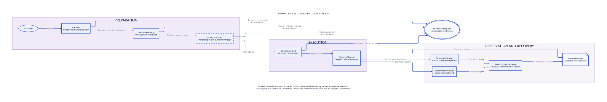

# SPDX-FileCopyrightText: 2026 hardenedlinux Linux Team and Contributors
#
# SPDX-License-Identifier: LGPL-2.1-or-later AND Apache-2.0

#+title: Component Visual Semantics and Reader Acceptance
#+language: en

* Design contract

A component symbol communicates responsibility. A technology mark communicates
implementation or deployment technology. A conceptual picture explains a reader
example. These declarations must remain separate, even when they are placed
beside the same model object.

The SysML component declares =glyph=. A contextual caption may declare a distinct
functional symbol, such as =securityGlyph= for source publication. A teaching
picture uses a separate field, such as =overviewGlyph=. Go preserves these
attributes through the actual OpenSysML SDK capture; generated D2 transports
them to the public Library icon packs and composition functions.

LLM routing uses a path-selection symbol, not the Go logo or a physical network
router. Authentication, authorization, Policy evaluation, durable consumption,
writing and observation remain visibly distinct. A symbol is accompanied by a
label; neither a shield nor a signature constitutes evidence that an effect was
authorized. The permission-gate illustration is a logical metaphor and makes no
claim of physical isolation.

[[file:../../architecture/diagrams/assets/icon-sources.org][The asset vocabulary]] records functional meanings and third-party attribution.
Original canonical SVG assets are captured locally; export performs no icon
network requests. Missing declared assets refuse. The illustrated-object
composition also rejects a brand mark used as a functional component glyph.

* Introductory view

The overview follows one concrete example: an agent summarizing a report.
Source-authored reading groups separate provider proposal, joined permission
and consumption, and actual bytes with observation. The original typed subjects
and ordered relation endpoints remain the model authority. The example person
is explanatory context, not an additional runtime service.

[[file:../../architecture/diagrams/00a-readme-overview.svg]]

* Acceptance observed

| Check | Observation | Scope |
|-------+-------------+-------|
| Actual OpenSysML capture | Passed | Functional symbols in overview, Gateway, Zero Trust and stream recovery |
| Generated semantic-copy refusal | Passed | D2 cannot replace source responsibilities |
| Canonical assets and missing-asset PBT | Passed | 100 generated subsets; labels, vectors and license sidecars |
| TypeScript typecheck | Passed | Public Library consumer and tests |
| Full export | Passed | 116 source-bound images on 12 host lanes |
| Full renderer suite | 13 passed, 1 failed | Vector readability remains unaccepted |

The readability failure is not a timeout: it reports labels rendered below the
existing minimum at GitHub width. The old downstream single-column projection
had flattened hierarchical diagrams and imposed a universal card treatment.
Its removal exposes unresolved layout and caption problems in complex views.
The full suite remains a failure; asset tests and successful export do not
substitute for it.

Failed note-layout exports and the full readability failure remain under the
ignored =.cache/= evidence boundary. Note layout now allocates an explicit width
beside the example illustration and exports successfully. The original
30-second readability deadline, minimum font size, opaque-canvas check and
resource cleanup remain unchanged.

* Remaining acceptance

Complex views need source-owned semantic grouping, concise contextual captions
and suitable notation while retaining their ownership and ordered relations.
Inspect the exported standalone SVG at GitHub width, not only a full-size PNG.
Routing choices, streaming progress and conditional recovery evidence require
different reading structures. The complete visual revision is not accepted for
PR delivery until the unchanged full readability suite passes.

* Candidate layout results

The source reader Designs select palettes and layout preferences for ownership,
routing, process, state, data and assurance views. The Library candidate wraps
labels while preserving source text and can place disconnected components below
one another. Each connected graph keeps its original hierarchy and ELK routes.

The full candidate export produced 116 source-bound SVG and PNG views using
12 host lanes. Chromium measured a minimum visible model label of 18.18 CSS
pixels for Policy continuation and 8.00 CSS pixels for LLM routing at a rendered
width of 830 CSS pixels. The latter remains below the 18 CSS pixel gate. Some
exports also became taller than 7,000 pixels, so the Policy continuation font
measurement alone does not qualify the layout.

The full acceptance run ended with seven passing tests and five failures.
The standalone SVG readability test hit its existing 30-second limit.
Compiler and browser lifecycle tests also reached existing five-second limits.
These failures are separate from the directly measured Routing font failure.
The local candidate export is provisional and has not been published to PR1.

* Reading tasks and runtime measurements

Routing selection and actual provider use have separate SysML views over the
same routing component. Selection exposes the request, routine and catalog
inputs. Provider use exposes current Policy, the guard, provider and response
stream. The illustrated views retain functional glyphs and use distinct vector
art for the routing choice, permission gate and provider. Stream admission and
recovery use separate source scopes over the same ledger and transport.

The timed candidate run exported 117 images before the final illustration
revision. Chromium finished the full 830-pixel check in 19.1 seconds with 68
views reporting small labels. The screenshot phase had the largest median
elapsed time across the 117 images at 915 milliseconds per image on concurrent
lanes. This run did not reproduce the earlier 30-second deadline.

The original five-second lifecycle test reproduced a separate timeout on its
own. Browser launch completed at 267 milliseconds. Both compiler subprocesses
closed and returned their results at 3.44 and 3.72 seconds. Neither browser export
completed before the deadline in that run. This locates the timed-out phase
and leaves the cause of the slow compiler and export path open.

* Floor and refinement views with compiler comparison

The floor design now has separate ordering and recovery views. The ordering
fork distinguishes commit-first from fence-first. The recovery view separates
acknowledging the original slot from qualifying a current effect. The SPEC
refinement view follows the required parent and ongoing-use constraints into
the same actual-use context. All three selected Chromium checks passed at 830
CSS pixels.

The D2 SDK initializes a separate worker and reads its roughly 22 MB WASM
module for each SDK instance. The existing corpus comparison found equal
semantic models and D2 declarations for 117 sources under the ELK and Dagre
compiler options. The normal consumer now uses Dagre for these semantic
observations and keeps ELK in the Library export path.

An upstream candidate compiles two entries with one cold SDK allocation. The
alternating pair completed in 4.16, 3.29, 2.78 and 2.95 seconds respectively
for separate, batch, batch and separate compilation. Each timed test includes
both exported figures and browser closure. These results describe the local
candidate and do not establish a stable full-gate latency bound.

The latest complete export produced 118 SVG and PNG views. The subsequent
unchanged full suite ended with nine passes and three failures. The 30-second
vector check completed 94 image decodes before timeout. Both the sequence
preparation and two-source lifecycle tests hit their five-second limits.
The run does not establish a final count of readable views or a completed
PR1 qualification.

* Integrated batch and browser timing

The execution correspondence view uses five source-authored rows. Each row
relates a concrete event, its Quint schedule and a Lean or physical evidence
obligation. The event column preserves the order from original consumption
to outcome observation.

The Chromium test now captures the entire SVG viewport using the browser's
speed-optimized lossless PNG encoder. It continues to measure the SVG at 830
CSS pixels and check text, geometry, image decoding and opacity. The measured
screenshot median was 286 milliseconds on the previous 118-image cohort.

An integrated full run used the local upstream compiler batch and the same
sequence and two-source lifecycle workloads. It exported 118 views and ran all
118 vector checks in 9.19 seconds. The two-source lifecycle closed its browser
at 3.84 seconds and the sequence preparation passed. The suite finished with
13 passing tests and one failing test. Chromium reported small labels in 65
views, so the integrated candidate remains unqualified for PR1.

* Frozen renderer and attempt views

The renderer lock now includes the upstream package patch. A normal frozen
pnpm installation exposes the batch API and both timed tests use it. The Go
source inventory binds the patch and workspace declaration to the receipt.

The attempt admission view shows the claim or abort race. Its companion starts
at the spent claim and follows evidence into recovery or settlement. Both
passed the selected 830 CSS pixel gate.

The full run on the frozen install exported 119 views. Chromium completed
all 119 checks in 6.27 seconds and the two-source lifecycle closed its browser
in 2.31 seconds. Sequence preparation also passed. The full test suite recorded
13 passes and one failure. The browser reported 64 views with labels below
18 CSS pixels. The render dependency and time budgets pass this run, while
the complete visual cohort remains unqualified for PR1.

* Complete reader cohort

The remaining 64 views have explicit SysML reader questions, subject sets and
relationships. The Gateway views distinguish canonical identity, scope and
recovery CAS. The execution views distinguish enqueue, actual offer,
reconciliation and financial persistence. The assurance and admission views
separate custody, enrollment, durable commitments and current use. The
architecture and research views follow their individual effect or lifecycle
boundaries. Canonical glyphs identify functions. Selected views use local
illustrations to show the route choice, admission gate and bounded writer.

The frozen renderer installation exported all 119 source-bound views. The
full Chromium 830 CSS pixel check passed at the 18 CSS pixel minimum in
5.40 seconds. The two-source lifecycle completed in 2.52 seconds and sequence
preparation passed. All 14 renderer tests passed with the original 5-second
and 30-second limits.
