# SPDX-FileCopyrightText: 2026 hardenedlinux Linux Team and Contributors
#
# SPDX-License-Identifier: LGPL-2.1-or-later AND Apache-2.0

#+title: Weaver Unified Gateway: System Design
#+language: en
#+date: 2026-10-18
#+property: STATUS proposed
#+options: toc:3

* Decision summary

Weaver unifies the contracts connecting identity, Governance, interfaces,
Policy, authorization, and effects across network protocols. One semantic
model can govern multiple independently deployed gateway instances.

Zero Trust is required from the initial design. No host, internal network,
language runtime, workload, or mTLS connection receives ambient authority.
Enforce identity, least privilege, current context, and explicit policy at
each resource boundary. The normative security baseline and review findings
are in [[file:04-zero-trust-and-review.org][Zero Trust baseline and architecture review]]. This requirement does not
assert that the current proposal already implements those protections.

Scheme, Go, and Rust are selected for their respective ecosystem strengths.
The architecture does not infer a language assignment from agentgateway's
repository layout. Go is a serious candidate for network ingress, protocol
adapters, service integrations, and cloud-native coordination. Rust is a
strong candidate for bounded runtime kernels, native authorization integration,
and forwarding workloads sensitive to allocation and memory ownership.
Scheme retains the public POO-native governance and composition model.

These are responsibility boundaries, not claims that a language is inherently
faster or that it makes an implementation secure. Go and Rust forwarding
placement remains subject to the matched experiment in
[[file:03-performance-and-validation.org][Performance and validation]].

Code as Policy is required for the Zero Trust baseline. Scheme owns POO
composition, Cedar remains the selected authorization Provider boundary, and
Go/Rust enforce the admitted artifact and operation contracts without defining
competing policy semantics. The concrete closure and known error-admission gap
are specified in [[file:09-code-as-policy.org][Code as Policy and Cedar integration]].

The [[file:10-zero-trust-assurance.org][mandatory Quint and Lean framework]] binds this contract to cedar-poo-spec,
existing POO proof owners, explicit transition/refinement obligations and
concrete Scheme/Go/Rust evidence. FM1-FM12 remain pending. A source digest,
certificate constructor, bounded model run or proof of pure guards alone
cannot qualify the complete authorization-to-execution path.

Cedar is the authorization kernel because it gives governed operations one
explicit permission meaning and reuses the existing POO specification foundation.
Scheme owns Governance and composition; Cedar does not replace that domain.
The gateway must carry the decision through current source facts, history/budget
coordination and the final credentialed effect. Quint examines fault/concurrency
schedules, Lean states preservation obligations, and runtime controls establish
the physical premises. See [[file:09-code-as-policy.org][why Cedar and formal assurance belong in the gateway]]
and its core policy-to-execution diagram.

Weaver is greenfield: existing Gateway APIs, old Policy encodings and native
objects need no compatibility layer. Reuse owner semantics and source contracts
against one deliberately selected baseline, then regenerate and qualify its
consumers. Research pins document evidence rather than mandate legacy support.
[[file:12-fm1-baseline-and-runtime-qualification.org][FM1 baseline selection]] distinguishes internal semantic/native consistency
from backward compatibility and defines the direct migration boundary.

* One architecture, three different kinds of responsibility

Cedar, Quint and Lean are not three additional gateway services competing with
Scheme, Go and Rust. Cedar defines and evaluates permission; Quint describes
state transitions and explores their interleavings; Lean expresses semantics
and conditional preservation/refinement proofs. Scheme, Go and Rust implement
owned parts of the system to which those contracts apply.

| Element | Core architectural role | Relationship to the execution chain |
|---------+-------------------------+-------------------------------------|
| Scheme / POO | Governance authoring, composition, source and lifecycle ownership | Selects the admitted policy closure and supplies owner-bound operation/currentness contracts |
| Go | Cloud-native control services and selected network/protocol integrations | Reconciles infrastructure, integrates workload identity, distributes admitted publications and normalizes operations; cannot mint an execution right |
| Rust | Reference authority integration, durable coordinator and constrained broker | Enforces consumption, ledger transitions, unique claims and final transport guards |
| Cedar | Shared authorization language and selected evaluation kernel | Evaluates the complete required permission questions on the bound operation; allow alone cannot send |
| Quint | Concurrent/fault state model | Models consumption, commit, claim, send, recovery and cloud-update races across all implementation owners |
| Lean / cedar-poo-spec | Semantic foundation and preservation obligations | Reuses owned definitions and proves meaningful projection/transition properties under stated physical premises |

The build/admission path establishes which policy and execution profile may be
activated. The live path still authenticates facts, evaluates required checks,
consumes the original grant and enforces ledger/broker guards. Quint exploration
and Lean proof checking are not per-packet RPCs. An admitted profile may still
require a Lean-native evaluator at operation time: proof checking and policy
evaluation are distinct activities, and optimization must preserve that profile.

The reference placement is deliberate: Go brings the Kubernetes/network/Gerbil toolchain
integration ecosystem; Rust reuses the native authority boundary and provides
explicit ownership for physical coordination; Scheme preserves POO-native
Governance. Neither cloud readiness nor the implementation language confers
trust. Moving a qualified adapter to Go does not move policy ownership or relax
the final-send contract. The overview below shows this relationship; the
[[file:09-code-as-policy.org][policy-to-wire contract]] specifies how it constrains actual egress.

#+caption: Core ownership and assurance relationships; dashed links describe design contracts, not request traffic.

* Reuse and framework differentiation

[[file:16-differentiation-and-reuse.org][The reuse and differentiation decision]] concentrates Weaver's intended value
in one POO-owned Governance model and preserved effect contracts across agents,
protocols, state changes and recovery. Learn gateway mechanisms from agentgateway:
shared runtime representation, small referenced resources, Go cloud integration,
explicit processing phases and selective bounded data capture. Reuse a library
or service only when its actual transport hooks preserve the protected contract.

The POO/Cedar/Quint/Lean foundation lets us extend existing semantics and assurance
owners rather than create parallel permission languages. The physical gateway
must still implement and qualify the missing bridges; a language mix or proof
tool name is not the differentiator by itself. The
[[file:15-authoritative-spent-state.org][one-use state review]] shows the practical consequence: unknown consumption,
a new nonce or restored pending work cannot bypass canonical message identity,
history, budget and final broker gates.

* Goals and explicit limits

** Goals

- One authoritative meaning for each governance and authorization decision.
- POO-native composition maintained through the existing Scheme ecosystem.
- Explicit separation of semantic admission, request authorization, and effect execution.
- Consistent interfaces across HTTP, gRPC, MCP, model providers, and agent protocols.
- Bounded latency, memory, concurrency, retries, and control-plane work.
- Independent deployment outside Kubernetes and useful native Kubernetes integration.
- Exact source, schema, policy, artifact, and runtime identity in evidence.
- Incremental updates without exposing partially compatible configurations.

** Limits

Weaver does not replace Cedar semantics, Lean-POO composition, POO Flow
Governance, or protocol specifications. It does not establish the truth of an
external claim merely by validating its schema. It cannot prevent traffic
bypassing the gateway without deployment-level network and credential controls.
Those controls are mandatory for a deployment claiming complete mediation,
not optional hardening. Service-gateway and protected-agent profiles must state
their different coverage. Local filesystem/process effects need a qualified
containment or broker owner; the network gateway cannot observe them by inference.

Unification does not require one process, one global control-plane instance,
one data format for all payloads, or one mandatory programming language per plane.

* Authority ownership

The source basis and its qualifications are recorded in
[[file:01-reference-comparison.org][Reference comparison and evidence]].

| Owner | Owns | Boundary |
|-------+------+----------|
| POO Flow Governance | Profile, Source, Threat Model, Assessment, semantic admission | A successful assessment is not a request permit |
| Domain contributors | Domain vocabulary, evidence, profiles, cases, policy sources | Must declare identity, revision, and ownership |
| POO Flow Authorization | Engine-neutral Provider and Capability contracts | Provider selection is explicit |
| cedar-spec | Cedar evaluation, validation, and language semantics | Weaver introduces no alternate Cedar interpretation |
| Lean-POO / cedar-poo-spec | Composition, proof dependencies, Cedar adapter, exports and replay contracts | Proof or replay evidence does not execute an effect |
| Runtime authority and Host | Selected evaluation protocol, receipts, grants, consumption state | Must authenticate actual runtime inputs and artifacts |
| Weaver deployment owner | Listeners, credentials, service discovery, execution bindings, operational constraints | Cannot silently weaken semantic admission |
| Actual executor | Last enforcement point and effect handoff | Must bind the consumed authorization to what it sends |

The gateway adds transport and lifecycle integration around these owners.
It must not create a second domain-governance implementation in Go or Rust.

* Language and ecosystem boundaries

** Scheme: semantic composition and maintainable governance

Scheme owns the normal public authoring model: POO objects, prototypes,
composition, profile selection, contract relations, and explicit functional
projection. Reuse the existing Governance and Authorization interfaces.
Wire representations are outputs of this model, not a replacement authoring DSL.

Pure functions perform projection and dependency calculation. Side effects
such as evidence acquisition, publication, and authorization invocation use
explicit host boundaries. Importing a profile must not authorize an action.

Lean-authored Cedar modules remain maintained through cedar-poo-spec's
existing ownership. Scheme selects and composes their admitted artifacts;
the design does not require rewriting every Lean policy in Scheme. Schema
and policy exports retain provenance back to their actual source owners.

Byte forwarding does not require a per-chunk Scheme round trip. A protected
operation may require a bounded call to the existing Scheme source/lifecycle
owner at admission or a declared checkpoint. Compilation cannot erase that
currentness premise. Keep this admission cost separate from byte forwarding.

Separate untrusted contributor evaluation from publication signing and runtime
secrets. POO-native values are not a sandbox for arbitrary Scheme code. A pure
state transition or a field named =signature= or =durability= cannot establish
cryptographic verification, serialized consumption, or durable storage. Preserve
these host obligations when reusing the existing semantic APIs.

** Go: networking, protocol integration, and cloud-native operation

Go has a substantive network-runtime role available to Weaver. Its standard
HTTP transport and reverse-proxy APIs, cancellation conventions, gRPC
ecosystem, and cloud SDKs make it a candidate for network services and
integration-heavy adapters. Kubernetes client and controller libraries add
resource watching, reconciliation, leader election, and status publication.
The source basis is listed as E1 through E5 in the comparison document.

Possible Go-owned components include:

- A complete HTTP/gRPC ingress and forwarding service, if qualified.
- Protocol adapters or connectors whose mature SDKs reduce semantic risk.
- Identity-provider, cloud-service, and service-discovery integrations.
- Kubernetes resource ingestion and reconciliation.
- Publication transport and operational administration.

The concrete initial Go role is cloud-native integration and operational network
services, including backend discovery and publication/status distribution. Go
ingress and selected connectors remain qualified candidates. The inspected
upstream responsibilities and their relevance to an AI-native gateway are in
[[file:06-go-control-plane-role.org][Go's cloud-native and Agent Gateway role]]. This establishes Go's value beyond
an arbitrary language split without granting its controller effect authority.

Go-owned ingress is a trusted enforcement component. Rust authorization does
not compensate for a Go adapter mutating the authorized target or payload.
Measure GC work, allocation, goroutine retention, and cancellation under
slow clients; do not assume those costs disqualify Go in advance.

** Rust: bounded kernels, native integration, and forwarding candidates

Rust is the initial integration choice for the existing Cedar Rust authority
and native Host boundary, since those components already exist in Rust/C/Lean.
It is also a candidate for parsers, artifact checks, connection management,
stream forwarding, and workloads requiring explicit ownership control.

This does not imply copying the authority code into Weaver. Prefer an
owner-maintained library or service contract with fixed artifact identities.
Rust async tasks, queues, locks, and allocations still require budgets.
An unsafe or FFI boundary requires its own ownership and lifecycle evidence.

For the reference coordination topology, Rust owns the physical durable state
adapter and minimal credentialed broker. Scheme retains the existing source,
semantic transition, and local lifecycle ownership. This concrete reference
assignment is defined in [[file:05-authorization-execution-protocol.org][Authorization-to-execution coordination]], while the
Go/Rust forwarding comparison remains a separate decision.

The exact owner contracts are refined in
[[file:07-source-admission-ledger-fencing.org][Source admission, durable ledger, and fencing contracts]]. The current Scheme
preflight is deliberately undecided; production source admission needs a
distinct issued-family extension, not a wrapper that renames preflight as allow.
The existing backend descriptor also needs a versioned coordination facet and
physical qualification before its capabilities can support this ledger.

** Cross-language boundary rules

Default to authenticated, versioned service boundaries with bounded messages
and cancellation. Use a Unix socket on one host and mutually authenticated
transport across hosts. Neither transport itself establishes peer authority:
validate peer identity, socket permissions or certificates, and role scope.

Authorize each named RPC for tenant, audience, and permitted operation. A Go
discovery service cannot issue capabilities; a Scheme contributor cannot publish
outside its delegated change scope; a Rust evaluator cannot claim the truth of
an adapter's observations. Each service derives expected issuer, epoch, and
runtime identities from authenticated deployment bindings, never from the grant
or request it is checking. Bootstrap and rotation are explicit trust-root duties.

Do not put cgo, Rust FFI, and the Scheme GC on one request thread as the
default topology. An FFI alternative needs measured benefit and explicit
proof obligations for ownership, panic, signal, thread, and shutdown behavior.

Keep payload streaming in its owning network process whenever possible.
Transfer bounded authorization metadata rather than relaying each chunk
through every language. Full payload inspection remains an explicit cost.

* Topology alternatives

| Candidate | Network ownership | Benefit hypothesis | Main cost or risk |
|-----------+-------------------+--------------------+-------------------|
| A | Go ingress, forwarding, adapters; Rust authority/Host service | Strong networking and integration ecosystem with existing authorization kernel | Per-operation authorization IPC; Go must enforce the final handoff |
| B | Rust ingress and forwarding; Go discovery, network integration services, selected connectors | Direct stream ownership and native runtime integration | SDK/protocol integration effort; connector hops on selected routes |
| C | Route-selected Go or Rust network owners using the same contracts | Exploit mature protocol ecosystems without a universal double proxy | Two implementations require shared conformance and operational discipline |
| D | One primary network owner plus in-process foreign kernels | Potentially fewer IPC costs | ABI/GC/lifecycle coupling and weaker fault containment |

Candidate C is the reference decomposition for evaluation, with A and B as
its concrete single-owner baselines. It is not a commitment to implement
both full data planes. Start with one measured owner for the first supported
protocol; introduce another only for demonstrated integration or resource value.
Candidate D is deferred until evidence justifies its complexity.

A route has one designated final executor. An adapter that itself dispatches
an upstream call becomes that executor and must consume its own correctly
scoped grant. A proxy must not consume a grant and pass reusable credentials
to an unconstrained adapter. Do not require Go-to-Rust-to-Go forwarding on
every request merely to include both languages.

Where compromise of a complex adapter must be contained, isolate final dispatch
and credential attachment in a smaller broker. Only that broker may emit the
credentialed operation. If the adapter itself retains unrestricted credentials
and egress, it remains inside the trusted base; a separate Rust policy service
does not remove that trust. Apply the same rule to Rust adapters and Go brokers.

* Logical structure

#+caption: W01. Proposed logical roles and authority boundaries.

The canonical [[file:diagrams/01-system-boundaries.d2][D2 source]] and
[[file:08-diagram-catalog.org][diagram maintenance contract]] accompany this view.

This is a logical diagram. A component's deployment may be combined only
when its independent authority and failure boundaries remain enforceable.
Network owner and final executor may be one qualified process; depicting two
roles does not mandate two network hops or establish process isolation.
The precise publication and operation contracts are defined in
[[file:02-interfaces-and-policy.org][Unified interfaces and Policy model]].

* Control-plane and data-plane lifecycle

1. Authenticate contributor and discovery inputs; preserve source identities.
2. Compose profiles and policy artifacts through their existing owners.
3. Check semantic admission, schema compatibility, and required evidence.
4. Publish immutable resources with a signed dependency manifest.
5. Stage resources and compile bounded runtime plans off the request path.
6. Activate a complete compatible closure with one local generation change.
7. Bind each operation to the selected closure and current security epoch.
8. Authorize the exact subject, consume a grant at its issuer, and dispatch.
9. Record completion, cancellation, or unknown outcome without reopening a grant.

Stateful history and budget premises require a versioned serialized admission
transition or a qualified protocol across their owners. Independently successful
checks do not establish atomic admission. The transition and its crash behavior
are required integration work, not an existing property of the Rust Host.

The selected proposal uses one serializable history/budget domain, durable
preparation, existing grant consumption, durable send commit, then a unique
dispatch claim. Consumption is outside the storage transaction: failure may burn
a grant but never permit an uncommitted send. Unknown non-idempotent sends are
not automatically retried. See the coordination protocol for exact abort,
settlement, currentness, and recovery rules.

Resource transport can be incremental. Activation must be atomic within each
declared dependency closure. ACK of delivery, acceptance of a staged resource,
and activation are separate states. xDS is a transport candidate, not an
atomicity or governance protocol by itself.

* Deployment, availability, and trust

Standalone and Kubernetes modes use the same admission contracts. A local
file is an authenticated publication input only when its provenance and
deployment role meet the same requirements; it is not a privilege bypass.

Separate traffic tenancy from publication namespaces and credential scopes.
Prevent cross-tenant reuse of routes, entity snapshots, quotas, and grants.
Use workload-scoped upstream credentials and deployment egress controls to
make the execution boundary effective.

Data-plane instances continue only while their active closure, credentials,
and required evidence remain valid. Control-plane loss does not extend
expiry or suppress revocation requirements. Each route declares its maximum
permitted staleness; once exceeded, protected new operations fail closed.

Revocation has a bounded propagation requirement, not an implied instantaneous
global guarantee. Issuers require fresh leases and monotonic fencing so a
partitioned replica cannot keep declaring its old epoch current. Define admission
at a linearization point ordered with revocation. Later revocation follows the
committed/in-flight policy; a stronger dispatch guarantee requires a qualified
executor/backend commit protocol. Long-running streams declare checkpoints or
termination rules. Bytes already released cannot be recalled by a later revocation.

Existing pending grants are issuer-instance state. Route consumption back to
that issuer; an issuer restart invalidates outstanding grants. Multi-region
issuance requires either disjoint issuer scopes or a qualified consistent
consumption service. A shared signing key does not provide single-use behavior.

Fresh recreation and paused-old-worker resumption are different cases. An old
worker retaining its original state may still know the old grant and fence.
Every ledger mutation checks authoritative lineage/owner/fence inside its
transaction. A successor cannot reset claimed attempts. Blocking already
accepted old broker work requires a separately qualified physical stop/drain
barrier or receiver fence; a new database fence or Kubernetes leader is insufficient.

* Security and operational boundary

The threat model includes forged identity metadata, confused-deputy routing,
cross-tenant references, stale evidence, adapter mutation, replay, malicious
policy inputs, partial configuration updates, and resource exhaustion.
Network facts, governance evidence, and authorization context retain distinct
origins. Client headers cannot declare a trusted principal or current epoch.

Administrative APIs require separate roles and authentication. Publication
signing, deployment configuration, runtime issuance, and audit-reader access
must not share an unrestricted credential. Secrets are referenced by identity
and version rather than embedded in exported policy artifacts.

Telemetry redacts secrets and sensitive payloads. Required audit recording
uses a bounded durable acceptance boundary before the protected handoff;
optional telemetry may be sampled or dropped under a declared policy.

* Decisions and open questions

| ID | State | Decision or required evidence |
|----+-------+-------------------------------|
| D0 | Required | Zero Trust from inception; satisfy Z1-Z10 before an affected deployment claim |
| D1 | Proposed | Preserve Scheme POO-native authoring and existing semantic owners |
| D2 | Proposed | Treat Go networking and Rust forwarding as measured placement candidates |
| D3 | Proposed | Reuse the existing authorization owner; add no parallel permit engine |
| D4 | Proposed | Use versioned service boundaries before introducing cross-runtime FFI |
| D5 | Open | Select the first protocol and workload envelope, then compare A and B |
| D6 | Open | Qualify exact Cedar/Lean version compatibility and close native input blockers |
| D7 | Proposed / open qualification | One history/budget domain and fenced claims; publication/revocation timing and backend durability still need qualification |
| D8 | Open | Decide upstream reuse versus integration after contract and operational fit checks |
| D9 | Proposed / open qualification | Rust final broker reference; containment implementation and identity bootstrap still require selection |
| D10 | Proposed / open qualification | Single-store ordered consume-then-commit protocol with X1-X10 owner contracts; qualify runtime Decision/source family, ledger facet and all fencing layers |

No language placement, performance target, or upstream reuse choice becomes
accepted solely from this document. The exit conditions are in the validation plan.

* Protected rollback-recovery placement constraint

[[file:19-anchor-recovery-and-egress-contract.org][The anchor/recovery/egress contract]] adds an explicit failure-domain requirement.
The canonical publication/replay authority and actual transport delegation/seal
state must survive the claimed host snapshot rollback, or the selected protected
profile remains unavailable. Co-location in earlier logical responsibility
views is not evidence of that independence. Programming language, container,
process and Kubernetes placement do not establish a separate rollback domain.
Status resolution, original claim recovery and actual buffer retirement remain
different contracts; no model result creates an atomic journal/socket write.

* Composed recovery and final delegation

[[file:20-composed-journal-transport-lifecycle.org][The composed lifecycle contract]] makes the exact same migration request own
seal, terminal journal decision and activation. It joins full finite-ledger
recovery to final-owner range admission and owner-incarnation fencing. Owner
restart must retain durable seals and possibly delegated ranges; uncertain
transport outcomes never reopen a range or reset original accounts. The
 separates these authority boundaries from the proof rail.

* Finite stream range ownership

[[file:21-finite-stream-manifest-proof.org][The finite manifest contract]] refines final delegation into immutable ordered
ranges of the complete admitted message. One original affine driver capability
owns each accepted range; prefix progress cannot be reconstructed from reported
byte counts or accepted records after restart. Shared escrow and canonical
history constrain all ranges together.  keeps Policy,
durable authority, final-owner admission and original-driver responsibilities
explicit without mixing verification evidence into the architecture.

* Terminal evidence, publication and financial authority

[[file:23-writer-isolation-settlement-closure.org][The writer/settlement refinement]] makes evidence storage, canonical ownership
decisions and local publication separate steps. A local cache, an SDK completion
or a usage receipt cannot grant stream release. Final usage joins the original
closed work inventory and immutable settlement key; unknown holds remain retained.
Physical transport, persistence and provider qualification remain explicit.

* Protected account application and restored views

[[file:24-settlement-anchor-recovery.org][The account/anchor refinement]] distinguishes canonical account-gate history
from restorable database views. Original application slots survive worker changes;
charged materialization requires the same actual gate receipt and independent
confirmation. A pending anchor intent alone cannot repair erased gate history.

* Independent consumption root and recoverable gate journal

[[file:25-gate-consumption-persistence.org][The consumption persistence refinement]] removes local gate-journal survival
from the abstract contract. An independent root seals the original application,
tombstones capability issuance and consumes it before actual effect. A real
original receipt must be archived before confirmation/full-image recovery. Go
reconciles exact status, Scheme preserves original semantics and Rust enforces
the final root/owner boundary. Unknown burns stay booked; all-root rollback and
unfenced external writer aliases remain excluded physical failures.

* Durable anchor commit versus actual broker authority

[[file:26-anchor-commit-broker-fencing.org][The handover refinement]] separates proposal, qualified commit, original response,
actual submission and application. Root election closes new control admission but
does not instantly isolate an old writer. An original confirmed operation can
submit before the actual barrier; the same unknown reservation remains held.
Physical isolation precedes root fence commit and qualified-prefix activation.
No status read recreates an execution continuation or another original key.

* Joint membership and complete deciding-prefix inheritance

[[file:27-anchor-configuration-prefix-inheritance.org][The membership refinement]] puts configuration changes and original data in one
committed lineage. Entering and finishing joint state require qualified old/new
quorums and exact determining-image installation. New economic admission stays
closed until stable-new and fresh scoped broker activation. Old original IO may
resolve without a new claim or budget domain; no election resets the joint state.

* Quorum durable promises and prefix recovery

[[file:28-quorum-durable-promises-prefix-recovery.org][Durable promise and prefix recovery review]] closes the shared-witness
rollback premise, separates signer retirement from actual broker isolation and
preserves original Policy, budget/history and consumption domains.
[[file:diagrams/29-quorum-durable-promises.d2][Core D2]] /  / [[file:../../dev/specs/evidence/quorum-durable-promises-2026-10-19.org][check receipt]].

* Embedded architecture views

** 21-composed-journal-transport-lifecycle.svg

** 22-finite-stream-manifest.svg

** 29-quorum-durable-promises.svg

