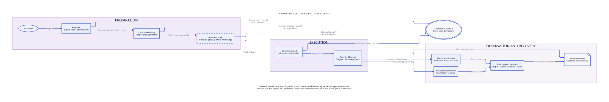

# SPDX-FileCopyrightText: 2026 hardenedlinux Linux Team and Contributors
#
# SPDX-License-Identifier: LGPL-2.1-or-later AND Apache-2.0

#+title: Weaver Authorization-to-Execution Coordination Protocol
#+language: en
#+date: 2026-10-18
#+property: STATUS proposed-safety-protocol-not-implemented
#+options: toc:3

* Decision and guarantee

Use one fenced runtime coordinator and one serializable durable state domain
for each connected history/budget scope. Reuse POO Flow's semantic admission,
source currentness, local authorize/reserve/deliver lifecycle, Cedar authority,
and recovery contracts. Add only the bindings needed between those owners and
the actual gateway executor. All names for new records below are conceptual.

This is a concrete proposed protocol, not evidence that the existing APIs
already implement a gateway transaction. The first supported mode sacrifices
automatic retry after an ambiguous send. It promises at most one gateway
dispatch attempt per committed attempt identity under the stated storage and
executor assumptions. It does not promise exactly-once application by an
uncooperative remote service, protection against a compromised final broker,
or progress while required state is unavailable.

The durable journal's commit is the admission linearization point. It binds
history restrictions, budget ownership, verified consumption, selected executor,
and permitted handoff. A later dispatch claim is a single-use local emission
right with its own deadline and currentness checks. Neither record is a new
Cedar authorization decision. Recovery requires new authority; old receipts
are evidence of the old attempt, not permission to run it again.

The source/ledger/fencing owner contracts are now specified in
[[file:07-source-admission-ledger-fencing.org][Source admission, durable ledger, and fencing contracts]]. They distinguish
direct algorithm reuse from required POO owner extensions. In particular, a
current undecided preflight cannot serve as the runtime admission used below.

* Visual protocol

#+caption: W02. Proposed preparation, evaluation and consumption (S1-S3).

[[file:diagrams/02-admission-sequence.d2][D2 source]]. The sequence preserves
separate grant consumption, durable send commitment, and final claim boundaries.
A positive consume result alone never permits dispatch. The normative guards
and failure branches are specified below and in
[[file:07-source-admission-ledger-fencing.org][the owner contracts]].

#+caption: W10. Continuation through send commitment, claim and observations (S4-S6).

[[file:diagrams/10-commit-dispatch-sequence.d2][D2 source]]. W10 continues the same bounded callback and immutable
attempt from W02. Splitting the view adds no protocol boundary, new attempt,
replayed grant or second consumption.

* Existing POO mechanisms to reuse

The exact-source register is in [[file:01-reference-comparison.org][Reference comparison and evidence]].

| Existing owner | Reuse | Does not establish |
|----------------+-------+--------------------|
| Governance and Authorization core, P1/P2 | Profiles, assessments, Provider/Capability meaning | Runtime source truth or network dispatch |
| Assurance verification Host, P16 | Host-issued exact request, fingerprint, source/assessment currentness | A preflight is not effect authority; optional source-reader cannot be assumed present |
| Assurance effect Host, P15 | Serialized authorize/reserve/deliver lifecycle; strict expiry and no reservation reuse, with an owner-extension for the new request family | Existing source guard is preflight-specific; receipt is non-durable and non-distributed |
| Signed Rust authority, P5 | Qualified Cedar evaluation, exact grant binding and issuer-owned consumption | Atomic history/budget transaction or actual remote effect |
| Pure token/mediation, P12/P13 | Semantic root, nonce, binding, immutable state transition | Cryptographic verification, durable append, concurrent host commit |
| Durable store backend negotiation, P17 | POO-selected backend contract, runtime handoff and capability negotiation | A selected backend is not automatically a serializable gateway ledger |
| Recovery owners, P18-P21 | Canonical transaction identity, durable intent, exclusive claim/fence, fresh recovery authorization, observation/provenance joins | Physical implementation of those predicates or generic HTTP exactly-once behavior |

** Local lifecycle and signed authority are distinct

The Scheme effect Host issues process-local grants/reservations backed by its
identity tables. The Rust authority issues signed grants backed by its own
pending table. Do not serialize a Scheme object reference into a network token,
convert a signed grant into the Scheme draft format, or confuse two successful
consumptions with a distributed transaction.

The trusted runtime adapter verifies the complete signed Rust result and maps
its exact request/policy/entity/decision identities to the Scheme decision
contract. The configured authorize callback is a privileged dependency; the
public Scheme decision constructor alone is not proof of engine execution.
Retain and verify the original complete engine responses and signed evidence;
an allow/deny or reason-list projection cannot hide erroring policies or prove
full-response equality. No nonempty evaluation-error result may execute.
Retain strong owned references to local objects until termination; weak identity
tables and GC are not durable transaction storage.

P16 projects an explicitly marked preflight. P6 rejects that marker and ordinary
preparation for source-admission-required actions. A new owner-qualified trusted
source-admission entrypoint must bind the Host's current source cut to the
actual strict evaluation and consumption. Never strip the marker or weaken
the capability flag to connect these APIs. Until this binding is qualified,
such protected actions remain non-executable.

The required extension also installs an owner-issued fully evaluated runtime
Decision/source-admission family and its currentness guard in P15/P16. Existing
P16 preflight state/outcome remain unknown and unchanged. Reusing P15's lifecycle
does not mean its current hard-coded preflight guard can accept the new family
without modification, or that an allow-shaped object can replace an issued one.

* Specific Scheme, Go, and Rust responsibilities

| Role | Reference placement | Required responsibility |
|------+---------------------+-------------------------|
| Semantic admission and lifecycle | Scheme on its existing serialized owner thread | Compose POO values; assess governance/history facts; issue exact Host requests; use authorize/reserve/deliver and existing recovery predicates |
| Cloud-native integration | Go services | Watch/reconcile infrastructure, discover backends, negotiate workload identity, deliver admitted publications, expose lifecycle/status APIs |
| Client protocol/connector | Selected Go or Rust network owner | Authenticate and normalize input, produce frozen operations, propagate cancellation, preserve protocol behavior; no unrestricted upstream credentials |
| Physical coordination adapter | Rust runtime owner in the reference topology | Own durable transaction/CAS, history and budget rows, runtime fencing, signed grant adapter, issuer calls, and recovery scheduling |
| Final credentialed dispatch | Small Rust broker in the reference topology | Verify committed attempt, claim once, enforce destination/credential binding, call transport once, record observed result |
| Storage / external effect | Explicit selected backend and upstream owner | Supply actual durability/serialization/fencing/idempotency guarantees used by the protocol |

The Rust coordinator executes POO-defined semantic transitions; it must not
reimplement the policy meaning as Rust conditionals. Invoke the existing
Scheme owner through a bounded owner-thread service/runtime adapter, outside
the database lock and network event loop. Carry the snapshot version back to
the physical CAS so a stale semantic result cannot commit.

Go can own qualified ingress and integration-heavy connectors. If a Go connector
must be the final transport, either it emits only through the constrained Rust
broker or it becomes the final trusted broker and passes the identical dispatch
qualification. Passing it a consumed success boolean and reusable secret is not
an equivalent implementation. Language assignment can change only with the same
state and authority ownership contract.

No Go controller, Kubernetes leader lease, or status condition grants runtime
commit authority. The detailed Go rationale is in
[[file:06-go-control-plane-role.org][Go's cloud-native and Agent Gateway role]].

* Streaming specialization and typed claims

[[file:14-stream-message-authorization.org][Message-stream authorization]] applies the same S1-S6 ordering to each complete
bounded child message on a separately admitted parent stream. A start claim,
a message claim and an attenuated range ticket have distinct effect kinds;
a child claim cannot reopen the application request. The reference uses finite
message callbacks on P15 and one authorized message slot per stream, with inert
parallel producer staging. It does not wait for an open stream's lifetime or
reenter its blocked Scheme owner. Physical queue copies, partial offers, seal
cuts and final-cost evidence have explicit separate states.

The canonical one-operation diagrams remain valid for their selected effect
kind;  supplies the child/parent specialization. It does not add
an asynchronous queue acknowledgment to P15 or infer durable authority from a
Session scheduling intent.

* Consistency domain and durable records

Start with one serializable store, not an assumed cross-service transaction.
Map every rule to its full scope: tenant, delegation tree, data-flow group,
budget owner, or a declared combination. All mutually dependent rows participate
in the same commit/lock set. Disjoint scopes may shard independently. A policy
spanning stores is unsupported until a coordination protocol or preallocated
escrow allocation with a proved bound is qualified.

The runtime owner persists, through an explicitly selected backend:

- Canonical intent and attempt registry, request/plan digest, tenant, and frozen
  payload reference with owner, range, generation, lifetime, and integrity rules.
- History scope, policy epoch, admission version, pending disclosures/effects,
  completed observations, and summary provenance/continuity.
- Budget capacity, held units, settled units, conservative unknown usage, and
  each reservation's owner, maximum, unit, and lifetime/state.
- Publication/security fence, issuer identity/generation/lease, selected executor,
  and grant/consumption correlation; raw secrets do not enter the journal.
- Admission commit, one dispatch claim, transport attempt identity, required
  audit record, and result/recovery observation with its trust/provenance.

Reuse the canonical transaction registry and receipt-binding obligations of
POO's recovery owner. Equal caller transaction IDs or matching strings do not
prove a valid prior commit. A retry with a different request digest is rejected.
Assign or validate client idempotency keys under authenticated tenant scope.

* State machine

#+caption: W03. Proposed attempt states and conservative recovery.

[[file:diagrams/03-attempt-state.d2][D2 source]]. Recovery has no transition
from an unknown external outcome back to dispatch for the same attempt.

#+begin_example
Proposed -> Prepared -> ConsumePending -> SendCommitted -> DispatchClaimed
                              ^
                GrantConsumed is positive owner knowledge, not a required durable state

DispatchClaimed -> ResultRecorded / OutcomeUnknown / NoSubmissionProven
ResultRecorded and OutcomeUnknown retain independent emission and accounting states

Before SendCommitted: -> AbortedNoDispatch
SendCommitted with claim absent: -> AbortedNoDispatch only by authoritative CAS
After DispatchClaimed: never -> AbortedNoDispatch or a new emission handle
#+end_example

=GrantConsumed= may be transient runtime knowledge with a journaled outcome,
not an assumed recoverable issuer query. =SendCommitted= means admission and
an exact send intent are durable, not that the upstream applied anything.
=DispatchClaimed= means the one possible transport invocation has been claimed;
it must be treated as potentially sent even if no completion exists.

** Orthogonal state records and terminal meaning

W03 is the attempt admission view. It is deliberately not the entire state of
an external operation. Keep these separate, attributable record components:

| Component | States / knowledge | Owner and consequence |
|-----------+--------------------+-----------------------|
| Admission | Prepared, ConsumePending, SendCommitted, DispatchClaimed, AbortedNoDispatch | Rust ledger enforces allowed-state/version CAS; GrantConsumed may be transient positive knowledge |
| Local lifecycle | Issued, Reserved, DeliveryEntered, Returned/Rejected | Scheme P15 owns identity and one-use state; none proves physical delivery |
| Submission observation | NotEstablished, InvocationMayHaveStarted, NoSubmissionProven | Broker evidence; a durable claim alone already means submission is possible |
| Emitter | PotentiallyOpen, ClosedWithEvidence | Broker/supervisor evidence admitted by the active ledger owner; result receipt alone cannot close it |
| External outcome | Unknown, AttributableSuccess, AttributableFailure | Resource-specific evidence; an error response may still imply charge or effect |
| Accounting | Held, UnknownExposure, Settled, SettlementPending | Current ledger owner moves units atomically; observation and settlement may be separated by a crash |
| Response release | Withheld, AdmittedRange, ReleasedRange, ReleaseUnknown | Scheme declares disclosure semantics; Rust broker enforces exact principal, stream/range and current conflict gate |

A result record is not global completion. A response may exist while the emitter
is open or budget settlement remains pending. An unknown business result may
coexist with a proved closed emitter. =NoSubmissionProven= after a claim is an
observation, never an admission rollback: the spent claim/tombstone remains.
Unknown or absent fields take their conservative value on restart.

** S1: prepare history and budget before authorization

Authenticate the frozen operation and choose its consistency domain. Under a
short serializable transaction, check the caller/tenant and registry uniqueness,
install pending flow restrictions, reserve a hard upper bound of budget units,
and persist =Prepared=. No grant or network emission is exposed at this stage.

Read the resulting admitted history/policy cut and its version. An operation's
own hold is represented explicitly in the projection, rather than accidentally
counted twice or ignored globally. Concurrent operations see the hold and any
pending sensitive read. A read's restrictive classification must be known before
bytes leave the broker; unknown classification uses the conservative restriction.

The budget invariant for each domain under its admitted capacity epoch is:

#+begin_example
settled_units + held_units + unknown_exposure_units <= admitted_capacity
#+end_example

Every unit changes buckets in the same storage transaction; it is never counted
in two buckets or removed while its possible effect is unaccounted. A requested
capacity decrease below existing exposure enters an explicit over-limit/frozen
state: no new admission, no erased exposure, and no claim that the inequality
already holds under the lower limit. A route without a defensible maximum external
charge cannot promise a hard spend cap; require a provider-enforced cap, a bounded
operation, or a separately scoped extension protocol before enabling it.

** S2: evaluate through the existing owners

Outside the storage lock, call the Scheme verification/effect Host on its exact
owner thread. Its configured runtime authorize callback invokes the selected
qualified Rust Cedar authority and verifies the complete result. Bind history
version, reservations, frozen operation, source cut, policy/entity/schema,
runtime identity, and intended broker to that result.

Reuse C10 =Receipt.allowed= over the exact nonempty required request set;
=Except.ok receipt= alone is not permission. C8 projection equality does not
authenticate live inputs. The required Quint/Lean correspondence and concrete
adapter evidence are specified in [[file:10-zero-trust-assurance.org][Zero Trust assurance]].

The source-admitted issue extension must also enforce the error-free execution
profile in [[file:09-code-as-policy.org][Code as Policy]] before exposing a grant. Deny, invalid input,
unsupported features, evaluator timeout/mismatch, equal error-bearing results,
missing evidence or expired admission produce no executable grant. Terminally
abort the unclaimed Prepared attempt through an authoritative CAS; ambiguous
abort/prepare replies retain holds until resolved. No denial path skips cleanup
by assuming there was no durable reservation.

This step requires the new fully evaluated owner-issued runtime admission in
X3-X6; it cannot reuse an undecided preflight as a production eligibility result.
The strict source-admitted prepare/issue/consume entrypoints preserve the ordinary
path's explicit refusal controls. Source validity follows the declared immutable-
snapshot or guarded mutable-source contract, not a generic timestamp promise.

Require byte-current source checking when the capability claims it; P16's
optional reader is not sufficient by its mere presence in an API. External
sources outside this consistency domain need an authenticated finite lease or
source-specific fence. Do not claim their state cannot change after a snapshot.

** S3: reserve local lifecycle and consume the signed grant

Use =assurance-effect-host-reserve!= for the local grant. Reservation is single
use and performs no external effect. Under coordinator control, durably mark
=ConsumePending=, then invoke =assurance-effect-host-deliver!= once. Its configured
delivery callback is the bounded coordinator integration described below, not
an arbitrary HTTP client supplied by the caller.

The callback asks the original Rust issuer to consume the exact signed grant
through the trusted source-admission binding. Record positive consumption only
from that authenticated owner response; never from a client receipt. A timeout
does not mean the issuer failed to consume. The inspected issuer has no assumed
transactional participation or durable consume-status/replay API.

If consumption is unknown, do not send. Irrevocably abort this attempt in the
journal or query an owner-qualified status protocol if one is later available.
An eventual late consumption response cannot reopen an aborted row. Losing a
grant is acceptable; acquiring a dispatch right without a proved consume is not.

** S3 integration: synchronous callbacks and owner-thread constraints

P15 =deliver!= invokes its configured callback synchronously, marks the
reservation spent before entry, and forbids effect-Host mutation during that
handoff. The reference sequence is: reserve and return, durably record the exact
ConsumePending command, then call deliver once. The callback drives the bound
Rust coordinator work through consumption, commit, claim and bounded observation.
Neither reservation nor callback entry is success evidence for those later steps.

In this synchronous reuse profile, the Rust service must accept the callback on
a separate bounded task while the initiating task awaits Scheme. Neither task
holds a database lock or waits for its own occupied task/thread. The callback
cannot call back into the blocked Scheme owner, mutate/revoke that effect Host,
or wait for a source guard that only that owner can issue. Acquire the qualified
immutable source witness/lease inline before entering the external call and
revalidate its fixed scope and finite validity at S4 and S5. The callback also
carries the semantic owner's admitted pure transition/claim derivation for V to
V+1; the runtime verifies that artifact and its exact guarded inputs. If computing
the current premise needs a new call to the blocked owner, this profile cannot
execute that route. Use the external
runtime/ledger revocation and lease authority during the wait. Scheme-side
queued revocation is effective only when processed; never promise instantaneous
revocation through a blocked owner. Strict deadlines bound the wait and may
leave an unknown result without refund or re-entry.

A route requiring mutable-source locking or fresh Scheme-owner interaction at
both S4 and S5 is unavailable in this profile unless its separate source owner
can safely supply that contract. An asynchronous continuation/owner-pump design
requires a distinct POO owner extension with cancellation and reentrancy semantics;
it is not supplied by existing synchronous =deliver!=. Do not emulate it by
returning =delivered= for a queued task or by repeating delivery. An asynchronous
protocol response such as Accepted is not the Scheme attributable-delivery ack.

** Local lifecycle receipts do not summarize the attempt

| Local observation | What it establishes | What must still be resolved |
|-------------------+---------------------+-----------------------------|
| Reserve returns false | This call acquired no new reservation | Existing attempt/command state; never retry with a new grant by assumption |
| Deliver rejects with handoff-executed false | This invocation did not enter the callback | A prior invocation of the same reservation may have entered or completed; inspect authoritative attempt state |
| Callback throws, returns failed, or returns indeterminate | No attributable success under its ack contract | It may already have consumed, committed or claimed; abort only by current allowed-state CAS |
| Callback returns delivered | The capability's attributable acknowledgment was observed | Durable emitter/outcome/usage/response-release states; receipt is not a dispatch capability |
| Host/thread restarts or loses references | Old local identity is unusable in the new process | Durable attempt facts remain; no deserialized replacement reservation or handle |

P15's duplicate rejection is scoped to the rejected call, not proof that the
reservation has never executed. Never translate a non-durable failed/rejected
receipt into no-submission, budget release or a second application attempt.

** S4: commit send admission in the journal

After positive consumption, perform a serializable compare-and-commit against
the expected history version, source lease/fence, budget holds, publication,
authority generation, executor identity, and deadline. It also records the
required audit acceptance and immutable handoff identity. If any premise has
changed, abort without dispatch; the consumed grant stays consumed.

Use strict =now < expiry= at required final checks, preserving the original
remaining deadline across calls. A long source check cannot reuse its earlier
clock sample to pass expiry. Each clock/lease authority has an explicit skew
and conversion contract; failure to establish freshness rejects the operation.

The default required audit acceptance is the durable audit row in this same
transaction. If a route requires acknowledgment from an independent audit sink,
obtain its bound durable receipt before this commit; journal append alone cannot
satisfy that stronger profile. Delivery to an observational sink may use an
idempotent outbox, but the effect-send record is not a generic replayable outbox.

Own-transition versioning must be explicit. Evaluation binds the post-S1 cut
V and immutable subject. S4 checks V and writes the authorized transition to V+1.
S5 checks an owner-derived claim premise for that committed transition and its
current scope version; it does not require V+1 to equal the old V. The semantic
owner must declare that derivation and which own reservations/events it covers.
It may not patch the Cedar subject or ignore unrelated intervening changes.
Unaccounted change rejects the claim; re-evaluation uses a fresh attempt rather
than rewriting the already consumed grant. The ledger executes this guarded
transition without inventing a new policy meaning.

The successful transaction writes =SendCommitted= and the next history version,
preserving pending disclosure restrictions and budget exposure. It is the only
admission linearization point. It does not call the network while holding the
store lock. A crash before it cannot produce a permitted send because the final
broker cannot emit for a row without this record.

Grant consumption and this commit are deliberately not claimed to be atomic:
a consumed-but-uncommitted grant is a safe orphan. This ordered protocol closes
the safety seam without adding a fictitious distributed transaction. It does
not provide the same availability as an atomic issuer/store transaction.

** S5: claim and perform the final send

The authenticated designated broker claims =SendCommitted= using a durable CAS
to =DispatchClaimed=, including attempt, owner instance, active fence, and a
short send deadline. The same transaction checks the current flow restrictions
and the current owner-issued source binding or its qualified immutable lease,
then registers the outstanding emission claim. A newly pending sensitive read
can invalidate a previously committed but unclaimed egress. A committed attempt
cancelled, expired, revoked, or flow-blocked before claim obtains no new handle.
Mark it AbortedNoDispatch only by an allowed-state CAS proving no claim won;
a competing winner instead retains the spent claim and possible exposure.

Flow eligibility is supplied by the selected POO semantic owner and bound to
the expected scope/version; the runtime CAS enforces that binding. It may deny
or require re-evaluation when the cut changed, never broaden an old permit with
locally invented Rust policy logic. No externally supplied Boolean can replace
the owner-bound evidence. Only the constrained broker role can redeem the
resulting dispatch claim or obtain the corresponding credential operation.

Only the owner that won receives the local unforgeable emission handle. Through
the constrained transport it validates the frozen bytes/reference and actual
destination, attaches the bound credential, and invokes one upstream attempt.
The enforcement boundary is the actual application request start, not one Gerbil toolchain
or HTTP-client method call. Headers/stream-open metadata already count as
application submission; lower transport retries, redirects, mirrors and mesh
fanout cannot hide within that call. Multiple socket writes/TCP retransmissions
within the same admitted attempt are not new application starts. Every range
still obeys its content and resource contract. See
[[file:13-go-adapter-broker-boundary.org][the adapter/broker and streaming refinement]] for exact binding, Scheme validator
ownership and additional per-unit gates. An unobservable/replaying transport
is unavailable for this protected profile.

A broker crash or lost response after =DispatchClaimed= forbids redispatch in
the conservative mode. A timeout cannot prove that no bytes escaped. New leader
election does not erase the claim. Never return an emission handle or raw secret
to the caller, controller, or another replica.

Revocation ordered before admission blocks S4. Revocation observed before S5
claim blocks dispatch as well. Between final validation and the socket write,
a previously committed in-flight operation may still occur. A paused old worker
cannot be made unable to write merely by changing a database fence; stronger
guarantees require backend-enforced fencing or revocation of the old execution
capability. No successor is allowed to send that attempt while its old claimant
might act. State this residual window instead of promising instantaneous revocation.

The new ledger owner fence blocks all stale worker mutations, not just new claims.
It cannot revoke an accepted broker syscall. If the route requires no old-broker
emission after takeover, keep the scope quiescing until a qualified stop/drain
or receiver fence is in place. A fresh process instance rejects old local grants;
a resumed memory image is still the old instance and needs these additional gates.

** S5 failures after a claim

#+caption: W07. Post-claim submission evidence, emitter closure, and settlement.

[[file:diagrams/07-post-claim-outcomes.d2][D2 source]]. After the claim commits, every local gate still checks
frozen bytes, audience/destination, credential version and strict remaining
deadline before the first application transport submission. Failed credential
acquisition or destination checks deny submission. The claim is still spent.

A live qualified broker can report =NoSubmissionProven= only after retiring the
one emission handle and every delegated queue/transport resource, with evidence
that no application operation was ever submitted. The current fenced ledger
owner admits that evidence before releasing provably unused exposure. DNS,
identity-service or credential-provider calls need their own service capability
and accounting; this observation concerns the named application attempt only.

An exception, a zero-byte counter, a lost claim reply, a broker crash, a timeout,
or an SDK's "not sent" string does not establish this condition. A crash between
claim commit and invocation leaves the same conservative possibility as a crash
after invocation. A durable invocation marker can help diagnosis but cannot be
atomic with the external effect. Unknown stays unknown until attributable evidence
is admitted. No path returns the attempt to SendCommitted or transfers its handle.

A final check can expire or be revoked before submission. Stop locally if still
possible; after transport acceptance cancellation is best effort. This is the
bounded in-flight contract, not proof that the remote effect did not occur.

** S6: observation, settlement, and release

Persist attributable result, actual disclosure, provider usage and its evidence,
and completion/unknown status. A successful =write=, connection close, HTTP
transport acknowledgment, or missing callback does not prove a business effect.
The configured Scheme deliver callback returns only after its bounded execution
has an attributable acknowledgment or fails/becomes indeterminate. It reports
=delivered= only under the
capability's attributable acknowledgment contract; otherwise report failure or
indeterminate. Its non-durable receipt does not replace the journal's outcome.

In P15, =handoff-executed?= records invocation of the configured delivery callback,
not evidence that an upstream request was emitted or applied. Keep callback
entry, durable send commit, broker claim, actual transport invocation, and
business observation as distinct events. A compound operation declares each
effect and its scope through the existing POO effect inventory; one consumed
grant must not authorize undeclared fanout, mirrors, or recovery sends.

Atomically move holds to settled usage or conservative unknown exposure. Release
unused capacity only with trustworthy usage or proof that dispatch could not
occur. HTTP error responses can still incur charges or side effects. Missing
usage may retain the full maximum. Stream disconnect does not automatically
refund work already handed to a model provider.

For responses, admit disclosure before releasing protected bytes. Preserve
cross-tool restrictions until a qualified declassification/cleanup transition
permits removal. A result query is itself a protected read and must not return
another tenant's completion or injected credentials. Each buffered response or
stream range needs its own applicable release decision and durable conflict gate
before bytes reach the caller. Request authorization and paid upstream work do
not imply response release permission. A release denied after upstream execution
retains usage and relevant history; it must not become an automatic refund.
Stream capabilities bind session, direction, range/sequence, unit ceiling and
checkpoint deadline. Disconnect or loss of a release reply retains conservative
released/unknown history without replaying a protected range to a different peer.

** Read/disclosure and egress ordering

A history version alone is insufficient if a send committed before a sensitive
read but emits after that read releases data. Use a common conflict gate for
emission and disclosure. A disclosure transition installs its durable restriction
and may release data only when no incompatible earlier emission claim can still
write application bytes. It waits, denies, or obtains qualified fencing/drain
of that claimant; it must not release data on a guessed timeout.

An egress claim checks the current restriction in the same store transaction.
If disclosure wins first, the later egress is denied. If egress wins first, the
sensitive disclosure waits until the old emission is closed. Emission closure
is an attributable broker observation that no further application writes or
automatic retries can occur for that claim; it is separate from remote business
completion. A paused broker is not a closed emitter. An unknown external result
can retain budget exposure even after a proved local emission closure permits
later disclosure. Scope raw packet/control traffic explicitly in the coverage
profile rather than pretending an HTTP history rule controls every packet.

* Abort and recovery rules

Abort before a dispatch claim must win a journal CAS that makes future claims
impossible. A request to consume may still be running; this is harmless only
because the final broker refuses to dispatch an aborted row. Release its budget
hold after that terminal no-dispatch transition. Preserve any disclosure label
whose actual release is uncertain. Do not equate consumed-grant status with
network execution status.

If the abort/commit response itself is lost, keep the hold until authoritative
command resolution establishes which CAS won. A stale callback, absent cache
entry, pending count, or =grant-consumed-or-unknown= refusal cannot resolve it.
Claim replay returns evidence only; a lost claim reply never yields a second
emission handle. The full timeout/restart matrices are in the owner contracts.

| Failure cut | Budget / history treatment | Permitted recovery |
|-------------+----------------------------+--------------------|
| Prepare definitely not committed | No admitted hold or send exists | Retry normal preparation under authenticated registry rules |
| Prepare reply lost | Hold may exist; no dispatch allowed | Resolve exact command before preparing again, consuming, or refunding |
| After Prepared, before consumption | Hold and pending flow state remain | Abort by CAS; release only no-dispatch exposure |
| During consumption / response lost | No send allowed; grant may be burned | Terminal abort or qualified issuer query; no guessed success |
| Consumed, before SendCommitted | Safe orphan; no emission right | Abort and later obtain fresh authority for a new attempt |
| SendCommitted, claim provably absent | Hold remains; no automatic replay | Cancel/abort via CAS or freshly authorized recovery with all current premises |
| Claimed, final gate fails before submission | Claim stays spent; full hold until attributable retirement evidence | NoSubmissionProven may release unused exposure; never recreate claim |
| Claim exists, no terminal observation | Possibly executed; retain maximum exposure and restrictions | Read/reconcile by fresh recovery authority; no resend in conservative mode |
| Emitter closed, business result unknown | Conflict gate may close only with evidence; budget exposure remains | Inspect/settle with fresh authority; closure is not no-effect proof |
| Result observed, settlement not committed | Preserve hold/unknown until evidence admitted | Idempotent settlement of the exact recorded attempt |
| Issuer/Scheme process restart | Local grant/reservation identities invalid | Do not reconstruct them from serialized fields; replay durable intent as evidence only |
| Coordinator failover / network partition | Store fence and outstanding claim remain authoritative | New owner must be storage-fenced; an unknown claim never becomes a free send |

Recovery reuses POO's durable canonical request, exclusive claim, current epoch,
worker/provider binding, terminal observation, and fresh recovery authorization
requirements. It does not import MRR orchestration or assume POO supplies a
gateway-specific physical store. Use an existing selected backend only if its
actual transaction and durability guarantees satisfy this contract.

Optional replay mode requires an upstream idempotency contract binding tenant,
account, intent, payload, retention period, and credential behavior. Reuse one
logical idempotency key while acquiring fresh local authorization for recovery.
The upstream must prevent duplicate application and inconsistent payload reuse;
expired keys, redirect changes, or an unknown provider contract disable replay.
POO's committed-effect exactly-once model additionally requires complete effect
coverage and multiplicity evidence. A generic proxy trace does not discharge it.

* Concurrency schedules the design must reject

| Schedule | Required result |
|----------+-----------------|
| Two sessions reserve the last budget units | One serializable hold wins; no oversubscription |
| Sensitive read prepares while another worker sends | Read restriction changes shared version; send either precedes that admission or fails/re-evaluates |
| Egress already claimed when sensitive bytes become ready | Disclosure waits for qualified emission closure/fencing; it cannot release merely because the send was admitted earlier |
| Two authorizations use the same old cut | At most one dependent S4 commit; stale consumed result cannot dispatch |
| Late consume response races with abort | One terminal row order; aborted attempt cannot become SendCommitted |
| Two brokers claim the same attempt | One durable claim and one emission handle |
| Old broker pauses and new replica starts | Existing claim stays spent; no successor resend without backend-qualified recovery |
| Policy, source, issuer lease, or budget changes during evaluation | S4 expected-version/currentness failure; no unchecked cached success |
| S4 advances its own state version | S5 uses a declared owner-derived transition premise, not equality with the old cut or a rewritten grant |
| Same-owner callback awaits blocked Scheme service | Reject unsupported dependency cycle; bounded immutable-lease profile or explicit continuation extension |
| Result arrives while stream/transport remains open | Record result separately; do not release conflicting data or settle to zero by inference |
| Cancel arrives after claim | Record cancellation/unknown and stop where possible; never reopen claim or refund by assumption |

* Safety argument and assumptions

1. Before S4, no journal record permits dispatch. Issuer consumption alone is
   insufficient, so a safe orphan cannot become an unaccounted effect.
2. S1 holds maximum exposure and installs pending restrictions before external
   read/disclosure. S4 serializes all dependent state, so concurrent local checks
   cannot commit against incompatible history or budget views.
3. S5's durable single claim is the sole broker emission gate. A compliant broker
   invokes transport once and cannot transfer the emission right.
4. S6 and recovery never infer absence of execution from a timeout. Unknown
   exposure and restrictions cannot silently disappear after failover.

These implications assume a serializable non-rollbackable store, authenticated
role-scoped RPCs, a correctly isolated broker/credential holder, qualified source
leases, and an honest observation boundary. They require proof and executable
refinement; this prose does not supply either. Storage corruption, malicious
root/broker, unmediated egress, and dishonest upstream usage invalidate the
corresponding guarantee. Apply the Zero Trust deployment coverage profile.

* Remaining integration work and acceptance

The selected protocol settles ordering and failure policy. It still requires:

- The trusted source-admission bridge linking P16/P15 to strict signed authority,
  with a fully evaluated issued runtime family and unchanged inert preflight.
- A negotiated physical backend providing registry uniqueness, atomic holds,
  history versions, durable commits, claims, and conservative settlement.
- A broker-bound grant/consume adapter, immutable handoff and credential path,
  and complete result/recovery observations mapped to the POO owner contracts.
- Exact protocol tests AC1-AC12 and applicable G0-G9 gates in the validation plan.
- Owner-extension controls SF1-SF12 for source admission, ledger uncertainty,
  lineage, restart and old-worker fencing.

These are explicit missing runtime bindings, not replacements for POO semantics
and not claims of implemented closure. Do not enable an affected capability
until its bindings are qualified.

* Source-to-execution assurance refinement

[[file:11-source-to-execution-assurance-review.org][The detailed FM1-FM12 review]] is normative for proof reuse and correspondence.
It distinguishes physical/authoritative state from caller knowledge, defines
required concrete-event joins and gives each FM property's premises, specified
counterexamples and acceptance evidence. Conditional POO effect/recovery
statements do not construct a durable claim or prove physical retirement.
Progress budgets/history do not substitute for cost/disclosure conservation.
The limited P30 guard checks passed under two compilers; Cedar integration,
Weaver dev/models/refinement and physical qualification remain pending.

* Composed migration and final-owner recovery contract

The normative closure for seal, journal decision, activation and final bounded
delegation is [[file:20-composed-journal-transport-lifecycle.org][the composed lifecycle contract]]. It requires the same exact
request across all phases, complete authentic recovery and persistent owner
range records before external calls. A lost reply or owner restart cannot mint
a new claim, free an unknown hold, erase restrictive history or replay a possibly
exposed range. Abort remains sealed in the checked conservative profile; no
implicit timeout-based reopen or liveness guarantee is introduced.

* Embedded architecture views

** 15-stream-message-authorization.svg

