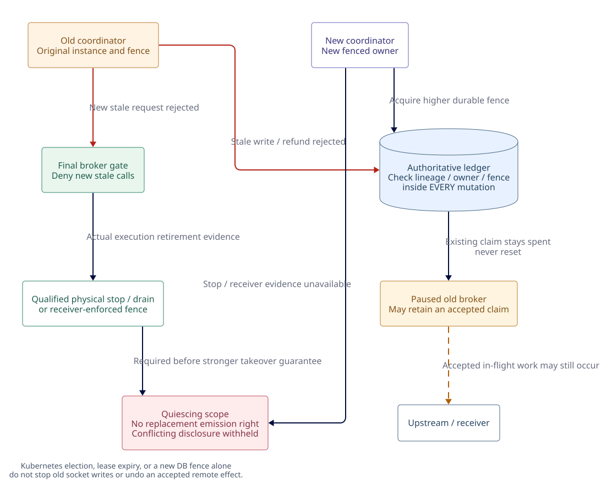
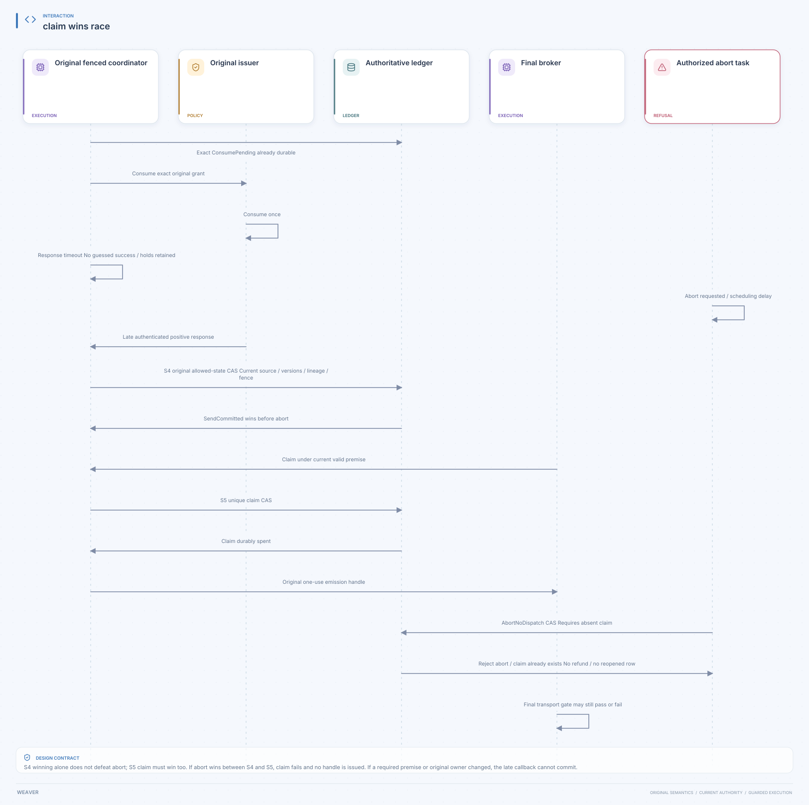

# SPDX-FileCopyrightText: 2026 hardenedlinux Linux Team and Contributors
#
# SPDX-License-Identifier: LGPL-2.1-or-later OR Apache-2.0

#+title: Weaver Source Admission, Durable Ledger, and Fencing Contracts
#+language: en
#+date: 2026-10-18
#+property: STATUS proposed-owner-extensions-not-implemented
#+options: toc:3

* Decision and scope

This document refines [[file:05-authorization-execution-protocol.org][Authorization-to-execution coordination]] into three
explicit owner contracts: runtime source admission, a durable coordination
ledger, and fenced ownership with conservative restart behavior. It replaces
the assumption that the existing preflight, backend descriptor, or numeric
fence is sufficient by itself. No code, physical transaction implementation,
RPC, native acceptance, or new proof is delivered here.

The inspected POO Flow revision remains
=a74fc2fd63437252175b5a67649ee54b886d3bf4=. Source IDs refer to
[[file:01-reference-comparison.org][Reference comparison and evidence]], including its distinct Core and Lambda
Aitia repository identities and the Core checkout/gitlink difference. Existing
tests were read, not executed.

The [[file:10-zero-trust-assurance.org][mandatory Quint and Lean framework]] binds this contract to cedar-poo-spec,
existing POO proof owners, explicit transition/refinement obligations and
concrete Scheme/Go/Rust evidence. FM1-FM12 remain pending. A source digest,
certificate constructor, bounded model run or proof of pure guards alone
cannot qualify the complete authorization-to-execution path.

* Source-grounded reuse and extension map

| ID | Existing source / exact symbol | Direct reuse | Required extension or binding |
|----+--------------------------------+--------------+-------------------------------|
| X1 | P16: =host-current-snapshot=, =invalidate-host-cut!= | Canonical cut checks; observed source change invalidates old local epochs | Authenticated source-owner incarnation and durable binding to the runtime/ledger generation |
| X2 | P16: =host-source-payload=, =host-materialized-inputs=, =host-handed-inputs-current?= | Read configured source, copy payload, hash before/after verifier handoff | Mandatory coverage of the selected input inventory and independent provenance/actual-process-input evidence where required |
| X3 | P16: =decision-preflight-bound?=, =assurance-host-preflight-decision= | Keep the undecided-candidate and currentness guard unchanged | Add a distinct owner-issued runtime admission for a fully evaluated eligible Decision; never promote preflight |
| X4 | P15: =assurance-effect-host-authorize!=, =reserve!=, =deliver!= | Serialized owner thread, local identity checks, strict expiry, one-shot reservation/delivery | Extend owner request validation to accept the new runtime-admitted family while preserving the existing preflight path's limits |
| X5 | P6: =Snapshot::prepare= | Capability lookup, schema/type checks, reserved context ownership, full subject/protobuf projection | A separate trusted preparation path for source-admitted actions, with equivalent validation and an owner-bound admission projection |
| X6 | P5: =Authority::issue=, =consume_proposal=, =consume= | Signed exact grants, issuer instance, pending-state removal, request/handoff binding | Trusted source-admitted issue/consume entrypoints; callback/RPC correlation and current-source guards; no weaker consume fallback |
| X7 | P17/P22: backend negotiation and store contract | POO-native backend selection and runtime handoff; existing append/checkpoint/job concepts | Versioned coordination capability contract for atomic multi-row state, idempotent mutation resolution, durable claims and fenced writes |
| X8 | P18/P19: =RecoveryEvidenceClosed= and authorized recovery bridge | Registry uniqueness, durable intent, exclusive claim, current recovery authorization, provenance joins | Physical meanings and runtime evidence for the parameterized validity relations; no all-true stub predicates |
| X9 | P20/P21: exactly-once owner and bridge | Existing completeness/multiplicity requirements | Upstream effect evidence if stronger replay/exactly-once mode is selected |
| X10 | P23-P25: Runtime client and focused test sources | Handshake generation, reply sequence/input identity, documented rejection controls | Cross-process restart, lease/ledger lineage, consume-timeout and stale-worker controls specific to this integration |

X1-X6 are extensions at existing POO owner boundaries, not permission for Weaver
to create a competing Governance or Cedar engine. X7-X10 bind those semantics
to a selected physical runtime and deployment. Scheme declares the public POO
contracts; Rust executes physical transactions and the constrained broker; Go
requests delegated cloud lifecycle actions and reports their actual state.

* Streaming use of the same owners

[[file:14-stream-message-authorization.org][The message-stream contract]] reuses X1-X10 at each complete child operation.
Its stream epoch, fixed escrow partition, queue credits and bounded offer intents
are extensions of X7/X8's physical coordination facet, not capabilities already
proved by append/checkpoint/job labels. P15 local reservation is not budget
allocation. P31/P43 retained recovery obligations must never become a runnable
stream resend queue. A durable seal fences new authority; stopping a previously
accepted offer still needs the same independent physical exclusion contract.
P12/P13 validation context must derive from the authoritative spent-state and
version: the pure transition does not compare its supplied spent context with
its own state, and an unknown observation can leave the root unchanged.

* Runtime source-admission bridge

#+caption: W06. Proposed source-admission bridge and protected consumption.

[[file:diagrams/06-source-admission.d2][D2 source]]. The undecided preflight branch terminates without runtime authority. The new
fully evaluated admission family remains an owner extension.

** Existing preflight remains inert

=decision-preflight-bound?= requires both Decision outcome and state to be
=unknown=. =assurance-host-required-support= explicitly leaves release
unauthorized. A current preflight means an undecided candidate is still bound
to supported evidence; it is not a current allow Decision. Source-current
preflight plus a caller-selected permissive Cedar policy does not fill that gap.

Keep =Snapshot::prepare='s rejection of =source_admission_required= actions,
caller =context.poo_flow=, and the presence of =poo_flow_preflight_only=,
including a false value. Do not delete markers, toggle capability metadata, or
send a trusted Boolean through the ordinary request path.

** New owner-issued runtime admission

The required Scheme owner extension evaluates the selected Decision's actual
policy, validity, authority, obligations and required-support evidence under
the existing admitted composition. It rejects deny, review, unknown, stale,
conflicted, or incomplete results. It produces a separate issued admission
handle only for that fully evaluated eligible result. It neither fabricates a
Cedar result nor treats its own eligibility as a runtime grant.

The baseline requires that this eligibility can be resolved without the very
grant it is supposed to admit. Reject circular profiles that require their own
effect grant as Decision evidence. A diagnostic/evaluate-only result remains
inert; using it in Decision evaluation needs an explicit owner-qualified staged
contract and exact input binding, not automatic preflight promotion.

In one process, the handle is identity-checked in an owner registry with strong
references while active. Across processes, a bounded authenticated service
dereferences that owner state, or a qualified signed attestation carries its
scope and freshness. A copied object, matching strings, or a signature from an
undelegated issuer cannot replace this lookup. Restart invalidates the old
owner incarnation; serialized fields cannot recreate an issued handle.

The conceptual admission binding includes:

- Tenant, intent, attempt, frozen request and handoff digest, capability, and
  designated coordinator/broker identity and audience.
- Source-owner incarnation, non-revivable local cut epoch, exact source and
  assessment/Decision identities, input inventory, and admitted semantic root.
- Policy/schema/entity/capability/publication identities and their projection
  versions; complete runtime context rather than a readable operation name.
- Ledger lineage, scope, expected history/budget state versions, active owner
  fence, source-validity contract, expiry, and one-use request correlation.
- Runtime/authority incarnation and selected evaluator/component identities.

This is a proposed projection of existing owners, not an implemented token
schema. Include the binding in the reserved runtime-owned evaluation context
and in the exact input digest and grant/effect linkage. Both engines receive
the same bytes. Revalidate the resulting schema and input; simply appending
metadata after evaluation leaves it outside the authorization subject.

Separate that fixed evaluation binding from a fresh per-use liveness guard.
The binding and its original maximum validity are hashed into the request before
evaluation and stay unchanged at consume. A later guard attests that the same
binding is still current for a named phase/challenge; it cannot extend the grant
or silently replace its source cut. Changing any subject-bound field requires
new evaluation and a new grant. Updating a timestamp inside the Cedar request
at consume would instead create a different subject and must be rejected.

** Issue, consume, commit and claim checkpoints

| Boundary | Required source-owner action | Runtime/ledger enforcement |
|----------+------------------------------+----------------------------|
| Before strict evaluation | Dereference runtime admission, materialize the selected exact input inventory, validate cut/Decision and validity | Authenticated role/audience, expected runtime/issuer and fixed projection versions |
| After evaluation / before grant issue | Recheck the same owner/cut/Decision after elapsed verifier time | Complete dual result and input identities; no grant on drift or error |
| Before consuming | Obtain a fresh guard for this exact issued grant/attempt and active source/runtime incarnation | Reproject full subject as well as handoff; use the same issuer and original grant |
| SendCommitted CAS | Supply a still-applicable owner-bound witness or qualified immutable source lease | Validate lineage/fence, expected versions, source-validity bounds, and positive consumption correlation |
| Dispatch claim | Revalidate current source admission or its explicitly valid immutable lease | Reject expired/changed owner, source binding, broker audience, or generation; no stale consumed result as authority |

The new trusted prepare/issue/consume paths reuse the current parsing,
reserved-context construction, schema validation, protobuf projection and
cryptographic functions. They must retain the stronger full-request re-projection
of =consume_proposal=; calling lower-level =consume= alone checks the signed
grant and exact handoff but does not reconstruct the complete Cedar request or
query the source owner. The new source checks wrap that same authority rather
than inventing another permit path.

** What source freshness can establish

P16's source reader is explicitly an application trust boundary. Matching
configured-reader bytes does not prove Git provenance, verifier executable
inputs, or the current state of a remote database. Reuse its copies and digest
checks while binding actual verifier inputs through the selected runtime owner.
Missing reader/inventory/provenance cannot be upgraded to a stronger claim.

The Host epoch changes when it observes a different cut. An unobserved A-to-B-to-A
change or process restart is not a durable monotonic source history. For a claim
about the latest mutable source, its source authority must expose a non-reused
revision/fence and participate in guarded admission. A signed timestamp alone
does not make mutable state immutable.

The first supported binding may use an immutable content-addressed cut with
explicit authority to operate against that snapshot, plus the current policy
and revocation view. It must not call that a latest-state guarantee. A mutable
source requiring atomic commit against its present state needs a guarded
source transaction, pin/lease that actually prevents incompatible mutation,
or receiver-enforced precondition. If the owner cannot supply it, that capability
stays disabled. Repeating a read immediately before sending does not close an
arbitrary external source mutation window.

* Durable coordination ledger contract

** Existing backend surface is not sufficient

P22 declares ledgers such as fact-log, checkpoint, job, artifact and communication.
Its capability inventory includes =append-fact=, =write-checkpoint=,
=claim-job-lease= and related operations. P17's descriptors and negotiation
receipts retain =runtime-executed #f=. Neither a capability string nor a Turso
descriptor's concurrent/local-first metadata proves serializable gateway state.

Add an owner-reviewed, versioned coordination facet to that contract, with a
negotiated physical runtime implementation. Do not advertise unsupported flags
through the current closed allowed-value validators or add an alternate backend
DSL in Weaver. No database product is selected by this document.

** Required records and unique keys

| Record | Identity and integrity rule |
|--------+-----------------------------|
| Ledger root | Non-reused lineage plus authenticated external generation/high-water anchor |
| Scope owner | Lineage, scope, coordinator incarnation, monotonic fence and lease version |
| Intent / attempt | Tenant-scoped canonical intent and unique attempt; immutable request/plan/source binding |
| Mutation | Caller role, operation kind, stable command ID and complete command digest |
| History / flow | Scope and policy epoch, monotonic state version, conservative pending disclosure/emission claims |
| Budget hold / usage | Domain, attempt, reservation, unit/capacity epoch, held/settled/unknown buckets |
| Consume correlation | Attempt, original issuer instance/key/generation, grant and full subject/input/handoff digests, command ID, response provenance |
| Send commit / abort | Attempt and transition version; mutually exclusive terminal send eligibility |
| Dispatch claim | At most one per attempt; exact broker incarnation, fence, operation and validity scope |
| Observation / settlement | Attempt, attributable observer, monotonic evidence and settlement IDs; independent submission/emitter/outcome/accounting state; no credential values |
| Protected response release | Principal/peer, session/range/sequence, current disclosure premise, release/unknown history |
| Tombstone / checkpoint | Retained terminal identities, claim/spent state, history restrictions and verified compaction position |

** Storage operations and linearization

Every mutating transaction first compares the ledger lineage, active owner
incarnation/fence and expected record versions at the authoritative store.
An expired lease, stale fence, zero affected rows or ambiguous commit is not
success. Check ownership inside the transaction, not only in an earlier read.

Owner acquisition and expiry use the selected authoritative lease clock/consensus
contract, not a caller's wall clock or observed network silence. Fence advance
is durable and strictly increasing within the lineage; never wrap or reuse a
counter. The deployment must qualify the storage authority and its own fencing,
not only application-row version checks.

| Operation | Single-store atomic changes |
|-----------+-----------------------------|
| Acquire owner | CAS prior owner/lease version; persist strictly advanced fence and new incarnation; never alter old attempt claims |
| Prepare | Register immutable attempt, reserve maximum budget, install pending flow state and append audit/transition event |
| Mark consume pending | Record the one exact consumption command and issuer binding; no send authority |
| Commit send | Expected-state CAS, authenticated positive consumption binding, all holds/source witnesses, durable audit and exact send intent |
| Abort no dispatch | CAS only from an allowed unclaimed state, write irreversible no-dispatch tombstone and release provably unspent holds atomically |
| Claim dispatch | CAS SendCommitted with no claim, current role/source/flow/fence; persist unique claim and conflicting emission state |
| Record observation | Deduplicate exact event and evidence digest; monotonic independent submission/emitter/outcome fields; observation alone does not release holds |
| Close emission | Admit qualified no-future-submission evidence for that claim; retain business-outcome and budget uncertainty independently |
| Settle / adjust usage | Current authorized owner verifies named evidence and bucket version; move each unit once; no repeated release from duplicate/older observations |
| Admit response release | Check peer/range, semantic disclosure premise and shared conflict gate; install restrictive release/unknown history before bytes escape |

An owner transaction may fail after grant consumption; the safe orphan remains
the default. No transaction includes the external network send. The existing
issuer is not assumed to enlist in this store. Claim replies never authorize
another broker or reconstruct an emission handle after failure.

** Idempotent mutations and uncertain commits

Every retryable ledger command has a stable ID scoped to authenticated caller,
lineage, operation and attempt. The store binds it to the entire command digest
and returns the same durable outcome for identical duplicates; a changed payload
under the same ID is rejected. A linearizable query resolves a lost commit reply.
An eventually consistent replica, empty cache, or local log tail is insufficient.

A historical successful command result is not proof the attempt is still
send-eligible. Subsequent abort, owner change or claim can make it ineligible;
the broker always obtains its current fenced claim through the live state
machine. Status resolution is a scoped read, never implicit restoration of the
old caller's mutation or emission authority.

Replaying a stored ClaimDispatch result returns evidence that a claim exists,
not another local emission handle. If the original one-use reply was lost and
delivery cannot be established without duplicate capability delivery, the
conservative outcome is unknown/no redispatch. This restriction is intentional.

No response permitting dispatch, credential release, protected data release or
budget reuse precedes the required durable commit. Corruption, truncated log,
failed fsync/replication or missing state denies that operation and quarantines
the affected domain. A checksum-valid prefix cannot prove that a later claim or
abort never existed.

** Failure evidence and authorization of cleanup

A stale broker may submit attributable evidence through a bounded observation
inbox, but cannot mutate settlement state directly. The current fenced owner
validates the original attempt/claim/observer provenance and current recovery
role before admission. Duplicate event IDs with different digests are rejected;
duplicates with identical digests do not release budget twice. Success/failure
and emitter closure must not overwrite each other through a last-writer-wins
status field. Contradictory trusted observations quarantine the attempt pending
owner-specific reconciliation.

Evidence admission, cleanup, abort and settlement are effects under separate
service/recovery capabilities. They do not consume the old application grant
again or require its expired execution permission to reconstruct authority.
The minimal service path is bound to the attempt and may only tighten unknown
exposure or apply owner-validated accounting evidence. Failure or revocation of
that service authority retains holds/restrictions; it never grants dispatch.
A result claiming more than the admitted upper bound freezes new admission and
records the over-limit violation without hiding usage. Hard-cap safety still
requires the provider/enforcement premise defined at S1.

NoSubmissionProven after a claim requires handle/queue retirement and no actual
application submission, not just a failure cause. Its successful settlement
retains the spent claim. Emission closure can release a disclosure conflict
while preserving unknown budget; business success cannot prove emitter closure.
See [[file:05-authorization-execution-protocol.org][orthogonal states and S5/S6]] and W07.

** Restart, rollback and compaction

Recover the verified committed journal position, owner high-water mark and all
pending/claimed attempts before admitting new work. Local monotonic clock values
cannot be replayed across process/host restarts; obtain a fresh clock/lease view.
Reconstruct facts and restrictions, not Scheme handles, Rust pending grants,
broker emission handles or prior release permission.

Backup restoration or cloned VM/disk images must not produce two active stores
or reuse an old fence floor. Reconcile with an independent non-rollbackable
lineage/fence authority, or establish a qualified all-old-executors-stop barrier
and issue a new lineage that old credentials/gates cannot use. Preserve old
attempts conservatively for recovery; do not reset their identities to Proposed.
If neither control is available, recovery remains read-only/quarantined.

Checkpoint/compaction may not remove spent/aborted/claimed identities, unsettled
budget or restrictive history merely because a grant TTL or owner lease expired.
Retain sufficient tombstones and high-water evidence to reject every still-live
replay. An unresolved old emitter can outlive a lease. Qualify any retention
bound against actual capability retirement, replay windows and source policy.

** Spent membership and observation recovery

[[file:15-authoritative-spent-state.org][The exact P13 review]] requires authoritative membership/context alignment and
full revision/fence publication even when execution-root stays unchanged. Preserve
spent facts and original logical-operation identity through unknown results,
replica competition, compaction and image restoration. Fresh P5 construction is
a different case from a retained old pending map or P15 registry image. A late
observation is appended under its own authority; it cannot reconsume a token or
retroactively manufacture missing S4/S5 permission.

* Three distinct fencing boundaries

#+caption: W05. Ledger, broker gate, and physical effect fences.

[[file:diagrams/05-fencing-boundaries.d2][D2 source]]. An old broker that has already passed the gate can still emit. A stronger
takeover guarantee requires a verified physical stop or receiver enforcement.

Numeric equality across epochs is not authority. Keep source cut/epoch,
publication revision, Rust issuer instance, RuntimeHello generation, coordinator
fence, history version and broker incarnation as distinct typed identities.
An unchanged signing key or reused runtime_generation cannot join them by itself.

| Boundary | Enforcer | What it prevents | What it cannot prove |
|----------+----------+------------------+----------------------|
| Ledger writer fence | Authoritative storage transaction | Old coordinator mutations, claims, releases and settlements | An already accepted emitter cannot write to an old socket |
| Final broker gate | Isolated credential/egress holder | Old callers obtaining new emission rights; arbitrary payload/credential use | An already accepted syscall/queued operation is recalled by a new database value |
| Receiver/effect fence | Qualified upstream or final enforcement substrate | Stale operations at actual effect acceptance under its contract | Generic HTTP services honor an invented fence header |

The runtime supervisor owns actual process/socket/isolation lifecycle. Go may
request replacement and publish observed state, but Kubernetes leader election,
Pod deletion requests or elapsed lease time are not proof that the old broker
and all delegated emitters are stopped. Bind stop/drain evidence to actual
incarnation, descendants/delegated handles and transport resources; a reused
PID or matching worker name is insufficient.

In the conservative mode, a stale coordinator's later CAS is rejected, but an
old DispatchClaimed row stays spent and holds its exposure. A successor cannot
redispatch it. A restarted broker receives a new incarnation and no old local
handle; a merely paused old broker may still complete previously committed
in-flight work. Do not describe that as fresh authorized work after restart.

If the deployment requires that a paused old broker cannot emit after takeover,
it must provide receiver fencing or a qualified physical stop/drain barrier
before activating a successor for that scope. Until that evidence exists,
the scope remains quiescing and conflicting sensitive disclosures remain
withheld. The barrier proves cessation of future local application submissions,
not absence of packets already queued or remote effects already accepted.
Stronger packet-time or remote-effect ordering is a separate receiver/network
contract. Never infer no business effect from process termination.

* Consume timeout: exact recovery decisions

#+caption: W04. Consume reply timeout with the abort transaction winning.

[[file:diagrams/04-consume-timeout.d2][D2 source]]. This view selects the abort-winning schedule. It does not establish the
competing claim-winning schedule; the decision table below defines both.

=Authority::consume= is currently a synchronous in-process mutation; the
evaluation RuntimeClient is a different protocol. A network consume timeout is
a property of the proposed wrapper/crash boundary, not an existing issuer status
API. =grant-consumed-or-unknown= is a refusal, not a durable consumption receipt
and not a delivery observation. =AuthorityInfo.pending_grants= is only a count.

| Observation / race | Required action |
|--------------------+-----------------|
| Consume request definitely not submitted | Abort through the ledger CAS; no direct refund from a client assumption |
| Issuer consumed, positive reply lost | No SendCommitted from guessed success; terminate unclaimed attempt or use a separately qualified issuer status extension |
| Timeout then late positive callback | Callback must match attempt/command/issuer/lineage/fence and win the original allowed-state CAS; an abort or owner change makes it non-authoritative |
| Abort reply lost | Keep holds and restrictions until a linearizable read resolves that exact command; do not assume abort won |
| Late commit races with abort | The store selects one order; claim absent and allowed state are checked inside abort CAS; a claimed attempt cannot be refunded |
| SendCommitted reply lost | Query the durable command/attempt; never rerun issue/consume or network send as a commit retry |
| Dispatch claim reply lost | Claim remains spent; query returns evidence only, not a second emission handle |
| Issuer process recreated with same key/bootstrap | Fresh random Authority instance rejects the old grant; never replay pending state or convert rejection into permission |
| Old issuer/worker resumes from a memory image | Its old instance may still exist; ledger lineage/fence, terminal states and broker gate must reject new work; recreation tests alone do not cover this case |

#+caption: W09. Late consumption, send commitment, and claim win before abort.

[[file:diagrams/09-claim-wins-race.d2][D2 source]]. This complementary schedule has a valid positive response and
current commit/claim premises; timeout alone never supplies those premises.
W09's response timeout is a per-call timeout, not permission to exceed the
original end-to-end deadline. A late positive result is usable only while the
original deadline, source/owner premises and uncancelled attempt remain valid.
An authoritative cancellation or expiry ordered before S4/S5 blocks those
transitions; a cancellation request still in transit is not a committed abort.
If abort wins before claim, no emission handle exists. If claim wins, abort
cannot erase that possibility or release its exposure.

The first implementation need not add durable issuer consume-status. Aborting
safe orphans closes safety while sacrificing availability. If later introduced,
that API must bind request digest, issuer incarnation, one consumption outcome,
authorized status-reader role and its own durability/rollback contract. It cannot
reissue the grant or create a broker handle. Do not silently assume the API in
the base protocol.

* Restart and old-worker decision matrix

| Restart boundary | Directly reusable existing behavior | Required coordination behavior |
|------------------+-------------------------------------+--------------------------------|
| Scheme verification/effect Host | Identity tables/owner thread reject foreign or copied local objects | New incarnation; reacquire source and Decision admission; no deserialized handle reuse |
| Rust Authority recreated | Random instance and empty pending map reject old grants even with same key | No old positive consume callback may authorize a new attempt/incarnation |
| Evaluation Host replacement | RuntimeHello/reply generation and input/sequence binding | Reconnect through a newly qualified authority; do not assume safe continuation of the old client/receipt lifecycle |
| Coordinator crash with unclaimed attempt | No existing POO claim of durable ledger recovery is assumed | Recover verified journal first; resolve or terminally abort; never refund from missing process memory |
| Broker crash after claim | No old local handle recreated | OutcomeUnknown unless attributable result; no automatic send replay |
| Old worker resumes after new owner acquired | POO formal claim requires exclusive validity, not merely matching fence numbers | Reject stale writes and new broker calls; retain existing spent claim and exposure |
| Whole store restored from backup | Backend descriptor is inert; hash-chain prefix is not rollback protection | External high-water/lineage reconciliation or qualified stop-and-new-lineage barrier; otherwise quarantine |

Fresh recovery authorization follows P18/P19 for the exact canonical request,
worker/provider assignment, active fence and responsibility scope. Settlement,
result inspection, abort and resend are distinct operations with distinct
permissions. Fresh authorization to inspect or settle an old attempt cannot
resurrect its send claim. Receiver-qualified idempotent replay uses the separate
mode in the coordination protocol and must still retain the original effect key.

* Extension ownership and completion criteria

| Extension | Owning implementation surface | Required completion evidence |
|-----------+-------------------------------+------------------------------|
| Runtime Decision/source admission | POO Flow Assurance/Authorization owners | New issued-family semantics, source inventory/provenance, process incarnation and use-time validation |
| Protected prepare/issue/consume bridge | Existing Cedar binding/authority owner | Exact subject/full-response binding and unchanged ordinary/preflight rejection controls |
| Coordination ledger facet | POO durable-store contract plus selected physical backend owner | Multi-row atomicity, idempotent commands, corruption/restart/restore and fenced-write controls |
| Final broker and supervisor barrier | Selected Rust runtime/execution owner; Go only under equivalent qualification | No bypass egress, one emission handle, stale worker and actual stop/drain/receiver-fence evidence |
| Recovery refinement | Existing POO recovery/proof owners plus consumer integration | Concrete validity relations, canonical request/provenance, no replayed permission and no all-true assumptions |

The source-to-design decisions X1-X10 are explicit reuse/extension choices.
Their executable tests are SF1-SF12 in the validation plan, all pending.
No affected capability is enabled merely by completing this document.

* Source-to-execution assurance refinement

[[file:11-source-to-execution-assurance-review.org][The detailed FM1-FM12 review]] is normative for proof reuse and correspondence.
It distinguishes physical/authoritative state from caller knowledge, defines
required concrete-event joins and gives each FM property's premises, specified
counterexamples and acceptance evidence. Conditional POO effect/recovery
statements do not construct a durable claim or prove physical retirement.
Progress budgets/history do not substitute for cost/disclosure conservation.
The limited P30 guard checks passed under two compilers; Cedar integration,
Weaver dev/models/refinement and physical qualification remain pending.

* Anchor, durable recovery and actual egress refinement

[[file:19-anchor-recovery-and-egress-contract.org][The anchor/recovery/egress contract]] specifies independent anti-rollback
identity, immutable canonical operation resolution, full state materialization,
seal-before-publication and actual-writer/receiver cut semantics. Checked
Quint/Lean artifacts distinguish blocked new delegation from accepted-buffer
drain; old raw sockets, co-rolled-back owner state and unauthenticated epoch
relabeling remain explicit counterexamples. The physical acceptance register
remains pending; no callback, cached status or capability flag supplies it.
