#+title: Weaver Code as Policy and Cedar Integration
#+language: en
#+date: 2026-10-18
#+property: STATUS required-baseline-source-reviewed-not-runtime-qualified
#+options: toc:3

* Decision and terminology

Code as Policy is a mandatory part of Weaver's Zero Trust architecture.
The term here means a versioned, reviewable, machine-evaluated policy program
with explicit source ownership, admitted artifacts, exact runtime inputs and
qualified enforcement. It includes Policy as Code practices, but does not make
arbitrary application code, an agent prompt, a code signature, or a diagram an
execution permit. Governance remains broader than Cedar authorization.

The policy language and Provider are named Cedar in the inspected sources.
Scheme/POO composition and cedar-poo-spec exports retain their existing owners;
Cedar is the explicit Provider for the selected Cedar-backed capabilities.
An alternative Provider requires its own admitted capability contract, never a
fallback chosen after Cedar fails.

All implementation observations below refer to the exact source identities in
[[file:01-reference-comparison.org][the evidence register]]. The initial review made no fresh native/build acceptance claim. Subsequent
scoped owner/native results are recorded in
[[file:12-fm1-baseline-and-runtime-qualification.org][the qualification record]]; no Weaver deployment or performance result is claimed.
The subsequent read-only standalone guard-proof checks are separately scoped
in [[file:11-source-to-execution-assurance-review.org][the source-to-execution review]]; they do not compile the Cedar proof closure.

The [[file:10-zero-trust-assurance.org][mandatory Quint and Lean framework]] binds this contract to cedar-poo-spec,
existing POO proof owners, explicit transition/refinement obligations and
concrete Scheme/Go/Rust evidence. FM1-FM12 remain pending. A source digest,
certificate constructor, bounded model run or proof of pure guards alone
cannot qualify the complete authorization-to-execution path.

* Why Cedar belongs in the gateway

** Decision and selection criteria

Select Cedar as the authorization language and evaluator foundation for governed
effects, with cedar-poo-spec as the existing semantic/proof dependency. It gives
Weaver one explicit meaning for a permission decision across Scheme, Go and Rust.
The decision is based on the gateway's authorization problem and the foundation
already owned by POO, not on a language-fashion choice, an upstream architecture
copy, a vendor name or a claim to be the fastest policy engine.

| Gateway requirement | Why Cedar fits | Weaver still owns |
|---------------------+----------------+-------------------|
| Authorize one precise agent/tool/model operation | Principal, action, resource and context model the subject of the decision; entities express application facts and relationships | Authentic identity/delegation, actual target/payload and complete fact projection |
| Deny unless explicitly permitted; retain hard restrictions | Default deny and forbid-overrides-permit provide explicit conflict rules | Correct mandatory root/layer composition and no bypass around the evaluator |
| Review and evolve permissions separately from transport code | Declarative policy programs, schemas and full decision diagnostics make changes inspectable | POO ownership, publication admission, invalidation and rollback controls |
| Connect implementation checks to a precise specification | Upstream Cedar has a Lean formalization and differential testing against Rust | Exact consumer correspondence and independent negative vectors |
| Reuse current project work | cedar-poo-spec already owns policy composition/export, bound operations and error-free receipt predicates | Source admission, durable coordination and physical execution enforcement |

The [[https://docs.cedarpolicy.com/other/security.html][Cedar security reference]] describes default deny and forbid precedence.
The [[https://github.com/cedar-policy/cedar-spec][Cedar specification project]] supplies the formalization and differential-test
infrastructure. Those are concrete foundations for our selection; they do not
certify Weaver's policy intent, supplied facts or final network effect.

Cedar is not the whole Governance framework. Scheme/POO owns the extensible
governance model, composition and source/lifecycle contracts. Cedar answers the
selected permission questions. Stateful budget conservation, restrictive history,
durable claims and actual egress remain separate enforcement responsibilities.
A gateway-specific Boolean authorization language in Go or Rust would duplicate
that meaning and weaken the cross-language boundary.

#+caption: Cedar inside Weaver: permission meaning, stateful coordination and physical enforcement.

[[file:diagrams/13-policy-to-execution.d2][D2 source]]. This is the proposed core design. Qualification and dependency
receipts are kept in their owning Org sections rather than on the diagram.

** Why it is Code as Policy here

The policy program is executable security logic with declared inputs and
reviewable outcomes. POO authors and composes the governance model; its admitted
Cedar policy/schema/entity closure is evaluated against an exact operation.
Transport code cannot invent a permission branch or infer authority from an
internal network address, a Kubernetes status or an agent's own description.

Schema validation helps detect policy/type mistakes under its stated input
assumptions. It does not authenticate a principal, make an entity fact current,
or guarantee the facts describe the bytes being sent. See the
[[https://docs.cedarpolicy.com/policies/validation.html][Cedar validation contract]]. An operation's supplied input must satisfy the
admitted projection and source contract at use time.

Cedar uses skip-on-error evaluation and reports diagnostics. Weaver's protected
execution profile additionally requires allow AND no policy errors across all
required checks. We enforce the existing cedar-poo-spec allowed/layersAllowed
meaning; we do not change Cedar's language semantics. The
[[https://docs.cedarpolicy.com/auth/authorization.html][authorization reference]] explains why applications must inspect diagnostics.

** Why formal methods are required, and what they cannot promise

An ordinary unit test can exercise allow/deny. It does not enumerate arbitrary
message delay, two concurrent claims, a lost consume reply, a restored ledger
or a paused old worker. A security policy can be correct while its integration
sends the wrong bytes or sends twice. The assurance design therefore has three
complementary responsibilities:

- Cedar's formal semantics and owner-maintained Lean definitions give the
  permission decision a precise meaning. Consumer proofs must preserve that
  meaning and bind the whole required operation/check inventory.
- Quint explores concurrent state transitions and fault schedules: consumption,
  commit, claim, physical submission, observation and recovery remain distinct.
  Counterexamples expose missing guards under explicitly stated bounds.
- Lean states and proves invariant/projection/preservation obligations beyond
  individual test samples. Real runtime tests must then qualify the assumptions
  about storage, source authenticity, clocks, credentials, transport and workers.

Upstream uses formal modeling together with differential testing; it does not
make every production component universally verified. See the primary
[[https://arxiv.org/abs/2407.01688][verification-guided development paper]]. Weaver must likewise distinguish
proved model properties, checked implementation samples and external premises.
The detailed contracts belong to [[file:10-zero-trust-assurance.org][Quint/Lean assurance]] and
[[file:11-source-to-execution-assurance-review.org][source-to-execution correspondence]].

** Adoption costs and explicit limits

Cedar is the selected authorization kernel, not a claim that it dominates every
policy language or removes integration work. Existing POO/Cedar ownership is a
major reason to reuse it here. A future alternative must be judged against the
same operation model, proof boundary and enforcement requirements, rather than
introduced as an error fallback.

- POO composition must map completely to the supported Cedar roots/checks;
  omitted layers or a weakened projection can invalidate an otherwise correct
  evaluator result.
- Authentic facts, currentness, delegation, history and budget serialization
  are not supplied by Cedar's language or schema validator.
- The proof covers stated definitions/properties under explicit premises;
  parser/native glue, cryptography, storage, clocks and transport need their
  own evidence. A privileged compromised broker cannot certify itself safe
  merely by producing a local allow result.
- Bounded input/resource contracts and matched performance measurements are
  still required. Formal assurance is no throughput claim, and selecting Rust
  is no proof that a protected path is fast.

** Concrete design example: internal read versus external model use

An agent may be permitted to read an internal document without being permitted
to send its content to an external model. These are different operations with
different resources, actions, recipients and disclosure obligations. An agent's
own assertion that the content is public is not an authentic classification.

Cedar expresses the permission predicates for the read and the proposed send.
The source owner authenticates the facts; POO Flow/Governance preserves the
restriction caused by the read; the shared history/budget ledger coordinates
concurrent effects; and the broker mediates the final credentialed send. A
policy allow produced before a conflicting sensitive read cannot bypass the
current disclosure gate.

Similarly, two agents may both observe sufficient budget and each receive an
otherwise correct permission decision. Without atomic holds they can overspend
the same capacity. Cedar meaning alone does not solve that race. Quint must
explore the interleaving, Lean must state the conservation/preservation contract,
and the real ledger must implement its serialization premises.

Formal checking runs outside packet forwarding. The runtime follows the
admitted assurance profile and performs its required live checks. If that
profile requires dual evaluation, it remains part of the contract; performance
work cannot silently drop an evaluator, source guard or durable obligation.

** How this supports Zero Trust in the gateway

Zero Trust's strength here is continuous explicit mediation, not the Cedar
name or the presence of a proof tool. The gateway is where a declarative
operation becomes a credentialed external effect, so it must close that chain:

1. Authenticate the actor and bind the exact operation to current source facts.
2. Evaluate every required policy check; deny/error/unsupported input creates
   no executable grant.
3. Consume the original scoped grant and commit history, budget and source
   obligations in the authoritative ledger.
4. Claim one dispatch attempt, recheck the final target/credential/lifetime gate
   and prevent unmediated transport or a replayed local emission handle.
5. Admit outcome, closure and usage independently, then apply the separate
   disclosure gate before releasing protected response bytes.

Scheme owns meaning; Go owns cloud/protocol integration and scoped observations;
Rust owns the reference physical coordinator, ledger adapter and broker guards.
None of those roles may manufacture authority for the others. Cedar supplies the
authorization kernel inside this architecture; the whole chain supplies the
Zero Trust enforcement contract. This remains a design requiring qualification,
not a claim that the new gateway is already secure or implemented.

* What is already implemented and what is missing

| Foundation | Existing implementation evidence | Weaver boundary / extension |
|------------+----------------------------------+-----------------------------|
| POO public composition and Provider boundary | P1/P2 declare Governance and explicit Authorization ownership | Reuse POO-native values; no second Go/Rust policy composition language |
| Policy artifact/export and schema-bound replay | C3-C5/C9 expose export, validation and replay APIs | Exact supported feature/ABI mapping and artifact closure admission still need consumer qualification |
| Strict policy/schema/entity projection | P6 parses policies, preserves stable IDs, rejects conflicts, applies strict validation and builds the complete request | Protected source-admitted preparation is absent; ordinary paths deliberately reject it |
| Independent Rust/Lean evaluation | P4/P23 invoke both evaluators on bound input and compare complete outcome identities | Agreement is necessary but not a proof of current source truth or physical execution |
| Signed receipt and one-use grant | P5 binds subject, input, handoff, issuer instance, runtime and epochs; consume removes pending state | No atomic issuer/ledger transaction, durable consume-status or final egress broker follows from that code |
| Serialized local effect lifecycle | P15 owns currentness, reserve/deliver and non-durable acknowledgment | New evaluated source family, callback integration and physical delivery evidence need owner extension |
| Compound semantic admission | C10 defines exact nonempty Receipt.allowed with allow decisions and empty error IDs | Enforce that predicate explicitly; authorizeAll/BoundOperation.authorize receipt construction alone is insufficient |
| Error-free case check | P27 explicitly rejects nonempty erroring policy IDs in case qualification | P5/P23/P26 do not establish equivalent rejection in runtime issue; add it to the protected executable path |
| Recovery/effect proof interfaces | P18-P21 state registry, exclusive claim, evidence and multiplicity obligations | Bind parameterized relations to the real ledger, broker and receiver; no all-true predicates |

Existing source therefore supports reuse of substantial Cedar and POO machinery.
It does not establish that Weaver's source-admitted authorization-to-execution
chain is implemented. Keep X1-X10, SF1-SF12 and CX1-CX18 as explicit pending work.

* Admitted policy program and artifact closure

#+caption: W08. Code as Policy from owner admission to final enforcement.

[[file:diagrams/08-code-as-policy.d2][D2 source]]. A policy is admitted with the following dependency closure:

- POO authoring source and composition root; contributor delegation, parent
  baseline and exact policy/profile/capability revisions.
- Cedar policy sources/exported representation, stable policy IDs, schema and
  entity snapshot; supported operators/extensions and full input dependencies.
- Projection/canonicalization version and source-to-artifact provenance; exact
  evaluator/Host artifact, semantic revision and required assurance mode.
- Failure and diagnostic admission profile, source-validity contract, authority
  generation, publication/revocation floor, validity and scope.
- Operational obligations and bindings: history domains, maximum budget units,
  audit requirements, transforms, credential/target scope and response releases.
- Review/replay/proof references with source/toolchain identities and explicitly
  stated validity assumptions; a historical green receipt is not a current permit.

Immutable policy artifacts and mutable operation facts are distinct. A mutable
entity/source update creates the required new snapshot/generation under its
owner contract; a request may not splice a new entity set into an old approved
closure. A counter exported to Cedar is a fact projection, not its reservation.
S4/S5 still enforce shared-state versions and resource holds atomically.

Authoring admission verifies actual contributor authority and mandatory parent
constraints before publication. Validation covers the selected closed feature
set. Unsupported schema, AST, extension, ABI or security-critical field rejects
activation. Go may distribute the already admitted closure and report observed
generation; neither a delivery ACK nor Programmed status replaces validation.
An old but signed closure cannot bypass the independent anti-rollback floor.

Compilation, replay and materialization execute in bounded authoring/build
contexts without runtime credential or signing authority. Tenant code may not
install arbitrary native callbacks in the broker or select a permissive runtime
configuration. A hash proves byte identity only under its acquisition contract;
it does not confer contributor authority or source provenance.

* Cedar semantics and Weaver's stricter execution admission

Cedar's [[https://docs.cedarpolicy.com/auth/authorization.html][authorization semantics]] use explicit permits, forbid precedence and
default deny. An erroring policy is skipped in its evaluation result, with errors
reported in diagnostics. An allow result can therefore carry diagnostics that
an application chooses to reject. The [[https://docs.cedarpolicy.com/policies/validation.html][schema-validation contract]] reduces errors
under its input assumptions; it does not remove the need to validate live inputs.

Weaver preserves that Cedar result and adds an application execution gate:

#+begin_example
executable_admission =
  admitted_policy_closure
  AND current_owner_issued_runtime_admission
  AND complete_bound_required_evaluator_witnesses
  AND same_exact_subject_input_and_full_diagnostics
  AND Cedar_decision_is_allow
  AND erroring_policy_ids_are_empty
  AND required_obligations_are_supported
#+end_example

This expression is a design predicate, not implemented code or a replacement
Cedar evaluator. P5's current issue path branches on deny/allow after witness
agreement; P26 permits identical nonempty erroring-policy IDs. P27's case-only
check must not be mistaken for runtime enforcement. Add the explicit gate before
a grant is exposed by the new trusted issue path. A consumer also checks the
signed full result; it must not strip diagnostics or trust a Boolean summary.
Keep protected execution unavailable until that owner extension is qualified.

Do not convert the diagnostic failure into a fabricated Cedar deny receipt.
Record the original Cedar decision/diagnostics and the distinct Weaver
=EvaluationFailed= admission result. A deny, disagreement, malformed reply,
unsupported feature or expired witness cannot select a fallback evaluator,
weaker assurance mode, unversioned policy function or cached allow.

Even error-free admission is insufficient to send: consumption, current fenced
S4 commit, S5 claim, final transport gate and response-release mediation remain
independent requirements. The source-owner guard and full subject cannot be
replaced by a policy that permits everything. Policy code cannot retroactively
reclassify an unknown send as absent or reclaim its budget.

* Policy-to-wire contract: why an allow cannot be bypassed

The binding unit is the exact governed operation, not an HTTP listener, a
Service name or a Boolean allow. Its admitted representation carries tenant,
actor/delegation, action/tool/model, recipient constraints, payload or bounded
stream contract, credential scope, lifetime, policy/source identity and required
history/budget/disclosure obligations. The interface contract is specified in
[[file:02-interfaces-and-policy.org][Unified interfaces and policy]]. This is not a new wire format.

| Link | What must remain bound | Owner that enforces it |
|------+------------------------+------------------------|
| Normalize to authorize | Actual method/tool, recipient, payload and authentic facts; all policy-required questions are present | Go/Rust adapter plus Scheme projection/source owner; Rust authority checks the complete input |
| Authorize to consume | Original issuer, full error-free result, exact subject, runtime incarnation and one-use grant | Authority/Host with Scheme's reservation and callback lifecycle contract |
| Consume to durable commit | Positive consumption evidence, current source/history cut, held budget, audit obligation and exact send intent | Rust reference coordinator and fenced ledger; Scheme defines valid semantic transitions |
| Commit to claim | The same durable attempt and current owner; a unique claim can only yield one local emission handle | Ledger and constrained broker; controller election cannot replace this fence |
| Claim to transport | Frozen bytes or admitted stream operation, permitted endpoint/TLS identity, credential scope and remaining deadline | Final broker with exclusive application credential access and constrained egress |
| Result to release | Actual receiving peer, permitted content/labels and authorized stream range | Response gate and its source/history owner, independently of request allow |

The broker consumes a qualified local emission handle and derives the actual
send from the bound operation. It does not accept an arbitrary URL/body paired
with a reusable allow receipt. Secrets remain in the constrained broker role;
the adapter, agent and controller cannot invoke an unrestricted alternative
transport. Deployment credentials, egress controls and receiver contracts must
make this complete-mediation premise true. A diagram or signature cannot make
it true in a deployment with another permitted bypass path.

Protocol normalization occurs before the bound permission decision. Any
subsequent transform must be admitted as part of that operation's contract;
otherwise changing its target, semantic headers, tool arguments or payload
requires a new operation. DNS resolution, TLS peer selection and pooled
connection reuse must satisfy the admitted recipient constraints at use time.
A redirect or provider-client retry is another application attempt unless the selected
protocol contract explicitly proves otherwise; the conservative profile disables
invisible retries and redirects. Never reuse a spent claim to hide them.

For streaming input, either acquire a bounded complete payload before deciding
or use an explicitly admitted session with per-message/checkpoint constraints.
A digest of future bytes is not evidence of their content. Once a stream is
active, cancellation, deadlines and revocation follow that profile's physical
transport contract; a control-plane flag cannot retract bytes already emitted.

The last gate is therefore necessary even after a valid policy decision and
ledger commit. Its failure spends the existing claim without sending; retirement
and accounting evidence are still required before releasing exposure. A timeout
leaves the outcome unknown. There is no general atomic transaction between the
ledger and an external socket, and no instantaneous revocation guarantee across
a paused broker and an accepted syscall. The exact residual window and stronger
stop/receiver-fence conditions remain in
[[file:05-authorization-execution-protocol.org][the canonical execution protocol]].

** Example: route churn during an agent tool call

Go discovers an internal tool endpoint and the agent requests an operation with
a restricted document. Cedar may permit that tool action under the admitted
recipient/classification facts. If a route update selects an external provider,
the old authorization cannot follow it merely because the logical tool name is
unchanged. The broker checks the actual destination against the bound scope;
a changed disclosure boundary requires new admission. An provider-client retry after a
lost response cannot reuse the prior claim. Quint models these update/send and
retry/recovery interleavings; Lean states the binding and conservation laws;
the Go adapter, Rust broker and deployment must preserve their concrete premises.

* Concrete adapter enforcement refinement

[[file:13-go-adapter-broker-boundary.org][The focused adapter/broker contract]] closes the gap between one client API
call and actual application submission. It specifies Scheme-owned semantic
validators, immutable Go handoff, Rust-side binding checks, no implicit extra
effects and separate stream-start/range authority. Scheme meaning that has no
qualified runtime projection/validator remains unsupported, not a trusted
Boolean supplied by the adapter. Its named safety properties map these seams
to the existing Quint/Lean FM obligations.

* Enforcement and language responsibility matrix

| Boundary | Scheme / POO owner | Go integration / adapter | Rust reference runtime | Required failure behavior |
|----------+--------------------+--------------------------+------------------------+---------------------------|
| Author and approve | Compose policy, delegation, evidence and obligations | Propose scoped observations/changes | Validate artifact/runtime compatibility | Unauthorized or unsupported closure stays inactive |
| Activate | Supply admitted semantic closure | Distribute and report actual per-instance generation | Check roots, baselines, feature set and rollback floor | No partial permissive activation |
| Evaluate S2 | Own eligible Decision/source admission, exact projection and lifecycle | Supply authenticated protocol facts, never allow-shaped objects | Existing Provider/Host plus new error-free protected issue gate | No grant on deny/error/stale/unknown |
| Consume S3 | Reserve once; pending-before-deliver; respect serialized synchronous callback contract | Propagate cancellation as a request, not evidence | Original issuer consumes once on exact subject | Timeout is unknown; no guessed success |
| Commit S4 | Define current semantic transition and own-version derivation | No authority to choose/reset ledger fence | Active owner atomically checks holds/history/audit/source and commits | Ambiguous result resolves exact command; no direct refund |
| Claim and send S5 | Supply supported claim premise or qualified immutable lease | If final broker, pass the same isolation/dispatch qualification | Claim once, retain one local handle, verify destination/credential/deadline | No replay; post-claim failures retain spent claim |
| Observe and release S6 | Define acknowledgment, disclosure and accounting evidence semantics | Return protocol/status without changing outcome meaning | Separate emitter/outcome/usage/release records; enforce range/peer gate | Unknown usage retained; result does not imply emitter closure |
| Recover/administer | Define separate service/recovery capabilities and provenance joins | Request drain/replacement and expose actual observed status | Fence old writers, validate evidence and preserve claims | Controller status or stale evidence cannot restore authority |

Rust implements physical guards and transactions defined by these contracts;
it must not silently introduce business policy through conditionals. Go's value
is network/cloud ecosystem integration and qualified connectors. Scheme's value
is extensible semantic composition and lifecycle ownership. Moving a role between
languages retains every guard and its compromise boundary; source language is
never a grant of trust.

* Cross-review outcomes and verification obligations

The corrected W02 orders reserve, durable ConsumePending and deliver separately;
W10 continues the same callback through commit, claim and observation.
W03 distinguishes transient consumption knowledge from durable states and adds
NoSubmissionProven without returning a claimed attempt to dispatch. W07 separates
submission evidence, emitter closure, business outcome and budget settlement.
W04/W09 cover both abort-winning and claim-winning races. Prose also defines
own-transition version derivation, bounded callback dependencies and protected
response ranges. These are design repairs, not executed acceptance receipts.

CX1-CX18 in [[file:03-performance-and-validation.org][the validation plan]] require independent expected results,
fault injection and actual transport/release observations. Include equal
error-bearing allow witnesses, default deny, explicit forbid, missing context,
changed entities/schema, stale publication, duplicate commands, callback deadlock,
claim-reply loss, post-claim failure, open emitter with a business result and
charged execution with a denied response. Match artifact roots and owner/fence
identities for every case. No result here closes G5, G6, G8 or G9.

* Source-to-execution assurance refinement

[[file:11-source-to-execution-assurance-review.org][The detailed FM1-FM12 review]] is normative for proof reuse and correspondence.
It distinguishes physical/authoritative state from caller knowledge, defines
required concrete-event joins and gives each FM property's premises, specified
counterexamples and acceptance evidence. Conditional POO effect/recovery
statements do not construct a durable claim or prove physical retirement.
Progress budgets/history do not substitute for cost/disclosure conservation.
The limited P30 guard checks passed under two compilers; Cedar integration,
Weaver dev/models/refinement and physical qualification remain pending.
