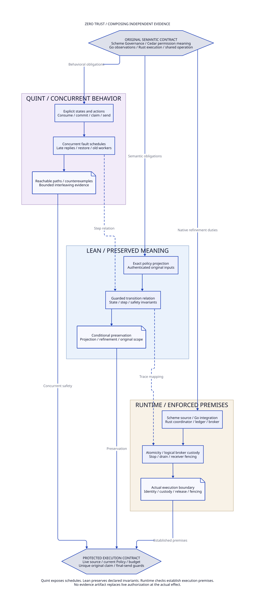

#+title: Weaver Zero Trust Assurance Framework: Quint, Lean, and Cedar POO Spec
#+language: en
#+date: 2026-10-18
#+property: STATUS mandatory-framework-design-models-and-proofs-not-implemented
#+options: toc:3

#+begin_quote
Historical Python verification entrypoints are retired. Commands and receipts
referenced below describe earlier experiments. Current native verification uses
the Go-owned plan; see [[file:../50-59-research-program/59-provider-rpc/59.21-verification-ownership.org][verification ownership and coverage]].
#+end_quote

* Required architecture, not an optional assurance experiment

Every Weaver profile claiming the Zero Trust contract requires both a Quint
state model and Lean proof obligations, connected to exact owner sources and
physical runtime evidence. This requirement covers Code as Policy, source
admission, authorization, grant consumption, history/budget coordination,
fencing, final submission, response release and recovery. Missing required
evidence keeps that protected profile unavailable. A weaker assurance mode
cannot be selected as an automatic fallback.

cedar-poo-spec is a critical versioned semantic dependency of this design.
It supplies existing Cedar/POO proof and admission interfaces; Weaver must
consume and extend the appropriate owners rather than invent a parallel Cedar
semantics. This is a required dependency contract, not a claim that Weaver
already has a working Lake/Cargo dependency manifest or a qualified Runtime Host.

This document adds no Quint modules, Lean proofs, generated bindings, CI jobs
or gateway code. All FM obligations below are pending. Reading existing proof
source is distinct from compiling it, checking axioms or qualifying execution.
Source identities and P/C references are in [[file:01-reference-comparison.org][the evidence register]].
[[file:11-source-to-execution-assurance-review.org][The detailed source-to-execution review]] gives exact theorem reuse limits,
per-FM premises/counterexamples/receipts and limited existing guard-proof checks.
Those four standalone checks do not close any FM integration obligation.

* Relationship to the running gateway

Cedar supplies permission semantics, while Scheme/Go/Rust own the concrete
services and effects. Quint and Lean cover properties of those owners and their
interactions; they are not extra permission issuers or a serial request pipeline.
The system overview in [[file:00-system-design.org][System design]] maps all six roles.

Quint models Go observations/publication changes, Scheme source/lifecycle
transitions and Rust consumption/ledger/broker transitions in one explicit
fault model. A successful exploration is conditional on its bounds, fairness,
state encoding and action definitions. Lean must state meaningful relations
between that model, the existing Cedar/POO definitions and the concrete operation
and transition contracts. A source hash does not construct those relations.

Proof checking and model exploration happen in the authoring/assurance path.
The admitted runtime executes its required evaluator and live guards; a selected
profile can require both Rust and Lean-native evaluation. This does not mean
running the Lean proof checker or Quint explorer for each network write. Proof
results cannot replace a current source lease, a real ledger CAS or an actual
credential/transport check.

| Architectural risk | Quint question | Lean obligation | Physical enforcement premise |
|--------------------+----------------+-----------------+------------------------------|
| Go route changes after authorization | Can an update cause dispatch to a new disclosure boundary? | Preserve recipient/operation binding across admitted projections and transitions | Broker validates the actual destination and adapter cannot bypass it |
| Two workers consume/claim concurrently | Can both obtain usable authority for the same attempt? | Preserve grant affinity, unique claims and budget conservation under declared serialization | Real issuer serialization, durable ledger atomicity and one local handle |
| A publication or identity observation becomes stale | Can stale input cross admission or a later checkpoint? | Preserve source/identity validity predicates under the selected lease rules | Authentic owner observations, bounded lifetime and runtime rejection |
| A paused broker resumes after takeover | Can a stale emitter act despite a new database owner? | Keep database fencing distinct from the physical stop/receiver premise | Qualified stop/drain or receiver fencing where stronger exclusion is required |
| An SDK retries after an unknown result | Is a second application attempt reachable without new admission? | Bind each attempt to its unique claim and preserve conservative unknown state | Retry controls, constrained credentials/egress and attributable observations |

These are requirements to model, prove and exercise, not claims of completed
integration proofs. The detailed FM dossiers preserve the separate evidence
boundaries and inherited proof limits.

* Existing foundation and exact reuse boundary

| Owner source | Reusable foundation | What still needs to be established |
|--------------+---------------------+------------------------------------|
| C10: CompoundAuthorization | Receipt binds exact compilation, requests, entities and responses; Receipt.allowed requires nonempty requests, allow decisions and no erroring policies | Relate Weaver's complete required boundary inventory to those requests and bind live input authenticity |
| C8: Admission.BoundOperation | Typed effect/state projection and explicit mismatch results | Host authenticity, current state, actual emission identity and serialization remain external obligations |
| C11: Composition.certificate / alignedCertificate | Existing evaluation/validation proof composition and alignment obligations | Instantiate meaningful premises; a certificate of evaluation can describe deny or error, not just allow |
| C3-C5: exports and schema-bound replay | Stable policy IDs, supported feature rejection, schema validation and artifact replay | Qualify selected compiler/toolchain/ABI and the consumer projection at the exact closure |
| P28: ContextSessionClaim / ContextTemporalLifecycle | Executable bounded transitions, currentness invariants and intentional bug variants | Gateway consume/ledger/send separation and physical fences are new model scope |
| P29: source_binding.py | Check a Quint byte digest and listed invariant names against a Lean contract | Metadata freshness is not semantic translation, complete invariant coverage or a refinement theorem |
| P30: ContextSessionClaim.lean / ContextTemporalPolicy.lean | Existing pure guard contracts and refusal/preservation proofs | A pure Gates record is not proof that concrete Scheme/Go/Rust inputs truthfully populate it |
| P31-P35: attempt, dual-engine, progress and publication owners | Pure attempt guards, subject negatives, conditional budget/history and lineage laws | Progress budgets/history differ from gateway cost/disclosure; instantiate concrete validity and external publication authority |
| P18-P21: recovery and effect owners | Canonical intent, exclusive claim, evidence joins and multiplicity requirements | Give concrete validity relations and actual ledger/broker/receiver evidence; no all-true validity predicates |

An =Except.ok receipt= from =authorizeAll= or =BoundOperation.authorize= is not
an allow result. Those functions can successfully construct a receipt whose
response denies or contains policy errors. The executable adapter must enforce
the existing =Receipt.allowed= meaning and its exact nonempty request set.
A proof-bearing receipt or successful compilation alone never permits dispatch.
This reuses existing semantics; it does not add an alternative deny/allow engine.

* Dependency baseline consistency and native qualification

The currently inspected source identities are a research baseline, not an
accepted integrated build. In particular, their declarations differ:

| Selected source | Declared toolchain / dependency | Consequence |
|-----------------+--------------------------------+-------------|
| cedar-poo-spec c8d1a0641120cf65e299e8a98f9fe7666ca96ab5 | Lean 4.34.1; Cedar 017c35c3d1f856a0f8b62a66660ee6628870bbcf; LeanPoo ccb94dc44d874050dc8a8ede692bb2afac55ea37 | C7/C12 fix this semantic source closure |
| POO Flow a74fc2fd63437252175b5a67649ee54b886d3bf4 proof package | Lean 4.31.0; Cedar e9fa9c1e6b636f29b0897d8706bd7aa5eaf06f9a | P9 fixes a different Lean/Cedar closure |
| POO Flow Cedar Rust bridge | Rust manifest pins cedar-poo-spec c8d1a06 | A Rust dependency pin does not align the separate Lean package or native ABI |
| POO Flow Core / Lambda Aitia | Distinct revisions in the source register; Core checkout differs from parent gitlink | Reproduce each owner independently before asserting an integrated closure |

Do not reuse =.olean= files or native Lean objects across toolchains, assume
Cedar revisions interchangeable, or silently update pins to make the tuple
appear compatible. FM1 requires an owner-reviewed internally consistent selection and a
clean build/replay/native qualification for the actual consumer. A deliberate
source-level migration must establish its projection and semantic obligations.
Weaver does not require backward compatibility or a legacy version adapter.
Select one greenfield baseline and regenerate its native artifacts. Separate
build environments preserve provenance but do not by themselves prove agreement.

The eventual evidence lock must bind all Git commits, nested gitlinks, dirty
source digests if deliberately admitted, Lean/Lake/compiler versions, transitive
manifests, Quint/checker versions and backend, model bounds, projection versions,
Host/component artifacts and the final Weaver consumer revision. A dependency
change invalidates affected proofs, replay and native evidence. An internally consistent
closure must be selected before enabling the protected integration. The
greenfield decision and isolated qualification belong to
[[file:12-fm1-baseline-and-native-qualification.org][FM1 baseline selection and native qualification]].

* Assurance structure and ownership

#+caption: W11. Shared semantics, concurrent models, proofs and physical runtime enforcement.

[[file:diagrams/11-zero-trust-assurance.d2][D2 source]]. Arrows are evidence obligations, not an implemented compiler
pipeline. D2 is the architecture view; it neither executes Quint nor proves Lean.

| Responsibility | Required owner |
|----------------+----------------|
| Cedar semantics, POO compilation, receipt meaning | cedar-poo-spec and its pinned Cedar/Lean-POO dependencies |
| Extensible Governance/source/lifecycle contracts and projection meaning | Existing Scheme/POO owners with their owner-maintained Lean contracts |
| Finite concurrent transition and fault exploration | Weaver integration model, extending POO Quint patterns and keeping owner sources explicit |
| Abstract safety, projection and refinement obligations | Appropriate Lean owners; Weaver owns its cross-boundary integration obligations |
| Cloud discovery, activation status, replacement/drain intent | Go, mapped to explicit model actions; observation/status does not establish retirement |
| Grant adapter, ledger CAS, broker, transport and evidence admission | Rust in the reference topology; concrete trace and fault qualification required |
| Durable serialization, stop/drain and receiver behavior | Selected physical authorities; audited assumptions and deployment receipts |

A Go final broker has the same obligations as the Rust reference broker. Scheme
pure values, Go status conditions and Rust types supply no ambient authority.
Owner approval, model checking, proof compilation and implementation evidence
remain distinct review artifacts.

* Quint model contract

** State and observable actions

Model independent actors for source/lifecycle ownership, evaluation/issuer,
coordinator, authoritative ledger, broker, cloud controller, transport and
receiver. Represent nondeterministic scheduling and RPC messages explicitly.
Include the old paused incarnation as well as a recreated new incarnation.

| State group | Required distinctions |
|-------------+-----------------------|
| Policy and source | Admitted closure, complete required checks, exact subject, source cut/incarnation, validity/lease, evaluator decision/diagnostics and publication/revocation floor |
| Attempt admission | Proposed, Prepared, ConsumePending, SendCommitted, DispatchClaimed, AbortedNoDispatch; positive consume knowledge may be lost independently |
| Local lifecycle | Issued, Reserved, DeliveryEntered, returned/rejected; callback active and blocked owner task are distinct |
| Issuer state | Original instance, pending/consumed grant, generation, full input/handoff binding; refusal and pending count never imply positive consumption |
| Ledger authority | Lineage, owner incarnation, monotonic fence, allowed prior state and expected versions, durable command result and uncertain client knowledge |
| Exposure and flow | Held/settled/unknown budget, capacity epoch, pending sensitive reads, emission conflicts and retained restrictive history |
| Physical submission | One local handle, handle delivery/spend/retirement, possible submission, emitter closure, attributable business result and usage |
| Response disclosure | Authenticated peer/session, admitted range/sequence, released/unknown history and stream cancellation |
| Recovery | Restore/rollback high-water, tombstones, original observer provenance, current scoped cleanup/recovery authority |

Actions include prepare commit/reply, local reserve, pending commit/reply,
deliver entry, strict evaluation/issue, consume and its reply, S4 CAS/reply,
abort CAS/reply, S5 claim/reply, final checks, actual application submission,
closure evidence, outcome/usage observation, settlement and response release.
Include cancellation, expiration, policy/source change, partitions, duplicate
or delayed messages, process crash/restart, stale worker resume and store restore.
An allowed observation-inbox submission is distinct from an authorized mutation.

Consume and S4 are separate actions. S4 and S5 are separate actions. Claim and
transport entry are separate actions. Durable commit and reply delivery are
separate actions. Recording a result, closing an emitter, settling budget and
releasing response bytes are separate actions. Never merge these pairs into an
atomic model step to hide the failure seams in S1-S6, W02/W10, W04/W09 and W07.

** Bounds, abstraction and progress

The initial required exploration includes at least two conflicting attempts,
two broker/worker incarnations, competing abort/claim tasks, multiple generations,
and a capacity small enough to exercise the last available unit. Include an old
incarnation that remains alive after takeover. Record the actual bounds and
whether they permit two fence advances, a source ABA sequence and message replay.
Larger-bound campaigns are separate evidence, not implied by the first run.

Do not collapse identities, epochs or payloads in ways that erase their equality
and freshness differences. A finite generation range must stop at its boundary,
not wrap to a valid earlier generation. A stopped model at that boundary proves
nothing about an unbounded runtime; Lean obligations cover the general transition
relations under their declared assumptions. Budget-unit abstraction needs a
conservation argument and a separate concrete integer/overflow qualification.

Cedar outcomes may be abstracted as complete allow/deny/error/mismatch witnesses
bound to their exact semantic inputs, not a freely trusted =authorized=true=.
The abstract connection to real Cedar requires semantic vectors and Lean
projection obligations. Physical retirement or truthful source evidence is a
named environment premise, not an always-true model flag. Model absent, stale,
forged or mismatched evidence and prove that untrusted claims cannot authorize.

Safety must tolerate arbitrary delays, duplicates, partitions and process loss
within the declared failure model. Progress is conditional on explicit fairness,
eventual access to required authorities, finite work and usable leases. The
conservative protocol need not eventually resend or settle an unknowable remote
outcome. Fail-closed waiting/quarantine can be safe without being available.
Do not assume fairness to remove a safety counterexample or promise termination
under permanent partition.

Quint provides simulation and model-checking tools; record which was used and
its precise backend, bounds and completion semantics. Simulation, bounded
symbolic checks and exhaustive reachable-state exploration have different
claims. A finite exploration receipt requires its complete declared frontier;
a bounded check states its depth/domain explicitly. A timeout, unfinished queue,
skipped invariant or zero explored actions is not a safety pass.
The [[https://github.com/quint-co/quint][official Quint project]] describes its tooling; no new tool version is
selected or installed by this architecture revision.

* Lean proof and refinement contract

Reuse cedar-poo-spec's definitions for actual Cedar evaluation, compilation,
validation, receipt identity and =Receipt.allowed=. Reuse existing POO lifecycle
and recovery contracts. Prove the consumer projection and guarded integration
rather than redefining those owners with weaker local Boolean approximations.

The required proof layers are:

1. Exact input/projection and policy-closure correspondence to the selected
   cedar-poo-spec/Cedar definitions, including nonempty required checks and
   rejection of deny/error/unsupported inputs.
2. Inductive preservation of abstract admission, unique claim, exposure/history,
   stale-owner rejection and protected release invariants over arbitrary finite
   traces, including recovery states and allowed stuttering.
3. An explicit relation between the specified Quint state/actions and the Lean
   transition system: initial-state correspondence, every modeled step covered
   by a declared transition or justified stutter, and safety-predicate alignment.
4. Runtime integration obligations relating admitted concrete events to that
   abstraction. Each observable CAS, callback, claim, transport and release
   boundary has a named trace mapping and an independently checked expected state.

No automatic Quint-to-Lean translator or end-to-end verified compiler exists
by virtue of this design. The existing source-digest helper is useful mandatory
freshness metadata, but it cannot discharge layer 3 or layer 4. A hand-maintained
step relation needs review and discriminating traces, including negative mutants.
The concrete-to-specification direction, safety reflection and finite-bound
limits are required explicitly in [[file:11-source-to-execution-assurance-review.org][the detailed correspondence contract]].
Concrete trace conformance covers observed executions; it is not a universal
source-code refinement proof. Any stronger theorem must identify the actual
implementation semantics and prove the additional relation.

Every theorem records owner definitions, quantified domain, preconditions,
trusted external facts and its transitive axiom set. Reject unfinished proofs
or dependencies on =sorryAx=. Review custom axioms and native-evaluation trust
separately; normal Lean logical axioms are not the same as unfinished proofs.
The [[https://lean-lang.org/doc/reference/latest/ValidatingProofs/][Lean proof-validation reference]] explains axiom inspection. Do not treat
kernel acceptance as evidence that a theorem states the intended physical
contract or that its external premises are true.

Build imported owner modules before direct consumer checks from a clean
selected closure. Retain exact commands, diagnostics and axiom reports. Do not
repair a failing proof by deleting an invariant, strengthening an impossible
premise, assuming exclusive ownership from equal fence numbers, or defining
every recovery-validity predicate as true. Include reachable successful work
and applicable negative traces so a model that disables all execution cannot
satisfy the acceptance profile vacuously.

* Required property and evidence register

All rows below are mandatory; none is fully discharged. The focused checked
artifacts linked below provide partial abstract coverage. The Quint and Lean entries describe
required artifacts, not existing theorem/module names. Runtime controls retain
their AC/SF/CX identifiers from [[file:03-performance-and-validation.org][the validation plan]].

| ID | Zero Trust property | Quint obligation | Lean obligation | Concrete controls |
|----+---------------------+------------------+-----------------+-------------------|
| FM1 | Exact internally consistent dependency and native baseline | Bind checker/model/configuration identities | Selected Cedar/POO/toolchain closure compiles with reviewed axioms and projection compatibility | G0/G2/G3; CX15/CX17; resolve the observed Lean/Cedar tuple difference |
| FM2 | No implicit policy or receipt authority | Deny, equal-error allow, incomplete check inventory and forged admission cannot issue an executable grant | Refine exact nonempty Receipt.allowed and owner-authenticated BoundOperation projection | SF1/SF3; CX2/CX3/CX15/CX17 |
| FM3 | Ordered one-use lifecycle | Reserve, durable pending and deliver occur in order; duplicates/rejected receipts cannot recreate work | Preserve local issued-family/one-use state and callback effect linkage | AC1; CX1/CX14 |
| FM4 | Consumption is necessary but insufficient | Lost/late consume response, abort-winning and claim-winning races remain distinct | Positive consume binding plus allowed S4 transition; aborted attempts cannot reopen | SF4/SF5; CX4/CX5/CX12 |
| FM5 | Typed unique claim and bounded effect initiation | Start/message/range kinds, duplicate replies, hidden retries and replacement never widen or recreate the claimed effect | Unique-claim and affine-handle preservation for the exact effect kind at actual submission | AC7; SF6; CX7/CX8/CX9 |
| FM6 | Current owner and original deadline | Stale writer, paused worker, incarnation reuse and delayed cancel cannot grant fresh work | Distinct identity/fence/lease relations and current-state guarded transitions | SF8/SF9/SF10; CX6/CX12/CX14 |
| FM7 | Budget conservation | Last-unit races, unknown usage, duplicate settlement and capacity reduction retain exposure | Bucket conservation, nonnegative usage and guarded release; capacity reduction retains explicit overcommit and blocks new work | AC2/AC10; SF7; CX10/CX11/CX18 |
| FM8 | History and disclosure conflict preservation | Pending sensitive read races with old/open emitters and stream-range release | Restriction preservation and emission/disclosure order for the common conflict scope | AC3/AC8; CX10/CX16 |
| FM9 | Observation is not execution authority | NoSubmissionProven, emitter closure, business outcome and settlement arrive independently | Evidence admission/provenance and monotonic orthogonal facts; no refund from result labels | SF12; CX8/CX9/CX10/CX11/CX18 |
| FM10 | Restore cannot revive permission | Old images, missing log suffixes, compaction and fence ABA cannot reset claims | Lineage/high-water and tombstone preservation under qualified external anchor/stop premises | SF2/SF11; CX4/CX7 |
| FM11 | Current policy/source and atomic obligations | Publication/source change, own V-to-V+1 transition, audit timeout and unsupported mutable-source contracts fail safely | Exact dependency closure, own-transition derivation and declared source-validity preconditions | SF2/SF3; CX6/CX13/CX15 |
| FM12 | Complete non-vacuous cross-layer evidence | Required successful traces and each guard-removal mutant discriminate the intended safety property | State/step/predicate correspondence plus reviewed runtime trace abstraction, no all-true premises | AC/SF/CX inventory coverage; G5/G6/G8/G9 |

P18 already assumes exclusive claim authority in its closed recovery evidence;
P20 already assumes one occurrence per effect in its closed structure. Their
projection theorems cannot supply those premises from a fence or a receipt name.
C10 also provides per-root layersAllowed; exact layer/check coverage remains an
additional obligation beyond its nonempty guard.

A formal at-most-one application-start result does not prove exactly-once
application by an arbitrary receiver. Coverage of every effect and any stronger
idempotency/multiplicity contract stays with the existing effect owners.

* Application-submission and streaming refinement

The named properties and counterexamples in
[[file:13-go-adapter-broker-boundary.org][the adapter/broker review]] refine the FM contract beneath SDK wrapper calls.
Model application starts, credential releases, semantic message effects,
segment queue admission and possible partial submission separately. A session
opening cannot stand for authorization of all tool calls it may carry. Add route/pool/identity churn, hidden
retry/mirror and stream reconnect actions. One atomic InvokeSDK action erases
the very multiplicity and disclosure conditions FM5/FM8 must check.

Lean correspondence must bind actual request starts and message ranges to the
owner's exact operation and admitted prefix contract; a generic wrapper-call
counter cannot establish that relation. FM7 retains unknown/queued exposure;
FM6/FM11 preserve deadlines, source cuts and owner guards; FM9 keeps observations
separate from closure/authority; FM10 preserves these facts across recovery.
No new formal run or theorem follows from this refinement.

* Stream-state and conservation specialization

[[file:14-stream-message-authorization.org][The streaming closure]] specifies complete-message authority, typed start/message
claims, fixed parent escrow with child suballocation, queue/memory credits,
S4 QueueEligible versus physical enqueue, and bounded OfferIntent versus actual
submission. Add those state coordinates and actions to the same fault model.
Final cost, accrued usage, retirement, closure and parent return are independent;
a timeout, usage sample or recovered pending list cannot create capacity.

The dossier maps each property to its FM scope, a discriminating counterexample
and future observation. Include two competing messages, two streams sharing a
last unit, two incarnations and both seal/ticket orderings. Reuse P31/P43's
obligation-retention laws without treating pending as executable. New stream
slot/escrow/queue/transport relations remain unproved integration obligations.

* Spent-state alignment and logical continuity

[[file:15-authoritative-spent-state.org][The authoritative spent-state dossier]] extends FM3/FM4/FM5/FM6/FM9/FM10/FM11/FM12
with exact context-to-snapshot correspondence, unchanged-root unknown spends,
competing aligned candidates, commit/reply ambiguity and cold-versus-image
restart distinctions. It also separates one-use issuance from stable logical
operation identity and late observation from another consume. P45/P46's pure
controls and P24's reconstruction tests do not already prove those integrations.
No existing theorem identified in this review closes P13's full durable stream
contract; the exact new properties, premises and mutants remain obligations.

* Negative controls, receipts and admission of results

Maintain intentional mutations for: accepting receipt existence as allow;
ignoring policy errors; dropping source incarnation; combining consume and
commit; refunding on timeout; reopening an abort; replaying a claim reply;
allowing stale settlement; declaring emitter closure from a business result;
erasing unknown exposure; accepting restore without high-water; and letting
Scheme callback reentry fabricate progress. Each mutant must reach its targeted
bad state under a stated scope, or record why that mutant/control is inadequate.
An unrelated exception or model parser failure is not the required counterexample.

The common receipt envelope binds the source/dependency closure, model and
invariant inventory, Lean theorem/axiom inventory, bounds, checker/backend and
tool versions, run identity, completion/exit status, counterexample or replay
trace, concrete artifact identities and invalidation conditions. Retain failures
and stale/timeout runs. Require exact coverage of the required invariant list;
P29 checks listed names exist but does not prove that every required property
has been listed. Never convert a missing receipt into a successful one.

Formal verification runs outside the request path. The runtime checks the
admitted artifact identities, compatible profile, freshness/revocation and exact
operation premises. A model receipt never substitutes for a per-operation Cedar
grant, source guard, budget reservation, fenced claim or disclosure decision.
Performance comparisons retain this same required assurance and runtime contract.

* Required delivery order after documentation review

1. Resolve FM1 with the dependency owners and select the exact semantic/runtime
   tuple; do not silently move the current research pins.
2. Agree owner-reviewed state, action, input, invariant and assumption inventories
   for FM2-FM12 and map them to the existing S1-S6 and AC/SF/CX cases.
3. Add and complete bounded Quint exploration plus discriminating mutations;
   retain positive and negative trace receipts with honest scope labels.
4. Add owner-maintained Lean obligations and explicit model correspondence,
   compiling imports and consumer proofs against the selected closure.
5. Qualify Scheme/Go/Rust adapters, native Host, store, broker and deployment
   with independent runtime trace/fault evidence for that same closure.
6. Admit the selected protected profile only when its required evidence joins
   G0/G2/G3/G5/G6/G8/G9. Keep unresolved features unavailable.

This order is a required implementation plan. The present change establishes
the framework contract plus the focused checked artifacts below; it does not
mark any full FM row passed.

* First checked Weaver model and proof

[[file:../../dev/specs/README.org][The formal artifact guide]] links the actual =.qnt= and =.lean= files,
state/action correspondence, positive and negative controls, tool commands and
local evidence. These now replace prose-only obligations for the narrow
logical-message/issuance/evidence abstraction. They do not replace the broader
FM register or inherited cedar-poo-spec/POO source premises.

The Lean file checks initial/step preservation and reachability induction,
per-issuance consumption, one logical claim/offer, sticky claim origin,
revision invalidation, retained history and a unit-hold partition. Quint tests
both permitted lifecycle traces and mutations that expose duplicate consume,
fresh-key/reconnect claim replacement, evidence reopening and early settlement.
The exact bounds and actual results remain in the linked receipt, outside D2.

No source refinement or automated Quint-to-Lean equivalence theorem is supplied.
Identity resolution, the real linearizable store, issuer/Cedar admission,
authentic observations and physical broker/receiver fences remain explicit
premises. These artifacts compile independently of the existing owner proof
packages; their success says nothing new about those packages' ABI or native
acceptance. Complete FM1-FM12 and protected-profile qualification remain pending.

* Cross-message proof extension

[[file:17-shared-identity-budget-proof.org][The cross-message identity and shared-budget dossier]] now links actual
Quint/Lean artifacts extending the single-message abstraction. It checks alias
soundness, preserved canonical claim origin, one weighted parent pool, shared
restrictive history and counterexamples with duplicate semantic offers under
individually affine local records. The initial/step induction reuses the previous
checked message laws. Identity/domain authentication, actual Cedar projection,
storage and physical emission remain separate premises; this is partial formal
coverage, not completed FM or native acceptance.

* Finite-domain and migration extension

[[file:18-finite-domains-and-migration.org][The finite-domain dossier]] now replaces the two-message scope with a
parametric finite-key proof and independent overlapping budget/history account
identities. Actual Quint/Lean artifacts add create/seal/stage/activate, retained
process/claim state, immutable tickets and stale-worker rejection. Earlier dated
receipts keep their scope. Canonical identity-preserving relocation does not
permit semantic reparenting or empty-ledger reconstruction; source authenticity,
physical persistence and post-cut emission remain separate qualification gates.

* Anchor, durable recovery and actual egress refinement

[[file:19-anchor-recovery-and-egress-contract.org][The anchor/recovery/egress contract]] specifies independent anti-rollback
identity, immutable canonical operation resolution, full state materialization,
seal-before-publication and actual-writer/receiver cut semantics. Checked
Quint/Lean artifacts distinguish blocked new delegation from accepted-buffer
drain; old raw sockets, co-rolled-back owner state and unauthenticated epoch
relabeling remain explicit counterexamples. The physical acceptance register
remains pending; no callback, cached status or capability flag supplies it.

* Driver completion assurance refinement

[[file:22-driver-completion-recovery.org][The driver completion dossier]] connects exact original-bound completion,
read-only resolution, driver incarnation and actual writer isolation to the
finite manifest proof. Completion never serves as final usage or a reusable
Policy grant. Its checked Quint/Lean extension does not discharge physical
buffer/FD ownership, anchored durability or provider billing authenticity.

* Split-store and final-usage assurance

[[file:23-writer-isolation-settlement-closure.org][The split-store dossier]] extends actual Quint/Lean composition to immutable
writer evidence, canonical decisions, conservative publication and original-bound
financial closure. Evidence-only release, restored writer adoption and duplicate
or conflicting usage remain explicit counterexamples. Authenticity predicates
and physical durability/fencing/provider finality are not proved by equality or
model checking.

* Account-gate and anchor recovery assurance

[[file:24-settlement-anchor-recovery.org][The account recovery dossier]] adds actual Quint/Lean composition for
original intent/application/confirmation binding, complete current recovery and
unknown reservation retention. One counterexample reaches a second write after
protected gate rows are erased, making the nonrollback/actual-writer premise
explicit. Physical root, storage and native qualification remain pending.

* Recoverable consumption journal with independent-root assurance

[[file:25-gate-consumption-persistence.org][The consumption persistence dossier]] and [[file:../../dev/specs/evidence/gate-consumption-persistence-2026-10-19.org][its executable receipt]] refine the
gate nonrollback assumption into separate durable seal/grant/burn/result phases.
Local journal loss cannot regrant an issued capability or reopen an unknown burn.
Lean composes archived actual receipts, confirmation coverage and original shared
reservation conservation; Quint exercises rollback and stale-capability mutants.
These extend the FM recovery/execution obligations; they do not establish a new
native acceptance result. Root independence, actual effect/receipt atomicity and
final-writer epoch enforcement remain explicit owner premises.

* Anchor confirmation and actual writer handover assurance

[[file:26-anchor-commit-broker-fencing.org][The commit/broker dossier]] and [[file:../../dev/specs/evidence/anchor-broker-commit-2026-10-19.org][its executable receipt]] extend the formal chain
with qualified committed entries and a separate physical writer state. Election
alone does not revoke held permission; the barrier/commit/current-read/activation
join closes the actual submission boundary. Lean preserves the canonical burn
body and original budgets; Quint retains conflicting-publication and actual
fork-replay counterexamples. Store prefix safety, original response authenticity
and actual effect/receipt atomicity remain explicit physical premises.

* Membership and prefix-transfer assurance

[[file:27-anchor-configuration-prefix-inheritance.org][The membership dossier]] and [[file:../../dev/specs/evidence/anchor-reconfiguration-2026-10-19.org][its executable receipt]] extend the initialized formal
chain to dual-quorum joint transitions, exact deciding-image transfer and scoped
physical activation. Original consumption, reservations and historical records
survive the control transitions. Native single-prefix publication, learner-copy
authenticity, all-alias isolation and actual account receipts remain qualification
obligations; abstract intersection lemmas do not prove a consensus implementation.

* Durable quorum witnesses across recovery

[[file:28-quorum-durable-promises-prefix-recovery.org][The durable-promise extension]] refines FM12's publication/recovery premise
with protected full-prefix promises, signer incarnation and irreversible
retirement. [[file:../../dev/specs/lean/QuorumDurablePromises.lean][Lean]] composes with the initialized original consumption/account
product; [[file:../../dev/specs/quint/QuorumDurablePromises.qnt][Quint]] checks finite witness failures and configuration/election
interleavings. [[file:../../dev/specs/evidence/quorum-durable-promises-2026-10-19.org][The receipt]] records bounds and counterexamples. Safety is
conditional on a qualified protected signing owner outside the permitted rollback
domain. Sticky pending promises may block indefinitely; no consensus liveness,
extracted runtime correctness or total-root rollback tolerance is claimed.

* Protected quorum publication obligation

[[file:28-quorum-durable-promises-prefix-recovery.org][The node-promise review]] supplies an explicit conservative refinement for
P35's fork-free publication premise. Require atomic durable promise-before-ack,
nonrollback signer identity/retirement and full deciding-prefix recovery. Go
orchestrates learners; Scheme owns semantic identities; Rust and the qualified
protected owner enforce persistence/signing and final submission boundaries.
[[file:../../dev/specs/evidence/quorum-durable-promises-2026-10-19.org][The check receipt]] does not discharge native key custody, storage durability or
physical writer isolation merely by proving the initialized logical product.
