# SPDX-FileCopyrightText: 2026 hardenedlinux Linux Team and Contributors
#
# SPDX-License-Identifier: LGPL-2.1-or-later AND Apache-2.0

#+title: Weaver Source-to-Execution Assurance Review
#+language: en
#+date: 2026-10-18
#+property: STATUS source-audited-pure-guard-checks-passed-integrated-assurance-pending
#+options: toc:3

* Review contract and evidence levels

This review refines [[file:10-zero-trust-assurance.org][the mandatory Quint/Lean framework]] against the exact
P/C source register in [[file:01-reference-comparison.org][Reference comparison]]. It adds no model, theorem,
service, generated binding or implementation. FM1-FM12 remain pending as
integration obligations. A small read-only check of existing P30 guard proofs
is recorded below; it is not a Weaver proof or an integrated Cedar build.

Use these evidence levels explicitly: definition inspected; theorem statement
and premises inspected; exact source compiled with axiom audit; bounded model
explored; concrete execution observed; deployed path qualified. Evidence at one
level does not imply the next. A theorem name is not a receipt. Neither a
runtime log nor a model witness authenticates itself.

* Proof reuse: exact declarations and missing premises

The symbols below belong to the pinned owners. Reuse means import or specialize
the same definitions after dependency qualification, not copy weaker definitions
into Weaver. The integration lemmas named by their purpose are future work.

| Source | Existing declaration and usable result | Required Weaver extension / limit |
|--------+----------------------------------------+-----------------------------------|
| C10 | Receipt.compiled and Receipt.evaluated bind compilation and all request responses; Receipt.allowed rejects an empty list, deny and policy errors | Definition reuse, not an existing cross-language adapter proof. Establish exact required-check coverage, live input authenticity and preservation through serialization |
| C10 | LayerReceipt, authorizeLayers, layersAllowed preserve per-root evaluation; compilation cache is local to one model/call | Multiple attachment roots need exact layer coverage and the layersAllowed gate; a single-root receipt cannot silently stand for a layered policy |
| C8 | BoundOperation.request/matches/authorize bind typed effect/state to a fixed projection | No Host authenticity or emission theorem follows. Two different effects can have equal projections unless relevant fields are bound separately |
| C11 | certificate and alignedCertificate compose actual evaluation/validation equalities; expression_change_affects_alignment and policy_change_affects_alignment expose alignment dependencies | The premises are correctness and alignment, not allow/error-free execution. Prove all additional Weaver dependencies and runtime serialization; reuse of an unaffected sub-obligation never preserves the whole aligned contract automatically |
| P30 claim | accepted_has_all_current_gates, accepted_increments_owner and the stale/revoked/expired/busy refusal theorems | Pure function of Gates. Extend to atomic authoritative reads/CAS, process identity, multiple attempts and physical submission; a caller-supplied true gate is not authenticated truth |
| P30 temporal | accepted_has_whole_interval, accepted_upper_is_strict, accepted_has_exact_current_vector and pending preservation/refusal theorems | Reuse strict conservative interval and cut logic. Prove clock-domain provenance, bounded uncertainty and use-time applicability; no distributed transaction or physical stop is supplied |
| P31 | recovery_keeps_obligations, recovery_fences_active, wrong_revision_refused, wrong_attempt_refused, accepted_has_exact_attempt | Pure Schedule transitions preserve pending work and reject stale completion. Recover's cleared active field does not stop a live old process or authorize redispatch |
| P18 | matchingFenceFieldsDoNotProvideExclusiveOwnership, missingDurableIntentAndEffectObservationAreAmbiguous, runtimeDigestRollbackCanHideExternalEffect | Reuse these negative results as mandatory counterexample shapes; they directly refute field-only fencing, timeout and rollback inferences |
| P18 | closedRecoveryProvidesExclusiveFence and closedRecoveryEndsInTerminalPhase | RecoveryEvidenceClosed already assumes claimAuthorityExclusive and receiptIsTerminal. Supply a concrete ledger/claim authority and genuine terminal evidence; these theorems do not construct a CAS or prove eventual completion |
| P19 | transactionRecoveryRequiredIsNotCommitted, staleRecoveryEpochRejectsAuthorizedBridge, wrongAtomicReceiptRejectsAuthorizedBridge | Reuse separation and mismatch results. Instantiate the request/worker/provenance/authority validity relations from actual evidence; no all-true relation or automatic retry |
| P20 | everyDeclaredEffectExecutesExactlyOnce and closedCommittedEffectsPreserveSourceBoundComposition | The closed structure includes effectUniverseExecutesExactlyOnce. Occurrence count = 1 is a premise being projected; it is not derived from a gateway claim or reliable delivery algorithm |
| P32 | dualAgreementDoesNotImplySemanticCorrectness, closedDualDecisionRejectsDifferentSubjects, closedDualDecisionRejectsSameEngineReplay | Reuse subject/engine negative controls. DecisionSemantics and receipt validity remain explicit parameters; instantiate actual Cedar meaning and full diagnostics, not just equal allow bits |
| P33 | closedBudgetAccountingBindsAuthorizedLimits and matchingRuntimeWatchdogThresholdDoesNotExhaustDeterministicBudget | Semantic/scheduling progress budgets differ from tenant/provider cost holds. Reuse evidence identity/conservation discipline; add concurrent hold/unknown/settlement conservation and unit conversion |
| P34 | progressAndFingerprintHistoryClosuresCompose binds exact source-bound progress checkpoint history | Progress fingerprint history is not Weaver information-flow history. Extend with principals, conflict scope, sensitive reads, open emitters and disclosure restrictions |
| P35 | exactEqualityAlonePermitsRollbackReplay, validTransitionsAlonePermitSameGenerationFork, sharedPublicationDomainRejectsSplitViewEquivocation; prefix publication excludes future positions | Reuse rollback/fork counterexamples and common-domain contract. Fork freedom, generation strictness and prefix head need an actual publication/high-water authority outside a rollback image |

P18/P19/P20/P33/P34/P35 were inspected, not compiled in this review. The local
P30 axiom-check run cannot qualify their transitive imports. The subsequent
[[file:12-fm1-baseline-and-runtime-qualification.org][FM1 owner builds]] compile the pinned POO aggregate with its actual parent
Core, but do not instantiate those theorems with concrete physical premises. The existing
pure Scheme P12/P13 token/nonce transitions also need a persistence and
serialization refinement; repeated evaluation of the same immutable input is
not a distributed one-use mechanism.

P28's ContextSessionClaim has =claims.length() < 1= and one active/pending
scope; it cannot witness two conflicting gateway claims. Its temporal companion
models one prepared/committed lifecycle and limited recovery rows. Their
bounded constants, BUG variants and guard patterns are reusable. Their names
alone do not cover two independent issuers, a durable claim reply replay,
physical emission, multi-bucket costs or receiver effects. P29 verifies a byte
digest and listed names only, not this missing scope or invariant completeness.

* Concrete event, abstract state and Lean correspondence

#+caption: W12. Proposed event correspondence; existing owner laws are partial foundations.

Read each row across the concrete event, its Quint schedule and the evidence
obligation. The vertical event track separates consumption, ledger commit,
handle delivery, transport entry and outcome observation.

[[file:diagrams/12-execution-correspondence.d2][D2 source]]. Every arrow below requires an admitted relation. The diagram does
not claim an executable translator, an existing Weaver transition model, or a
proof of concrete source code refinement.

** Relation and identity contract

The future correspondence relation must cover three distinct states: physical
owner state, authoritative durable state, and each participant's knowledge.
A successful durable transition with a lost reply changes the first two even
when the caller still knows only unknown. An observer log is a fourth artifact;
it is not the state authority. Require the following identity tuple at each join:

- Exact operation/attempt, canonical payload, transform result, intended peer,
  credentials and response destination/range; explicit parent/child effect IDs.
- Cedar model/root or required layers, complete request/entity/schema closure,
  full decision/diagnostics, publication floor and evaluator artifacts.
- Source cut, process incarnation, lease/clock domain and original deadline;
  owner, ledger lineage/fence, expected state version and stable command ID.
- Local reservation/delivery, issuer instance/grant/consumption, S4 decision,
  S5 claim and local affine handle as distinct identities; never one generic nonce.
- History conflict domain/version, budget bucket/unit/hold, settlement dedupe key,
  audit requirement and bound evidence provenance.

Projection need not be injective over every irrelevant field. It must preserve
all policy/effect-relevant distinctions, or bind omitted fields separately in
the admitted operation/handoff. Equal Cedar requests alone cannot justify
substituting different recipients, bytes, credentials or side effects.

| Concrete boundary / reference owner | Required abstract transition | Lean / evidence obligation |
|------------------------------------+------------------------------+----------------------------|
| Scheme source preparation and Rust S1 ledger command | Prepared commit and caller reply as separate events | Authenticated projection and atomic history/budget/audit hold; lost reply remains resolvable by original command |
| Scheme P15 authorize/reserve, durable ConsumePending, deliver | Evaluated, Reserved, PendingCommitted, DeliveryEntered in that order | P15's in-memory reservation and deliver flags precede callback use; one callback entry is not issuer consumption or send |
| Rust P5 consume pending removal | ConsumeApplied, then independent ConsumeReply | Original issuer positively consumed exact grant; process loss can erase knowledge. Unknown/pending count zero is not positive consumption |
| Rust coordinator / authoritative S4 CAS | SendCommitted with holds/source/history, then reply | Conditional commit relation preserves all versions and obligations; consume and S4 cannot be one atomic step |
| Rust final broker / authoritative S5 CAS | DispatchClaimed; claim reply and handle delivery distinct | Exactly one authorized claim; durable reply replay cannot mint a second local emission handle |
| Rust final gate, then transport invocation | FinalGateAccepted, followed by possible physical submission | Fresh scope/deadline/target/credential checks plus physical mediation. Model pause after gate and takeover before socket use; logical CAS does not stop old work |
| Observer, recovery owner and response gate | Independent submission, emitter closure, outcome, accounting and disclosure events | Bound evidence admitted with fresh scoped mutation authority; result/closure/refund/release never collapse into one terminal bit |
| Go reconciliation / replacement / drain status | Observation, activation intent, replacement intent or retirement evidence admission | Go cannot establish old-worker retirement merely by reporting Ready, changing a pod UID or acquiring a lease; actual stop evidence belongs to the physical owner |

For Lean, each concrete event must preserve the state relation and correspond
to an abstract transition, a declared finite sequence, or a justified stutter.
For an existing Quint action that combines multiple physical boundaries, split
the integration model rather than hiding an interleaving in an unobservable
atomic step. For every safety-relevant omitted event, explain why stuttering
cannot conceal a forbidden external effect, exposure change or release.

** Direction, coverage and bounds of the relation

For an unbounded abstract safety argument, relate concrete states to the Lean
transition system in the direction concrete-to-specification: every allowed
concrete step must have a matching abstract step/finite sequence or justified
stutter, including crashes, retries and observation loss. Initial-state coverage
must include admitted restart/restore states. The safety predicate must reflect
back to the concrete claim; matching steps in the opposite direction is not
sufficient. An implementation with an extra unauthorized send can simulate every
successful specification step and still violate safety.

The bounded Quint system needs its own initial/step/predicate relation to the
Lean system and an explicit domain restriction or justified quotient. Its finite
bounds do not cover all concrete identities, counters or traces automatically.
Require either an abstraction argument preserving each relevant equality/conflict
and safety predicate, or honest limited-scope exploration evidence. Do not infer
an unbounded result from a finite check, or require a fixed finite bound to
represent every unbounded runtime state without a proof of abstraction.

Lean safety transfer also needs concrete-predicate correspondence: a true Lean
invariant over related states must imply the claimed concrete property. A
relation that omits transport entry, pending reads or unknown usage can preserve
all abstract steps while erasing the actual violation. Audit initial coverage,
step coverage and property reflection separately. If the implementation relation
is supported by owner review and sampled fault traces rather than a universal
source semantics proof, name that assurance limit in the release receipt.

Record partial orders from authoritative command/CAS identities and causal
links. Wall-clock log ordering alone is insufficient. Missing recorder suffixes,
unauthenticated logs, dropped fault events or unexplained transitions make a
concrete conformance run incomplete. A successful sample establishes that
sample's conformance; universal source refinement needs implementation semantics
and additional proof. Safety proofs do not establish liveness or availability.

* FM obligation dossiers

These dossiers refine the single FM register in the framework document. All
acceptance evidence below is required future work unless the limited source
checks later in this review explicitly say otherwise. Counterexamples are
specified witness schedules, not newly executed model results.

** FM1: compatible dependency and artifact closure

Premises: exact manifests/configs agree with actual owner trees, nested
checkouts, compiler versions and transitive builds; no untracked cache supplies
an import. Reuse C7/C12/P9/P36 declarations and P29 freshness discipline. Extend
with a consumer compatibility selection and artifact/ABI provenance.

Counterexample: load the POO cache's acb0db7 Cedar objects while labeling the
run with pinned e9fa9c1; a pure guard proof still passes and conceals the wrong
semantic owner. Another negative control imports a stale .olean or omits an
imported owner build. Reject before admitting integrated evidence.

Acceptance: archive selected manifest/tree identities, clean owner builds,
import/axiom inventory, feature/diagnostic vectors and native Host ABI/lifecycle
receipts. Changing the pin creates a new qualification tuple. The observed
four guard checks below are useful compatibility evidence only for those files.

** FM2: complete and authentic policy admission

Premises: trusted owner determines every required root/request and authentic
facts; exact payload/effect projection and full diagnostics survive transport.
Reuse C10 allowed/layersAllowed, C8 typed equality, C11 alignment and P32 subject
negatives. Extend proofs of inventory coverage, live source binding and adapter
rejection. Multiple roots must use per-layer meaning or prove an equivalent
compilation; nonempty alone does not prove completeness.

Counterexample: authorize only an allowed read while omitting the required send
check; or obtain Except.ok for deny/equal-error allow; or change recipient while
preserving a lossy Cedar projection. Every case must produce no executable grant.

Acceptance: independent expected vectors for allow/deny/error/empty/missing-layer,
projection collision and changed context; Lean coverage/projection statements;
exact cross-language serialized artifacts and source-admission trace. Agreement
between two engines without an independent expected result is insufficient.

** FM3: ordered one-use local lifecycle

Premises: P15 exact owner thread and identity tables remain authoritative within
one incarnation; no callback reentry/mutation; pending durable command is
resolved before deliver. Reuse the actual reserve/deliver pre-callback flags
and P31 pure stale-attempt laws. Extend for the new evaluated family and the
Scheme callback/Rust task ordering; flags are not restart-persistent receipts.

Counterexample: reserve, enter callback, crash before pending is durable; replay
reservation after callback exception; callback waits on its blocked Scheme
owner. Model actual refusal/deadlock rather than treating entry as success.

Acceptance: owner-thread/reentry/exception controls, durable pending-before-entry
trace and independent task scheduling evidence; repeated deliver cannot reenter.
Post-restart serialized objects cannot reconstruct old local capability identity.

The [[file:15-authoritative-spent-state.org][focused P13 dossier]] adds ContextMatchesSnapshot, UnknownSpendIsMonotone,
OneCommitPerIssuance, CorrectReceiptPairing and ObservationDoesNotReconsume.
Its pure unknown-root and concurrent-candidate traces require real publication
and observation authority; existing deterministic P45 fixture calls do not
establish those properties. Issuance freshness also does not prove logical
message uniqueness across a new nonce/issuer.

** FM4: consumption is necessary, never sufficient

Premises: P5 original issuer state, exact grant/handoff, positive consume result,
and a separately authoritative S4/abort CAS. Reuse P5 binding/removal and P18
ambiguity examples. Extend consumption knowledge states and orphan accounting.

Counterexample: issuer removes pending, loses reply, then restarts; caller sees
unknown and refunds/reissues. Also execute abort-winning and claim-winning
races with a delayed positive reply. A consumed grant cannot reopen an aborted
attempt, and an unknown command cannot be resolved from a negative local cache.

Acceptance: consume-before-S4 traces, crash at each boundary and original stable
command resolution; W04/W09 must discriminate both winners. If the issuer cannot
recover consumption status, orphan/quarantine is safe and must remain possible;
no liveness premise may manufacture a positive answer.

** FM5: unique claim and at most one application request start

Premises: authoritative compare-and-set of the exact unclaimed row, one broker
incarnation/handle identity, no hidden transport retry/redirect/fanout, and no
alternative credential/egress path. Reuse P18's fence counterexample and claim
contract. P20 provides a separate conditional effect-count contract, not this
claim algorithm. Extend the unique-claim/affine-handle invariant across faults.

Counterexample: duplicate a successful claim reply to two workers; or restart
between claim commit and handle delivery; or let an HTTP library retry inside
one recorded invocation. The recording boundary must include every admitted
application attempt, including protocol retries and expanded effects.
[[file:13-go-adapter-broker-boundary.org][The adapter/broker refinement]] supplies the explicit request-start, credential
release and stream-range correspondence, including delayed body reads and
queued authority. These are additional integration obligations, not theorem
consequences of one wrapper invocation.

Acceptance: two-worker/two-incarnation schedules, duplicate/lost replies, broker
kill points and independently recording upstream; inspect retry configuration.
At most one gateway application submission allows zero submissions and an unknown
remote outcome. Exactly-once receiver application requires a separately qualified
receiver/idempotency contract and a complete authenticated effect trace.

For the [[file:14-stream-message-authorization.org][message-stream specialization]], a child claim emits one semantic message on
the bound parent and cannot initiate another application request. Range tickets
only attenuate that child claim. P31/P43's recover keeps obligations; feeding
those pending items directly to a stream sender is an explicit counterexample,
not justified reuse of the scheduling proofs. The escrow partition and
seal/OfferIntent ordering require new physical and refinement evidence. P12/P13
also require authoritative state-to-validation-context alignment: its unchanged-
root unknown branch can evade a root-only freshness check if the caller supplies
an old spent context. The streaming review records that source-level negative
trace without claiming a new executed test or weakening P5/P15 one-use guards.

** FM6: owner, clock and physical retirement

Premises: unique non-reused incarnation, authoritative fence allocation, qualified
clock-domain/uncertainty evidence and a finite original deadline. Reuse P30
strict-window/currentness laws and P35 fork controls. Extend integer bounds,
clock reset/restart behavior and actual final-gate/transport authority.

Counterexample: pause old worker after final check, replace it, then resume its
accepted socket operation. Also supply two same-number fences from forked
publishers or reset monotonic time on restart. Database refusal alone must not
be labeled physical retirement or justify incompatible new work.

Acceptance: pause at the last check/write seam, receiver or stop/drain evidence,
clock uncertainty and strict endpoint tests, incarnation/fence overflow controls.
An instantaneous globally revoked socket is not assumed. If physical retirement
is unproved, retain exposure and conflict restrictions under the declared profile.

** FM7: budget and unknown exposure conservation

Premises: explicit units and provider charge bounds, atomic multi-bucket holds,
capacity epochs, deduplicated evidence and fresh settlement authority. Reuse
P33 conservation/evidence binding as a pattern; its semantic/scheduling units
must not be relabeled as money, tokens or network usage.

Counterexample: two attempts reserve the last unit, lost commit reply triggers
a second hold, cancellation releases unknown usage, or duplicate settlement
credits twice. Reduce capacity while exposure exists; model overflow/rounding
and usage above a claimed reservation bound.

Acceptance: inductive held/unknown/settled/available accounting with each amount
counted once, last-unit races, duplicate evidence and actual usage vectors. A
capacity reduction may create an explicit overcommitted state: retain existing
liability and block new work rather than forcing an invalid nonnegative free
balance. Bound violations require an explicit exposure/debt policy, not erasure.

** FM8: history, conflict scope and disclosure

Premises: complete common information-flow domain, durable restrictive history,
pending sensitive read registration, open-emitter conflicts and peer/range-bound
response release. Reuse P34 source-history provenance and P30 pending discipline;
new proofs must cover information flow rather than progress fingerprints.

Counterexample: egress reads history before a pending sensitive read is recorded;
old worker remains open after a new classification; release one stream range
under another peer/session's approval; compact away a restrictive dependency.

Acceptance: interleavings of reads/egress/stream release and concurrent sessions,
summary preservation with no loss of restrictions, trusted conflict-scope mapping
and an independently recording disclosure sink. A cleared active field, emitter
closure or settled budget cannot by itself clear information restrictions.

** FM9: independent observations and authoritative mutation

Premises: submission, physical closure, result, usage and disclosure facts have
separate provenance, dedupe keys and monotonic admission rules; cleanup authority
is independently scoped. Reuse P18/P19 evidence validity separation and P32
identity negatives. Extend the orthogonal S6 evidence algebra.

Counterexample: business success implies closed emitter or zero usage; duplicate
NoSubmissionProven resets the claim; old worker submits valid-looking evidence
and directly settles/refunds; current collector mistakes inbox acceptance for
trusted mutation. Contradictory evidence must quarantine rather than overwrite.

Acceptance: all evidence arrival orders including lost suffixes, duplicates,
contradiction and expired application grants. Fresh recovery owner can admit
bound old observations without granting old workers mutation or resend rights.
NoSubmissionProven never recreates an affine emission handle.

** FM10: restore, compaction and rollback resistance

Premises: external publication/lineage high-water survives the restored domain;
claim tombstones and command outcomes cannot disappear while their effects or
replay messages remain possible. Reuse P35 equality/fork/prefix counterexamples,
P18 external-effect rollback ambiguity and P31 no-reopen laws.

Counterexample: restore a pre-claim image and replay its old grant/command;
accept a later-context witness from a different publication domain; garbage
collect a claim while a paused worker or duplicate message still exists.

Acceptance: snapshot restore with missing log suffix, alternate lineages,
compaction/replay and unavailable anchors. Pin actual nested Core identity.
If anchor freshness cannot be established, quarantine/disable the affected
profile; do not infer safety from matching local digests or advance an arbitrary
counter inside the same rollback image.

** FM11: source/policy validity and atomic obligations

Premises: complete dependency closure, immutable/guarded source contract, admitted
own V-to-V+1 claim derivation, original callback lease, required audit durability
and all S4 joins. Reuse C11 invalidation, P30 exact cuts and P15 no-reentry rule.
Extend cross-owner source admission X1-X6 and real ledger transaction semantics.

Counterexample: each source/history/budget check passes at a different instant
but their joint cut never exists; own claim version increment is interpreted as
unconditional freshness; missing audit append is ignored; fresh mutable-source
checking waits on blocked Scheme. No timestamp shortcut may admit this path.

Acceptance: source/policy change at every boundary, atomic history/budget/audit
fault injection and exact own-transition derivation. Unsupported mutable-source
callbacks remain unavailable until an owner-approved continuation/guard extension
exists. A proof of one stable sub-obligation does not certify the changed closure.

** FM12: non-vacuous and complete correspondence evidence

Premises: required state/action/property inventory is independent of the model
under test, all receipt identities join to one selected closure, and recorder
coverage includes failures. Reuse P29 metadata check and owner axiom inventories;
extend init/step/stutter/predicate relations and runtime trace abstraction.

Counterexample: delete an invariant and its digest inventory entry together;
model all sends as disabled; stutter over a real unauthorized transport event;
prove a validity predicate that accepts everything. Each can produce a green
local artifact without qualifying the intended contract.

Acceptance: required successful traces plus discriminating mutants for every
FM dossier, exact action/invariant/theorem coverage, reachable edge cases and
bounded-backend completion receipts. Audit assumptions for satisfiability and
physical ownership; collect axioms transitively. A model run alone or sampled
trace conformance cannot be labeled a universal concrete refinement proof.

* Version compatibility: verified observations and unresolved gates

** Declared closures and actual local cache

| Layer | Verified source observation | Qualification consequence |
|-------+-----------------------------+---------------------------|
| POO P9/P36 | Lean 4.31.0; Cedar e9fa9c1; batteries fa08db58; path dependency PooFlowCoreProof | Actual Core checkout differs from parent gitlink; the build tuple includes that path and its transitive tree |
| Cedar at e9fa9c1 | Its own toolchain is 4.31.0; batteries requirement v4.31.0 | POO declarations agree with this Cedar toolchain; integrated owner proofs were not built here |
| cedar-poo-spec C7/C12 | Lean 4.34.1; Cedar 017c35c; LeanPoo ccb94dc; batteries f2effa3 | Cedar at 017c35c also declares 4.34.1 and batteries v4.34.0 |
| LeanPoo at ccb94dc | Its own toolchain is 4.34.0 | A dependency toolchain difference is an integration question; not a demonstrated failure under the parent 4.34.1 build |
| POO local .lake cache | Cedar acb0db7, LeanPoo 6e6a706, batteries f2effa3 | This cache does not match pinned P9. It was read only and must not supply evidence labeled with the pinned closure |
| Rust P11/P36 and C6 | Bridge pins cedar-poo-spec c8d1a06; both declare cedar-policy =4.12.0; optional extension/features differ by consumer | Same Rust version string does not establish shared lock resolution, supported features, Lean semantics or ABI |

The cache inspection is a local observation, not a claim about the pinned
repository's correctness. No cache, manifest, submodule or dependency pin was
modified. Do not repair this review by compiling against whichever objects
happen to be installed.

** Cedar source comparison at the two exact commits

The cached Cedar Git object database contains both pinned commits; comparison
used committed blobs, not the active cached checkout. Authorizer.lean,
Request.lean, Response.lean and Entities.lean are byte-identical across these
commits. This limited agreement does not establish semantic equivalence:

- Expr/Evaluator add extHasAttr and nested attribute checks.
- Datetime parsing replaces component-length checks with offset-length checks;
  the surrounding Lean runtime/library version also differs.
- Typechecker/validator and CedarProto expression/partial-evaluation surfaces
  differ. Thirteen files change across the inspected Spec/Validation/CedarProto
  subtrees; this count is a scoped source comparison, not a compatibility test.

FM1/FM2 need explicit supported-feature selection and vectors for nested
attributes, datetime valid/invalid boundaries, error identities, entity/request
validation and protobuf round trips. Do not silently accept a new constructor,
drop it during export, or assume unchanged outer authorizer code makes changed
imported evaluation equivalent. Select one owner-qualified semantic
closure for the new framework and port/requalify its consumers directly. A
legacy adapter is not required. [[file:12-fm1-baseline-and-runtime-qualification.org][The subsequent FM1 investigation]] records this
greenfield decision and actual isolated build/native evidence without pin changes.

** Limited read-only proof and freshness receipt

On 2026-10-18, exact pinned P30 blobs were extracted to a temporary directory.
Both files import only Lean. Each was checked separately with installed
Lean 4.31.0 and 4.34.1, with LEAN_PATH/LEAN_SYSROOT overrides removed and a
30-second per-process watchdog. All four checks exited naturally with status 0.
No source, proof or runtime implementation was added or changed.
The reported compiler builds were arm64-apple-darwin24.6.0 Release:
Lean 4.31.0 commit 68218e876d2a38b1985b8590fff244a83c321783 and
Lean 4.34.1 commit 5045d0056413266e57c625dcd7c365b10e377c52.

| Existing file | Source SHA-256 | Compiler-emitted axiom audit at both versions |
|---------------+----------------+---------------------------------------------|
| ContextSessionClaim.lean | 88161770d3d2b66dc46cb372aa22273437dcb855d49d9de36350bf64fcbff16f | CONTEXT-SESSION-CLAIM-AXIOM-AUDIT-OK: 25 theorems; standard Lean axioms only |
| ContextTemporalPolicy.lean | fe2b50021fee851cf741a29b8f7a41051a3f79e6757806acc53ab5523f46b070 | CONTEXT-TEMPORAL-POLICY-AXIOM-AUDIT-OK: 30 theorems; standard Lean axioms only |

These are the owner audit's reported namespace declaration counts, including
generated theorems, not counts of newly authored Weaver obligations. The owner
allowlist is propext, Classical.choice and Quot.sound; successful checks do not
cover other modules' axioms. A reproducible command shape is
=elan run leanprover/lean4:<version> lean <exact-extracted-owner-file>=.
Build imported owners first for modules that require them; these two standalone
files require no Cedar or Lake dependency build.

The pinned P29 check_binding helper was also applied to just the two exact
P28/P30 pairs. Both metadata checks passed, retaining these model digests:

- ContextSessionClaim.qnt: sha256:e0c6d46354ca44a3e79b9cbc61b42c789dc544e01d69033fcb191d25e088e9bf.
- ContextTemporalLifecycle.qnt: sha256:61a322e9ffa316c0d3371734bca70fb1f68d7e6b1f758579f10fd59906000708.

No Quint exploration, Cedar/LeanPoo/POO integrated build, native Host run,
ABI qualification, receiver test or deployment acceptance was performed.
The clean cedar-poo-spec reference has no .lake dependency cache; the POO cache
has different identities. The results establish limited pure-guard portability
and metadata freshness, leaving FM1's actual integration gate unresolved.

* Review disposition and required next evidence

The design may reuse the named owner definitions and conditional theorem
interfaces. It must extend the concurrency, persistence, knowledge, physical
emission, budget/disclosure and concrete refinement scope. None of FM1-FM12 is
closed by the limited checks above. Keep G6 and G9 pending and require the same
admitted assurance profile on performance lanes; formal checks run outside the
request path while live guards remain mandatory.

A later implementation must deliver one joined receipt set: compatible owner
builds; complete model actions/properties and targeted counterexamples; Lean
projection and preservation/correspondence proofs with axiom inventories; and
independent concrete fault/receiver/isolation evidence. Preserve the distinction
between a proved conditional statement and validated premises at every boundary.
