#+title: Weaver Streaming Authorization: Messages, Escrow, Queues and Revocation
#+language: en
#+date: 2026-10-18
#+property: STATUS proposed-reference-contract-owner-extensions-not-implemented
#+options: toc:3

* Reference decision

Use complete bounded semantic messages, not arbitrary byte fragments, as the
reference unit of policy authorization. Each effectful message is a protected
child operation with its own exact input, owner-issued admission, original
one-use grant consumption and typed message-dispatch claim. The parent stream
has separate opening/credential/recipient authority. A range ticket only permits
a bounded part of an already authorized message; it cannot authorize another
tool, message, recipient, application request or reconnect.

This specializes [[file:13-go-adapter-broker-boundary.org][the adapter/broker contract]] and preserves the S1-S6 ordering in
[[file:05-authorization-execution-protocol.org][the execution protocol]]. It is a design closure, not an implemented stream
capability, runtime queue or formal proof. Generic prefix-policy streaming,
mid-stream escrow top-up, automatic reconnect and pipelined message admission
are outside this reference profile until their owner contracts are extended.

#+caption: Full-message authority and held capacity precede queue eligibility; every offer remains bound to the stream and its cut.

[[file:diagrams/15-stream-message-authorization.d2][D2 source]]. Component grouping does not merge ledger transactions, issuer
consumption, physical enqueue, ticket delivery or socket submission into one step.

** Bounded serialization without a blocked Scheme owner

Select one authorized message slot and one application writer per stream.
Concurrent producers may assemble bounded inert candidates; only one wins the
stream's admission slot. Independent streams can progress concurrently while
sharing atomic budget scopes. This restriction does not remove the need to
model competing producers, revocation or stale workers.

Reuse P15's synchronous owner-thread callback only for a finite message handoff,
including its bounded queue/writer attempt and declared acknowledgment. Never
wait for the lifetime of an open stream or unbounded provider usage reporting.
The callback cannot request another decision from its blocked Scheme owner.
Preacquire a qualified finite source lease and owner-derived transition/validator
contract; otherwise the message cannot enter that callback.

Queue eligibility or callback entry is not a delivered effect. Return delivered
only for the capability's actual attributable acknowledgment; a bounded failure
or uncertainty remains failed/indeterminate. No generic queue ACK replaces that
acknowledgment contract. A callback timeout does not stop the separately running
broker. Keep the message slot occupied until its writer/submission authority is
retired or fenced. Ambiguous framing or a partial-write failure seals the stream.
An exact completed message can permit the next slot only under the protocol's
framing, retained-exposure and source/history contract; unknown usage stays held.

More than one authorized message in flight per stream needs an explicit
asynchronous owner/lifecycle extension. Do not obtain it by returning delivered
on enqueue, reentering P15, or treating its local receipt as durable authority.
This is a deliberate throughput boundary of the reference design.

* POO Flow source reuse and extension boundary

Source IDs resolve through [[file:01-reference-comparison.org][the source register]] at its existing pinned commits.
The inspected committed blobs, rather than adjacent working-tree edits, support
these observations. No owner source, dependency pin or theorem is changed here.

| Existing mechanism and exact symbol | Reuse within its current meaning | Stream-specific extension or premise |
|------------------------------------+---------------------------------+--------------------------------------|
| P15: assurance-effect-host-authorize!, reserve!, deliver!, current? | Owner identity, strict expiry/currentness, reserve once, mark delivery spent before invoking the callback | New fully evaluated source-admitted message family; finite message callback and qualified stream binding; current preflight remains inert |
| P5: Authority::consume_proposal, consume | Full reprojected request/handoff binding, issuer instance/epochs, pending grant removal before external work | Parent stream, message effect kind and content/range inventory must be in the owned projection; existing one-shot grants do not grant arbitrary future messages |
| P12/P13: authorized-effect token and poo-flow-strict-mediate | Pure nonce/root transition structure and spent-record update on indeterminate observation | Bind validation context to authoritative state; pure fields do not enforce durable/serialized replay refusal or transport retirement |
| P18/P19: transaction registry and RecoveryEvidenceClosed | Exact command identity, canonical intent, exclusive claim, provenance joins and retained recovery obligations | Physical serializable stream/escrow/slot rows, queue deduplication and bounded offer authority; instantiate meaningful validity predicates |
| P31/P43: SessionAttempt.recover and poo-flow-session-recover | Increment owner coordinates and retain active obligations for reconciliation; closed schedules refuse recovery | Pending obligations are not runnable network work; never reenqueue an ambiguous message for submission |
| P30/P42: ContextSessionClaim guards and session-host current-proof/observe-proof | Expected owner/source/grant, deadline/anchor and original owner-enrolled proof binding checks | A pure Gates record or local Session revision does not establish a real stream epoch, lease or durable fence |
| P33: deterministicBudgetAccountingClosed | Explicit owner-bound accounting and separation from watchdog/retry authority | Progress semantic/scheduling units are not API money, token or byte budgets; add a typed escrow/suballocation refinement, not a renamed progress counter |
| P34/P35: history and publication lineage | Existing provenance, restriction/lineage and source continuity requirements | Bind to actual message disclosures, pending emitters and shared conflict scopes; progress fingerprints are not disclosure history |
| P17/P22: durable store contract/ledger-kind inventory | Keep POO-native backend selection and physical-runtime ownership | Append-fact, job lease and a kind named communication do not prove multi-row budget CAS, offer-ticket durability or stop/drain |
| C8/C10: BoundOperation, Receipt.allowed and layersAllowed | Complete operation projection and nonempty error-free allow across required checks | Runtime truth, complete message inventory and actual bytes/peer correspondence remain integration obligations |

P43 explicitly marks scheduling receipts runtime-published?, action-authorized?
and durable? as false. Its recovery result preserves an obligation; reconciliation
requires trusted terminal/isolation receipt resolution. P31's corresponding pure
proof cannot turn that obligation into a new grant. P13 similarly consumes a
nonce on an indeterminate observation; the word strict in a value is not storage
or socket evidence. These are useful reusable constraints, not streaming runtime
implementations.

** P12/P13 validation-context premise

P12's rejection-code checks token reuse against context.consumed-nonces. P13
passes its supplied validation-context to that validator, while appending spent
nonces to the separate state; it does not itself check those two sets agree.
Its no-observation branch also leaves execution-root unchanged. Consequently,
a source-level counterexample is to call strict-mediate twice with observation
absent, the updated state but the old empty spent context, and the same expected
root: the supplied-context reuse check does not see the consumed nonce. This is
a source trace to exercise later, not an executed regression result or a claim
that the separately guarded P15/Rust issuer accepts such replay.

Reuse P12/P13 only with the owner constructing expected root, binding, revocation,
clock and spent context from the authoritative snapshot and atomically checking
its full state/version on commit. Root equality alone cannot detect the
indeterminate transition's spent-set/sequence change. Treat this state/context
alignment as an explicit host binding/owner-extension obligation. P5's original
pending-grant removal remains the actual issuer one-use guard; draft token
validation cannot replace it for stream messages or range tickets.

The deeper [[file:15-authoritative-spent-state.org][authoritative spent-state review]] distinguishes semantic/execution roots,
state revision and issuance versus logical-operation identity. It inspects the
existing P45/P46 tests/fixture, adds concurrent-publication and restart controls,
and requires late observations to append evidence without re-consuming the token.
P13/P15/P5 remain separate guard layers; no shared token format is inferred.

* Authority and identity inventory

Distinguish these concepts instead of calling every one a reservation:

| Item | Scope and authority |
|------+---------------------|
| Parent stream opening claim | One application request/stream start to the admitted peer; no arbitrary later message effects |
| Child semantic operation | Parent identity/incarnation, tenant, actor/delegation, message ID/sequence, action/tool, immutable content, recipient, policy/source cut and effect kind |
| Scheme local reservation | One use of the original owner-issued local lifecycle grant; no budget capacity or external effect |
| Issuer grant consumption | Original issuer's positive one-use consumption of the exact child input; no durable send right by itself |
| Escrow suballocation | A cost upper bound taken from the parent's already-held envelope; not another global charge and not permission |
| Queue/memory credit | Capacity for bounded staging/queue/delegated buffer ownership; distinct from monetary/token exposure |
| Message dispatch claim | One child semantic emission on the existing parent stream and designated writer; never a new application start |
| Range offer ticket | One fixed immutable range of that message, current epoch, writer and validity; neither a grant nor an arbitrary write capability |

The claim's effect kind is mandatory. A start claim permits at most one
application start; a message claim permits at most one logical message emission
within the bound parent. Continuations use nonduplicated range tickets under
that message claim. Splitting one semantic message cannot avoid full-message
checks; combining several tool calls cannot avoid their complete action inventory.
Unknown extension fields or unsupported projections reject the protected profile.

Some protocols do not expose independently meaningful messages. For a policy
requiring the complete HTTP body, buffer the whole bounded body. A compressed
fragment, token or SDK callback is not automatically a policy unit. If request
headers/opening metadata already reveal or trigger the message's effect, parent
opening must wait until the required full-message admission and holds exist;
an independent session-open allow cannot bypass that requirement.

* Message admission and queue protocol

The following stages reuse S1-S6 per child; the names are conceptual records,
not new implemented enums or wire formats. The parent and child affected rows
must share the selected consistency domain. A cross-store streaming variant is
unsupported without a separately qualified coordination contract.

| Boundary | Exact prerequisite and durable result | Failure/concurrency rule |
|----------+---------------------------------------+--------------------------|
| Assemble and seal | Go obtains a complete bounded message under independent staging limits; Rust verifies immutable content, parser/transform identity and full child binding | No executable grant or upstream socket is exposed to the producer; mutable reference/mismatched duplicate rejects |
| S1 MessagePrepared | CAS acquires the one stream slot, checks active epoch/cut, splits sufficient parent escrow and reserves queue/memory credits; pending history/audit identity recorded | Competing producers cannot allocate the same credit; a lost reply resolves the same bound command, not another message |
| S2 Evaluate | Scheme owns eligible message projection/currentness; required Cedar inventory allows without errors, original issuer grants exact message effect | Empty checks, allow-with-errors, unsupported semantics, stale/unknown or timeout never creates queue authority |
| S3 ConsumePending and consume | Local reserve once, durable pending command, deliver once and authenticated positive original-issuer consumption | Lost consume reply retains unresolved obligation and held credits; no queue eligibility or guessed success |
| S4 QueueEligible | Current-state CAS checks consumed evidence, same stream/cut, all cost/memory/history/audit obligations and exact immutable send intent | Stream sealing/changed cut can defeat commit; consumed grant stays spent; abort/reclaim requires exact authoritative evidence |
| Physical enqueue | Queue gets the committed message ID and immutable data under already-held credits | Enqueue/ACK is not atomic with S4; lost ACK or duplicate delivery never allocates new credits or a second claim |
| S5 MessageClaimed | Designated parent writer claims that exact eligible child under current epoch and fixed peer | Queue duplication/stale dequeue cannot mint another handle; a replayed claim reply is not another local handle |
| Bounded OfferIntent | CAS binds a fixed range to that claim, writer, active epoch, source/lease/deadline and held exposure before any async transport acceptance | Revocation and this CAS have a defined ledger order; ambiguous ticket delivery never permits a replacement offer |
| Transport offer and observation | The constrained writer checks actual bytes/peer and offers only the admitted range; records attributable offsets/unknown outcome separately | Socket/lib acceptance and the durable record are not atomic; crash or partial failure cannot reoffer an uncertain range |
| Retire and settle | Admit scoped producer/queue/writer retirement and separately authenticated usage evidence | No new send right; memory may be reclaimed only after real reference retirement, cost only under its own evidence rules |

QueueEligible is an authorization state, Enqueued an observed queue fact.
Neither implies MessageClaimed or actual submission. The physical queue can be
rebuilt only as an inert ID index; its entries do not carry reusable transport
handles. Claim/offer tombstones and the original immutable command binding remain
authoritative even when a queue entry or callback reply is lost.

Abort after S4 is possible only while a ledger CAS proves no message claim won,
following the canonical abort/claim race. Once a claim wins, even a pre-offer
failure keeps it spent. Pre-claim cleanup must make every delayed queue
copy unable to claim through the authoritative terminal row/fence; physical
queue copies may remain inert, with memory still charged until retired. Canceling a sender goroutine or
dropping the visible queue is not that proof.

* Escrow, queue capacity and conservation

Select a finite parent cost envelope E before opening the stream. It includes
admitted per-stream overhead and defensible worst-case message costs in each
separate cost domain. No reference-profile top-up is inferred from a usage sample,
a timeout or a provider response. Without a defensible bound or provider-enforced
maximum, a hard-budget streaming profile is unavailable.

For each domain, track the following disjoint portions of E:

#+begin_example
E = UnassignedHeld + ActiveMessageHolds + SettledCharges + ReturnedToGlobal
RemainingParentHold = UnassignedHeld + ActiveMessageHolds
#+end_example

Unresolved/possibly submitted message exposure is inside ActiveMessageHolds,
not an extra additive bucket or an implicitly free balance. The parent envelope
was charged against the shared global capacity once. Child preparation moves
units from UnassignedHeld to its exact message hold in one transaction; it does
not count the same units again as a second global reservation. Two streams still
compete through the global ledger; separate local parents cannot duplicate it.

Only an admitted final-cost/no-future-accrual contract can establish that a
message's total actual charge is closed. A progress counter or a current usage
sample is not final cost. Proven accrued usage can move from ActiveMessageHolds
to SettledCharges while the remaining possible maximum stays held. Final closed
cost no greater than the upper bound, together with the applicable retirement
and accounting premises, can return the proved unused remainder to UnassignedHeld.
Cumulative usage is keyed/deduplicated and only its newly admitted increment is
charged; inconsistent or unsupported correction evidence does not silently
release a hold. A proven no-submission child can return its unused allocation
there only after all claim/ticket/queue/writer resources are retired; its spent
claim remains spent. This allows a later different eligible message to use those
units while never recreating the old operation. No missing usage, EOF, response
status or elapsed reservation timer is sufficient to release a message hold.

For example, with E = 10, settled overhead 2 and a message hold 6, only 2
units are unassigned. A progress usage observation cannot return the other 6.
If the admitted final total for that message is 4, its 2 unused units can join
the unassigned portion, yielding settled charges 6 and unassigned hold 4.
Those 4 are still inside the parent's global hold until an eligible return.

ReturnedToGlobal increases only under an admitted parent return transaction
that seals further allocations and joins retirement of its delegated submission
capabilities. Unknown message costs remain held, even after the parent emitter
is closed; they do not prevent proving closure but do prevent asserting full
financial settlement. A selected window/bucket rollover preserves obligations
under the original key; it does not reset a live stream's available envelope.

Parent opening/overhead is an explicitly assigned envelope entry or separately
admitted service budget, never an unaccounted extra. Independent inbound staging
limits apply before S1, so an unauthenticated/denied producer cannot allocate
unbounded memory while waiting for queue credits.

Money, provider tokens, semantic work, bytes and memory slots have separate keys,
units, bounds and conservation relations. Queue credit remains owned through
all delegated copies, producer callbacks and transport buffers. Dequeue does not
free it if the transport still owns the memory. Physical allocation limits and
bounded encoding/compression expansion must justify the credit model. Memory
retirement does not prove zero provider cost, and a usage receipt does not retire
an async write callback.

A provider cost exceeding its admitted bound or an incompatible capacity change
enters an explicit frozen/overcommit condition, retaining the actual debt and
observed discrepancy. The normal partition accounts for funded units; record
any excess as explicit uncovered debt with the original full cost attribution.
The funded partition is not proof that real invoices cannot exceed it. Never
clamp observed cost, fabricate a nonnegative free
balance or claim the old bound was satisfied. The hard-cap theorem is conditional
on the enforced upper-bound contract; that premise needs independent evidence.

* Partial writes, ordering and immutable ranges

The one stream writer owns message order and range sequencing. A Go callback
cannot inject new bytes after sealing. Rust verifies the actual content/range,
not just a producer-supplied digest. Declared encoding, framing, semantic metadata
and trailers must preserve the full operation; unsupported transformations fail.

Before invoking an asynchronous transport for a bounded range, record its
OfferIntent. A crash between that commit and library acceptance is ambiguous,
just like a crash after acceptance: no replacement ticket or automatic replay.
The intent is not a truthful sent marker. A successful write or accepted-byte
count is not remote receipt, semantic processing or provider usage evidence.

A qualified exact offset can permit only the remaining not-yet-offered tail on
the same live stream under the same message claim and a fresh current range
check. This continuation uses the same affine range authority with a strictly
advancing qualified cursor, not another claim or an expanded range. If the
whole range was handed to an async API, treat that whole range as possibly
submitted unless its ownership contract proves an exact prefix and relinquishes
every unsent-tail copy/callback. A returned byte count alone is not that proof.
Previously offered/uncertain bytes are never reoffered. An API that cannot
establish that frontier, a framing error or a failed/ambiguous partial write seals
the stream and retains possible prefix exposure. A timeout cannot turn a zero
reported byte count into NoSubmissionProven. Reopening a connection/session or
replaying a whole message is a new effect, not continuation of this ticket.

The finite-manifest extension selects an explicit whole-range delegation profile:
the actual owner gate gives the entire bounded range to one constrained original
driver, so that whole range is already in the cut's exposure window. Driver
prefix progress is drain within that scope, not a fresh owner offer or a returned
tail. The retained-tail profile above, where a suffix has not crossed the owner
gate, still requires a fresh current range check before another delegation.
[[file:21-finite-stream-manifest-proof.org][The finite manifest proof]] covers the whole-range profile only; it does not
silently discharge the stronger suffix-recertification or temporal/lease contract.
Neither profile permits a copied capability or recovery requeue after uncertainty.

Range authority has a bounded maximum, finite lease and monotonic deadline no
later than the parent/child limits. Reference execution permits one outstanding
range offer per stream; it advances only when the prior offer's ownership/frontier
is qualified. Protocol/transport buffering remains part of bounded in-flight
exposure, not a reason to equate accepted with remotely applied.

* Revocation and history: define the cut, do not invent atomic sockets

Revoke, expire or cancel through a durable stream seal that advances its epoch
and blocks fresh S1/S4/S5/OfferIntent authority at their CAS boundaries. Source,
publication, identity or policy invalidation uses the same declared cut/lease
contract. Messages cannot extend the parent deadline by waiting in a queue.

| Race ordering | Allowed behavior and retained obligation |
|---------------+-------------------------------------------|
| Seal before preparation or S4 | No new eligible message; spent local/issuer grants are not revived; resolve exact cleanup before returning credits |
| Seal before message claim | Stale queue copies are inert; no handle is issued; authoritative abort/retirement may reclaim unused allocation |
| Claim before seal, no offer ticket | Claim stays spent; later OfferIntent CAS rejects the closed epoch; retire handles/copies before no-submission evidence |
| OfferIntent before seal, callback has not written | Fixed in-flight range may still act within its qualified physical contract; stop/drain or receiver fence is needed for stronger exclusion |
| Partial offer before seal | Retain possible prefix, whole-message cost bound and all outstanding delegated authority; no implicit resend/refund |
| Seal ACK lost or worker paused | Scope remains unknown/quiescing until exact seal result and required retirement are established; a new writer cannot resume the old parent |

Seal request, durable seal commit, broker observing it, and physical retirement
are distinct. A stale actor may enqueue an inert duplicate after the cut; the
safety condition is no new usable authority, not a claim that all physical queue
mutation stops instantaneously. No OfferIntent can linearize after the sealed
epoch under the old authority. A pre-cut ticket and already accepted buffered
bytes can outlive the control-plane observation. Bound that residual exposure;
do not promise zero wire bytes after revocation without an actual stop/receiver
fence covering every emitter and delegated resource.

New restrictive reads participate in the same history/conflict scope as all
pending messages and parent in-flight exposure. A policy requiring no disclosure
after that read must delay the read's eligible commit or establish the required
physical exclusion before it becomes true. A fresh Cedar allow under a new cut
cannot erase an old outstanding emitter. S4's own-transition derivation must be
owner-qualified; an arbitrary Rust version increment is not source validity.

A ticket expiry/deadline check also does not physically stop a process paused
between that check and a syscall. The unconditional model property is rejection
of new authority after the logical cut/deadline. A stronger no-byte-after-deadline
or finite latest-emission claim needs a qualified transport/receiver deadline
fence or stop/containment guarantee. Without that premise, keep the possible
bounded prefix and its conflict exposure; do not claim a strict physical deadline
from a timestamp alone. A profile that requires that stronger guarantee remains
unavailable without its physical implementation.

* Failure and restart disposition

A stream binds its actual connection, peer and broker incarnation. Restart never
restores that local handle from a durable row or session name. Reference recovery
seals/breaks the old stream, retains spent claims/offer intents and reconciles
pending obligations without executing them. A resumed old worker needs real
fencing/stop containment; changing its database epoch cannot retract a syscall.
No successor is allowed to take over the same emission ticket.

Grant-consumption uncertainty remains the canonical S3 orphan/quarantine case;
it does not become queued work. A lost S4/queue reply is resolved by exact command
identity. A lost claim/offer reply is never repaired with another handle. Usage
can arrive after closure and be admitted once through the current fenced owner;
late observation does not reopen source authority or clear unknowns by its label.

P43/P31 recovery's preserved pending list represents these obligations. Calling
it replayable would discard the very evidence and isolation requirements those
owners preserve. Reconciliation/close intents still need physical receipt
resolution; a local completed list is not proof of network retirement.

* Concrete language and host responsibilities

| Boundary | Scheme / POO | Go | Rust and selected physical authorities |
|----------+--------------+----+-----------------------------------------|
| Message definition | Define complete semantic unit, action inventory, projection, allowed transforms and validity/history relation | Assemble/seal under staging bounds; preserve authenticated identity/sequence | Verify supported framing/content and all bound inputs; reject mutable/partial substitutes |
| Message eligibility | New evaluated owner-issued family and exact error-free required checks; keep unknown preflight inert | Submit facts and intent without an allow-shaped verdict | Original authority/Host evaluates and consumes exact one-shot grants |
| Budget and slot | Define units, worst-case/cap relation and allowed transition; local reserve remains a separate lifecycle act | Respect backpressure; no local budget reset or inferred free capacity | Atomic parent split, slot/history/audit CAS, queue credits and stable command resolution |
| Queue and write | Preissue finite source/validator/own-transition contract; never service a reentrant callback on its blocked owner | No live upstream socket, raw secret, mutable producer callback or retrying client | Parent-bound claim and one writer; fixed range tickets, exact peer/bytes and constrained transport |
| Revoke/retire | Define cut and evidence semantics, including pending disclosure conflict | Request cancellation, stop production and report scoped observations | Seal epoch, reject new authority, contain/drain emitters, retain unknown exposure and tombstones |
| Observe/recover | Preserve provenance and reconcile retained obligations without creating permission | Do not auto-reconnect or reenqueue pending effects | Admit deduplicated usage/retirement independently; no restored handles or automatic resend |

* Performance path within these constraints

A range ticket covers a bounded application unit, not an individual TCP packet
or socket write. Choose its maximum explicitly; do not infer it from the network
buffer size. Coarse ranges reduce coordination work only by accepting the stated
larger in-flight/revocation exposure. A bounded whole message can be one range;
its later uncertain prefix is still not replayable.

Scheme compilation/projection and bounded semantic evaluation run outside the
storage critical section; callbacks use the existing finite owner-thread contract.
No Scheme RPC is inserted into every write. The runtime uses the already admitted
validator/lease and exact immutable content under that contract, while keeping
required Cedar evaluation and durable transitions. Queue backpressure limits
memory independently of cost; other streams can progress without widening one
stream's message slot. Source currentness and strict consumption cannot be cached
away. Batching/pipelining or an immutable-reference optimization needs its own
owner/lifetime proof and measured full-path benefit, not a presumed speed claim.

* Quint, Lean, counterexamples and future observations

These are required properties and discriminating controls, not implemented model
modules or proved theorems. Reuse existing POO transition/source-binding patterns
and cedar-poo-spec definitions, then extend the concrete relation to real stream,
message, slot, escrow and range events. A metadata digest is not that relation.

| Property and FM scope | Quint actions/premises to retain | Lean safety/preservation obligation | Counterexample when the guard is removed | Required future observation |
|-----------------------+---------------------------------+-------------------------------------+------------------------------------------+-----------------------------|
| CompleteMessageAuthority: FM2/FM8/FM12 | Fragment, assemble, seal, source-bound evaluate, consume and semantic message submit are distinct | Every effectful message projects to the complete admitted action/check inventory with Receipt.allowed/layersAllowed; every range belongs to that same message | Approve a harmless first fragment and submit a forbidden tool call in the rest | Actual parsed message, content identity and full determining/error results discriminate the split-message mutant |
| AuthoritativeValidationContext: FM3/FM6/FM10/FM11 | Construct context, validate, update spent set, stale-context replay and CAS are distinct | Expected root, spent state, clock/revocation and version derive from the same authoritative snapshot | Apply P13 twice on its unchanged-root unknown branch with an old empty context | Source/host negative trace binds context to the changed spent-set version; a stale-root-only guard must discriminate the mutant |
| TypedAffineClaims: FM3/FM4/FM5 | Parent start, child consume, message claim and range ticket each have distinct identities/kinds | No start from a message/range claim; no second logical message from one child; positive consumption precedes S4 | Queue duplicates or a lost reply create a second handle/message, or a range token reopens the request | Stable command/claim/ticket IDs and receiver-visible starts/messages reject replay |
| EscrowConservation: FM7/FM12 | Two producers and two streams compete for final credit; allocation, charge, return and unknown are distinct | Parent partition equality, global no-double-count relation and per-domain nonnegative allocations under the bound/capacity premises | Each worker reads the same free unit, or children count parent escrow as new capacity | Exact ledger split/settlement records demonstrate the last-unit race and retain overcommit/unknown controls |
| QueueIsNotAuthority: FM4/FM5/FM11 | S4 commit/reply, enqueue/ACK, dequeue, claim and actual offer are separate | Queue data alone has no emission authority; every offered unit is committed, claimed and credit-backed | A fast consumer offers bytes before S4 or duplicates an ACK into another claim | Commit/queue/claim/frontier trace rejects the reordered-queue mutant |
| RangeAndMemoryBounds: FM6/FM7/FM8 | Seal, reserve byte/slot credits, async accept, partial offset and buffer retirement are separate | Offered ranges are nonduplicated subranges; allocated/delegated resources stay covered without mixing byte/token/money units | Free memory on dequeue while a library retains it, or replay an ambiguous prefix | Real buffer/transport ownership and offered-range evidence, not a mocked queue counter |
| CutOrderedOffers: FM6/FM8/FM10/FM11 | Seal commit races against S1/S4/S5/OfferIntent; pre-cut intent may pause before syscall | No new old-epoch ticket after cut; pre-cut exposure remains bounded under a separately stated physical lease/stop premise | Check an epoch once, pause, then allocate a fresh range after seal; or claim a database fence stops a pre-cut syscall | Both cut-winning and ticket-winning schedules, including a paused old emitter |
| PendingHistoryPreserved: FM8/FM11 | Sensitive read competes with prepared/queued/possibly offered messages in a shared conflict scope | No new cut/read erases restrictive history or pending emitter authority; derive own transitions meaningfully | Commit the restrictive read, clear pending sends, then let the old queue drain | Source/history/offer records plus stop/receiver evidence discriminate the forgotten-emitter mutant |
| ClosureIsNotSettlement: FM7/FM9 | Cancel, seal, producer EOF, queue drain, emitter retirement, usage and closure are independent actions | Closure needs no remaining submission capability; charges/unknown remain until their own evidence; return never recreates claims | Timeout or delivered/closed label refunds cost while a task may still write | Delayed usage, buffered writes and lost cancellation ACK preserve held exposure |
| RecoveryPreservesObligation: FM5/FM6/FM9/FM10 | Crash at every durable/physical seam; old resume, fresh process, duplicate observation and pending reconciliation remain distinct | Recover retains spent identities, escrow and unresolved work; pending does not entail executable authority | Apply SessionAttempt.recover, feed pending to a runnable queue and emit the same message again | Existing P31/P43 intent semantics plus exact broker/receiver identity trace reject auto-replay |
| CallbackFiniteAndNonReentrant: FM3/FM6/FM11 | Serialized Scheme owner, blocked callback, bounded coordinator task and deadline loss are explicit | Admission uses original owner evidence under a finite qualified lease; progress is conditional and cannot create authority | Writer waits for Scheme to reauthorize the next range while Scheme waits for that writer | Bounded real owner/callback failure trace; no synthetic liveness or timeout-based success |

The exploration must distinguish at least two competing candidate messages on
one stream, two streams sharing a last budget unit, two broker incarnations,
a partially offered range, a seal generation change and delayed duplicate
commands/queue entries. Preserve content, effect kind, epoch and owner equality;
do not collapse them into a single trusted allowed flag. An independent receiver
observation is not assumed to be available after every fault.

Lean obligations need initial-state correspondence, coverage of each Quint step
or justified stutter, refinement to exact Cedar/POO definitions, parent/child
conservation and meaningful runtime validity predicates. Queue delivery stutters
only if it cannot change authority, holds or offered ranges. The exact-offset,
upper-bound, storage durability and physical stop assumptions remain explicit
premises with required implementation evidence; proving pure guards cannot
supply them. Check model/trace bounds and performance separately from safety.

No new Quint run, Lean proof, native fixture or transport experiment is performed
by this documentation revision. The reference profile remains unavailable until
its owner extensions and all corresponding physical/formal requirements qualify.

* Checked logical-message safety subset

[[file:../../dev/specs/README.org][The executable Quint model and Lean proof guide]] now provides actual
artifacts for a focused single-message abstraction: scoped consumption,
non-replaceable claim, original stream binding, separate observations and a
unit held obligation. [[file:15-authoritative-spent-state.org][The identity/evidence review]] closes the semantic
relationship among reconnect, fresh issuer keys and the original claim.
The earlier source-review receipt above records its historical scope.

This does not discharge the full stream properties table. Message ranges,
queue ownership, multiple messages sharing parent escrow, physical revocation,
provider pricing and source/issuer/native projection still need refinement and
runtime qualification. A complete-message abstract offer cannot be counted as
proof of every partial write or an eventual receiver effect.

* Cross-message proof extension

[[file:17-shared-identity-budget-proof.org][The cross-message identity and shared-budget dossier]] now links actual
Quint/Lean artifacts extending the single-message abstraction. It checks alias
soundness, preserved canonical claim origin, one weighted parent pool, shared
restrictive history and counterexamples with duplicate semantic offers under
individually affine local records. The initial/step induction reuses the previous
checked message laws. Identity/domain authentication, actual Cedar projection,
storage and physical emission remain separate premises; this is partial formal
coverage, not completed FM or native acceptance.

* Anchor, durable recovery and actual egress refinement

[[file:19-anchor-recovery-and-egress-contract.org][The anchor/recovery/egress contract]] specifies independent anti-rollback
identity, immutable canonical operation resolution, full state materialization,
seal-before-publication and actual-writer/receiver cut semantics. Checked
Quint/Lean artifacts distinguish blocked new delegation from accepted-buffer
drain; old raw sockets, co-rolled-back owner state and unauthenticated epoch
relabeling remain explicit counterexamples. The physical acceptance register
remains pending; no callback, cached status or capability flag supplies it.

* Checked arbitrary finite manifest refinement

[[file:21-finite-stream-manifest-proof.org][The finite manifest dossier]] now provides actual Quint/Lean artifacts for
arbitrary finite range counts, full ordered partitions, same-claim range
delegation, qualified partial-offer frontiers, persistent quarantine, owner
restart and shared escrow coverage. Returned byte counts do not reconstruct
an unsent tail; the original unique driver capability is a separate physical
premise. Existing full stream assurance and physical acceptance rows remain
pending where source/transport refinement is not established.

* Completion and restart refinement

[[file:22-driver-completion-recovery.org][The completion/recovery contract]] makes full-frontier occupancy, canonical
finish resolution and driver-continuity loss explicit. Late receipts address
only their original range; status, SDK restart and new driver identity cannot
release a successor, transfer a tail or settle unknown cost. The selected failure
profile requires external isolation and permanently quarantines the stream.

* Writer evidence and financial closure refinement

[[file:23-writer-isolation-settlement-closure.org][The writer/settlement contract]] separates possible exposure, no-future-writer
evidence, canonical terminal commit, local stream publication and final usage.
A completion blob without a decision retains occupancy; a committed but
unpublished decision blocks same-stream new admission. A late usage receipt
changes neither stream ownership nor original account identity.
