# SPDX-FileCopyrightText: 2026 hardenedlinux Linux Team and Contributors
#
# SPDX-License-Identifier: LGPL-2.1-or-later OR Apache-2.0

#+title: Weaver Authoritative Spent State: P13 Alignment, Consumption and Recovery
#+language: en
#+date: 2026-10-19
#+property: STATUS abstract-model-and-proof-checked-runtime-refinement-pending
#+options: toc:3

* Finding and exact scope

P13 is a pure transition with a caller-supplied validation context. It appends
the accepted nonce to state.consumed-nonces but P12 tests reuse against
context.consumed-nonces. P13 does not check those inputs are aligned. Its
indeterminate/no-observation branch increments sequence and records the nonce
without changing execution-root. Consequently, expected-root equality alone
cannot protect a caller that supplies an old spent context.

This is a concrete source-level counterexample to unconditional one-use claims
for that pure API. It is not an executed end-to-end exploit of the P15 effect
Host or Rust issuer: those owners have independent local identity and one-use
guards. The complete protected path must join their real guarantees rather
than assuming that a field named strict provides durable consumption.

Source IDs refer to [[file:01-reference-comparison.org][the pinned source register]]. This review reads committed
blobs; it changes no owner source, dependency pin or gateway runtime. The
focused executable model and checked proof are linked in the final section.
The proposed authority boundary is shown below.

#+caption: Owner-derived validation and a committed state transition are distinct; neither replaces issuer consumption or the final execution gates.

[[file:diagrams/16-authoritative-spent-state.d2][D2 source]]. State revision/epoch labels describe runtime consistency, not
dependency versions. Source identities and qualification records remain in Org.

* Source-by-source guarantee boundary

| Owner / exact symbol | Observed behavior | Safe reuse and missing binding |
|----------------------+-------------------+-------------------------------|
| P12: poo-flow-token-validation-context, rejection-code | Root/binding, supplied spent list, time window, revocation and diagnostic checks; signature field is not cryptographically verified there | Pure predicates under authentic expected inputs; do not accept a context or signature-shaped value from an untrusted caller |
| P12: poo-flow-authorized-effect-token-consume | Requires validation.accepted? and constructs a root/observation receipt | Standalone constructor does not authenticate/rebind that receipt to the supplied token; P13 internally pairs its own validation with the same token, which is the safe local composition to preserve |
| P13: poo-flow-strict-mediate | Checks expected execution root, invokes P12, then returns a new state/receipt; no-observation updates sequence/spent but not root | Bind context to the exact authoritative state/version and publish the candidate atomically; pure accepted? is not committed consumption |
| P15: entry, current?, reserve!, deliver! | Exact serialized owner thread and identity registry; strict expiry after source validation; reserve/deliver flags are spent before handoff | Reuse same-process affine lifecycle; no durable table, restart replay or cross-process serialization follows |
| P5: Authority::new, consume_proposal, consume, revoke, close | Fresh random authority instance, empty pending map on construction, full signed/request/handoff/epoch checks; pending entry removed before returning consumed handoff | Actual issuer one-use authority; fresh reconstruction rejects an old instance, but there is no assumed durable consume-status query or cluster-wide transaction |
| P44: NativeAuthority::issue/consume | Safe mutable owner access; consume reprojects the POO request and delegates to consume_proposal | Retain safe single-owner access to that Authority; &mut is not a distributed lock or a VM-snapshot fence |
| P45/P46: authorized-effect-token scenarios and canonical control-plane fixture | Token-reuse test supplies a spent context explicitly; unknown test checks spent membership; repeated initial-state calls test deterministic output; fixture builds one aligned initial context | Useful pure controls, not stale-context replay, simultaneous publication, persistent spent-state or rollback coverage |
| P24: signature/context and recreated-context tests | Source includes replay rejection, new-instance rejection even with reused signing seed, revoke and close controls | Existing qualification scope only; these tests are not a P13 state/context, simultaneous replica, rollback or stream-recovery proof |
| P18/P19: registry and recovery closure | Canonical request uniqueness, exclusive claims, authorization and provenance obligations | Reuse these relations with concrete storage/observer validity, not all-true predicates |
| P31/P43: SessionAttempt.recover, poo-flow-session-recover/reconcile | Active work becomes a retained pending obligation; owner coordinates advance; scheduling receipts deny runtime/action/durability authority | Reconcile evidence without treating pending as runnable network work |
| P30/P42: pure current gates and enrolled proof/source bindings | Guard equality/currentness and original owner registration | Extend to the real snapshot and spent membership relation; a supplied Boolean or hash cannot establish that relation |

P5's signed runtime grant, P15's local object-identity grant and P12's draft token
remain different protocols. Do not copy their nonce fields into a shared wire
format or replace issuer verification with P13. A protected source-admitted
message still requires the existing X3-X6 extensions and explicit error-free
issue gate; this review does not make the currently inert preflight executable.

P45's committed-again call intentionally repeats the same pure input state;
its matching output checks determinism, not an authoritative duplicate consume.
Its unknown branch checks that a nonce appears in the returned state, but does
not replay that nonce on the updated unknown state with the old context. P46
constructs one aligned initial fixture with symbolic observation/signature data;
its qualified status is not storage, issuer or network acceptance. These exact
source limits guide the new negative controls.

* Roots, versions and identities must not be conflated

| Coordinate | Meaning and independent check |
|------------+-------------------------------|
| Policy semantic root | Expected admitted policy/decision meaning used by P12, obtained from the semantic owner and exact operation |
| Execution root | P13's effect-observation history root; it may remain unchanged for an indeterminate transition |
| State revision/sequence | Changes on every accepted spent-state transition, even when execution-root does not change; no wrap or rollback reuse |
| Lineage and owner fence | Identifies the authoritative storage history and current mutation owner; a process counter alone cannot survive restore safely |
| Issuance/replay key | Owner/issuer namespace, incarnation, tenant/capability scope and actual nonce/grant identity; bare numeric equality is insufficient across owners |
| Logical operation identity | Canonical, authenticated message/effect intent that survives worker replacement; not just a caller trace ID or a newly generated nonce |
| Runtime binding | Actual parent stream, broker incarnation, peer, message content/effect kind, source/publication epoch and deadline |

The semantic root is not the execution root. Deriving context does not mean
putting the execution-log digest into the semantic-root field. Expected binding
comes from the admitted operation, not from copying the token's self-asserted
fields. The spent index is authoritative within its declared issuance namespace;
its snapshot revision and completeness must match the state being committed.

At-most-one consumption per issuance is weaker than at-most-one effect for a
logical message. A restarted worker must not reissue a fresh nonce for the same
unresolved operation and bypass its durable registry/claim. Conversely, legitimate
new operations can have identical payloads: scope and intent semantics, rather
than a global content hash, determine whether an operation is new. Scheme owns
that meaning; the ledger enforces its canonical identity and shared constraints.

* Discriminating source traces

These are symbolic source traces. The focused subset now exercised by Quint
is identified in the checked-artifact section; the other controls remain pending.
Assume other P12 predicates are satisfied and distinguish pure acceptance from
authoritative publication and actual emission.

| Trace | Why a weaker guard fails | Required result of the selected host contract |
|-------+--------------------------+---------------------------------------------|
| State has root R, revision q, empty spent set; accept nonce n with no observation; next state has root R, revision q+1, spent {n}; submit n with old empty context | P12 sees no n in the supplied context; expected execution root still equals R | Reject reuse using authoritative membership/revision; never treat unchanged root as unchanged state |
| Two workers read q and each derive a correctly aligned empty context, then each computes accepted next state for n | Context derivation alone does not serialize the two candidates | Only one version-and-unspent commit can win; loser discards its candidate and rechecks authoritative state |
| Same root R is used for two unknown transitions with different nonces from q | Root-only CAS may overwrite a spent-set update or admit a stale writer | Revision/fence CAS preserves both accepted spends and rejects stale publication |
| Candidate is computed, then process dies before durable commit | accepted? was only a pure value | No committed fact or new effect is inferred; resolve the exact command without executing from the candidate |
| Commit succeeds but reply is lost | Client cannot distinguish committed from not committed by timeout | Resolve the same bound command; do not mint another transition, nonce, claim or handle |
| Restore an old spent checkpoint while an old issuer/writer remains live | State loses tombstones and may recreate the same local identity/nonce | Reject unverified lineage/rollback or quarantine until qualified old-executor exclusion and a fresh lineage are established |
| Recover the same message with a new issuer/nonce | Nonce uniqueness holds while logical effect duplication remains possible | Existing canonical operation/claim and retained obligations prevent automatic reissue/resend |

A correct pure transition may reject on a fresh context, but that alone proves
neither atomic publication nor irreversible external effects. All three layers
need their own relation and actual authority.

* Proposed owner alignment and publication contract

This is an extension at the existing POO owner boundary, not a second Governance
engine or a new draft-token replacement for Rust grants.

The owner retains an immutable or otherwise protected stable snapshot during
projection; outside writers cannot mutate its spent index or expected binding
without advancing the checked revision. A version number cannot detect an
untracked mutation through shared references. An optimized membership witness
must prove the required no-false-negative lookup against that authoritative
snapshot; a digest or incomplete cached set is insufficient.

1. Resolve the actual logical operation and its admitted semantic binding under
   the trusted owner. Read the exact authoritative spent/source/publication
   snapshot with lineage, current fence and monotonic revision.
2. Construct the P12 context internally from that snapshot and admitted expected
   semantic root/binding, current revocation and qualified clock view. Spent
   membership must be complete for the checked issuance namespace at that
   revision; caller lists or independently cached negative lookups cannot supply it.
3. Compute the existing pure candidate outside the storage critical section
   where useful. Keep its receipt inert. Preserve the original expected snapshot
   identity and a digest of the exact command/operation; do not expose an emission
   capability from candidate.accepted?.
4. Before publication, recheck qualified source validity and strict remaining
   lease/deadline, then atomically verify lineage/fence/revision, expected binding
   and unspent status. Persist the nonce/tombstone, updated sequence, execution
   root if changed, exact command outcome and required audit/lineage record in
   the same selected consistency domain. Advance revision even for unknown results.
5. On conflict, discard the candidate. Re-evaluation uses a new authoritative
   snapshot; it cannot ignore a consumed nonce or erase prior restrictive history.
   On ambiguous commit, resolve the exact command through the authoritative
   owner or quarantine; the current pure P13 API supplies no such query itself.
6. A committed consumption fact remains necessary but insufficient for execution.
   Match the original Rust issuer's positive consume evidence to that same
   operation, then enforce S4 obligations, typed S5 claim and final broker/range
   gates. A returned historical command result never reissues a local handle.

The alignment can be enforced by an owner-internal context projection or an
owner-maintained API that verifies an exact snapshot witness. Either requires
binding source implementation and proofs; a wrapper name alone is insufficient.
If the host cannot provide the atomic state/command/tombstone contract, that
protected profile remains unavailable.

This contract describes the principle for a consumer using P13; it does not
require duplicating a pure draft-token spend alongside every Rust grant. The
reference runtime must bind its actual authority records and POO-owned transition
relations. Scheme token digests and Rust signed canonical CBOR remain separate
until an owner-qualified projection relates their meaning.

P12's pure expiry test accepts the expiry endpoint, while P15 checks strict
remaining validity after source checking. Preserve the protected host's stricter
use-time deadline rather than assuming a previously sampled context.now remains
valid through blocking work. Restart obtains a fresh qualified clock/lease view;
it does not deserialize a prior local monotonic timestamp. No timestamp alone
stops a process paused before a syscall; physical cut guarantees remain conditional
as specified in [[file:14-stream-message-authorization.org][the streaming contract]].

** Recording a late observation does not consume again

If P13 is used to record a pre-effect unknown/absent-observation transition,
its accepted nonce is already spent. A later outcome must be admitted as a
separate observation update linked to that committed operation, under current
observation/recovery authority. It preserves spent state and advances the
applicable observation/state record without minting a dispatch right. Calling
strict-mediate again with the same token is not a completion protocol; a correct
fresh spent context rejects it. Supplying an old context to make it succeed
would erase the one-use boundary.

P13's truthy-observation branch only incorporates its supplied observation into
a pure receipt/root. It does not authenticate the observer or prove an external
effect occurred. Existing S6/P18/P19 provenance and orthogonal outcome/usage/
retirement rules are the proper reuse point. The missing concrete observation
append binding remains an owner/host extension; no new append API is implemented
here. Late evidence may describe an expired operation, but does not renew its
execution permission or resurrect its local handle.

* Uncertainty, concurrency and restart matrix

| Boundary | Existing guarantee | Required durable/recovery behavior |
|----------+--------------------+------------------------------------|
| Pure unknown observation | P13 returns accepted/indeterminate with spent appended, unchanged execution root and incremented sequence | Commit the full next state/version before treating the pure fact as authoritative; unknown never restores unspent |
| Concurrent pure calls | Both can compute candidates; P13 has no internal mutex/storage CAS | Exactly one authoritative version/unspent transition for the same key; safe retry rereads membership |
| Same live Rust Authority | Safe mutable access and pending removal reject another consume of that issuance | Keep one actual owner; do not manufacture aliases/replicas to claim this as cluster-wide serialization |
| Lost issuer-consume reply | Issuer may have removed its pending entry; grant-consumed-or-unknown is not a positive answer | Canonical S3 quarantine/terminal abort; no S4 or queue eligibility without positive consumption evidence |
| Fresh Authority reconstruction | Random instance and empty pending map reject grants from the old instance, even if signer seed is reused | Bind expected instance through trusted deployment/source ownership; do not reissue the same unresolved logical effect |
| Fresh P15 Host | Old object identity cannot be reconstructed from copied grant fields | No restored Scheme reservation or delivery bits; obtain new current semantic admission for eligible new work |
| VM/process memory image resumes | Old instance, pending map, object registry and live callbacks may still exist | Real owner/lineage fencing and physical retirement; fresh-constructor tests do not cover this case |
| Spent-log checkpoint or compaction | No automatic durable bound is supplied by P12/P13 | Preserve membership/tombstones and independent high-water/lineage evidence for every live replay capability; TTL alone does not prove safe deletion |

P24 constructs the replacement while the original Authority still exists, then
explicitly revokes/closes the original in separate calls. New construction does
not stop that original owner or clear its pending map. Two Authority instances
can each enforce local one-use while independently issuing fresh grants for the
same logical proposal. Current ledger/source ownership and broker fencing must
exclude the stale path at S4/S5; fresh random instance identity is not that fence.

P5's comment requiring fresh evaluation for recovery states a necessary issuer
condition, not permission to replay an unresolved effect. The logical registry,
retained history/budget and qualified receiver/recovery eligibility still apply.

Random nonce/instance uniqueness is conditional on the selected entropy and
identity-acquisition contract, not an absolute theorem from a String type.
Restoring an image with retained identity is a different failure model from a
fresh constructor. No durable consume-status protocol or issuer/ledger atomic
transaction is inferred from the in-memory pending map.

* Stream-message recovery constraints

Use [[file:14-stream-message-authorization.org][the complete-message and escrow profile]] without relaxing it on restart.
Every child keeps its canonical operation, original issuance identities, parent
stream/broker binding, immutable content, typed claim, offer intents and retained
cost/history obligations. Recovery creates facts and cleanup work, not executable
copies of a prior message.

| Recovered knowledge | Allowed action | Forbidden inference |
|---------------------+----------------+---------------------|
| Only staged immutable message | Recheck current eligibility as a proposed operation under the real registry and parent validity | Staging or a remembered allow is a grant |
| Prepared/ConsumePending, consume unknown | Resolve/abort under current recovery authority; retain unresolved identity and holds | A missing pending map proves no effect or authorizes fresh-nonce retry |
| QueueEligible, no child claim | Resolve exact durable state; recovery of a broken parent seals/quarantines it and reconciles inert queue references | Rebuilt queue index transfers a stream handle to a new worker |
| MessageClaimed or OfferIntent exists | Preserve spent identities, possible prefix and escrow; retire/fence old emitters | Absence of an outcome or changing nonce/incarnation permits another offer |
| Closed emitter with unknown final usage | Admit usage/settlement evidence independently, once, under current owner | Closed means financially settled or erased from history |
| SessionAttempt pending/reconcile intent | Apply P31/P43's obligation-retention and evidence-resolution semantics | Pending is a runnable resend list or reconcile intent is terminal/isolation evidence |

A new stream or new nonce is not a recovery shortcut. Any separately authorized
new operation or qualified idempotent replay must preserve the old obligations,
logical lineage, source/history/budget eligibility and explicit receiver contract.
The conservative reference enables no automatic replay of an unknown message.

* Quint and Lean properties, premises and counterexamples

Existing P30/P31/P18 owner laws and cedar-poo-spec definitions provide reusable
parts. No existing theorem was identified here that establishes P13's complete
state/context alignment plus durable, distributed stream execution. New
correspondence and physical premises are necessary.

| Property and FM scope | Quint state/actions to preserve | Lean obligation and required premise | Discriminating counterexample/control |
|-----------------------+---------------------------------+--------------------------------------+-------------------------------------|
| ContextMatchesSnapshot: FM2/FM3/FM11 | Read revision/spent, derive context, pure validate and publish are distinct | Every committed candidate used complete authoritative membership, expected semantic binding and current revocation from its checked snapshot | Replace spent context with an old empty list while keeping the same execution root |
| UnknownSpendIsMonotone: FM3/FM4/FM9 | Observation unavailable, accepted unknown transition, commit/reply loss and later lookup are separate | A committed unknown transition preserves spent membership and advances revision without requiring a root change | Clear spent on unknown or use execution-root equality as the only state guard |
| OneCommitPerIssuance: FM3/FM5/FM12 | Two workers both compute accepted candidates; CAS and response delivery are separate | At most one committed consumption transition for a namespaced issuance under real linearizable version/unspent checks | Correct local contexts but no atomic publication; both return effect authority |
| NoCandidateExecution: FM4/FM5 | Pure acceptance, authoritative commit, positive issuer consumption, S4, claim and range submission are distinct | Candidate receipts and command-status reads cannot create a dispatch capability | Emit before commit ACK or treat an ambiguous command reply as successful consumption |
| ObservationDoesNotReconsume: FM3/FM4/FM9 | Unknown consumption, late observation, observation append and attempted second consume are separate | Observation admission preserves spent state and provenance, never issuing another execution capability | Reuse the old empty context to turn unknown into committed by calling P13 again |
| LogicalOperationContinuity: FM5/FM7/FM8/FM10 | Fresh nonce/issuer, canonical message ID, new attempt and existing unknown effect are distinct | Issuance refresh cannot bypass an existing logical claim, held budget or restrictive history | Recreate the same message with a new random grant after losing the old response |
| RestartDoesNotUnspend: FM6/FM10 | Cold construction, retained image resume, old live owner, restore and compaction are different actions | Monotone lineage/tombstones and old-owner exclusion preserve spent identities; entropy/current-owner/stop are meaningful premises | Restore a pre-spend checkpoint or clone an owner with its old pending map |
| CorrectReceiptPairing: FM2/FM12 | Validate token A, construct receipt, substitute token B and consume | The selected composition binds the same complete token/operation to validation; no generic accepted? object is authority | Pass another token's accepted validation into standalone P12 consume |
| PendingIsNotPermission: FM5/FM9/FM10 | Move active to pending, reconcile evidence, seal parent, retire resources and observe usage independently | P31/P43 recovery preserves obligations without restoring handles or resetting escrow/unknown prefix | Rebuild a runnable queue from the recovered pending list |
| StrictUseTimeValidity: FM6/FM11 | Source check delay, deadline advance, context sampling, commit and final range gate are separate | Protected strict deadline/source contract holds at its declared use point; physical late emission needs separate fence/stop premises | Sample time before a slow source check, or replay old monotonic time after restart |

Explore at least two consumers, duplicate/delayed replies, two nonces and logical
operations, an unchanged-root unknown transition, an owner replacement and a
pre-spend restored image. Include legitimate controls: a fresh distinct operation
can pass; a duplicate command resolves the original fact without another effect;
an unknown observation preserves spent; stale context and a CAS loser cannot
execute. Bounds, fairness and independent physical evidence are explicit.

Lean must prove initial/step/property correspondence, not just equality of model
hashes. Its state relation separates semantic root from execution root and maps
actual owner membership/version, typed claims and logical registry coordinates.
A receipt constructor, a constant validity predicate or an assumed unique-claim
field does not prove those runtime facts. The following focused artifacts now
check part of the abstract contract; native and source-refinement acceptance
remain pending.

* Canonical message, issuance and evidence closure

** Identity resolution precedes nonce allocation

The logical registry key is owner-resolved intent within authenticated tenant,
workflow and admitted parent-operation scope, plus the semantic message slot.
A physical connection, worker generation, issuer instance, grant nonce or caller
trace ID is not that key. Scheme resolves this meaning and the full immutable
message binding. Go may transport proposed IDs and correlation metadata; it
cannot declare that a retry is a new intent. Rust atomically enforces the
resolved registry entry and its stored immutable binding.

The same key with different content, recipient, effect kind or admitted parent
meaning is a conflict, not a permitted upsert. Equal content with independently
admitted distinct intent can be legitimate; global payload-hash deduplication
would incorrectly merge it. Hash equality is only an index hint until the
qualified complete binding relation holds. Changing Authority or reconnecting
must first resolve the same intent; it cannot create a second empty registry.
The logical parent-operation identity and physical parent-stream incarnation
are separate: the former resolves intent, while the latter restricts execution.

P18 already distinguishes canonical registry uniqueness from individually valid
requests: individualCommitClosureDoesNotEnforceTransactionIdUniqueness supplies
a negative theorem. receiptBindsCanonicalRequest binds the full subject and
pre/post state; duplicateOutcomeDoesNotProvePriorCommit rejects a duplicate label
as proof of a prior commit. Reuse these relations. Extending them to tenant,
message slot, immutable payload/recipient and actual durable registry ownership
is still required. A new message registry API is not implemented here.

** New issuance does not reset the logical transaction

| Existing knowledge | New nonce / new Authority / new stream rule |
|--------------------+-------------------------------------------|
| Canonical entry absent | Admit and atomically create only after trusted identity resolution and normal source/history/budget checks |
| Entry exists, no claim | Resolve its original command and eligibility; do not create another reservation, empty history or independent runnable copy |
| Consumption unknown | Preserve original issuance identities and uncertainty; no positive evidence is manufactured by issuing another key |
| Original claim exists, no offer known | Preserve its origin and affine ownership; the conservative profile does not transfer it to a replacement stream |
| Offer or ambiguous prefix exists | No automatic resend; retain original possible-effect, history and cost obligations |
| Outcome known, emitter or final cost unknown | Admit evidence separately; keep the remaining hold and do not reopen execution |
| Fully reconciled old operation | Retain deduplication/history lineage; separately admitted distinct intent is a new operation, not deletion of the old one |

Per-issuance one-use and per-message unique claim are separate invariants.
The focused model deliberately permits multiple admitted keys to be consumed
for the same canonical message; this alone cannot obtain another claim.
That permissive abstraction tests the second barrier. It does not authorize a
runtime recovery path to issue around unknown original consumption. P5's
original issuer must still provide its own positive consume evidence at the
runtime join, with the stricter recovery conditions above.

P43 same-attempt? compares complete attempt and frozen-input bindings; recover
retains an obligation and advances owner coordinates. reconcile needs trusted
terminal/isolation evidence. Its scheduling receipt expressly denies runtime,
action and durability authority. Reuse these semantics rather than converting
pending work to a network retry queue. P5's fresh Authority instance and local
pending removal do not replace the canonical registry or fence a still-live
original worker.

** Late evidence is a separate, monotone command

An observation command binds the canonical message, original claim, original
issuance, physical stream/attempt, offer or range identity, evidence kind,
observer identity and exact evidence content. Admission uses the current
observation/recovery role, source state and storage revision. The historical
execution grant may have expired; this can permit evidence admission without
renewing execution authority. Go can collect protocol facts; only a qualified
observer can assert their truth. Scheme defines the evidence/provenance relation;
Rust checks it and appends under the authoritative owner.

Duplicate evidence ID with identical admitted content resolves the original
append. The same ID with conflicting content, incompatible terminal outcomes,
or a late cost assertion contradicting an admitted final bound requires conflict
or quarantine handling. Never overwrite terminal evidence using arrival order.
An unavailable or unmatched observation remains non-authoritative; do not attach
it to whichever new nonce currently looks active. Out-of-order compatible facts
can accumulate, including after reconnect, without changing the original claim.
No evidence append calls strict-mediate again with the old token.

Outcome, emitter retirement and final-cost/no-future-accrual are independent.
Usage samples are cumulative evidence under the qualified accounting relation,
not additive new charges on every retry. Settlement is idempotent and cannot
release an unknown tail. A receiver result does not prove an Gerbil toolchain has stopped
retries or that buffered writes cannot accrue more cost. P18's external effect
observations and P19's validity joins are reuse points; their trusted observation
and exclusive-authority premises still need concrete Scheme/Go/Rust bindings.

#+caption: Logical identity survives issuer and stream changes; late evidence has no return edge to execution authority. Quint and Lean constrain the design outside the request path.

[[file:diagrams/17-logical-message-observation.d2][D2 source]]. The diagram contains core responsibility and authority relations;
proof/tool receipts remain in Org.

* Executable Quint model and checked Lean proof

The actual artifacts are [[file:../../dev/specs/quint/LogicalMessageAuthority.qnt][the Quint specification]] and
[[file:../../dev/specs/lean/LogicalMessageAuthority.lean][the Lean proof]]. [[file:../../dev/specs/README.org][The formal artifact guide]] maps every declared action,
invariant and theorem, lists executable counterexamples and trusted premises,
and links the exact local validation receipt.

reachable_safe is an induction over Reachable and Step, established by
initial_safe and step_preserves_safe. It proves safety for every declared
abstract trace, including arbitrary issuer/stream changes and late observations.
Separate independent transition counters prevent Boolean spent/claimed flags
from hiding duplicate consume or claim operations. claim_origin_is_sticky
prevents a new issuance or stream from replacing the original claim binding.
consume_invalidates_captured_revision addresses unchanged-root unknown results;
budget_partition and unknown_retains_hold address the one-unit held obligation.

This is focused formal coverage, not completion of FM1-FM12. The model fixes
one correctly resolved key and abstracts an atomic authoritative store; it does
not establish identity resolution across keys, source projection, authentic
Cedar admission, complete issuer/ledger joins, parent escrow allocation,
physical stop/drain, range refinement or persistent recovery. Those are explicit
extension/qualification boundaries. In particular, restoring an empty machine
for the same intent violates the persistence premise; no theorem makes that
restore safe. Quint sampled runs and Lean inductive proofs are reported
separately, and no deployed Zero Trust guarantee is inferred from either alone.

* Cross-message proof extension

[[file:17-shared-identity-budget-proof.org][The cross-message identity and shared-budget dossier]] now links actual
Quint/Lean artifacts extending the single-message abstraction. It checks alias
soundness, preserved canonical claim origin, one weighted parent pool, shared
restrictive history and counterexamples with duplicate semantic offers under
individually affine local records. The initial/step induction reuses the previous
checked message laws. Identity/domain authentication, actual Cedar projection,
storage and physical emission remain separate premises; this is partial formal
coverage, not completed FM or native acceptance.

* Finite-domain and migration extension

[[file:18-finite-domains-and-migration.org][The finite-domain dossier]] now replaces the two-message scope with a
parametric finite-key proof and independent overlapping budget/history account
identities. Actual Quint/Lean artifacts add create/seal/stage/activate, retained
process/claim state, immutable tickets and stale-worker rejection. Earlier dated
receipts keep their scope. Canonical identity-preserving relocation does not
permit semantic reparenting or empty-ledger reconstruction; source authenticity,
physical persistence and post-cut emission remain separate qualification gates.
