#+title: Weaver Differentiation: Reuse Gateway Mechanisms, Preserve POO Authority
#+language: en
#+date: 2026-10-18
#+property: STATUS proposed-positioning-grounded-in-reference-sources
#+options: toc:3

* Architectural position

Weaver should combine strong gateway infrastructure with a POO-owned contract
for governed effects. The intended advantage is consistent Governance and
policy-to-execution meaning across agents, tools, models, protocols and recovery,
rather than another proxy distinguished by its language choices. Scheme, Go and
Rust are implementation owners with ecosystem benefits; Cedar, Quint and Lean
provide distinct semantic and assurance foundations.

Agentgateway is a reference for network/cloud integration and runtime design.
Learn from the inspected A1-A12 mechanisms in [[file:01-reference-comparison.org][the source register]] without
claiming its current product lacks security properties or that Weaver is faster.
The comparison concerns the pinned inspected snapshot. No embedding API,
dependency package, fork or deployment choice is approved merely by this design.

POO and cedar-poo-spec supply existing reusable foundations. The gateway's
durable bridge, strict source-admitted issue path, stream escrow and final broker
remain integration work. The advantage described here is a target design with
explicit qualification conditions, not a claim of implemented competitive parity.

* What to learn and how to apply our foundation

| Reference mechanism worth learning | Weaver foundation or difference | Concrete architectural use |
|-----------------------------------+----------------------------------+----------------------------|
| A1: local and distributed resources converge to shared runtime IR | Scheme/POO owns one public Governance/composition model | Project one admitted semantic closure into runtime resources; Kubernetes/API handlers do not become independent policy authors |
| A1/A5/A6: fine-grained resource references and Go controller/distribution | POO owner/dependency/source relations | Keep low-fanout updates, while activating only a complete admitted closure and preserving revocation/currentness |
| A2: dependency analysis during configuration | Explicit POO input inventory and policy projection | Compile bounded data-retention/validation plans; uncertain dependency access cannot silently omit a security input |
| A3/A8/A12: request, response and backend-attempt phases | Source admission, exact bound operation, one-use consume, typed claim and separate response release | Make each real effect and disclosure cross its applicable authority boundary, including retry/mirror/tool follow-ups |
| A5/A6 and inspected controller integrations | Go's Kubernetes/network/identity ecosystem | Reuse operational discovery, scoped observations, publication transport and status patterns without treating reconciliation as permission |
| A9/A12: systems proxy/runtime integration | Existing Rust authority/native Host and explicit ownership | Keep a minimal constrained execution boundary around actual credentials, peers, immutable bytes and physical submission |
| A10/A11/A12: retries, body replay and mirrors | POO effect identity, history, escrow and recovery contracts | Treat additional application effects explicitly; enable a feature only when its scope and multiplicity preserve the selected contract |

These are reuse directions and interface requirements, not claims that an
upstream component can be dropped in unchanged. A transport that hides extra
requests or cannot enforce the final broker boundary cannot be used for the
protected profile merely because it is mature or convenient.

* Reuse placement that preserves the boundary

Prefer learning and integrating owner-maintained operational/protocol components
through narrow contracts before assuming a complete proxy or a long-lived fork
is the right dependency. No concrete embedding library is selected by this
review. The actual API and runtime hooks must be inspected before implementation.

| Possible reuse position | Required condition for the protected profile |
|-------------------------+-----------------------------------------------|
| Cloud/discovery/distribution service | Supplies scoped observations and admitted artifacts; cannot sign policy, mint grants, reset fences or reach arbitrary application recipients |
| Ingress/protocol construction component | Produces exact bounded immutable operations without upstream sockets, hidden callouts, mirrors or application credentials |
| Network engine inside the qualified broker | Exposes control over every actual request/message/range effect, peer/credential choice, retry/redirect and delegated buffer lifecycle |
| Proxy after the broker | Cannot be treated as an opaque safe hop; any extra request, retry or mirror belongs in the enforceable effect/receiver contract |

An external allow-filter integration that cannot mediate expanded backend attempts
is insufficient for the declared execution contract. Likewise, removing a secret
from a component does not prevent data disclosure through unauthenticated egress.
Existing protocol support is valuable only with its actual mediation and failure
boundary intact. Preserve these requirements while measuring maintenance and
integration cost, instead of rebuilding every protocol merely to own its code.

* Where Weaver's differentiation becomes useful

** One maintainable domain model across integrations

Scheme preserves POO-native objects, composition, contributor ownership and
source/lifecycle contracts. A domain owner can express a Governance rule once
and project it through the admitted Cedar/operation interfaces. Go controllers,
protocol adapters and Rust kernels implement that contract instead of copying
business meaning into separate conditionals, CRDs and provider-specific DSLs.

This can reduce duplicated rules and semantic drift only if the projections are
complete and owned. It does not mean arbitrary Scheme code runs in the broker
or that every policy must be rewritten in Scheme; cedar-poo-spec retains its
existing authored/exported policy and proof ownership.

** Govern the effect across time, not only the incoming request

A valid read can restrict a later model/tool send. Several agents can compete
for the same budget. A message can be consumed but never committed, partially
written, or unknown after a crash. The useful product behavior is preserving
those restrictions and obligations through every adapter and recovery path.

The [[file:15-authoritative-spent-state.org][spent-state review]] makes that distinction concrete: nonces need exact
state/context alignment and linearization; a new random nonce cannot stand for
new authority over an unresolved logical effect. Existing one-shot primitives
are reusable, while durable lineage, stream slots and physical emitters require
their declared integration. This is a platform contract, not another allow filter.

** Code as Policy with an explicit proof and enforcement boundary

Cedar supplies one permission meaning; cedar-poo-spec connects existing POO
composition/projection work to that foundation. Quint explores concurrent/fault
states, and Lean states preservation/refinement properties under explicit
premises. Actual Scheme/Go/Rust and deployment behavior must establish those
premises. Formal tooling does not authenticate facts, stop a socket or establish
market superiority by its presence.

The practical outcome should be reviewable answers to: which operation was
allowed, under which current facts, which obligations were held, whether its
one-use right was consumed, what could have escaped, and why recovery cannot
silently resend it. Those answers must derive from real authoritative records,
not a dashboard label or a proof-shaped receipt.

* Concrete differentiated flow

Consider an agent that reads a restricted document and invokes a tool through
a streaming connection while a Kubernetes route changes and a worker restarts.

1. Go discovers candidates and integrates workload identity while Scheme/POO
   selects the exact Governance/source contract. Discovery is an observation,
   not tool invocation permission.
2. A complete semantic message is bound to actor, tool, content, parent stream
   and permitted recipient. Cedar checks every required policy question; the
   existing strict owner paths supply original consumption evidence.
3. Rust splits the already-held escrow, commits source/history/audit obligations,
   grants one typed message claim and gates bounded immutable range offers.
   Queue data and an open session cannot authorize later tool calls.
4. Route/identity change cannot widen that recipient binding. A sensitive read
   participates in the shared conflict scope, including old queued emitters.
5. Restart preserves canonical operation, spent identities and unknown cost/prefix
   obligations. Session pending is reconciled, not fed into a resend queue.
   Returned data still passes its own peer/label/range release gate.

The reference topology appears in . Its message execution
and recovery constraints appear in  and
. These show responsibilities and trust
relations; research versions and acceptance receipts stay in the Org evidence.

* How to turn the design advantage into a reusable framework

| Priority | Reusable framework asset | Boundary that keeps it credible |
|----------+--------------------------+---------------------------------|
| Preserve the semantic source of truth | POO-owned Governance, capability/source contracts and Cedar projections | Do not implement alternative permission rules in Go or Rust; reject unsupported projections |
| Standardize the effect contract | Canonical logical identity, exact subject/handoff, issuer consumption, typed claim, history/budget and response-release interfaces | Wire formats and language choices cannot weaken identity, currentness or failure behavior |
| Integrate gateway strengths through narrow boundaries | Discovery/distribution, protocol parsing and qualified request construction/transport | Select upstream libraries/services only after their hooks expose actual effects and their maintenance cost is understood |
| Reuse assurance rather than repeat slogans | Existing Cedar/POO definitions, source-bound model patterns and per-boundary counterexamples | New storage/stream/runtime relations still need proof and physical evidence; a model hash is not refinement |
| Keep expensive work out of byte forwarding where valid | Admitted immutable artifacts, bounded validators and explicit finite leases | Required live checks, strict evaluation and durable obligations remain; caching never turns an expired allow into authority |
| Qualify useful behavior end to end | Cross-agent restrictions, concurrent budget use, route churn, unknown outcomes and controlled recovery | Matched protocol/assurance semantics and whole-path resource measurements; no inferred speedup from Rust or a microbenchmark |

The current complete-message reference deliberately has one authorized message
slot per stream to reuse the finite synchronous P15 lifecycle. Parallel inert
staging and independent streams remain possible. Higher per-stream pipelining
requires the asynchronous owner/lifecycle extension and its proof, not hidden
relaxation. Record this cost alongside the intended safety benefit.

Evaluate differentiation by concrete outcomes: fewer independently maintained
policy definitions, faithful projections, preserved mandatory parent rules,
useful cloud integration, controlled additional attempts and recovery that
retains uncertain exposure. Architecture documents and diagrams alone establish
none of those deployed outcomes. The next implementation phase must qualify
them before turning design intent into a product claim.

* Embedded architecture views

** 01-system-boundaries.svg

** 15-stream-message-authorization.svg

** 16-authoritative-spent-state.svg

