# SPDX-FileCopyrightText: 2026 hardenedlinux Linux Team and Contributors
#
# SPDX-License-Identifier: LGPL-2.1-or-later AND Apache-2.0

#+title: Weaver Finite Message Sets, Domain Identity and Migration
#+language: en
#+date: 2026-10-19
#+property: STATUS finite-parametric-proof-checked-physical-refinement-pending
#+options: toc:3

* Scope and the earlier limitation

[[file:../../dev/specs/lean/FiniteDomainMigration.lean][FiniteDomainMigration.lean]] replaces the two-key store and two-term sum
with an arbitrary finite duplicate-free list of canonical message keys. All
claims quantify over Config and all finite reachable traces. There is no fixed
maximum number of messages, aliases, roots, budget accounts, history accounts,
workers, generations or fences in the Lean theorem. The empty key list is
included. An admitted key must belong to that finite support; key admission
cannot manufacture an unaccounted message outside it.

The proof imports the existing unkeyed message Step laws and Passive relation,
not the earlier Bool-indexed ledger or its budget theorem. New finite-sum lemmas
establish conservation for every budget account. Budget and history identities
are independent functions of canonical owner roots: multiple roots may share
one budget, one history scope, both or neither. Neither mapping is assumed
injective. Cost weights and capacities are arbitrary natural numbers.

[[file:../../dev/specs/quint/FiniteDomainMigration.qnt][The parameterized Quint fixture]] exercises concrete finite cardinalities,
with independently tracked reservation, history, original-owner and semantic
effect facts. Its normal transitions include domain creation, endpoint aliases,
seal/stage/activate migration, crash, restart and retained old-worker resume.
Invalid transitions are separately selected counterexamples. Exact bounds and
results appear in [[file:../../dev/specs/evidence/finite-domains-2026-10-19.org][the validation receipt]]. Existing sources and dated receipts remain intact.

* Four identities and one authoritative join

| Coordinate | Owner meaning and runtime use |
|------------+-------------------------------|
| Canonical message key | Authenticated intent and immutable effect/recipient; raw aliases resolve to it and share its original claim, spent state and history |
| Canonical owner root | Stable semantic lineage of that intent; a new deployment endpoint cannot choose a different root for an existing message |
| Canonical budget / history IDs | Separate persistent account identities derived from the admitted root; they are not process, connection, nonce, worker or deployment IDs |
| Endpoint / executor incarnation | Replaceable routing/domain handle, worker generation and root fence; these constrain who may act without changing the preceding identities |

Config.intent, payload, root, endpointRoot, budget, history, cost and capacity
are authenticated owner inputs, fixed for the selected profile. A raw alias or
endpoint string does not authenticate its own meaning. Enrollment binds a key
and complete payload projection; endpoint registration binds the admitted root.
Bound joins the alias, finite key inventory, actual endpoint and ticket root.
Every message mutation and offer checks that join, not just fence equality.

An attacker cannot move an existing message to an empty cost pool or unrestricted
history by supplying an endpoint for another root, even if its numeric fence
and worker generation equal the original values. New legitimate roots can share
accounts, but their messages still contribute to the same account sum and
history lookup. Account identity is not a label chosen by a Go adapter.

The current migration profile relocates execution/storage handles while retaining
canonical message, root, budget and history meaning. It rejects semantic
reparenting that would assign an existing intent a different cost account,
history scope, cost unit, cap or accounting window. Such a change needs a separate
owner-admitted transfer/merge protocol with retained old exposure, conserved
charges and restriction union; renaming an endpoint is not that protocol. There
is deliberately no reset/top-up/refund/window-rollover transition in this model.

The finite key inventory can cover messages that have not yet been reserved;
new logical operations are admitted and reserved lazily. The proof is parametric
in that finite inventory, not tied to a preallocated two-message fixture. It does
not model in-place replacement of Config or removal/compaction of live keys.
Changing a semantic publication must preserve the established account/claim
lineage or use an independently qualified semantic migration protocol.

* Finite accounting with independent overlapping domains

For every canonical budget account b, the model computes the real finite sum:

#+begin_example
Booked(b) = sum over admitted canonical keys k:
            if budget(root(k)) = b and Reserved(k) then Cost(k) else 0
Held(b)   = sum of uncharged reserved upper bounds in b
Charged(b)= sum of settled upper bounds in b
Free(b)   = Capacity(b) - Booked(b)
Held(b) + Charged(b) = Booked(b) <= Capacity(b)
Free(b) + Held(b) + Charged(b) = Capacity(b)
#+end_example

sum_update_fresh uses duplicate-free support and an unreserved key to establish
the exact allocation delta. This is not a separate mutable total assumed to
match the records. reserve checks the same canonical account and current
revision, then updates the actual message record atomically. Passive updates
and administrative migration/restart transitions preserve its reservation.
Charges remain booked after settlement. Unknown consumption/outcome retains
its hold. Costs are conservative full upper bounds in one unit per account;
provider pricing, partial refunds and currency conversion are not proved.

For each canonical history account, restriction is sticky. Every final offer
uses history(root(message)), with Bound proving the ticket refers to that same
root. Shared history can constrain messages in different budget accounts.
Sealing one root does not freeze another root sharing its account. Therefore a
transfer witness must check the current shared revision; matching only a root's
unchanged fence cannot establish a current budget/history snapshot.

The shared revision is a conservative serialization abstraction within the
modeled authority lineage, not a requirement for one worldwide gateway mutex.
A runtime may use dependency-scoped account/history/publication revisions only
after proving that its projection includes every shared dependency and its
atomic admission preserves the same invariant. A per-root fence alone fails
that requirement. No throughput or scalability result follows from these proofs.

* Tickets, process restart and old workers

A ticket contains worker ID, worker generation, root, root fence, shared revision
and purpose. Slots are write-once: capture requires an empty slot, and an
existing issued ticket is immutable. Ordinary tickets require an active root;
transfer tickets require a created, sealed root. A transfer ticket cannot serve
as an ordinary action ticket.

Current requires a live worker, exact current generation, active root, exact
fence and revision. Bound additionally requires the canonical identity join.
Restart increments worker generation and shared revision but preserves every
message, account, history fact, spent nonce, claim, original executor stamp and
old immutable ticket. Keeping old tickets in the model makes rejection explicit;
safety does not depend on assuming an old pointer disappeared from memory.

Crash removes worker liveness. resumeOldWorker only resumes the old actor with
its old authority; it cannot enroll a new generation or refresh its ticket.
A trusted new capture is a different action. Even a newly current worker cannot
inherit an already claimed message: the claim's worker/generation/fence stamp
is sticky, separately from its original token/stream binding. No automatic
handoff, reissue or reconnect turns that claim into a new executable operation.
Current recovery authority can append admitted evidence for the original claim
without inheriting its send authority.

The proof establishes rejection by the abstract broker at a new offer point.
It does not stop a syscall already accepted before the cut, revoke buffered
bytes or prove remote non-delivery. Old-emitter retirement, constrained egress
and receiver fencing remain independent physical requirements. A worker that
can reach an unconstrained socket without the final broker violates the model's
mediation premise, regardless of its database ticket status.

* Migration lifecycle and failure seams

| Transition / failure | Modeled behavior and required consequence |
|----------------------+------------------------------------------|
| First create | Require a fresh canonical root and owner-bound endpoint; establish active root/fence without allocating or clearing message/account state |
| Existing root, new endpoint alias | Register only the same admitted root; cannot reopen a sealed root or refill capacity |
| Seal | Disable ordinary actions, advance root fence and shared revision; retain original claims, uncertainty and exposure |
| Stage transfer | Capture an immutable transfer-purpose ticket under current worker generation, sealed root, fence and full shared revision; still no execution authority |
| Other root updates a shared account/history | Shared revision changes; staged transfer must be discarded and restaged from the authoritative state |
| Activate | Require an exact current transfer witness and owner-bound target endpoint; advance fence/revision, retain the same authoritative message/account/history state |
| Lost activation response | Query/reconcile the exact authoritative operation before another activation; this abstract model does not implement a durable command-status API |
| Old source worker resumes after activation | Its fence/revision is stale; original claim stamp is not transferred to the target worker |
| Target process restarts | Worker generation changes; original claims/tickets/holds persist, and recovered metadata is not a local execution handle |
| Restore stale checkpoint or clone old owner memory | Not an admitted recovery transition; retained audit facts expose missing reservations, repeated claims/offers or lost history in counterexamples |

Activation operates on the same abstract authoritative state. The revision
witness represents a complete consistent state, not a copy hash accepted without
proof of origin/completeness. This is a contract for the storage migration
bridge, not a proof of copying bytes, transactional log replay or atomic pointer
publication. A real copy must bind the full state, account/history lineage,
source/publication identity and exact command/fence outcome; inability to verify
that closure keeps the target unavailable.

* Exact POO Flow and cedar-poo-spec comparison

Source IDs and immutable snapshots resolve through [[file:01-reference-comparison.org][the source register]]. Only
committed blobs are inspected; concurrent owner worktrees, pins and native ABI
remain unchanged.

| Existing declaration | Direct relation to reuse | Extension and non-inherited premise |
|----------------------+--------------------------+------------------------------------|
| P18 transactionRegistryUnique / receiptBindsCanonicalRequest | Canonical request registry and complete subject/pre/post linkage | Join message, root, cost/history IDs and actual endpoint to one authoritative registry; independent endpoint-local registries are insufficient |
| P18 RecoveryEvidenceClosed | Durable record/request/fence/receipt matching plus explicit claimAuthorityExclusive | Stage/activate must instantiate authentic record, witness and exclusive owner predicates; matching fence fields alone is explicitly disproved by the existing counterexample |
| P19 recovery-authorized transaction bridge | Conditional joins across source, completion, recovery and authorization owners | Supply actual storage/observer/issuer validity and migration operation identity; do not replace them with all-true predicates |
| P35 AuthoritativeContextPublicationDomain / sharedPublicationDomainRejectsSplitViewEquivocation | Shared authority/publication identity and fork-free membership | Domain structure specifies semantics, not a database or consensus engine. Bind the real canonical account/history lineage across relocation and checkpoint restore |
| P33 deterministicBudgetAccountingClosed / SourceBoundDeterministicBudgetEvidenceClosed | Conservation with owner/plan/registry/generation/provenance | Extend to finite weighted gateway messages and independent overlapping account domains; progress units and runtime watchdogs remain separate |
| P34 historyIdentityAndProvenanceClosed / current fingerprint membership | Restriction provenance and current evidence binding | Instantiate disclosure conflict scopes across roots; a progress fingerprint is not actual disclosure history |
| P31/P43 recover / reconcile / same-attempt? | Freeze complete source/input/consumer bindings and retain recovery obligations | Pending/reconcile intent does not restore a transport handle, durable transaction or send permission; target restart must retain the original canonical operation |
| P5 Authority::new / consume / revoke / close | Signed request/issuer binding and pending removal before handoff | Fresh instance is not a durable account reset or an old-worker stop. Original issuer verification and live-owner exclusion remain separate from ledger migration |
| P12/P13 strict mediation | Pure state/context and spent-state relations from the earlier alignment review | Authoritative snapshot/membership and atomic revision checks still need the real owner store; a copied root digest does not prove complete migration |
| C8 BoundOperation.request / matches / authorize | Exact supplied effect/state projection and typed mismatch | Authenticate actual domain/message/account/history/executor state and tie final send to it; source explicitly leaves this Host obligation external |
| C10 Receipt.allowed / layersAllowed | Nonempty requests, all allow, no erroring policies | Enforce at real runtime admission with current publication/identity inputs. Compilation, receipt construction or domain registration alone does not permit send |
| C11 certificate / alignedCertificate | Conditional semantic evaluation/validation composition | Bind exact semantic subject and migration publication; this new proof does not import or establish native/compiler/ABI refinement |
| Weaver previous message Step / Passive | Actual imported local preservation, affine claim, spent-state and history laws | Replace the two-key ledger with new finite support, account sums, domain/executor tickets and migration transitions; the generalization is not a renamed Bool theorem |

Scheme owns canonical identity and publication lineage, authenticated projection,
account/history meaning and migration admission policy. Go owns cloud discovery,
endpoint/worker lifecycle integration, reconciliation requests and attributable
observations; Kubernetes placement or resource versions are not canonical
budget/history authority. Rust owns the persistent registry, exact command and
snapshot/revision joins, fencing state, worker generations, held/charged records
and final broker checks. Physical stop/drain/receiver enforcement must be
qualified against that same owner lineage.

* Lean and Quint correspondence

| Model relation | Checked Lean declaration | Required interpretation |
|----------------+--------------------------+-------------------------|
| Arbitrary finite support | sum_congr, sum_add, sum_update_fresh | Arbitrary duplicate-free canonical key lists, not a selected maximum cardinality |
| Initial and all transitions | initial_invariant, transition_preserves, reachable_invariant | Induction over every finite trace of the declared transition relation |
| Per-account finite weighted conservation | finite_budget_bound, finite_budget_partition, finite_free_held_charged_conservation | Actual record sums for every canonical budget ID |
| Canonical endpoint / account binding | endpoint_identity_is_canonical, bound_preserves_budget_and_history | Physical endpoint and ticket cannot select a different account/history for the same message |
| Local projection | local_step_or_stutter, per_message_affinity | Reuse the checked message state relation under every administrative transition |
| Original claim, stream, history and executor stamp | claim_and_history_survive, claim_executor_stamp_is_sticky | Migration/restart cannot reset or reassign execution authority |
| Shared restrictions | history_account_is_sticky, account_restriction_blocks_offer | New roots/messages still consult their admitted shared history account |
| Retained tickets | issued_ticket_is_immutable, restart_rejects_retained_ticket | Restoring old local data cannot refresh its worker generation |
| Seal / activated fence | seal_rejects_old_worker, advanced_fence_rejects_old_ticket | Reactivation does not make an earlier fence current |
| Shared-state transfer freshness | shared_update_invalidates_transfer, activation_rejects_transfer_reuse | A current root fence is insufficient without the current shared state revision |
| Migration obligations | migration_preserves_obligations, changed_executor_cannot_inherit_claim | State and account conservation remain separate from making a target executor eligible |

Quint erases the Lean finite-list choice to bounded integer fixtures and adds
independent audit ghost state. semanticClaims/semanticOffers record actual
logical events, reservations retain admitted holds, auditRestricted retains
restriction facts, originalOwners retain first claim ownership, and staleActions
records administrative/execution operations admitted with invalid context.
These ghosts expose corruption that a locally self-consistent restored record
would otherwise hide. They are specification history, not a claim that an
invisible runtime ledger survives arbitrary rollback. If an attacker can roll
back both authoritative state and its identity/high-water anchor, local equality
checks cannot establish freshness. Independent current-owner/publication lineage,
rollback-resistant anchoring or qualified receiver evidence is a physical
premise; it is not proved by retaining a ghost variable. Lean proves the normal relations and refusal/preservation
laws; it does not contain a machine-checked translator from the Quint source
or a semantic refinement of Scheme, Go or Rust source.

The Quint fixtures bound roots, workers, ticket slots, nonce indices, issuer
selectors and stream incarnations. They cap worker restarts and seal only active
roots. Lean permits unbounded coordinates, repeated sealing and the more
permissive admitted-issuance Passive relation inherited from the prior proof.
Its safety claim is therefore not restricted to those fixture bounds. These
abstraction choices and the ghost erasure relation are reviewed correspondence,
not an automatic equivalence checker.

The finite model contributes to identity/domain admission, one-use, unique
claims, budget/history, recovery, fencing and serialization obligations. No
complete FM row or native protected profile is admitted. Fault-free formal state
copying is not evidence of crash-safe physical persistence or post-cut network
silence. Those acceptance boundaries remain as strict as the earlier dossiers.

* Executable controls and acceptance evidence

The normal controls cover empty support, more than two messages, overlapping
budget/history accounts, retained settled charges, seal/activate migration,
restart with retained tickets, stale shared snapshots and rejected endpoint/root
substitution. The bad variants execute stale-worker offers, reassign an original
claim to a target worker, allocate using a different root's cost pool, select an
unrestricted history account, erase shared restrictions during migration,
activate a stale transfer, or restore a checkpoint and repeat a logical effect.

Each negative test requires the relevant invariant violation. Several keep
local affinity and capacity valid while violating current executor or canonical
history binding; local one-use alone is therefore insufficient. Raw traces,
exact input hashes, commands, tool bounds and axiom inventories are retained in
[[file:../../dev/specs/evidence/finite-domains-2026-10-19.org][the separate evidence receipt]]. Failed admission tests end at Quint's fail
combinator, which supplies no successor ledger state; they are not runtime
checkpoint-loss evidence.

#+caption: Canonical budget/history lineage survives domain and process changes; fresh execution authority still requires current tickets and the original claim binding.

[[file:diagrams/19-finite-domains-and-migration.d2][D2 source]]. Only core responsibilities, identities and state transitions appear
in the diagram; versions, hashes, bounds and evidence remain in Org.

* Anchor, durable recovery and actual egress refinement

[[file:19-anchor-recovery-and-egress-contract.org][The anchor/recovery/egress contract]] specifies independent anti-rollback
identity, immutable canonical operation resolution, full state materialization,
seal-before-publication and actual-writer/receiver cut semantics. Checked
Quint/Lean artifacts distinguish blocked new delegation from accepted-buffer
drain; old raw sockets, co-rolled-back owner state and unauthenticated epoch
relabeling remain explicit counterexamples. The physical acceptance register
remains pending; no callback, cached status or capability flag supplies it.
