# SPDX-FileCopyrightText: 2026 hardenedlinux Linux Team and Contributors
#
# SPDX-License-Identifier: LGPL-2.1-or-later OR Apache-2.0

#+title: Weaver Anti-Rollback Anchor, Durable Recovery and Final Egress Contract
#+language: en
#+date: 2026-10-19
#+property: STATUS conditional-proofs-and-counterexamples-checked-physical-acceptance-pending
#+options: toc:3

* Decision and exact evidence boundary

The protected recovery profile requires a canonical operation journal whose
identity, committed prefix and recovery payload survive the host's complete
snapshot rollback. Host-local counters, cached signed receipts, fresh process
names and recreated Authority instances do not establish freshness. If the
journal/anchor and its only trust/high-water reference roll back with the host,
this profile cannot claim rollback exclusion. The correct outcome is unavailable
protected admission, not a newly empty domain or a fabricated successful restore.

Migration publication, recovered state, executor activation, transport delegation,
wire emission and receiver application are different facts. A status lookup
returns a fact about the original operation; it cannot mint a send handle. A
logical fence rejects new authority at its declared gate; it does not retract
previously accepted buffers or stop a worker holding an unrestricted socket.

[[file:../../dev/specs/lean/AnchoredRecoveryAndEgress.lean][The new Lean proof]] checks a journal/recovery component that imports the
arbitrary finite ledger proof, an independent bounded-range egress component,
and their conditional publication join. [[file:../../dev/specs/quint/AnchoredRecoveryAndEgress.qnt][The Quint model]] exercises reply loss,
rollback, copied buffers and deliberately weaker designs. These are conditional
abstract contracts, not a transport driver, database implementation or complete
source-to-network refinement. [[file:../../dev/specs/evidence/anchor-recovery-2026-10-19.org][The validation receipt]] separates executed formal
results from the pending physical evidence register below. Existing owner code,
dependency pins, native ABI and previous proof receipts remain unchanged.

* Failure domains, identity and anchor contract

| Owner domain | State that must survive / exact assumption |
|--------------+-------------------------------------------|
| Rollbackable host | Scheme/Go coordination, local materialization, cached status, opaque handle and any copied producer buffer can all revert; none is the freshness authority |
| Canonical journal / anchor | Authenticated lineage, canonical intent/domain IDs, full command binding, immutable committed/rejected result and recoverable state/log prefix survive outside that rollback scope |
| Actual final transport owner | The old epoch seal and range-delegation tombstones survive the relevant host rollback; its acceptance gate mediates the real writer rather than an earlier advisory check |
| Receiver, where selected | Authenticated epoch barrier and canonical operation/range deduplication survive receiver restart/rollback under its qualified contract |

Different languages, processes, containers, Kubernetes objects, disks or service
names do not prove different rollback domains. An entire VM snapshot can include
local broker memory, kernel queues, local database files, clocks, PRNG state and
cached TLS/admission state. A Rust broker inside that VM is not independent by
virtue of being Rust. The selected topology must prove the required fate/identity
separation or use a qualified external enforcement/receiver profile with its
narrower guarantee. A receiver gate is not a substitute for a disclosure cut.

The canonical anchor contract is a non-equivocating committed-prefix authority,
not merely an incrementing integer. Every accepted append binds the lineage,
expected predecessor, canonical operation identity, exact request/effect and
policy/source/domain bindings, resulting state or complete replay data, and its
terminal decision. The commit point must survive the advertised fault model.
A high-water value without recoverable payload cannot reconstruct held budget,
spent state, original claims or restrictive history. Matching height/hash fields
without authenticated full membership and complete replay are insufficient.

The proof uses unbounded natural-number coordinates. Actual bounded sequence,
epoch and generation counters must refuse before wrap; a new incarnation cannot
reset canonical account, claim or high-water lineage.

Anchor freshness is checked by a verifier that did not roll back with the host.
It must reject an old anchor incarnation or stale signed read. A nonce generated
by a restored host PRNG may repeat; a timestamp from a restored clock may move
backward. Neither establishes a fresh read by itself. Bind an authenticated live
read/challenge to the independent verifier's current authority state, lineage,
operation and purpose. The abstract online read in the model represents this
contract; it does not implement the channel, trust bootstrap or challenge ledger.

Publication authority and key rotation must preserve the canonical lineage and
old obligations. Rebuilding a new cluster, changing an endpoint or signing a new
instance name cannot authorize reusing an old account as empty. If independent
current-owner/high-water evidence is absent, preserve uncertainty and quarantine.
No local-only predicate can distinguish two worlds with the same restored host
image and different external histories; the Lean host-only indistinguishability
lemma makes that missing premise explicit.

* Durable publication and materialization order

The selected reference uses the independently durable journal decision as the
publication linearization point. Staged local writes and reconstructed runtime
objects remain inert until the exact committed decision and complete state have
been verified. This is a required storage protocol, not a claim that the existing
POO store supplies an atomic distributed transaction.

1. Resolve the canonical migration intent and exact command/request binding.
   Reuse existing source, immutable-subject, budget/history and recovery ownership
   semantics; do not allocate a new logical operation for a transport retry.
2. Seal the actual old transport epoch through its qualified owner. Resolve the
   exact seal outcome; a timeout is not an acknowledgment. The old epoch cannot
   reopen merely because publication or its reply is uncertain.
3. Stage the full recovery closure or an independently durable replayable payload.
   Any local prepare is inert. Publish one journal decision using lineage and
   expected-prefix CAS plus canonical operation uniqueness. The decision must
   retain enough data to recover even if all staged host files are lost.
4. Obtain or query the original immutable result. Materialize and verify the
   complete journal prefix/state, original claims, spent facts, held/charged costs,
   restrictive history and domain identities. A successful result lookup alone
   is not materialization and cannot restore local handles.
5. Activate the new transport/executor epoch only from the exact committed
   transition and applicable retirement/barrier evidence. Old claimed messages
   keep their original ownership constraints; status resolution cannot transfer
   them. New eligible operations still require current Cedar/source admission.

If local staging precedes publication and the host dies, unanchored bytes are
not committed authority. If publication precedes host materialization and the
host dies, the journal supplies recovery data; missing data blocks activation.
A two-store arrangement with neither durable replay payload nor an atomic
publication contract leaves a real gap and is not an accepted implementation.
There is no atomic database-plus-socket write in this design.

* Lost migration reply and canonical command resolution

| Observed state | Permitted conclusion and next action |
|----------------+--------------------------------------|
| Published result, reply lost | Query the same canonical operation and complete original request; return its immutable committed fact, without another append or handle |
| Same operation, different command ID | Resolve the original operation; a new RPC ID cannot cause another epoch change |
| Same ID/operation, changed target, source fence, predecessor or semantic binding | Conflict; never normalize the changed request into an apparently matching old receipt |
| No record in a fresh point read | No decision was observed at that read point; an earlier request may still be in flight. Retain pending obligations and do not infer abort or retry with a new operation |
| Terminal abort installed | Its immutable canonical-operation tombstone excludes a late commit; resolve lost abort replies using that same record |
| Anchor unavailable or read authenticity uncertain | Unknown; no protected recovery/admission from cached status. Previously delegated buffers may still drain |
| Result committed but payload missing, forked or only partly replayed | Keep target unavailable; equal sequence alone does not prove state/claim/account recovery |
| Activation/seal acknowledgment lost | Resolve that phase's exact owner-bound command and epoch; a historical result does not reopen the old epoch or create another writer |

An intent named UUID or nonce is not automatically canonical. Scheme owns the
stable migration intent and full subject; Rust binds its command and operation
registry atomically. Go reconciles the original identity and reports observed
status. P18's valid prior-commit relation is the reuse point; a receipt labeled
duplicate or committed without a valid original record is not enough.

* Final sending: three cuts and retained buffers

| Cut / fact | Guarantee and limitation |
|------------+--------------------------|
| Ledger/admission cut | No new claim/OfferIntent under stale lineage, source or owner state; this does not stop an already issued local callback |
| Actual transport-ownership cut | Seal serializes against the final bounded-range delegation at the real writer. A cached preflight result cannot cross it. A raw FD or autonomous SDK path outside that gate invalidates this premise |
| Receiver application barrier | An authenticated old-epoch frame can be rejected or deduplicated as a business operation; bytes may already have reached that peer |

A Go adapter receives an opaque broker reference, not unrestricted destination
credentials or a reusable native socket. Rust's final gate must bind the actual
message/range, original claim/stream, owner instance, worker generation, transport
epoch, canonical domain and current source/publication guard. Its serialized
acceptance/delegation gate and seal must have one qualified ordering. Checking
those fields, pausing, then calling an unrelated socket API is a check-to-use gap.

The owner records irreversible range delegation before handing the buffer to an
API that might accept it. This mark means offered/possibly accepted, not remote
success. If it crashes before or after the API call, the range remains consumed
and unknown; no automatic redispatch. An independently durable delegation record
and non-replay recovery are required. They do not make the kernel write atomic
with the journal. A hidden provider-client retry, redirect or second callback violates the
single qualified delegation contract unless separately mediated and budgeted.

Treat the full async buffer as possibly submitted unless the transport proves
an exact accepted prefix and relinquishes every unsent-tail copy/callback. Partial
write counts, cancellation success, local close or queue deletion do not establish
that proof. Bounds and credits cover all retained copies until qualified
retirement; history and possible provider cost remain attached to the original
logical message. Usage accounting, emitter retirement and final settlement remain
independent, as specified in [[file:14-stream-message-authorization.org][the streaming contract]].

After the cut, an already delegated old buffer may still drain through userspace,
TLS, kernel, NIC or peer queues. The normal model permits this and Lean proves
such a trace is reachable. This is a positive witness against an unconditional
no-post-cut-wire claim, not a failure of the new-admission fence. For a stronger
profile, activation must wait for qualified old-executor exclusion, buffer/callback
retirement and the required receiver barrier. If those facts cannot be established,
retain exposure and keep that stronger profile unavailable.

Receiver epoch checks require authenticated frame/operation identity; relabeling
old bytes with a new epoch must fail. Receiver deduplication protects only its
declared business effect. It does not erase wire disclosure, undo an earlier
application or prove zero billing. A malicious/unauthorized peer already seeing
plaintext cannot be made unaware by rejecting its application frame later.

* Exact owner-source reuse and required extensions

The immutable source identities are in [[file:01-reference-comparison.org][the source register]]. This review
reads committed blobs; it does not build or mutate concurrent owner checkouts.

| Source / declaration | Directly reusable relation | Missing physical or integration evidence |
|----------------------+----------------------------+------------------------------------------|
| P35 exactEqualityAlonePermitsRollbackReplay / AuthoritativeContextPublicationDomain | Rollback counterexample plus shared authority/fork-free publication membership | The structure explicitly does not choose a database/consensus implementation or rollback-resistant anchor; qualify the actual fate/identity boundary |
| P18 runtimeDigestRollbackCanHideExternalEffect | Equal runtime state can coexist with a leaked external effect | Recover external observation/retirement independently; a restored state hash cannot erase network exposure |
| P18 missingDurableIntentAndEffectObservationAreAmbiguous | Missing intent and equal runtime digest cannot distinguish before/after unrecorded effect | Durable pre-effect delegation, conservative unknown state and independent observer/receiver evidence |
| P18 receiptBindsCanonicalRequest / priorCommitExists / duplicateOutcomeDoesNotProvePriorCommit | Complete request/subject/state binding and actual valid prior commit | Concrete canonical migration operation/status API with exact command identity, immutable result and abort tombstone |
| P18 matchingFenceFieldsDoNotProvideExclusiveOwnership / RecoveryEvidenceClosed | Exclusive claim validity is an explicit premise beyond matching numeric fields | Real store serialization, qualified owner exclusion and actual final-writer mediation; no field-only physical claim |
| P19 recovery transaction bridge / P20 effect multiplicity | Conditional joins of source, claim, completion, recovery and effect evidence | Instantiate authentic observers, complete delegation inventory and actual external-effect counts |
| P17/P22 store backend negotiation / ledger-kind and capability inventory | Existing place to describe runtime owner, supported ledgers and capabilities | store.ss delegates locking, leases, fsync, replay and side effects to the runtime. Advertised flags do not prove durable commit, cross-store atomicity or anti-rollback |
| P31/P43 recover / reconcile / same-attempt? | Preserve pending obligations and full frozen subject; reconciliation intent is not acknowledgment | Current owner-bound terminal/isolation evidence; never rebuild a runnable network queue from pending work |
| P5/P24 Authority instance, consume/revoke/close and recreation controls | Actual signed issuer binding and pending removal before consumed handoff | New instance does not stop an old live owner, persist its spend map or retract accepted buffers; cold recreation tests are not VM snapshot/transport tests |
| P12/P13 pure mediation | Spent/context relations and the existing state-alignment requirement | Complete authoritative replay, actual membership and commit ordering; a pure accepted candidate is not a journal or send receipt |
| C8 BoundOperation.matches / authorize | Supplied effect/state mismatch checks before policy evaluation | Source explicitly leaves actual input authentication and eventual execution binding to Host; include canonical lineage/domain, receiver and physical operation |
| C10 Receipt.allowed / layersAllowed / C11 composition | Nonempty allow-only error-free admission and conditional proof composition | Real phase-specific current projection; migration status, compile success or proof-bearing deny/error receipt cannot authorize emission |

Scheme defines semantic identity, required policy boundaries, evidence kinds and
recovery eligibility using existing POO owners. Go owns cloud/protocol integration,
original-operation reconciliation and attributable observations; it cannot treat
Kubernetes liveness or resource versions as an anti-rollback anchor. Rust owns the
reference journal/coordinator bridge and final broker/driver boundary, subject to
its qualified external identity and persistence. Placement/fate separation is an
explicit deployment requirement, not a property of the programming language.

* Checked proof scope and correspondence

Journal.Step.publish/abort serialize canonical command and operation decisions
against the current anchored prefix and lineage. The immutable payload is either
the result of an actual previous finite-ledger Transition or the unchanged abort
state. Its induction preserves finite-ledger reachability and one decision per
logical operation. Recovered requires an authenticated online anchor plus the
complete exact image, not only an integer comparison. recovered_budget_conservation
then reuses the prior arbitrary finite account theorem.

Egress.Step distinguishes handoff, seal, migration publication, activation, host
rollback, buffer drain, receiver barrier and receiver application. Activation
requires an advanced committed epoch, so a sealed old epoch cannot reopen merely
from an uncertain reply. Host rollback does not roll back the external owner's
acceptance record or receiver deduplication. The per-range wire bound assumes one
qualified bounded-buffer delegation; it is not a theorem about arbitrary SDKs,
retries, multiple ranges or a malicious socket holder.

| Property | Checked Lean declaration / Quint control |
|----------+------------------------------------------|
| Canonical migration decided once | Journal.operation_decided_at_most_once, operation_receipt_is_immutable; lost reply and new-command retry controls |
| Full authenticated recovery retains budget/history/claims | Journal.recovered_payload_retains_finite_invariants, recovered_budget_conservation; snapshot and same-height missing-payload controls |
| Anchor outage does not authorize recovery | Journal.anchor_outage_blocks_recovery; outage with an already delegated buffer |
| Local-only rollback check is insufficient | Journal.host_only_check_cannot_distinguish; co-rollback anchor counterexample |
| Status is not execution authority | lookup/status transition does not mint references; new_reference_is_not_created_by_status |
| Seal precedes publication | joint_publication_preserves; same_epoch_seal_cannot_reopen and failed premature activation control |
| Old handle cannot pass a fresh actual-owner gate | Egress.sealed_owner_rejects_held_handle, new_epoch_rejects_old_handle; cached-preflight direct-write counterexample |
| Already accepted range is not reaccepted | Egress.accepted_range_cannot_be_reaccepted, per_range_wire_bound; co-rollback transport-owner counterexample |
| Post-seal emission is possible | Egress.post_seal_wire_emission_is_reachable, seal_does_not_retract_accepted_buffer; normal post-cut drain witness |
| Receiver fence differs from wire cut | Egress.receiver_fence_rejects_old_buffer, receiver_application_bound; wire-plus-rejected-application and unauthenticated relabel controls |

ProtectedHandoff is the refinement target for a real final-owner acceptance:
it requires Journal.Recovered, ClaimBound over the actual anchored finite ledger
(key membership, original token/executor and held reservation), and the egress
gate. recovered_claim_is_exact relates that original claim to the verified local
image. The journal proof starts from an empty ledger; the range proof starts
after one range has been admitted, with its epoch normalized to zero. Those
initial states are not silently identified. Concrete claim/range issuance and
the event correspondence still need owner/runtime evidence.

The wire counter counts modeled bounded application-range exposure events,
not TCP packets, retransmissions, syscalls or byte offsets. Partial-write and
multi-range refinement remains a separate transport qualification obligation.

These are orthogonal components and conditional joins. The egress freshness
projection stands for a verified current journal/source/claim binding; comparing
snapshotable epoch integers is not its implementation. The bounded fixture uses
one preexisting canonical claimed range and no handle-issuance action. It does
not establish the full finite-ledger-offer to real socket event refinement.
The request-to-transition projection, cryptography, fresh-read challenge,
transport-owner serialization, durable delegation and receiver truth remain
explicit premises. No automatic Quint-to-Lean translation or native ABI proof is
claimed. Audit ghosts are specification history, not an invisible runtime oracle.

* Physical acceptance evidence register

The following tests are required future integration evidence. None was executed
by this formal/document revision; every physical row remains pending. Fault
injection must bind exact source/build/deployment identity, canonical operation,
lineage, account/history IDs, owner/worker/fence, range and observation provenance.
A model pass, a capability flag, a cached receipt or missing packet sample does
not satisfy a row.

| Case | Fault / race to inject | Required result and independent evidence | Status |
|------+------------------------+------------------------------------------+--------|
| AR1 | Restore full host VM including clocks, PRNG, cached signatures and sessions | External current anchor rejects stale incarnation/prefix/challenge; retain anchor-side read/append history and restored-host admission trace | Pending |
| AR2 | Restore or fork alleged anchor/owner with the same host snapshot | Demonstrate the declared external fate boundary, or classify the profile unsupported; a renamed service is insufficient | Pending |
| AR3 | Crash at local prepare, journal commit, result delivery and target replay seams | One canonical decision; exact recovery payload/prefix; no activation from staged bytes or lost status; inspect durable journal and target state independently | Pending |
| AR4 | No-record read races late original migration and terminal abort | No-record remains unknown; abort tombstone or committed original wins exactly once; old request cannot commit after terminal abort | Pending |
| AR5 | Same height with missing spent/claim/hold/history data, wrong lineage or replay gap | Complete state validation fails and target remains unavailable; retain exact replay manifest and independently recomputed account/claim/history comparison | Pending |
| AR6 | Other root updates a shared budget/history during transfer | Stale witness cannot activate or overwrite the shared update; account sums and restriction lineage remain conserved | Pending |
| AR7 | Pause worker after preflight with old handle/raw FD, then seal and resume | Actual writer gate rejects new delegation; test direct socket/SDK bypass and credential/egress containment, not only a ledger error | Pending |
| AR8 | Async full-buffer acceptance, partial write, cancel and seal | Retain bounded possible prefix/copies/callbacks and credits; allow attributable old-buffer drain only within the declared profile; no inferred NoSubmissionProven from zero reported bytes | Pending |
| AR9 | Transport owner crashes before/after durable delegation and API acceptance | No automatic range replay, including after owner restore; unknown exposure remains held; inspect durable owner tombstone plus actual library/receiver trace | Pending |
| AR10 | Receiver barrier reply lost, delayed old frame and forged new epoch | Authenticated barrier/dedup resolves original outcome; old business application rejected while wire disclosure remains separately recorded | Pending |
| AR11 | Anchor/network partition with already delegated buffers | No new protected recovery/handoff from cached proof; old buffers may drain; history/cost exposure remains retained, without claiming global network silence | Pending |
| AR12 | Seal/activation acknowledgment loss and old-owner resume | Resolve exact phase command and new committed epoch; no same-epoch reopen or claim handoff. Strict cut additionally requires qualified stop/drain/receiver evidence | Pending |

Wire capture and receiver logs must have a qualified attribution/completeness
scope. An absent packet or business response alone is not proof of no submission,
no disclosure or zero cost. Natural exit and exact build/source identities remain
separate from model evidence. Missing or timed-out physical evidence cannot be
relabeled as a successful Zero Trust profile.

#+caption: The host can roll back; authoritative decisions and actual egress mediation must retain independent identity. Already delegated buffers and receiver applications have different cuts.

[[file:diagrams/20-anchor-recovery-and-egress.d2][D2 source]]. Tool identities, evidence counts and acceptance status remain in Org.

* Subsequent composition closure

[[file:20-composed-journal-transport-lifecycle.org][The composed lifecycle dossier]] extends these original conditional components
into an initialized reachable product. It adds exact request ownership across
seal/commit/activate, external-owner restart, durable no-replay range records and
trace-wide claim/history/account proofs. The historical receipt above remains
evidence for its original component scope. The new composition does not mark
any physical acceptance row complete or strengthen the post-cut wire guarantee.
