# SPDX-FileCopyrightText: 2026 hardenedlinux Linux Team and Contributors
#
# SPDX-License-Identifier: LGPL-2.1-or-later AND Apache-2.0

#+title: Weaver Finite Stream Manifests, Partial Offers and Restart Composition
#+language: en
#+date: 2026-10-19
#+property: STATUS abstract-proof-checked-physical-refinement-pending
#+options: toc:3

* Decision and evidence boundary

A complete admitted logical message owns one immutable finite range manifest.
Its canonical coordinates are lineage, original message, manifest identity and
range ordinal. A fresh nonce, Authority, provider-client retry, connection, owner incarnation
or range label cannot create another copy of that message's disclosure or escrow.
The manifest is a partition of the complete admitted serialized message, subject
to the authenticated framing/projection contract. It is not an open-ended producer
callback, a collection of independently authorized fragments or a new message.

[[file:../../dev/specs/lean/FiniteStreamManifest.lean][FiniteStreamManifest.lean]] composes arbitrary finite range counts with the
actual initialized coordinator from [[file:20-composed-journal-transport-lifecycle.org][the preceding lifecycle contract]]. The old
single-range delegate/drain constructors are excluded from the coordinator
projection; range ownership now lives in the finer state machine. The imported
finite ledger still starts empty and retains canonical account/claim semantics.
[[file:../../dev/specs/quint/FiniteStreamManifest.qnt][FiniteStreamManifest.qnt]] imports the existing Quint coordinator and selects
its administrative actions explicitly, then supplies finite manifest fixtures,
partial offers, uncertainty, shared-stream exclusion and bad-design controls.
[[file:../../dev/specs/evidence/finite-stream-manifest-2026-10-19.org][The receipt]] records the actual checks, finite samples and source identities.

The proof establishes safety for the declared abstract ownership/persistence
relation. It does not authenticate physical buffers, implement a transport,
verify provider pricing, qualify the external owner store or prove eventual
stream delivery. One original affine driver capability per accepted range is a
physical premise. A copied FD, retained callback or replayable outbox can violate
that premise; counterexamples retain those distinctions rather than claiming
that a pure proof stops an unmediated socket.

* Manifest identity and complete-message binding

| Field or relation | Normative meaning |
|-------------------+-------------------|
| Original message and claim | Owner-resolved canonical key, scoped consumed issuance, original token/stream and executor; never caller-selected retry identity |
| Manifest identity | One immutable identity under the same journal lineage and original message; install once, no replacement after uncertainty |
| Range ordinal | Position in the fixed finite inventory; count is arbitrary finite, including zero for an empty serialized body |
| Offset and length | Positive, bounded, pairwise disjoint intervals that cover the admitted body exactly; no gaps, overlap, integer wrap or hidden appended trailers |
| Content and route | Immutable admitted byte/encoding/framing identity and exact destination/purpose; actual driver buffers and peer must refine these references |
| Stream scope | Canonical serialization/exclusion domain; reconnect or owner restart cannot select another empty stream scope for the same unresolved message |
| Range quota | Nonnegative suballocation in one declared escrow unit; sum over the full message manifest cannot exceed the original admitted message cost |
| Source and Policy | Complete semantic action/check inventory, error-free Cedar allow and current source/history dependencies at each new range delegation |

The Lean Manifest parameter contains finite counts, descriptors, content-root
binding to the ledger payload identity, stream mapping, complete coverage,
one exact admitted peer, positive lengths, ordered offsets, bounds, disjointness
and quota-bound proofs. These are validated
manifest premises; Lean proves their consequences and composition, not a concrete
manifest parser, hash implementation or Scheme/Cedar compiler. Matching a root
integer does not prove that arbitrary supplied chunks are the actual admitted
bytes. That input-authenticity/refinement obligation remains explicit.

The current gate abstracts authentic source-admitted offers, canonical history
and executor/publication revisions; it does not contain the full Cedar evaluator,
entity store, source validator or clock/lease state. Concrete Receipt.allowed,
error-free layers and source/Policy invalidation must refine the gate. A Policy
or determining-source change must enter the qualified conflict/publication
closure before new range delegation; a sealed manifest is not perpetual Policy
permission. This remaining integration premise is distinct from the proved
claim/history/account laws.

Lean uses unbounded natural numbers. Concrete bounded ordinals, offsets, lengths,
quota sums, journal coordinates and owner generations must reject overflow or
wrap. A new numeric namespace cannot reset canonical obligations.

The full parameter is immutable for the selected authoritative lineage. The
install record enrolls its original RangeBinding and exact manifest identity;
the parameter supplies the complete fixed inventory without duplicating it in
each state. An implementation must durably retain/authenticate that inventory
and all determining metadata, not merely its digest or an empty installation
marker. Recovering with another parameter, Config, chunk layout or cost mapping
is not a normal restart transition. A new process cannot instantiate an empty
product for an already anchored intent.

Connection opening, credential disclosure and autonomous protocol control frames
require their own bounded parent authority. The finite body-byte theorem does
not authorize them. Headers/trailers must be included in the admitted serialized
inventory or an explicitly qualified control scope; hidden provider-client retries, redirects
or control-frame sends cannot escape the broker through that distinction.

A changed route, compression, content transform, SDK framing, trailer or semantic
action requires a separately admitted complete-message proposal. Source owners
must define whether a transformation preserves the operation and its exact range
partition. Unsupported or unbounded transformations are rejected. Partition
validity alone does not establish semantic equivalence or Cedar permission.

For an adaptive stream whose future content is unknown, the protected semantic
unit must be a newly completed, bounded and admitted logical message. It cannot
extend an already sealed message manifest on demand. Authorized independent
messages retain their shared parent account/history roots and pending obligations.

* Range lifecycle and partial-write frontier

1. Install the finite manifest only under a complete current original claim,
   original executor ticket, held reservation and admitted complete-message offer.
2. Before each range delegation, require its exact descriptor, immutable enrolled
   claim, current owner epoch/incarnation, current original executor/source/history,
   unblocked canonical stream and absent durable range record. Another started
   message on the same stream must be complete before this message can acquire
   any range, including the gaps between two ranges. Previous ranges
   of that message must have relinquished their original range ownership,
   including completion of a full-frontier API handoff.
3. Serialize at the actual owner with seal/revocation. Record the range's entire
   bounded delegation before handing its unique capability to the original driver.
   This record spends that range once and reserves its full range quota.
4. The qualified driver consumes only a strictly advancing prefix of its remaining
   capability before invoking the external API. The cursor marks the irreversible,
   possibly offered frontier. A returned byte count is an observation, not this
   ownership frontier and not remote delivery.
5. A known not-yet-offered tail can continue only through that same original live
   driver capability, same claim/stream and immutable range. The API contract must
   prove that no retained buffer/callback/offload can submit that tail independently.
6. Reaching the full cursor does not release the range slot. A separately
   authenticated qualified finish must bind the original range/driver and its
   exact full frontier. It proves ordered handoff and relinquishment sufficient
   for the next range under this driver profile; it is not a raw byte count,
   generic SDK success, remote application or final provider cost. A lost finish
   reply resolves the same durable record without reconstructing a capability.
7. Ambiguous partial failure consumes the remaining range as possibly exposed,
   closes its tail and persistently quarantines the canonical stream. No new range
   or message on that scope may use timeout, observation, reconnect or restart to
   reopen it. Budget and original obligations remain retained.

AdmissionGate reads the authoritative coordinator and installs the range record
as one conflict-ordered formal event. The proof does not establish an atomic
transaction across the journal, owner store and socket. The physical profile
must serialize every conflicting source/history publication and delegation at
one qualified ownership boundary, or provide an equivalent authenticated prefix
and barrier protocol. A read from one store followed by an unrelated CAS in
another is insufficient. A source/history cut that wins first blocks new range
delegation; a delegation that wins first retains its stated bounded exposure.
Split views, stale read replicas and uncertain barrier outcomes keep admission
unavailable. Existing POO contracts are the semantic inputs to this required
refinement, not evidence that this distributed ordering already exists.

The refinement selects complete-message acceptance by the protected broker as
the abstract finite ledger's one message-offer boundary. It does not assert that
the destination or an autonomous SDK has already accepted the entire body. The
broker keeps the immutable message under its gate, then delegates bounded ranges
without creating a second complete-message offer. If an owner integration maps
that earlier offer to an unconstrained full-body upstream async call, this range
refinement is inapplicable: all passed bytes are already possibly exposed.
That concrete event mapping must be qualified; it is not established by importing
the earlier abstract theorem.

Parent retirement has an additional composition guard: a control publication
may mark the message retired only after all its active original tails are
closed. A retired message cannot delegate a later range. Quarantine can close
an uncertain tail or a full-frontier pending handoff while retaining possible exposure, but that does not prove
provider final usage or absence of already delegated buffers. Original-bound
terminal/isolation evidence and independent final-cost evidence remain required
by the source/settlement contract; an outcome or empty queue alone is insufficient.

This proof selects whole-range delegation to the constrained original driver.
The entire range enters the cut's bounded exposure window at owner acceptance;
subsequent original-driver prefixes are drain within that already delegated
scope, even if history/seal changes meanwhile. The cursor proves affinity, not
a smaller revocation window. It cannot be used to return an unsent tail to the
owner. The stronger retained-tail profile in the original stream contract must
recheck current authority before each newly delegated suffix; it is not proved
by this relation. Profiles cannot be switched after uncertainty to manufacture
fresh authority. Driver lease/expiry and actual shutdown evidence remain
physical qualification obligations; this proof has no clock model.

The driver frontier is a capability boundary, not a guess from a socket result.
If an async API receives the entire remaining range, the entire range crosses
that boundary even if it later reports zero or a short count. If only a bounded
prefix is passed and the contract excludes all tail aliases/callbacks, the
original driver can retain the tail. Otherwise the tail is uncertain and the
stream is quarantined. The model does not authorize arbitrary suffix recovery
from an owner-local offset or an unverified callback acknowledgment.

The active range slot includes a possibly empty tail waiting for qualified
completion. A full-range async call can therefore fail or report an unknown
short write after its cursor reaches the end: uncertain still closes/quarantines
that range, without counting its prefix again. A stale prefix receipt cannot
finish a different/full frontier, and a duplicate finish cannot close a later
range. The original driver must authenticate the exact outcome/ownership fact;
the standalone numeric frontier comparison does not authenticate an SDK report.
The state has no separately pending prefix map: within the one delegated range,
prefix submission events presuppose the qualified original driver's serialized,
nonduplicating enqueue contract. Quiescence at range completion needs the
explicit finish event. Lost driver continuity takes the quarantine path.

The byte observations count possible application-byte offers, including an
unknown range's conservative upper bound. They are not TCP packets, confirmed
wire delivery, business applications or provider billing. Cursor advance occurs
before the modeled API effect, so a crash can overcount possible exposure and
cause conservative loss. It cannot create a second exposure capability. The
observational byte counts are never execution guards.

One unfinished original message and one active original range slot are permitted per
canonical stream across messages. Completed range records retain that occupancy
until the entire manifest has been offered; owner restart cannot clear it.
Independent streams can progress concurrently. A message's next ordinal requires
all previous ordinals complete and inactive; an uncertain terminal range still
quarantines the stream. The model prohibits interleaving unfinished message bodies; it does not prove
remote cross-message application order,
framing correctness or scheduling fairness. Source-owned message order and real
transport serialization must refine this exclusion contract.

* Shared budget and typed conservation

Range allocation subdivides an existing message reservation; it does not reserve
the parent amount again for each range or mint a fresh account. All ranges of
all messages mapped to the same budget root remain under the original finite
ledger's weighted capacity. Canonical history can overlap those budget groups
independently. Message/stream/owner migration does not reparent either identity.

The proof derives, rather than assumes, the following chain:

#+begin_example
sum admitted range quotas for one message
  <= sum immutable manifest quotas
  <= original admitted message cost
sum admitted range quotas for one canonical account
  <= authoritative booked message allocations
  <= original account capacity
#+end_example

The first two sums range over arbitrary finite message/range sets. Every stored
range retains its enrolled manifest; every enrolled manifest retains its original
claim and therefore the reservation in the current reachable finite ledger.
Partial prefix progress, ambiguous results, late observations and owner restart
leave the full admitted range quota booked. This profile adds no refund or early
hold release. The imported ledger keeps its free/held/charged partition; charged
and held cost are not double-counted as two reservations.

Bytes, provider tokens, money, queue memory and scheduling fuel are different
units. The Lean quota theorem is parameterized by one declared account unit; it
does not sum those units together. Actual cost estimation and any vector of
independent resource escrows need separately authenticated owner bounds and a
componentwise refinement. POO Flow progress-budget counters cannot be renamed
into provider money or disclosure-byte budgets.

The Quint coordinator's historical fixture holds two parent units per message.
The finite-range fixture uses a fixed conversion chosen once per initializer:
unit(n) is max(1,n*(n+1)/2); each parent unit becomes that many quota quanta;
range r costs r+1 quanta. Each message therefore has a conservative envelope of
two units, and the two-message shared account has four units, in that same
conversion. n, conversion and descriptors never change during recovery. This
is a representation fixture, not a provider-price claim or an attacker-selectable
per-range exchange rate. Lean supports arbitrary admitted costs/quotas directly.

* Owner restart, concurrency and failure schedules

| Schedule | Required outcome |
|----------+------------------|
| Another message arrives between two ranges | Durable started/incomplete state retains stream occupancy across owner restart; the second message cannot insert a prefix into the first body |
| Two range delegations race on one stream | Exactly one actual gate installs a live original tail; competing stream work waits or fails |
| Two independent streams delegate | Both can progress under their own manifest and shared-account coverage |
| Seal wins before new delegation | Current owner gate rejects it; no cached successful check or new nonce can override the cut |
| Delegation wins before seal/history restriction | Original bounded range may continue through its one original driver capability; no later new range is admitted under stale history |
| Full frontier submitted, finish absent or reply lost | Keep the range slot occupied until the original qualified finish is resolved; do not admit another range from a byte count or cached status |
| Prefix handed to transport, reply lost | Frontier stays spent regardless of reported count; replay or cursor rewind is forbidden |
| Whole async range reports only a prefix | No owner-reconstructable tail; the full submitted range remains possibly exposed |
| Ambiguous write or framing failure | Quarantine the canonical stream, retain full range quota and original pending obligations |
| Owner restarts while original driver remains live | Owner readiness closes first; immutable manifests, records, frontier and quarantine survive; original driver may consume only its existing bounded tail |
| New owner reads accepted records | Records are reconciliation obligations, never commands to recreate tail capabilities or enqueue sends |
| New owner obtains a current incarnation | It can propose an eligible unaccepted range after full recovery/current validation; it cannot retag or acquire the old range's driver capability |
| Migration commit/activation reply lost | Resolve the same bound operation; imported exact seal/commit/activate contract survives without resetting manifests/ranges/accounts |
| Old driver also restarts or loses capability continuity | No tail continuation from owner records; preserve possible exposure and quarantine under the selected failure protocol |
| Tail state or owner store is stale, torn or rolled back | No protected recovery from incomplete state; complete authoritative recovery and physical ownership evidence are required |
| Late observation, new Authority or reconnect | May append original-bound evidence; cannot install another manifest, erase an acceptance, advance a different claim or free an unknown hold |

The normal model allows owner restart while its original driver state has a
separate qualified continuity contract. It does not model a fresh driver that
magically reconstructs the same tail. Losing that continuity requires the
uncertain/quarantine path before new work becomes available. Recovery must not
misread a durable cursor as proof that no old buffer is still executable.
Concurrent driver replacements and whole-machine rollback remain physical
qualification cases; an integer holder stamp alone proves neither exclusivity
nor absence of raw sockets.

* Checked correspondence and composition proofs

| Property | Lean theorem / invariant | Scope and premise |
|----------+-------------------------+-------------------|
| One initialized product | initial_invariant, step_preserves, reachable_invariant | Actual imported coordinator reachability plus finite range state, immutable enrollment and unique stream tail |
| Complete partition | manifest_exact_partition, no_cross_range_byte_alias, canonical_body_byte_affinity | Validated positive/bounded/covering/disjoint finite manifest implies one unique ordinal per admitted body byte |
| Affine partial offers | byte_offered_at_most_once, cursor_never_rewinds, advancing_frontier_retains_slot, occupied_range_blocks_new_delegation | Every range-relative byte has at most one possible offer; observational counters follow the unique advancing capability |
| Original claim and history | bound_survives_control, original_claim_and_history_survive_trace | Current installed claim and trace-wide original token, stream, executor and sticky history survive administrative/range steps |
| Account restrictions | restricted_history_cannot_delegate, account_history_survives_trace | Rechecks current canonical history, including another message sharing that account |
| Exact peer | admitted_range_has_exact_peer | Every new range descriptor uses the same fixed admitted message peer; a redirect or partial route change is not accepted |
| Manifest and range records | original_manifest_is_immutable, range_admission_is_immutable, active_prefix_admission_cannot_replay | No new manifest/ordinal alias or owner recovery can reset a stored acceptance |
| Stream exclusion | live_stream_has_one_tail, one_unfinished_message_per_stream | One unfinished message and one active tail per canonical stream, including inactive gaps between ranges; independent streams can progress |
| Shared escrow coverage | message_quota_bound, shared_budget_covered, message_quota_never_released | Sum range suballocations is bounded by original message reservations and arbitrary finite shared account capacity |
| Unknown outcome | quarantine_is_monotone, blocked_stream_cannot_delegate | Uncertainty cannot be removed by any declared transition or turned into new range authority |
| Retirement join | retired_message_has_no_live_tail | Control retirement cannot coexist with an active original tail; current unretired admission prevents new tails afterward |
| Owner restart and holder identity | owner_restart_does_not_rebuild_ranges, old_holder_is_not_retagged | Administrative events preserve range state; existing admission stamps remain immutable |
| Existing coordinator contracts | ControlAdvance, range_step_projects | Administrative projection reuses real checked coordinator events; all new range steps stutter on its authoritative finite payload |

The ControlAdvance filter requires the old coordinator's single-range delegation
store to remain empty. From the original empty state it excludes those old
accept/drain constructors structurally; it is not a runtime ghost-counter check.
The physical owner implements the new manifest/range protocol, not both sender
machines side by side. Original seal/commit/activate and arbitrary finite ledger
proofs are reused without editing their source or historical receipts.

Quint uses the same imported coordinator, four preadmitted messages, two shared
accounts/stream scopes, variable finite range counts and fixed four-byte ranges.
Lean permits arbitrary finite messages, counts, positive lengths, admitted quota
weights and disjoint bounded offsets. Quint is a sampled/deterministic abstraction,
not a mechanically translated Lean module. The imported coordinator tests remain
separate controls; their rerun does not become a new range-product test.

* Counterexamples retained as design controls

| Excluded design | Concrete counterexample |
|-----------------+-------------------------|
| Use reported count as frontier | Offer the whole range, receive a short count, rewind and reoffer the suffix; historical byte multiplicity exceeds one |
| Rebuild accepted queue after restart | Clear range acceptance metadata, obtain a fresh owner incarnation and delegate the same range again |
| Replace manifest after exposure | Reinstall the same original message under an empty inventory/acceptance state and admit the same ordinal again |
| Give a new ordinal an overlapping interval | First ordinal and a differently named ordinal offer the same canonical body bytes |
| Duplicate the driver tail | Original and copied capability each offer the same prefix, violating per-byte affinity |
| Ignore shared suballocation | Admit one range quota larger than the original held envelope |
| Ignore current history | Restrict the shared account, then delegate a previously unaccepted range anyway |
| Admit simultaneous same-stream tails | Two messages sharing one stream each receive an active capability |
| Retag the old driver for the new owner | Restart, replace original holder incarnation and continue through an unauthorized reconstructed capability |
| Omit manifest coverage | Shift a range and leave an admitted byte uncovered or append beyond the complete body |
| Retire before closing original tails | Mark the parent retired after a partial prefix while an original driver still owns an active tail |
| Release stream occupancy at each completed range | Insert another message after the first range but before the original manifest completes |

Some semantic gate mutants additionally record an independent invalid-admission
observation because count/capacity laws alone do not detect wrong authority.
They are deliberate weakening of the proposed relation, not demonstrated bugs
in POO Flow or cedar-poo-spec. The receipt retains exact ITF traces and log scope.

* Source reuse and extension boundary

Committed source identities and navigable paths remain in
[[file:01-reference-comparison.org][the reference register]]. Inspections use pinned Git blobs from POO Flow,
its separate Lambda Aitia owner and cedar-poo-spec; adjacent dirty files are not
compiled or modified. No dependency pin, native ABI or gateway runtime change.

| Source owner | Reuse | Required manifest/transport extension |
|--------------+-------+---------------------------------------|
| P5 Authority.consume_proposal / consume | Full reprojected Cedar request/handoff/issuer validation and grant removal before external execution | Bind full message/manifest effect inventory, original claim and range identity; a fresh evaluated grant does not resolve old ambiguous transmission |
| P12/P13 pure token/strict mediation | Exact validation context, nonce membership and sequence/spent transition, including indeterminate observation | Authoritative durable publication must retain complete context/spent facts with manifest/range acceptance; pure next state is not storage serialization |
| P15 effect-host-deliver! | Reservation marked consumed before currentness/callback; rejection, exception and unknown acknowledgment do not reopen it | Local owner identity/weak tables are not durable driver ownership or restart reconstruction; use a qualified final owner and immutable range protocol |
| P17/P22 durable backend | Scheme selects/projects contracts; runtime owns append, fsync, leases, replay/checkpoint/repair | Persist complete manifest, range tombstones and quarantine outside rollback scope; replay reconstructs obligations, not executable send capabilities |
| P18/P19/P20 recovery/application proofs | Exact canonical request/prior receipt, explicit exclusive claim and conditional application multiplicity/completeness | Real driver prefix/tail ownership, buffer uniqueness and exposure semantics require new refinement; receiver exactly-once cannot retract disclosure |
| P31/P43 SessionAttempt / Session recovery | Frozen attempt inputs and retained active/pending obligations; reconciliation requires trusted terminal/isolation evidence | Do not feed pending ranges into an automatic retry queue or use a new Session generation to replace the original manifest |
| P33 deterministic budget and runtime separation | Owner-bound typed accounting laws and distinction between budget, watchdog and retry authority | Add message-to-range escrow suballocation in the correct unit; scheduling/progress units do not price tokens, bytes or money |
| P35 authoritative publication domain | Common authoritative membership and fork-free lineage; exact equality alone permits rollback replay | Qualify full manifest/range prefix recovery and independent verifier/high-water evidence; immutable local IDs alone are insufficient |
| C8 BoundOperation | Exact supplied effect/state projection | Authenticate actual full message, manifest/bytes/route and current authoritative state at final delegation; equality does not authenticate either input |
| C10 Receipt.allowed / layersAllowed | Nonempty allow-only required layers, no erroring policies | Gate original message and bounded range refinement; successful receipt construction or a harmless first fragment cannot authorize an arbitrary suffix |
| C11 composition | Conditional evaluation/validation certificates and dependency alignment | Complete determining dependencies, source authenticity and actual driver correspondence remain explicit, not implied by aligned metadata |

P20 carries effectUniverseExecutesExactlyOnce as an explicit closure input;
its projection theorems expose that input rather than deriving driver uniqueness.
It cannot be reused as a proof of affine prefixes, qualified range finish or
physical byte delivery. Those are separate obligations in this refinement.

The new standalone Lean file imports Weaver proofs and Lean Std, not the owner
packages. This is contract reuse and a proposed refinement target, not a native
proof of those packages or their ABI.

* Scheme, Go, Rust and the high-performance path

Scheme owns the complete semantic unit, canonical message/account/stream identity,
Cedar projection, valid manifest partition, typed quota envelope and allowed
transformations. It supplies finite non-reentrant currentness/source contracts;
a per-prefix driver call must not synchronously reenter a blocked Scheme owner.
An incomplete fragment is never the complete effect supplied to Code as Policy.

Go owns cloud-native discovery/reconciliation and agent/SDK adaptation: assemble
and seal bounded message input, preserve the exact immutable proposal and resolve
original pending operations. It cannot redirect/retry independently, hand the
broker a mutable producer callback, generate replacement range IDs on reconnect
or turn accepted records into a recovery send queue. A changed SDK transform or
route becomes a separately admitted complete-message proposal.

Rust owns durable manifest/range publication, current final-owner gate, durable
unfinished-message occupancy, stream
serialization, shared-account enforcement and the qualified driver frontier.
The original driver alone can divide its one remaining capability into a consumed
prefix and retained tail. A new owner can validate an unaccepted next range,
not manufacture an old capability. Any zero-copy slice/borrow, async queue or
buffer pool must prove those same ownership and lifetime facts.

A sealed manifest can be validated once, with exact descriptors and indexed
current account/source dependencies at new range delegation. Typed quota bounds
can be precomputed and suballocation charged once per range. Qualified prefix
operations stay within one original driver capability, avoiding a Scheme/Cedar
round trip per byte. This is an architecture option subject to invalidation,
buffering/lease and actual mediation proofs, not a measured speedup. Larger
ranges trade fewer gates for a larger possible-exposure window at a cut.

Quint explores schedules/weak designs and Lean checks arbitrary finite composition.
Neither evaluates on the gateway request path. Diagram labels carry only these
core responsibilities and flow; tool versions, theorem details and validation
results remain in Org and the receipt.

* Physical acceptance still required

| Obligation | Required evidence | Status |
|------------+-------------------+--------|
| Full manifest source refinement | Real staged body, all headers/trailers/transforms, range partition and actual peer match the complete Cedar-admitted operation | Pending |
| Bounded prefix ownership | Qualified API/driver only retains the passed prefix and relinquishes all unsent-tail aliases before continuation; test async callbacks and offload copies | Pending |
| Ambiguous write disposition | Crash/timeout before and after API acceptance, short/zero reports, framing failure; no replay or early quota release | Pending |
| Owner and driver replacement | Owner restart while old driver/FD/buffer lives; concurrent replacements; no new owner can retag or rebuild the old capability | Pending |
| Durable manifest/range recovery | Torn writes, stale/partial prefix, VM snapshot rollback, lost migration/activation replies; restore full identities, ranges and quarantine or remain unavailable | Pending |
| Shared-account races | Different messages/ranges share budget/history, source/revocation races with delegation, independent streams progress without double allocation | Pending |
| Source/driver runtime binding | Real scoped issuance, current original executor, exact immutable descriptor and bounded physical capability mapped to the formal events | Pending |

#+caption: Core finite-manifest ownership and enforcement flow.

* Driver continuity extension

[[file:22-driver-completion-recovery.org][The driver completion contract]] refines this relation with explicit driver
incarnation, canonical pending/terminal completion and read-only status. It closes
the original-driver continuity gap at the abstract model boundary. Lost continuity
retains occupancy until authenticated isolation and permanent stream quarantine;
no cursor can reconstruct a tail. Physical quiescence, durability and writer
isolation remain refinement premises. This file's original proof/receipt retains
its historical scope.
