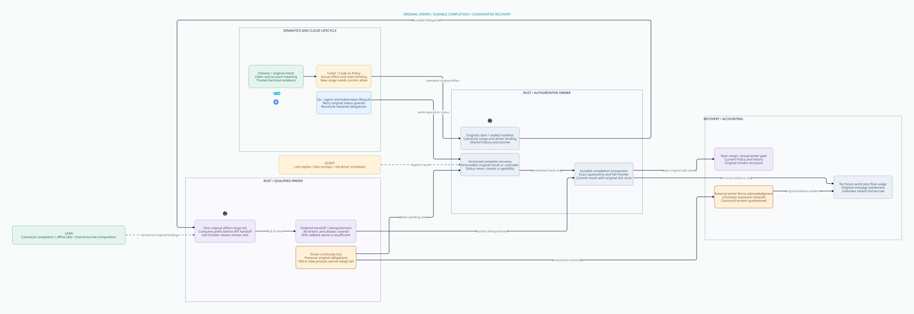

# SPDX-FileCopyrightText: 2026 hardenedlinux Linux Team and Contributors
#
# SPDX-License-Identifier: LGPL-2.1-or-later OR Apache-2.0

#+title: Weaver Range Completion and Driver Recovery Contract
#+language: en
#+date: 2026-10-19
#+property: STATUS abstract-composition-checked-physical-refinement-pending
#+options: toc:3

* Decision and scope

A range's possible-offer frontier, its original driver's relinquishment and the
provider's final usage are three independent facts. A full frontier does not
release a stream. A driver restart does not transfer its original tail. A
completion receipt does not settle an account. Unknown status retains the
original claim, possible exposure, stream obligation and full escrow.

This contract extends [[file:21-finite-stream-manifest-proof.org][finite manifests]] with an explicit driver incarnation,
one canonical pending completion per range, immutable durable completion results,
read-only resolution, external isolation and a permanently quarantined failure
path. [[file:../../dev/specs/lean/DriverCompletionRecovery.lean][The Lean product]] projects every event into the actual initialized finite
manifest relation. [[file:../../dev/specs/quint/DriverCompletionRecovery.qnt][The Quint extension]] imports the existing manifest fixture,
with concrete lost-reply, late-receipt and restart schedules. [[file:../../dev/specs/evidence/driver-completion-recovery-2026-10-19.org][The check receipt]]
records source identities, executable controls and remaining acceptance work.

The selected profile deliberately sacrifices availability after lost driver
continuity: it never reconstructs a tail, and isolation quarantines the original
stream permanently. It proves neither delivery nor eventual recovery. A future
transport profile that can safely transfer a tail needs a separate conservation
proof over outstanding API submissions, aliases, queues and writer fences.

 shows responsibilities and effect boundaries only.

* Identity, authority and the canonical completion operation

The authoritative completion key is the original lineage, canonical logical
message, immutable manifest and range ordinal. It is resolved by the owner;
a caller cannot choose a new completion identity with a nonce, connection,
Authority, RPC request, driver incarnation or retry count. There is at most one
prepared request and one terminal completion per canonical range. RPC retries
resolve that request; they cannot replace its binding or perform another send.

The complete concrete binding must authenticate the original admission record,
claim token and stream, issuer/executor, source/Policy publication dependencies,
canonical budget/history roots, manifest descriptor/bytes/peer, driver identity
and incarnation, owner epoch/incarnation and exact full possible-offer frontier.
The ordered relinquishment fact additionally covers every callback, enqueue,
offload and retained buffer under that original range capability. Matching a
frontier, PID, generation number or SDK outcome alone is insufficient.

In Lean, the immutable Manifest/Config parameter supplies lineage-scoped identity,
static descriptors and account roots; the immutable Delegation supplies the
original image, claim/executor ticket and owner epoch/incarnation. Request stores
key, manifest identity, original driver generation, owner epoch/incarnation and
full frontier. Exact joins those values to the original stored Delegation and
current driver continuity. These are scoped symbolic identities, not hashes or
cryptographic authentication. Separate driver instances in a deployment must
also bind authenticated driver identity; the model selects one driver process
with a global incarnation, so its crash invalidates all its outstanding tails.
Counter wrap, identity reuse and reboot with another Config are excluded.

Quint uses the same reduced binding with the imported four-message fixture.
Its fixed canonical keys determine claim/account/stream identity. It does not
implement source admission, the Cedar evaluator or a concrete receipt verifier.
Existing Cedar allow and authentic actual-effect/state requirements remain
prerequisites to the imported admission gate. A completion result is evidence
about an already accepted range, never a Cedar permission for a new range.

* Lifecycle and commit ordering

| State or event | Durable effect | Execution authority |
|----------------+----------------+---------------------|
| Delegated | Original range record, original driver incarnation, quota retained | One original bounded capability only |
| Prefix offered | Frontier consumed before invoking API, including retained async input | Same live original capability may consume its remaining bounded tail |
| Full frontier, completion absent | Active slot remains owned | No successor range; full cursor is not relinquishment |
| Completion prepared | Immutable canonical request recorded while full frontier and original driver are live | No stream release and no budget effect |
| Qualified finish committed | Authenticate original driver quiescence; publish immutable result and close exactly that slot in one owner transaction | Successor still requires current admission, history, source and budget guards |
| Completion reply lost | Same durable result survives | Exact status resolution is read-only; duplicate finish is rejected |
| Driver continuity lost | Advance incarnation, stop protected use, preserve every slot, request, result and frontier | Neither restored old process nor new process acquires old tails |
| Recovery, no terminal result | Missing is unknown, not aborted or never-sent | Keep occupancy; resolve or isolate, never replay |
| Qualified external isolation | Writer fence acknowledgment for the exact original range and all its aliases | Further mediated writes disabled; accepted bytes may still drain |
| Quarantine after isolation | Spend uncertain remainder as possible exposure, close that slot and permanently block canonical stream | No successor on that stream and no tail reconstruction |
| Late status/observation | Authenticate and append/read original-bound evidence | No new send, stream release, refund or settlement |

Preparation is not completion. A timeout at either side of the commit boundary
queries the same authoritative request/result. If finish committed before the
crash, resolution may read its historical original-driver result after restart;
it need not pretend that the old driver is current. If finish did not commit,
a late old-generation finish cannot create a terminal result. It may be retained
as evidence for trusted isolation/reconciliation, without releasing the slot.
The selected model then takes the conservative isolation/quarantine path.

Finish result publication and slot release are one abstract authoritative event.
A concrete implementation must supply a crash-atomic transaction or equivalent
commit-marker interpretation. With multiple stores, a bare slot flag becoming
inactive before its canonical result is durable is forbidden. Recovery must keep
the stream unavailable across intent-only, partial publication, conflicting
responses, unavailable status and unverified rollback. A committed result may
be published to a caller only after durable ownership publication. The model
contains no two-store distributed transaction implementation or fsync proof.

No absence of a local thread, process or lease constitutes isolation. The actual
transport owner must revoke every future submission path held by the original
driver, including copied FDs, callbacks, remote workers, queued retry tasks and
external offloads. If this cannot be established, keep the unresolved slot and
stream unavailable. A numeric epoch checked only on new broker calls cannot
stop an old raw FD. The counterexample explicitly admits a bypass write and
breaks byte affinity even after modeled quarantine.

Already accepted bounded bytes may drain after either finish or isolation. The
selected finish profile requires ordered, nonduplicating handoff and no future
writer, not remote application acknowledgment or cancellation of accepted bytes.
If a transport cannot preserve order against the next range, its finish cannot
release the slot. If it cannot bound uncertain accepted buffers, the manifest
refinement does not apply. Receiver idempotency can suppress duplicate business
application; it cannot undo disclosed bytes or justify refunding unknown exposure.

* Races and failure decisions

| Interleaving | Required decision |
|--------------+-------------------|
| Two matching completion calls | One canonical durable finish; the second reads the original result, never replays finish |
| Same canonical key, altered request | Reject; do not use last-writer-wins replacement or a fresh operation ID |
| Full API submission, short or lost callback | Frontier stays full, slot stays owned; callback cannot rewind or relinquish |
| Finish committed, reply lost, driver restarts | Preserve result and closed original slot; exact status returns it without transferring a capability |
| Finish prepared, driver crashes before commit | Preserve pending request and active slot; late original-generation finish rejected after restart |
| Late original receipt while successor is active | Resolve original record only; successor slot remains active |
| Driver crash after partial write | Old tail remains bound to old incarnation; new driver cannot continue from saved cursor |
| Old driver resumes after new process starts | External writer fence or continued unavailability; no retagging of original tail |
| Isolation wins before future write | Protected submission rejects; quarantine preserves full possible exposure and stream block |
| Finish races with isolation | Serialize at owner; a qualified finish may close its exact full range, otherwise quarantine; neither path creates another tail or refund |
| Completion and owner seal/history cut race | Already accepted range retains its bounded exposure; new range requires current gate even if old finish succeeds |
| Final usage arrives before no-future-writer evidence | Record original usage, but settlement waits for retirement |
| Completion or isolation arrives without final usage | Retirement is not billing evidence; hold remains unresolved |
| Snapshot restores pre-completion state | Independent anchor/high-water and complete recovery reject stale admission; restart with an empty result map is not allowed |

The abstract crash event is an authoritative loss-of-continuity transition,
not a claim that a resurrected process automatically observes the new generation.
The runtime refinement must enforce its monotonic incarnation and fence at the
actual writer. A restored driver cannot restore the independent authority domain.
If the monotonic registry or physical fence is partitioned, protected admission
and recovery remain unavailable. No wall-clock timeout grants authority.

* Budget, history and parent retirement

Completion preparation, commit, reply loss, status resolution, driver crash,
recovery and isolation do not publish a financial ledger transition. Every range
continues to retain its admission and quota. Quarantine conservatively consumes
the remaining possible-offer frontier without charging that quota a second time.
There is no automatic refund profile. Full original message reservations remain
in the same canonical shared account throughout all these events.

Parent retirement requires all active original tails closed; at the concrete
boundary it also requires authenticated terminal/isolation evidence covering
all accepted work. It does not require successfully offering every unaccepted
range: abandonment can terminate a partially sent message, but cannot resurrect
its original manifest later. Permanent stream quarantine retains uncertain
framing and exposure. The selected profile does not open a replacement stream
for that unresolved original intent.

The actual imported ledger permits charged only with observed, retired,
finalCost and reserved. The Lean extension derives this conjunction from the
reachable initialized ledger, and derives closed tails separately. It does not
establish that an arbitrary supplied finalCost bit is authentic provider usage.
The owner must join original-bound financial evidence, typed units and any
conservative exposure/cost bounds. Multiple late usage observations must refine
one canonical settlement, not accumulate duplicate charges or release unknown
holds. A variable pricing/refund protocol remains outside this fixed-envelope
model. Charged and held are categories of the same retained reservation.

* Source-by-source reuse and extension

Committed source identities and navigable paths are in [[file:01-reference-comparison.org][the reference register]].
This review reads those Git objects, preserving dirty owner checkouts and pins.

| Owner / inspected definition | Direct reuse | Driver completion extension and evidence boundary |
|------------------------------+--------------+---------------------------------------------------|
| P43 funs-attempt.ss, recover/reconcile/close | Recover moves active attempt to obligations, advances generation, retains frozen input; close rejects pending obligations | Use obligations for original range resolution, never replay jobs. The reconcile source explicitly says intent for trusted terminal/isolation receipt resolution, never acknowledgment by itself; host must authenticate and CAS-publish |
| P31 SessionAttempt.lean / Quint | Pure generation/revision and pending-attempt transition laws | Join driver incarnation, original canonical completion and writer-fate evidence; Session generation does not fence sockets |
| P18 receiptBindsCanonicalRequest / priorCommitExists | Bind full request and require actual valid stored committed receipt | Completion status must point to actual original durable finish. duplicateOutcomeDoesNotProvePriorCommit rejects duplicate labels without a prior commit |
| P18 RecoveryEvidenceClosed | Explicit registry uniqueness, valid record, exclusive claim and bound terminal receipt | Supply actual durable driver registry and physical no-future-writer evidence. matchingFenceFieldsDoNotProvideExclusiveOwnership shows numeric field agreement alone is insufficient |
| P19 source-bound recovery bridge | Cross-owner evidence joins remain conditional on their owners | Add the manifest/range/driver join; do not infer terminal authority from a transport callback |
| P20 CommittedEffectApplicationExactlyOnce | Closed declared effect universe and projection of its application property | effectUniverseExecutesExactlyOnce is an explicit closure input. It does not prove driver byte affinity, transport completion, physical shutdown or pricing |
| P12/P13 token and strict mediation | Exact validation context, monotonically spent issuance and indeterminate-result handling | Retain authoritative spent context through completion/recovery; fresh nonce or fresh Authority cannot reopen old range. No new grant is consumed merely to query status |
| P15 effect-host-deliver! | Reservation consumed before currentness/callback, even rejection/exception/unknown | In-memory identity/reservation tables do not persist driver continuity or establish relinquishment; keep the durable owner extension |
| P17/P22 durable memory/backend | Scheme projects contracts; runtime owns append/fsync/lease/checkpoint/repair | Persist completion requests/results/frontiers/quarantine in the anchored authoritative image; replay restores obligations only |
| P33 budget/runtime separation | Typed semantic accounting and separation of watchdog/retry from budget authority | Join authenticated provider final usage separately; driver completion is not money or token usage |
| P35 publication/lineage proofs | Exact equality alone permits rollback; fork-free authoritative publication is explicit | Completion and incarnation state need the same protected recovery/anchor contract; local snapshot equality is insufficient |
| C8 BoundOperation.check/authorize | Equality of supplied actual effect/state with the bound projection | Source explicitly leaves actual input authenticity to Host. Verify actual completion/quiescence evidence, manifest, destination and original state |
| C10 layersAllowed / Receipt.allowed | Nonempty required allow layers with no erroring policies | Use for new semantic admission; successful receipt construction is not allow and completion status is not a reusable policy grant |
| C11 composition | Conditional certificates and aligned dependencies | Extend actual-effect correspondence through the final driver; no certificate alignment theorem authenticates physical buffers |

No native owner theorem or ABI was rebuilt here. Standalone Weaver Lean uses
Std plus the existing Weaver proof chain. These are explicit reuse targets and
checked abstract refinements, not a claim that POO Flow already implements the
new durable completion protocol or that cedar-poo-spec proves a live gateway.

* Checked properties and counterexamples

| Lean declaration | Checkable consequence | Premise that remains external |
|------------------+-----------------------+--------------------------------|
| reachable_projection | Every completion/recovery event is a genuine manifest step or its observation stutter; initialized reachability is preserved | Actual implementation refines the event mapping and atomic durable publication |
| durable_completion_never_releases_another_slot | Every stored completion retains its canonical pending request and an admitted inactive original slot | Finish event authenticates original-driver quiescence; it is not any SDK report |
| terminal_result_has_exact_original_binding / finish_changes_only_original_slot / result_is_immutable / pending_is_immutable | Terminal result retains original key, manifest and full frontier; only the exact slot changes and original requests/results cannot be replaced | Canonical lineage and full request identity authenticated |
| old_driver_never_regains_tail | Across arbitrary finite event traces, original admission/tail binding persists; a newer incarnation cannot acquire it | Independent monotonic generation, actual writer gating and no unmediated aliases |
| no_duplicate_bytes / shared_escrow | Arbitrary finite manifest byte affinity and shared-account coverage lift to this product | Partition, buffer authenticity, typed envelope and physical bounded-capability premises |
| retirement_requires_closed_tails / settlement_has_independent_final_usage / settled_message_has_no_live_tails | Charged requires observed, retired, finalCost, reserved; retired has no active tails | Evidence authentication and all runtime work included in the protected universe |
| completion_keeps_ledger / completion_keeps_quota | Finish changes neither financial control state nor original admitted quota | No hidden adapter/driver side accounting or automatic retry |
| original_claim_history_and_executor_survive | Original claim/token/stream/executor and history remain sticky through the product trace | Immutable Config/Manifest and complete authoritative recovery |

Quint adds twenty-four positive/rejection scenarios and six explicit bad-design
controls. Lost prepare/finish replies, late original status against an active
successor, duplicate/altered requests, old-generation finish, missing status,
partial restart, full-frontier occupancy, fencing, unknown holds and separate
usage/retirement are checked. Imported manifest controls retain their old scope.

Six counterexamples expose early release from a prefix callback, retagging a
recovered tail, treating finish as usage, applying an old receipt to the successor,
erasing a result after reply loss and bypassing the writer with an old buffer.
The first, second, fourth and fifth use an explicit semantic violation audit bit
to retain the forbidden transition fact; that bit is never an execution guard.
The third violates settlementSafety directly; the sixth duplicates a possible
byte offer and violates imported rangeSafety directly. They are excluded mutants,
not claims of discovered POO Flow runtime bugs.

Lean proves arbitrary finite manifest/count and trace consequences for its
relation. Quint sampling is bounded, with four-byte fixed descriptors and fixed
canonical account fixtures; it is not exhaustive or a refinement proof into Lean.
The settlement fixture has separate observed/usage/charged sets joined to the
manifest retirement guard; the Lean statement instead uses the actual imported
financial ledger. Their event correspondence is documented, not asserted as
byte-identical state machines. There are no gateway performance results.

* Scheme, Go, Rust and the fast path

Scheme owns semantic completion/abandonment meaning, original logical identity,
claim/account/history domains, full action inventory, typed budget contracts and
trusted receipt requirements. Reuse SessionAttempt recovery and source-bound
promotion/reconciliation semantics. A pure proposed next state cannot stand in
for durable publication or authorize runtime completion.

Go owns cloud-native agent/session orchestration, SDK adapters, Kubernetes
identity/lifecycle integration, backpressure and read-only recovery/status
coordination. It retains original operation IDs across RPC retries, suppresses
provider-client retry/redirect/reconnect behavior that would enqueue a protected effect and
passes immutable complete-message proposals into the Rust broker. A Pod restart,
new controller leader or SDK success cannot release a stream, retag a tail or
settle provider usage. Go needs no raw protected egress handle to perform these
cloud-native responsibilities.

Rust owns actual broker admission, canonical durable completion registry,
monotonic driver incarnation, prefix capability consumption, ordered transport
handoff, writer fencing, stream quarantine and escrow publication. Only its
qualified original driver may consume an accepted tail. Rust memory safety alone
does not provide distributed durability, FD revocation or exact external effects;
transport and persistence qualification are explicit obligations.

The intended high-performance path serializes only conflicting work at the
actual owner. Prefix progress uses the one original in-memory affine capability;
a completion performs one bound durable ownership transition, and retries use
read-only exact resolution. Independent streams and accounts may proceed in
parallel. Fsync grouping or batched terminal records must preserve per-range
canonical identity and commit dependencies; a batch acknowledgment cannot release
an uncommitted member. Formal models do not validate any batching optimization.
No per-byte Scheme RPC, Go status callback or new Cedar grant becomes a second
sender. Fresh range admission still checks current determining dependencies.

* Physical acceptance obligations

The following remain required before claiming end-to-end runtime closure. Each
run must retain original request/result/anchor identifiers, driver and owner
incarnations, all submitted buffer ranges, conflict ordering and financial joins.

| Failure injection | Required evidence |
|-------------------+-------------------|
| Kill before/after completion intent, commit marker, fsync and reply | Only durably committed original finish releases slot; every incomplete/torn combination remains blocked, same-operation resolution never sends |
| Concurrent exact and conflicting completion RPCs across replicas | One immutable full-bound result; altered or absent requests do not inherit its authority |
| Deliver original receipt after successor has begun | Original status is read-only and successor remains owned; no ordinal-relative lookup or current-driver substitution |
| Restart driver with partially written or fully submitted async buffers | No recreated tail; all retained aliases/offloads inventoried, original quota retained and canonical stream stays unavailable until qualified isolation |
| Resume old driver with copied FD after new Pod/driver starts | Actual writer denies future submissions or safety is explicitly unqualified; local generation comparison alone is a failed gate |
| Lose or partition external fence acknowledgment | Keep active obligation and unknown hold; no timeout-based release; already accepted drain remains bounded |
| Restore whole-machine snapshot before finish or incarnation advance | Independent anchor/high-water rejects stale image; no empty registry/current incarnation is inferred from local disk |
| Race history/seal cut with finish and next range | Finish conveys no permission; actual next admission serializes against the cut |
| Duplicate/reorder final usage, completion and isolation | One original-bound settlement only with no-future-work and authentic final usage; unknown holds never refund automatically |
| Commit a batch with one torn/missing member | No member release from a generic batch success; exact durable member dependencies determine visibility |

These are acceptance requirements, not executed runtime receipts. Abstract
quiescence/fence constructors are trusted event boundaries. Complete physical
source/storage/driver refinement, authentic billing evidence, native acceptance
and deployed behavior remain pending. No gateway code or dependency pin changes.

* Embedded architecture views

** 23-driver-completion-recovery.svg

