#+title: Weaver Writer Isolation, Split-Store Completion and Final Settlement
#+language: en
#+date: 2026-10-19
#+property: STATUS abstract-composition-checked-physical-refinement-pending
#+options: toc:3

* Decision and trust boundary

Separate the durable evidence store, the canonical ownership decision, the local
stream view and the financial settlement record. An evidence write, a transport
callback, a missing response or a late usage receipt cannot release a stream.
One canonical terminal decision determines the original range's ownership;
publication exposes that decision conservatively to the local owner. Settlement
joins the original message's closed work inventory with independently authentic
final usage. Unknown outcomes retain occupancy or escrow.

This extends [[file:22-driver-completion-recovery.org][the driver recovery contract]]. [[file:../../dev/specs/lean/WriterSettlementClosure.lean][The Lean product]] imports its actual
initialized transition relation and retains the finite-manifest and original
ledger projection. [[file:../../dev/specs/quint/WriterSettlementClosure.qnt][The Quint model]] imports the preceding driver model and adds
split-store and financial receipt schedules. [[file:../../dev/specs/evidence/writer-settlement-closure-2026-10-19.org][The check receipt]] distinguishes
executed checks from physical qualification.  contains design
relationships only, with source versions and verification evidence kept in Org.

This is an ordered publication protocol with one authoritative ownership decision,
not a claim that independent stores magically share an atomic transaction. The
selected owner must bind that decision to the actual writer gate. An integration
with two independently authoritative permission stores, an autonomous SDK sender
or a disconnected raw FD does not satisfy this profile.

* Writer evidence and original capability binding

Both completion and isolation evidence bind the canonical lineage, original
message/claim/stream, immutable manifest and ordinal, original driver identity and
incarnation, original executor/owner stamp, exact writer inventory and possible
accepted-buffer inventory. Concrete evidence also needs an authenticated issuer,
its authorized scope, an irrevocable writer barrier and the admitted bytes/peer.
Receipt IDs, matching integer epochs, PID death, a lease timeout or a signature
from an unrelated issuer do not establish these facts.

| Evidence | Required semantic fact | What it does not establish |
|----------+------------------------+----------------------------|
| Qualified completion | Original full-frontier handoff is ordered, nonduplicating and relinquished; no future submitter retains that range capability | Remote application, drained accepted buffers, final cost or authority for a new range |
| Qualified isolation | Every future submission path for the exact original capability is disabled; accepted work is bounded and inventoried | Retraction of disclosed bytes, cancellation of accepted offloads, final provider usage or a safe transferable tail |
| Final usage | Original closed billable scope has authoritative final usage in the admitted unit and envelope | Writer isolation, stream release, admission of another effect or authority to overwrite a prior final settlement |

Writer inventory includes FDs and their duplicates, callbacks, tasks, retry queues,
shared-memory rings, TLS/protocol state, offload engines, remote workers and any
SDK object capable of protected disclosure. Buffer inventory covers the maximum
possibly accepted scope, not only a returned short byte count. A hash authenticates
a declared inventory only after an authorized owner establishes completeness.
A missing alias invalidates the isolation claim even when all supplied fields match.

A fence acknowledgment must be durable and irrevocable for the original capability
across process, node and transport-owner restart. Merely checking generation on
new broker requests cannot stop writes through an old raw FD. If the transport
cannot supply such a boundary, keep the unresolved stream unavailable. Accepted
bounded buffers may still drain after the barrier; their effects remain in the
original billable/exposure scope. A receiver business deduplication key does not
prevent disclosure or prove that an old buffer cannot be submitted again.

Lean Profile.evidenceAuthentic and Profile.usageAuthentic are explicit predicates
supplied by the evidence owners. The model preserves those inputs and their
bindings; it does not derive authenticity, inventory completeness or physical
revocation from numeric equality. Profile writer/buffer identities, closure and
unit mapping remain immutable under the selected lineage. They are symbolic
references, not implementations of hashes, verifiers or transport barriers.

* Durable evidence slots and terminal decision

Each original range has two separate immutable evidence slots: completion and
isolation. They have different evidence keys but share one canonical terminal
decision key. One terminal decision may select exactly one branch. A nonce, new
Authority, reconnect, driver incarnation or another RPC ID cannot select a new
terminal identity for the same range.

This distinction closes a recovery deadlock: an authentic completion blob may
have been persisted before the driver crashes, while its terminal decision never
committed. The old driver generation can no longer perform a fresh finish. The
owner must still be able to append isolation evidence without replacing the
original completion blob. After authenticated isolation it can choose the
quarantine branch. Both blobs remain historical evidence; only one terminal
branch controls ownership. A committed finish cannot later become quarantine,
and a committed quarantine cannot later become finish.

The Lean blobKey encodes branch and original range using unbounded naturals.
Concrete encodings must be injective and reject overflow, truncation and namespace
reuse. The one canonical decision remains keyed by the original range, independent
of this evidence storage encoding. Quint uses a typed pair of range and branch.

* Publication protocol and crash cases

1. Preserve the original claim, manifest, prefix frontier, driver binding, held
   budget and pending completion request. Preparation alone retains occupancy.
2. Authenticate writer evidence and durably append it to its immutable typed
   evidence slot. The evidence owner must establish actual stable persistence,
   complete content and the exact original scope before the next phase.
3. At the canonical ownership decision store, compare-and-commit the original
   terminal key, selected evidence reference and ownership transition. The finish
   branch refines the existing driver finish; the isolation branch requires the
   exact external fence acknowledgment and refines quarantine. This is the
   linearization point. Only this authoritative decision interprets the original
   slot as closed; no independent cache flag can grant authority.
4. Publish a local view only from the exact durable decision and its exact evidence.
   A committed but unpublished decision conservatively blocks new admissions on
   the same canonical stream. Other independent streams can progress. Missing or
   conflicting evidence keeps recovery unavailable; it never becomes success.
5. Parent retirement requires every accepted range inactive and its exact terminal
   decision published. Freeze the original work inventory before recording the
   canonical message closure. Unaccepted ranges may be abandoned; retirement
   prevents later acceptance under the original message identity.
6. Authenticate original-bound final usage after closure, then commit one immutable
   usage record and one canonical settlement record. Apply the original ledger's
   final-cost/charged categories only through those joins. A lost response queries
   the same record; it never creates another financial application.

The abstract driver product closes its authoritative slot at terminal commit;
the new product separately tracks local publication. Thus a restart after commit
can publish an original historical finish even though the driver generation has
advanced. This is readback of a committed decision, not a new old-generation
finish. If only a completion blob exists, driver continuity loss cannot be
repaired by replaying the uncommitted finish. Take the isolation path instead.

No cross-store atomic write is assumed for evidence and local views. Their
ordering, immutability and fail-closed interpretation are required. The canonical
decision and authoritative ownership interpretation still need one qualified
transaction or equivalent durable commit marker at the actual writer boundary.
A concrete database/fsync/outbox integration is not proved here.

| Lost response or crash point | Recovery rule |
|------------------------------+---------------|
| Before evidence durability is known | No ownership decision; query exact evidence slot, keep pending occupancy |
| Evidence durable, decision absent/unknown | Evidence alone cannot release; query canonical decision; missing is unknown, never an inferred abort |
| Terminal decision durable, reply lost | Recover the same immutable branch/result; retain local admission block until exact publication |
| Local view persisted, publication reply lost | Repeated publication is read-only in authority terms; it cannot close a successor or rebuild a send capability |
| Driver restarts after evidence but before finish commit | Old-generation fresh finish rejected; append separate isolation evidence without replacing completion evidence |
| Driver restarts after finish commit | Preserve original decision; readback/publication can succeed without transferring old capability |
| Isolation acknowledgment response lost | Resolve exact original barrier; timeout or a new local generation cannot supply the acknowledgment |
| Usage or settlement commit reply lost | Resolve the exact original record; no new settlement key, sum increment or refund |
| One store is stale, unavailable or restored from snapshot | Reject incomplete recovery against the independent anchor/high-water; never infer authority from a local empty map or cached success |

A concrete decision must retain complete determining evidence or a verified durable
reference whose availability and retention contract covers recovery. The model
has no evidence deletion, decision erasure or independent authoritative image
rollback transition. The earlier anchor contract remains mandatory. A reference
to an unavailable or rolled-back blob does not qualify a complete recovery.

* Final usage and settlement binding

Final usage binds the original canonical message, manifest, original consumed
claim token and claim stream, original budget/history roots, immutable closure
scope, accounting unit and bounded amount. The closure identifies the frozen
original work inventory, including every possibly accepted buffer/offload. It is
not the latest connection, current driver generation or caller-selected retry ID.
The actual provider/evidence owner must attest finality over that complete scope.

Progress, estimated usage, a short write, elapsed time, successful completion and
isolation are not final billing receipts. Early observations may be retained as
untrusted/pending evidence, but the final-usage commit action is unavailable until
the original closure exists. A late final receipt cannot synthesize that closure,
release any active stream or substitute another account, unit or message.

Usage records and settlement records are independently immutable per original
message. Exact duplicate status resolution is harmless. A different late final
amount or another receipt body is rejected by normal settlement, even if it has
a fresh RPC ID or valid signature. Such a conflict creates an accounting dispute
or correction obligation; it cannot silently overwrite prior history, apply a
second charge, refund a hold or reopen execution. A future correction/refund
ledger needs its own append-only identity and conservation proof.

The selected profile retains the original fixed reservation. Internal settlement
classifies admitted held resources; it does not execute an external payment or
prove a provider's charging semantics. Settled amounts are nonnegative, in the
original unit, and bounded by the original message envelope. Their finite shared
account sum is proved covered by the actual booked reservations and capacity.
No unknown or over-envelope amount is normalized to zero. An over-envelope
receipt blocks this normal path, retains conservative holds and records an
uncovered-liability/repair obligation outside this model; it does not make that
external liability disappear. Currency conversion, vector resources, pricing
changes, refunds and provider dispute resolution remain separate refinements.

Lean uses the actual original ledger: its charged category requires observed,
retired, finalCost and reserved. The new advance relation additionally requires a
canonical settlement record before any charged ledger state is admitted, and a
usage record before finalCost is published. The new financial records do not
clear reservations. A crash between settlement decision and ledger materialization
retains the decision; replay materializes the same category, not a second effect.
An external billing/payment integration needs an additional execution-idempotency
or no-retry-on-unknown contract; this proof does not provide one.

* Source-by-source reuse and required extension

[[file:01-reference-comparison.org][The source register]] retains exact committed identities and navigable paths.
The new receipt verifies the relevant Git objects; no dirty owner tree is built
or modified and no dependency pin is changed.

| Source owner | Directly reused contract | Extension required for this chain |
|--------------+--------------------------+-----------------------------------|
| P18 PromotionTransactionRecovery | receiptBindsCanonicalRequest, actual valid priorCommitExists, registry uniqueness and exclusive recovery claims | Canonical range/financial decisions must point to real durable original records; duplicate labels or matching fence fields alone prove neither commit nor exclusivity |
| P19 source-bound completion/recovery bridge | Explicit authorization-request/recovery-identity and owner validity joins | Add actual writer/buffer universe, selected terminal branch, closure and financial receipt joins; the bridge does not supply physical facts for the Host |
| P20 CommittedEffectApplicationExactlyOnce | Closed declared-effect universe with explicit application multiplicity premise | Its effectUniverseExecutesExactlyOnce input is not a derived FD fence, durable cross-store transaction or provider finality proof |
| P31 SessionAttempt / P43 funs-attempt.ss | Frozen original attempt, retained recovery obligations and trusted terminal/isolation reconciliation | Resolve original evidence slots and canonical decisions; pending obligations are not replayable send jobs and reconcile intent is not acknowledgment |
| P12/P13 token/strict mediation | Full validation context and monotone consumed issuance, including indeterminate outcomes | Retain spent context through all stores and recovery; completion/status/usage does not refresh nonce or authorize another logical claim |
| P15 effect-host-deliver! | Reservation spent before callback/currentness even on unknown or failure | In-memory consumed state cannot establish writer continuity, durable completion or financial finality |
| P17/P22 durable backend/store | Scheme projects backend contracts; runtime owns append/fsync/lease/checkpoint/repair | Add authenticated immutable evidence retention, canonical decision CAS, exact publication and complete anchored recovery; negotiation metadata is not an executed durability guarantee |
| P33 deterministic budget/runtime separation | Typed owner-bound budget accounting; watchdog threshold does not establish semantic exhaustion | Provider final usage is a separate authenticated unit/scope, not timeout, scheduling fuel or a retry observation |
| P35 authoritative publication/lineage | Fork-free common authority and exact-equality rollback counterexample | All recovered decisions, evidence references, usage and settlement must share protected original lineage; equality of restored local snapshots is insufficient |
| C8 BoundOperation | Exact supplied effect/state projection, with explicit Host authenticity obligation | Authenticate actual writer evidence and final usage, their authorized issuer and original scope; matching supplied fields does not establish physical facts |
| C10 layersAllowed / Receipt.allowed | Nonempty required allow layers, no erroring policies | New range admission still needs current actual effect/Policy; completion/settlement receipts never become reusable policy grants |
| C11 composition | Evaluation/typechecking certificates under supplied validity and alignment premises | Extend actual Host-to-driver correspondence; dependency alignment cannot authenticate external barriers, billing or persistence |

The Weaver Lean extension imports Weaver's existing checked relation and Std.
It is not an import/build/ABI qualification of those owner packages. Source reuse
here means explicit semantic contracts and proposed refinement targets; no claim
is made that POO Flow already implements this gateway split-store protocol.

* Checked composition and counterexample oracles

| Lean declaration | Consequence | Required external premise |
|------------------+-------------+---------------------------|
| reachable_projection | Every product event refines the initialized driver/manifest/ledger chain or its stutter | Actual source and storage events refine this mapping |
| every_decision_has_durable_evidence_and_closed_original_slot | Original decision retains exact evidence and an admitted inactive original slot | Evidence storage durability and canonical commit interpretation |
| no_visibility_from_prepared_blob / unpublished_decision_blocks_stream | A blob cannot become a published decision; unpublished original decisions block same-stream new admission | Actual owner uses the publication gate, including after restart |
| terminal_decision_has_authentic_original_evidence | Preserves declared authentic evidence and original driver/inventory binding | Profile authenticity/completeness and irrevocable physical barrier are supplied inputs |
| settlement_has_published_terminal_coverage / settlement_joins_authentic_final_usage | Same immutable usage, original unit/account/manifest/envelope and retired fully published work inventory | Genuine provider finality over possible accepted work |
| charged_ledger_has_canonical_settlement | Actual charged ledger state requires a canonical settlement record | Ledger materialization is gated by that exact durable record |
| settlement_covered_by_original_reservations / account_settlement_never_exceeds_capacity | Arbitrary finite settled-amount sum stays within the actual original booked shared budget and capacity | Original typed envelope bounds; no hidden refunds or pricing effects |
| decision_addresses_only_original_range / typed_evidence_key_is_injective / blob_immutable / decision_immutable / usage_immutable / settlement_immutable | Original-range addressing and typed evidence keys remain distinct; reply loss, restart and later receipts cannot replace canonical records | Independent protected authority survives machine snapshots |
| late_usage_never_changes_driver / byte_affinity_survives_split_stores | Usage publication cannot release a slot or transfer a tail; original byte affinity lifts to this product | Actual transport obeys affine capability and writer gate premises |

Quint adds thirty-two positive/rejection scenarios and eight excluded bad designs,
including both terminal-branch race outcomes, separate isolation evidence after
uncommitted finish, lost cross-store replies, missing publication, wrong writer/
buffer scope, old FD adoption, duplicate/conflicting final usage, closure/unit/
account/token mismatches, over-envelope usage and shared-account finalization.
The preceding driver's directly imported controls retain their original scope.

Quint separates settlement decision from account application as distinct actions.
A durable applied-record set guards account materialization; its charge counter
is an observation, never an execution guard. Tests cover decision commit with a
lost reply before account application, application reply loss, and a rejected
second application. Lean independently gates the actual charged ledger category
on the canonical settlement record. Repeated materialization of an unchanged
category is not an external payment effect; no physical payment exactly-once
claim follows from either model.

Six new mutants violate visible, closed or financial invariants directly: publish
from a blob, duplicate settlement application, overwrite final usage, synthesize
closure from a usage event, erase a published decision after reply loss and treat
completion as billing. Old-FD retagging and incomplete writer-universe acceptance
retain explicit semantic violation audit facts; those facts are never execution
guards. They illustrate missing contracts, not discovered POO Flow runtime bugs.
The imported driver control also retains the concrete possible-byte duplication
counterexample for an unmediated old buffer.

Quint fixtures use four admitted messages, two shared accounts and fixed four-byte
ranges. The accounting unit conversion is fixed once per finite-size initializer.
Its claim-stream scope is the declared canonical fixture stream; Lean checks
actual stored claimToken/claimStream at usage publication. There is no proved
Quint-to-Lean equivalence or native driver/storage refinement. Bounded simulation
is not exhaustive. The receipt states exact checked bounds and tool identities.

* Scheme, Go, Rust and the fast path

Scheme defines semantic original-message identity, Code as Policy projection,
account/history/closure meaning, complete writer/effect inventory and trusted
terminal/finality contracts. Reuse POO Session/recovery and source-bound receipt
contracts. A pure proposed transition cannot certify physical durability or
actual provider usage.

Go owns cloud-native agent/session coordination, Kubernetes identity and owner
lifecycle, SDK adaptation, backpressure and exact-original status reconciliation.
It may retry queries against canonical evidence/decision/settlement keys. It may
not retry protected effects, infer stream release from an RPC result, substitute
a new Pod identity for an old writer barrier or turn SDK usage callbacks into
financial authority. It does not need a raw protected egress FD for these roles.

Rust owns actual writer and buffer capabilities, protected submission, immutable
evidence/decision publication, stream-view gates, anchored recovery and typed
financial materialization. A strong Rust memory model helps with affine local
handles; actual FD aliases, offloads, persistence and external writers still
need independent contracts and acceptance evidence.

The intended fast path retains the unique original prefix capability, stages
immutable evidence once, commits one canonical terminal decision and publishes
an idempotent view. Status retries read original records. Only conflicting stream
work waits for its terminal publication; independent streams can progress. Usage
and financial materialization run off the send path but remain joined to the
original closure and account. Batching may amortize persistence only if every
member retains its exact durable dependency and canonical decision; a generic
batch success cannot release missing members. No throughput or latency claim
is established by formal checks.

* Physical acceptance still required

| Fault injection or source refinement | Required observable evidence |
|--------------------------------------+------------------------------|
| Kill around evidence append/fsync, decision CAS/commit marker and view publication | Exact original records and durability receipts; no evidence-only or response-only release; readback of a committed decision never sends |
| Partition stores or lose every phase response | Original operation resolution remains read-only; missing/ambiguous state retains occupancy or holds, with no replacement identity |
| Persist finish blob, crash driver before decision, then isolate | Both evidence branches retained; exactly one canonical terminal decision; original completion blob is not overwritten |
| Restore process/node/transport snapshot with copied FD, queued callback or offloaded buffer | Independent actual writer fence rejects future submission or safety remains unqualified; all accepted work remains in original exposure/billing scope |
| Reboot the external fence verifier itself | Monotonic protected authority and original writer inventory survive; a local cached barrier/lease cannot restore permission |
| Late original completion while successor is active | Only original decision/view addressed; successor ownership and current Policy gate unchanged |
| Late, duplicate, conflicting, progress or wrong-scope usage | No stream release; original closure/unit/account/token/finality verified; one canonical settlement, unknown holds retained and conflict escalated |
| Settlement decision committed, account write/reply lost | Same decision materialized once into the same category; no second financial effect or refund from RPC retry |
| Evidence or account snapshot older than ownership decision | Complete anchor/prefix joins reject recovery; no admission from a mixed image or empty local map |
| Accepted buffers drain after writer isolation | Bound original accepted work and independently authentic final usage cover that drain; no early finality or disappearance of liability |

All rows are required acceptance work, not completed physical tests. The proof
keeps authentic evidence predicates, durable monotonic stores, one authority
interpretation and actual writer mediation explicit. Runtime qualification,
provider finality, external payment correctness, native ABI and deployed behavior
remain pending. No gateway implementation or dependency pin changes.

* Embedded architecture views

** 24-writer-settlement-closure.svg

