# SPDX-FileCopyrightText: 2026 hardenedlinux Linux Team and Contributors
#
# SPDX-License-Identifier: LGPL-2.1-or-later OR Apache-2.0

#+title: Weaver Account Application and Anti-Rollback Recovery
#+language: en
#+date: 2026-10-19
#+property: STATUS abstract-composition-checked-physical-refinement-pending
#+options: toc:3

* Decision and scope

Treat the original settlement decision, account-gate acceptance, canonical account
application receipt, independent anchor confirmation and restored database view
as different records. A lost write response cannot become a second application.
A restored empty table cannot make an unknown reservation free. A new worker can
resolve an original operation but cannot replace its canonical identity.

This extends [[file:23-writer-isolation-settlement-closure.org][the writer/settlement contract]]. [[file:../../dev/specs/lean/SettlementAnchorRecovery.lean][The Lean product]] imports the actual
initialized source relation, adds account authority and full-image recovery, and
lifts original reservation/capacity proofs. [[file:../../dev/specs/quint/SettlementAnchorRecovery.qnt][The Quint model]] imports the preceding
model and exercises lost account responses, mixed snapshots, worker fencing and
excluded rollback/replay designs. [[file:../../dev/specs/evidence/settlement-anchor-recovery-2026-10-19.org][The executable receipt]] records exact scope.
 contains design relationships, without versions or evidence.

The selected profile puts the canonical account gate outside worker and derived
account-database snapshot rollback. Its accepted-operation journal, application
receipts and monotonic fencing survive those restores. An independent anchor
records original intents and exact application confirmations. Database tables
restored from backups are verified projections of these authorities; they cannot
authorize new writes, mint budgets or establish absence of an old application.

A pending anchor intent alone is insufficient if the effect gate can forget its
consumption history. An explicit counterexample rolls back gate rows after a
write and produces a second write while the original intent still exists. This
is a trust-boundary failure, not a condition repaired by comparing local hashes.
The profile therefore requires a protected gate or an equivalently qualified
irreversible consumption boundary. If neither is available, stop recovery and
retain the unknown hold. Restoring every trusted authority together is outside
the safety claim; the independent root must actually survive the fault domain.

* Canonical identity and five records

| Record | Binding and authority |
|--------+-----------------------|
| Original settlement decision | Immutable original message/claim/stream, manifest, closure, budget/history roots, unit and final amount from the preceding source product |
| Anchored application intent | One original message key and lineage bound to the complete settlement receipt; RPC retry, new nonce or worker does not create another intent |
| Gate acceptance / permit | One immutable accepted request, original worker and gate fence; acceptance spends the canonical account-application slot before any account effect |
| Canonical application receipt | Exact original accepted permit plus atomic account-ledger application; receipt and application commit together at the actual protected gate |
| Anchor confirmation | Exact application receipt joined to the original intent; confirmation does not enqueue another application |

The restored account view is a sixth, derived object. It is not an authority
record. The existing source ledger's charged category is materialized only after
both the protected gate receipt and the matching independent confirmation exist.
An earlier account application that lacks confirmation remains booked and is
resolved before this category is published.

The application key is lineage, canonical original message and internal
settlement-application purpose. The model uses one fixed lineage parameter and
one canonical Nat key per original message; it never allocates a second purpose
or period. Concrete encodings must preserve the full tuple and reject overflow,
identity collisions, cross-tenant substitution and epoch reuse. The full Usage
value is retained, not only its receipt ID or amount. Current worker identity is
not a new message/account identity.

* Account-write and response-loss protocol

1. Complete the preceding original-bound writer/usage/settlement chain. The full
   original reservation remains held/booked; no account application grants send
   permission or replaces the source Policy/history guards.
2. Authenticate a complete current authority image and anchor one application
   intent referencing the exact original settlement. An unknown anchor response
   resolves this same intent. Another request body cannot overwrite it.
3. At the actual account gate, validate current worker identity and monotonic
   fence, original anchored intent, exact receipt and an absent canonical
   acceptance record. Persist the one accepted operation before dispatching its
   account effect. A new worker cannot acquire another slot for this key.
4. The gate commits the original internal account-ledger application and its
   immutable receipt in one qualified transaction. A duplicate request reads the
   original receipt; a missing/ambiguous response does not repeat the effect.
5. Resolve the actual receipt and append one exact independent anchor confirmation.
   A matching generation, generic success or duplicate label without a real
   committed gate receipt cannot confirm anything.
6. Recover a coherent full image, then materialize the source ledger/account view
   from that exact confirmed receipt. Rebuilding a derived category is not another
   canonical account application. No status read or projection replay sends bytes
   or executes an external payment.

A gate-accepted original operation may finish after its worker has been fenced.
It is already inside the bounded original account-application universe, and its
canonical slot is spent. New requests from that old worker are rejected at the
actual gate. The original accepted request does not transfer to a new worker or
become a replayable job loaded from a snapshot. The gate journal owns the pending
operation independently of worker process memory.

The gate's atomic application/receipt boundary is still a physical qualification
premise. A normal database connection, retained callback or raw credential that
can mutate the account around this gate invalidates the profile. Fencing only
in a Go controller or at a queue consumer cannot qualify an unfenced writer.
This model concerns internal reservation classification, not provider billing or
external payment exactly-once behavior. Those effects require additional owners.

* Full-image recovery and conflicting snapshots

The authority image is a logical product of the source state, anchored intents,
gate acceptances/results, anchor confirmations, current worker/fence and separate
source/intent/gate/confirmation revisions. It does not mean that all stores are
updated by a distributed atomic transaction. Every phase remains independently
observable, including accepted-but-unknown and applied-but-unconfirmed states.

Recovery compares complete authenticated determining records and lineage at a
qualified current cut, not only maximum sequence numbers or equal local digests.
An account row with the right version and a wrong amount, receipt, account or
original request fails recovery. Revision vectors locate the required records;
the vectors do not authenticate those records by themselves.

Lean retains the full source product in the image and compares recoveryView of
the entire current product. The new acceptance/application ghost counters are
explicitly removed from recoveryView; counters never grant execution authority.
Quint compares its exported source world plus original complete request/permit/
receipt maps and revision vector. The preceding hidden source components are
represented through their source publication revision and imported invariants.
This is documented event correspondence, not an automated state-equivalence
or cryptographic verification proof.

| Snapshot or response condition | Required decision |
|--------------------------------+-------------------|
| Intent known, authoritative gate acceptance absent | Only a current fenced worker may compete for the one still-unaccepted slot after complete recovery; local absence alone is insufficient |
| Acceptance known, result absent or response lost | Keep pending original operation and full reservation; resolve gate status, never issue another permit |
| Gate result present, anchor confirmation absent | Resolve and confirm the exact result; do not repeat the account write or infer failure |
| Anchor confirmation present, restored account table older | Reconstruct the derived view from the protected original receipt; never execute a fresh account application |
| Anchor claims confirmation but canonical gate receipt unavailable/conflicting | Recovery unavailable; no synthetic success, replacement receipt or budget release |
| Same revisions but different determining records | Reject image even if local stores agree with one another |
| Source, gate or confirmation store at different authoritative cuts | Keep protected operations unavailable until the complete qualified image is reconstructed |
| Gate completes while recovery is reading | Revalidate against the gate's current revision/receipt or retry readback; an older read cannot authorize a new attempt |
| Old worker resumes after fence publication | New gate acceptance rejected; a preaccepted original operation may complete once under the protected journal |
| Whole worker/database backup restored | Only local/derived images move backward; protected gate and independent anchor retain authority and reject replay |
| Gate consumption journal itself regresses before confirmation | Safety premise violated; stop rather than infer the old application never happened |

The abstract model invalidates local readiness after each authority mutation.
Recovery restores readiness only with the complete current image. An implementation
may use authenticated incremental prefixes and conflict-local barriers instead
of rereading a whole deployment, provided they refine this gate. Each relevant
write must still serialize with fencing and currentness at the actual authority.
The model proves no wait-free recovery or eventual availability under continuous
updates/partitions. Source, gate and anchor version counters must not wrap.

The independent anchor and protected gate need an actual anti-rollback root,
monotonic publication and durable retention outside the snapshot domain. An
unverified backup, restore of their own old image or equality of two stale replicas
cannot supply those properties. This is an explicit trust premise to qualify,
not a theorem obtained from Cedar allow or from a local generation counter.

* Unknown budgets and materialization conservation

An anchored intent retains its exact original source settlement, which retains
its authenticated Usage, original installed manifest and original reservation.
The Lean product proves that reservation remains true even when account outcome
or confirmation is unknown. It does not turn an unknown outcome into a refund,
zero usage, a new account domain or another spendable envelope.

The finite account proof establishes:

#+begin_example
sum canonical gate application amounts for one original account
  <= sum original canonical settlement amounts
  <= actual booked original reservations
  <= original account capacity
#+end_example

Accepted-but-unresolved operations also retain their full original reservations;
the sum of visible successful applications is not a measure of available budget.
The earlier held/charged partition remains authoritative and fixed-envelope;
materializing charged does not clear reserved. A restored account cache showing
zero applied rows cannot reduce authoritative booked amounts.

Usage amount, accounting unit, original budget/history roots, closure and lineage
are immutable in the anchored request. A late differing usage receipt is handled
by the preceding conflict/repair contract, not by changing an application already
accepted or confirmed. Over-envelope liabilities, corrections, refunds, exchange
rates and external payments remain outside this selected profile. They cannot
be smuggled in as recovery or cache repair.

* Source reuse and extension boundary

[[file:01-reference-comparison.org][The source register]] retains exact committed identities; the receipt records
reverified source blobs. Native owner builds and existing pins are unchanged.

| Source owner | Reuse | Required extension / limit |
|--------------+-------+----------------------------|
| P18 canonical recovery | Full canonical request/receipt binding, actual valid prior commit, unique registry and exclusive recovery claim | Persist the original account intent/permit/application join; duplicateOutcomeDoesNotProvePriorCommit rejects labels without a real receipt; numeric fence matching does not supply exclusive gate ownership |
| P19 cross-owner recovery bridge | Explicit authorization-request, recovery-identity and owner validity joins | Add exact account-gate receipt and independent anchor membership; the bridge consumes owner evidence rather than producing storage facts |
| P20 committed-effect application | Closed declared effect universe and explicit application multiplicity premise | effectUniverseExecutesExactlyOnce is a closure input, not a proof that rolled-back account writers cannot replay |
| P31/P43 SessionAttempt and Session recovery | Frozen original attempts, retained obligations and trusted terminal/isolation reconciliation | Pending account operations are reconciliation obligations, not a worker retry queue; reconcile intent is not a committed receipt |
| P35 publication/lineage | exactEqualityAlonePermitsRollbackReplay, common authority binding and forkFree publication | Qualify the independent gate/anchor authority and complete source/application prefix; equal restored local snapshots are insufficient |
| P17/P22 durable store | Scheme projects contracts; runtime owns append/fsync/lease/checkpoint/repair | Implement protected application/receipt atomicity and anchored complete recovery; backend negotiation metadata does not establish physical persistence |
| P12/P13/P15 mediation and reservation | Monotone spent issuance, exact contexts and consumption before callbacks, including indeterminate outcomes | Status and recovery must retain old consumption; a new Authority/worker cannot mint another application slot from local absence |
| P33 deterministic budget/runtime separation | Typed resource accounting, watchdog/retry separate from budget authority | Unknown account-write response does not prove an unused hold or establish provider final usage |
| C8 BoundOperation | Exact supplied effect/state equality with explicit Host authenticity obligation | Authenticate actual account operation, source receipt, worker/fence and protected recovered state; matching supplied values does not authenticate either input |
| C10 Receipt.allowed / C11 composition | Error-free required allow layers and conditional aligned evaluation/validation certificates | Cedar constrains new semantic admission; it does not manufacture durability, anti-rollback roots, account idempotency or budget refunds |

The standalone proof imports Weaver's actual checked source relation and Std,
not the native POO Flow/cedar packages. These are reusable semantic contracts and
proposed concrete refinement targets. No claim is made that the existing owners
already implement this protected account-gate and anchor protocol.

* Checked proof and counterexample correspondence

| Lean declaration | Consequence | Unproved physical/input boundary |
|------------------+-------------+----------------------------------|
| source_reachable / reachable_invariant | Initialized source/ledger composition and original intent/permit/receipt/confirmation joins | Actual store event mapping and authenticity |
| accepted_and_applied_at_most_once | Every original key has at most one protected acceptance and one canonical application; ghost counts do not guard events | Nonrollback gate registry, atomic application/receipt and no bypass writer |
| application_has_original_settlement | Exact original key, lineage and complete source settlement retained | Concrete canonical identity and receipt authentication |
| online_requires_complete_current_image | Ready implies complete current recovery view; mixed images cannot restore readiness | Independent current authority, authenticated full read/prefix and serialization against conflicting writes |
| charged_has_exact_anchor_and_gate_receipt | Actual source charged category requires the same gate receipt and anchor confirmation | Derived materialization follows that record, without a second external financial effect |
| materialization_covered / materialization_within_capacity | Arbitrary finite application amounts remain within actual original booked shared capacity | Typed envelope and all actual effects represented in the gate universe |
| unknown_application_retains_reservation | Anchored original obligation retains its actual source reservation regardless of missing outcome | Original authority is not replaced by a restored local account image |
| intent_immutable / permit_immutable / outcome_immutable / confirmation_immutable | Restarts, lost replies and late receipts cannot replace original authority records | Durable retention across the selected physical fault domain |
| restore_never_changes_authority / ghost_counts_do_not_grant_recovery | Restorable images cannot reset authorities; model counters cannot authorize recovery | Protected roots actually lie outside snapshots |

Quint adds twenty positive/rejection scenarios and six excluded mutants. The
rollback mutant actually reaches a second canonical write after erasing gate
history while retaining the original intent. Other mutants expose wrong full-row
recovery, duplicate application, fabricated confirmation and original obligation
erasure. The unknownRefund mutant erases the source settlement reference and
breaks the original obligation join; it does not implement a real balance refund.
The old-worker bypass mutant retains a semantic ordering violation audit fact,
since a valid-looking old permit could otherwise resemble an operation legitimately
accepted before fencing. Audit facts and application counts are never guards.

Directed tests construct the preceding real source pipeline with this product
preserved at each step, including original settlement. Cold sampling starts from
its finite manifest initializers; additional samples start at anchored/accepted
states reached by that pipeline. Bounds, inherited-test scope, retained failed
fixtures and raw traces remain in the receipt. Neither bounded sampling nor this
composition proves a concrete distributed database implementation.

* Scheme, Go, Rust and the intended fast path

Scheme owns original intent, claim/closure/account/history semantics, Code as
Policy projection and trusted recovery/effect/finality contracts. Reuse the pure
Session and source-bound receipt vocabulary; a proposed transition is not a
durable application or an anti-rollback fact.

Go owns cloud-native worker/controller and agent lifecycle, SDK adaptation,
backpressure, exact-original status resolution and recovery orchestration. A new
Pod, leader or worker generation is a new proposer, not a new account identity.
Go cannot authorize refunds from a timeout, issue another original application
or bypass the protected gate with raw account credentials.

Rust owns actual account-gate admission, worker fencing, immutable application
journal, atomic account effect/receipt, protected anchor protocol and qualified
view materialization. Its storage/effect authority must cover every writer.
Language memory safety alone cannot protect a rolled-back database or certify an
independent root. The actual persistence and privileges remain acceptance work.

The intended normal path anchors an original intent, spends one gate slot,
commits one account application/receipt and confirms it before category publication.
Lost replies use read-only exact resolution. Derived account views can rebuild
without reexecuting canonical financial effects. Independent authority shards may
progress concurrently, but one original shared account cannot split into separate
empty authorities. Batching/prefix recovery must retain exact member dependencies
and conflict ordering; no benchmark or availability result is claimed.

* Physical acceptance still required

| Injection | Required evidence |
|-----------+-------------------|
| Kill before/after intent append, gate acceptance, account transaction commit, confirmation and reply | Exact phase records; one application at the actual gate; unknown outcomes retain holds |
| Restore worker/account snapshots from different cuts | Complete source/intent/gate/confirmation/fence joins reject the mix; same versions with altered records also reject |
| Gate result durable but response and anchor confirmation lost | Read original receipt, append same confirmation, publish category without replaying the account write |
| Restore a database that lacks the applied row | Protected gate history remains current; derived view repair creates no new application or free budget |
| Resume old worker with queue item, retained DB connection or credential | Actual gate rejects new stale requests; no bypass mutation path; preaccepted original operation remains bounded to one receipt |
| Lose/rollback the gate's consumption history before confirmation | Recovery fails qualification; no automatic new attempt based on anchor intent alone |
| Reboot/restore anchor verifier and gate authority | Independent monotonic root and retained journal verified; joint rollback is not silently accepted |
| Partition a store during full recovery or let gate complete during read | Revalidate or keep protected readiness closed; no partial image becomes current |
| Late differing usage, wrong account/unit/lineage or copied success receipt | Full original request binding rejects substitution; no replacement application or automatic refund |
| Repair a materialized charged category after its acknowledgment is lost | Same original confirmed record materialized idempotently; external financial effects stay outside this replay |

All rows remain physical qualification requirements. Storage/root authenticity,
nonrollback gate consumption, account transaction semantics, real fencing,
native integration and deployed behavior are not established by these formal
checks. No gateway implementation or dependency pin changes.

* Embedded architecture views

** 25-settlement-anchor-recovery.svg

