# SPDX-FileCopyrightText: 2026 hardenedlinux Linux Team and Contributors
#
# SPDX-License-Identifier: LGPL-2.1-or-later OR Apache-2.0

#+title: Weaver Gate Consumption Persistence and Independent Root Recovery
#+language: en
#+date: 2026-10-19
#+property: STATUS abstract-composition-checked-physical-refinement-pending
#+options: toc:3

* Decision and scope

A recoverable gate journal cannot be the sole authority for an application
permit. Persist the original acceptance, issuance tombstone and pre-effect
consumption at an independent irreversible root. Archive an authenticated actual
application receipt there before confirming settlement or rebuilding an online
account projection. Absence from a restored journal never means unused.

This refines the nonrollback gate premise in [[file:24-settlement-anchor-recovery.org][the previous account/anchor dossier]].
The recoverable-journal profile is the current recommendation under a qualified
independent root. The previous profile remains valid when its entire gate
authority survives. The present
profile explicitly permits arbitrary loss/replacement of the local gate journal,
including a result lost before independent confirmation. It does not permit the
independent root to roll back with the journal. If root survival or current
publication cannot be established, close admission, isolate final writers and
retain every unresolved original reservation.

[[file:../../dev/specs/quint/GateConsumptionPersistence.qnt][The Quint product]] imports the real preceding source pipeline; [[file:../../dev/specs/lean/GateConsumptionPersistence.lean][the Lean product]]
projects into the initialized nine-layer source relation. [[file:../../dev/specs/evidence/gate-consumption-persistence-2026-10-19.org][The check receipt]]
separates executable abstract evidence from native obligations. Here source
product means Weaver's formal original-claim/reservation/execution model; it is
not a generated refinement proof of the Scheme or Rust implementation. [[file:diagrams/26-gate-consumption-persistence.d2][Canonical D2]] and
 show only core ownership and authority flow.

* Original identity and authority records

The canonical key remains the original lineage/message/settlement purpose, with
its original claim, manifest, budget domain, account, history domain, usage unit,
closure and exact final amount. A new nonce, Authority object, RPC ID, Go worker,
stream connection or driver is not a new application key. Authentication binds
all these determining fields, not only a digest supplied by that worker.

| Record | Trusted meaning | What its absence cannot establish |
|--------+-----------------+-----------------------------------|
| Source settlement and anchored intent | Original final usage and booked obligation from the preceding source chain | A new budget domain or permission to send again |
| Root seal | One accepted canonical permit, exact intent, original worker/fence | Local journal absence cannot make the slot fresh |
| Root grant | Irreversible issuance tombstone and current writer epoch, committed before capability exposure | A lost delivery response cannot prove that no capability escaped |
| Root burn | One pre-effect consumption of this exact seal in the current epoch | No receipt does not prove that the account was untouched |
| Root result | Authentic actual committed account receipt, joined to the original burn and intent | A matching success label, amount or fence is insufficient |
| Local journal / restored account view | Rebuildable copies of determining root records and source obligations | Neither is an authority for regrant, replay, refund or new money |
| Live capability / original pending I/O | Original affine execution object under the final broker | Serialized status is not a reconstructible execution handle |

The root is one qualified linearizable durable authority for seal/grant/burn/
result and writer generation. These rows are not scattered best-effort writes to
independent databases. A concrete root must authenticate its complete current
prefix, survive the declared journal/account restore domain and prevent forked
or rolled-back publication. CAS success before quorum/fsync qualification is not
a durable acknowledgement. A stale consistent prefix is not necessarily the
current prefix. Migration must preserve the same root lineage and original keys;
it cannot initialize empty tombstones on the destination.

* Persistence and execution protocol

1. Complete the original-bound source settlement chain. Anchor its full intent
   while retaining the original reservation and history/claim identity.
2. At the qualified current root, compare the actual original intent and current
   proposer fence; atomically seal one canonical permit. Resolve a lost response
   by exact original status, never by accepting a replacement identity.
3. Persist a grant tombstone before exposing an affine capability. Only the
   original successful issuance path may create that capability. A status reader
   may observe issued, but must not deserialize, clone or reissue it. If the
   response or capability is lost, availability may be lost with it.
4. At the actual Rust account broker, serialize the capability's consume with
   the independent writer-generation barrier. Verify its epoch and full sealed
   binding; persist one burn before the original I/O can enter the account effect
   universe. An ambiguous burn result cannot be treated as failure and retried.
   The selected profile permits only the original unambiguous successful path to
   submit once; a consumed-but-undispatched request can remain unknown forever.
5. Commit the original account mutation and its canonical receipt at the actual
   qualified account-effect owner. An original already accepted I/O may complete
   after journal loss or fencing. It is not a pending job handed to a new worker.
6. Authenticate the actual original receipt from a surviving owner/copy and
   archive the exact result against its root burn. A local result append can be
   lost before this step. Root burn remains authoritative until a real receipt
   arrives; root status alone cannot synthesize that receipt.
7. Confirm only an independently archived result. Recover the complete current
   source/root image; materialize the account category using that same receipt.
   Category repair does not call the financial effect API again.

Every root mutation can commit with its response lost. Root readback determines
which immutable records exist; it never returns a fresh execution capability.
A grant or burn record with an unverified/stale root read is still unknown. No
step performs a distributed transaction across source ledger, local journal,
account store and independent root. Safety comes from irreversible ordering,
original identities, conservative unknown states and a qualified final owner.

The actual owner must distinguish submitted I/O from a record saying submission
was intended. Persisting a pending flag is not permission to reconstruct and
resubmit a syscall, callback, transaction or buffered account write. Losing both
the original execution object and its outcome sacrifices progress, not safety.
The same rule applies to provider transport handles; accounting completion never
creates a stream-tail capability or relaxes the preceding send Policy.

* Recovery, barriers and concurrent schedules

Journal loss first closes readiness. Recovery obtains a qualified no-new-
submission barrier at the actual writer owner and advances its independent epoch.
This must cover old FD aliases, retained callbacks, raw account credentials,
SDK/offload queues and restored workers. A PID, Kubernetes Lease expiry or a
larger integer in Go is not such evidence. The broker's epoch-check-and-burn
linearization must serialize with the barrier. If an old capability cannot be
prevented from entering this boundary, recovery remains closed.

| Concurrent or failed schedule | Required result |
|-------------------------------+-----------------|
| Seal committed, reply/journal lost | Original seal survives; no second acceptance |
| Grant committed, delivery uncertain | Never regrant from readback; retain original obligation |
| Old unburned capability retained during restart | Loss closes admission; barrier invalidates its old epoch before recovery |
| Burn races with barrier | Burn either linearizes first as the single original accepted operation, or stale submission is rejected |
| Burn committed, response/dispatch unknown | No replay or presumed nonapplication; hold remains |
| Original I/O accepted before barrier, finishes later | At most that original completion; accept only its exact authentic receipt |
| Account mutation committed, local result lost before root archive | Root burn stays unresolved; no confirmation or budget release |
| Late original receipt arrives after restart | Verify actual owner and complete original/burn binding, archive once, then rebuild |
| Late wrong account, amount, lineage, fence or operation receipt | Reject; metadata equality is not authenticity |
| Root result committed, reply/local view lost | Resolve same result; rebuilding creates no application or capability |
| Account snapshot older than root result | Rebuild derived state from authenticated result; do not replay financial I/O |
| Journal snapshot newer than verified root prefix | Do not promote it; obtain qualified current root or remain closed |
| Independent root and account/journal all rolled back | Outside the survival premise; retained counterexample duplicates an application |

The checked recovery profile requires every burned key in the authority shard to
have an archived authenticated result before rebuilding an online full image.
An unknown key can block the entire shard indefinitely. The model does not claim
per-key recovery availability, cancellation, automatic unused-grant replacement
or safe compaction. These need separate protocols and proofs. Root generation
never wraps; concrete bounded counters must reject exhaustion. Compaction must
preserve tombstones and authentic prefixes outside backup rollback, not infer
unused from deleted records.

A trusted proof that no new submissions remain does not prove that a pre-barrier
operation did not apply. Retain its uncertainty until an actual qualified result
exists. In this conservative source profile, reservations remain booked even
after category materialization; there is no generic refund transition. Introducing
release requires a separate original-bound no-effect/terminal accounting proof.

* Scheme, Go, Rust and Policy responsibilities

| Owner | Responsibility | Forbidden inference |
|-------+----------------+---------------------|
| Scheme / POO Flow | Canonical logical identity, claim/history/budget binding, pure nonce/semantic transitions, original settlement intent and exact invalidation rules | An unchanged semantic root or pure returned state proves native durability |
| Cedar / cedar-poo-spec | Code as Policy admission for the bound actual operation and state; all required layers allow without evaluation errors; fixed evaluation/validation alignment | A constructed certificate authenticates caller-supplied state or makes a permit reusable |
| Go / cloud-native adapters | Kubernetes discovery, workload identity, reconciliation, Agent/Gerbil toolchain integration, readiness and exact original-status resolution | Restart/retry/controller reconciliation can regrant, submit raw effects or mint new logical keys |
| Rust / independent-root client and final broker | Full binding validation, qualified root CAS durability, irreversible issuance/burn ordering, affine actual I/O ownership, final epoch barrier, authentic receipt ingestion and conservative projection recovery | Local fsync, stale cache equality or a cancelled task alone isolates every physical writer |
| External account/transport owner | Actual account effect/receipt atomicity and enforced no-new-submission barrier over every alias | Its acknowledgement can be fabricated by Scheme, Go or a generic timer |

Language choice follows ecosystem strengths: Go integrates cloud-native control
and Agent Gerbil toolchain lifecycles; Rust owns memory/FD/capability-sensitive final execution;
Scheme owns the existing POO semantics. Rust owns the root adapter and final
broker; a qualified external root service need not be reimplemented in Rust.
These are ownership requirements, not a
requirement to copy agentgateway's language split. Cedar constrains admission but
does not replace one-use state, durable root publication or actual writer fencing.
Retries, redirects, route changes and reconnects remain subject to the original
bound operation and final broker, including their earlier message/range guards.

* Source-by-source reuse and extension

[[file:01-reference-comparison.org][The pinned source register]] defines the identities below. [[file:../../dev/specs/evidence/gate-consumption-traces/source-review.json][The fresh source review]]
reverified all eighteen committed blobs and their numbered excerpts. Direct reuse
means the stated semantic mechanism, not a new claim that its native host has
already implemented this persistence profile.

| Source | Reuse | Required extension / uncovered premise |
|--------+-------+----------------------------------------|
| P12 authorized-effect-token.ss | Complete effect binding and consumed-nonce validation | Durable source/root publication and original account key across nonce/worker replacement |
| P13 strict-mediation.ss | Consume sequence/nonce even on indeterminate outcome; semantic root may remain unchanged | Publish authoritative spent state before native effect; never infer unused from semantic-root equality or a lost returned state |
| P15 effect-host.ss | Consumption before callback and currentness checks | Persist root grant/burn and enforce final owner barrier; local identity tables are not an independent durable ledger |
| P17 store-backend.ss and P22 store.ss | Scheme contract selection/projection; runtime owns append, fsync, leases, repair | Qualify actual irreversible CAS, fault domain, prefix authentication and recovery IO; negotiated metadata is not a durability receipt |
| P18 PromotionTransactionRecovery.lean | Canonical request/receipt binding; duplicate outcome alone does not prove prior commit; matching fences do not prove exclusive ownership | Apply valid actual owner receipts and exclusive claims to root/broker joins |
| P19 recovery authorization bridge | Conditional authorization/recovery identity joins | Bind actual seal, burn and original account-effect owner, not only declared IDs |
| P20 CommittedEffectApplicationExactlyOnce.lean | Declared effect-universe closure and conditional exactly-once composition | effectUniverseExecutesExactlyOnce is a supplied premise; qualify the affine original execution boundary rather than claiming storage/IO is proved |
| P31 SessionAttempt.lean / .qnt and P43 funs-attempt.ss | Recovery advances generation/revision, retains active work as pending obligations; close refuses unresolved work | Pending obligations are not runnable resubmission jobs; reconcile needs trusted resolution/isolation evidence |
| P33 deterministic/runtime budget closure | Semantic budgets remain separate from runtime watchdogs | Timeout/retry does not free an economic reservation or establish provider usage |
| P35 monotonicity and lineage-prefix proofs | Exact context equality alone admits rollback replay; authority-bound fork-free publication and prefix joins | Physical root survival/current publication remains an input; no local hash proves it |
| C8 BoundOperation.lean | Fixed complete effect/state projection equality | Host authenticates both actual inputs, including original burn and owner |
| C10 CompoundAuthorization.lean | Nonempty required layers all allow with no policy evaluation errors | A receipt constructor or generic success is not admission |
| C11 Composition.lean | Conditional evaluation/validation certificates and explicit expression/policy alignment | No theorem supplies root persistence, actual receipt authenticity or physical FD isolation |

No POO Flow or cedar-poo-spec source, ABI or dependency pin is changed. The new
Weaver formal product is a proposed extension, not an assertion that these
upstream contracts already implement the independent consumption root.

* Checkable composition and counterexamples

| Protocol event | Quint action | Lean constructor / checked obligation |
|----------------+--------------+---------------------------------------|
| Seal exact original operation | sealRoot | sealRoot; root seal equals prior accepted semantic permit |
| Persist issuance before exposure | grant | grant; immutable one-time issuance tombstone |
| Consume at final epoch boundary | burn | burn; unique original burn and original affine pending I/O |
| Actual original effect finishes | complete | complete; projection into prior actual application relation |
| Authenticate/archive actual outcome | archive | archive; EvidenceOwner.receiptValid plus actual outcome and burn equality |
| Journal loss / arbitrary replacement | loseJournal | loseJournal; root records remain unchanged, readiness closes |
| Qualified actual owner barrier | fence | fence; EvidenceOwner.barrierValid, strictly advancing epoch |
| Reconstruct without executing | rebuild | rebuild; every burn has a real archived result |
| Confirm / materialize original result | confirm / materialize | restricted advance; prior source relation plus archived result |

Lean quantifies over the preceding arbitrary finite manifest/account configuration
and all finite reachable traces from its actual initialized source product. It
proves immutable seals/grants/burns/results, at most one grant/burn/application,
archived receipt binding to the original settlement, original reservation
retention and shared-account conservation. Covered root results equal actual
semantic outcomes, so full-image recovery need not guess that a missing result
means no effect. Explicit theorems reject rebuild with an unresolved burn, show
that the barrier invalidates the previously current cap and prove that rebuild
does not change capabilities, pending execution, grants or burns.

The imported authority is a semantic execution history, not a secretly surviving
physical gate disk. complete denotes the original affine I/O actually completing;
it does not look up a lost result to decide whether to resubmit. The conditional
physical refinement must supply exclusive original issuance/dispatch and atomic
actual account mutation/receipt. The model's historical outcome freshness is
justified only by that owner boundary and irreversible burn; it is not an
operational recovery oracle. A root burn with lost execution status remains
unknown until a qualified original receipt is available.

Quint retains six explicit excluded-rule traces: rollback of all trusted roots
causes two actual applications; reissuing from status duplicates capability
issuance; bypassing the epoch barrier admits a stale held capability; invented
results lack actual outcomes; reopening with unknown burns violates the recovery
contract; refunding an unknown operation breaks the original source chain.
The first trace observes two actual applications using the prior semantic write
counter. The stale-cap and unknown-reopen mutants record forbidden boundary
events; they do not claim to simulate OS FD revocation or prove a second physical
write. Ghost counters are audit observations, never acceptance guards or recovery
records. Neither formal tool proves the concrete runtime refines these models.

* Runtime qualification and performance boundary

| Physical obligation | Required acceptance evidence |
|---------------------+------------------------------|
| Independent root | Crash/restore and fork tests across declared storage domains; durable CAS acknowledgement before exposure; authenticated current prefix; no credential path to old root publication |
| Journal loss before confirmation | Fault injection after seal/grant/burn/effect and before archive; restore empty/mixed journal; original tombstones survive; no new permit or refund |
| Lost root commit response | Partition/drop response after each commit; status resolves exact original records without creating a capability or dispatch |
| Final writer barrier | Paused old worker with retained FD/callback/offload buffer; serialize burn against barrier; block unburned old cap while allowing only previously accepted original IO to finish |
| Actual effect and receipt | Atomic account mutation/receipt proof and crash tests at actual owner; authentic late receipt; fabricated, wrong and duplicate receipt rejection |
| Account/root snapshot mismatch | Account older/newer than restored view and stale root replica; readiness closed until authenticated determining records agree |
| Unknown retention | Kill all receipt copies after burn; no recovery/refund/replay; measure blocked obligations explicitly |
| Recovery / migration | Old worker resurrection, copied disks and migrated same original domain; no empty fresh root, counter wrap or tombstone garbage collection |

The design adds irreversible coordination to each economic application. This
can be a message-frequency hot path; it cannot be assumed cold merely because
it sits outside byte forwarding. No latency/throughput claim is made. Warm immutable Policy artifacts and
original-bound descriptors may be reused; consumption, current fence, actual
receipt and current-root checks cannot be cached as authorization. Any batching
must preserve per-key durable issuance/burn and acknowledged prefix ordering.
Sharding cannot split a shared budget/history domain into independent new funds.
The current full-shard unknown barrier is deliberately conservative and may be
unacceptable for availability; optimizing it requires a separately checked
per-key recovery protocol rather than weakening the safety invariant.

* Embedded architecture views

** 26-gate-consumption-persistence.svg

