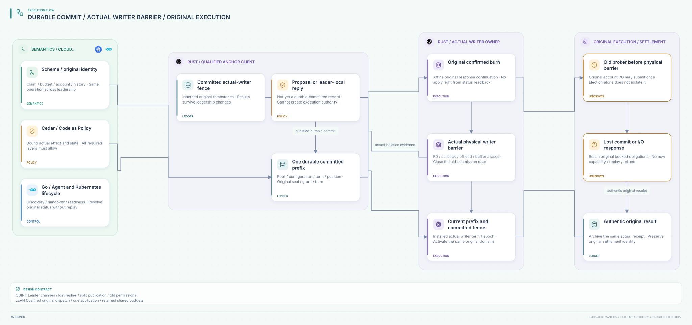

# SPDX-FileCopyrightText: 2026 hardenedlinux Linux Team and Contributors
#
# SPDX-License-Identifier: LGPL-2.1-or-later AND Apache-2.0

#+title: Weaver Anchor Commit Confirmation and Final Broker Fencing
#+language: en
#+date: 2026-10-19
#+property: STATUS abstract-composition-checked-consensus-and-native-refinement-pending
#+options: toc:3

* Decision and corrected boundary

A leader reply, a durable committed record and a currently usable execution
permission are different facts. Preserve one original consumption history across
anchor leadership changes. The broker accepts only a qualified original grant/
burn confirmation, and actual dispatch must still pass the physical writer gate.
Status resolution never reconstructs an affine execution continuation.

This refines [[file:25-gate-consumption-persistence.org][the recoverable gate-journal protocol]]. In particular, anchor
leadership change does not instantly stop an old broker, FD or buffered callback.
The new model retains that window: before the actual writer barrier, an original
already confirmed burn can still submit its one original I/O, including when its
confirmation arrives late. Recovery retains its budget and cannot replay it.
After the physical barrier, old permission cannot enter the final submission
boundary. Previously submitted original I/O can still finish and report its real
result. Election, consumption, submission, completion and settlement remain
separate transitions.

The tracked effect is the original internal account application. Its broker
submission does not authorize provider bytes or resume a stream range; those
retain the preceding final-send, revocation and writer-isolation guards. This
model does not prove external payment or provider delivery exactly-once.

[[file:../../dev/specs/quint/AnchorBrokerCommit.qnt][The Quint product]] extends the preceding real formal pipeline. [[file:../../dev/specs/lean/AnchorBrokerCommit.lean][The Lean product]]
projects into all ten preceding initialized Weaver model layers. These are formal
models of source semantics, not an automatically extracted refinement of Scheme,
Go, Rust or a consensus implementation. [[file:../../dev/specs/evidence/anchor-broker-commit-2026-10-19.org][The receipt]] retains checkable evidence.
[[file:diagrams/27-anchor-commit-broker-fencing.d2][Canonical D2]] and  contain core ownership and protocol only.

* Four independent coordinates

| Coordinate | Meaning and authority | Invalid substitution |
|------------+-----------------------+----------------------|
| Original operation identity | Canonical lineage/message/settlement purpose plus claim, manifest, account, budget/history roots, unit, closure and actual final usage | A new nonce, Authority, worker, route or connection is not another operation |
| Root domain and configuration | One protected publication domain and qualified durable membership/configuration | A new endpoint or cluster with an empty log is not recovery of this domain |
| Anchor term and committed position | Proposal authority and one immutable determining entry at each committed position | A larger term or leader signature does not prove a committed entry |
| Actual writer term/epoch and gate | The qualified final owner that accepts a specific original dispatch | Election or a root fence record alone does not revoke old physical aliases |

Root leadership term and writer epoch have different owners and advance for
different reasons. The writer may still be in the previous term/epoch after an
anchor election. The physical barrier closes that writer before a new writer
fence is committed and activated. All terms, positions and epochs are unbounded
naturals in Lean; native fixed-width representations must reject exhaustion.
No counter or transport identifier substitutes for full original identity.

* Qualified commit confirmation contract

A concrete confirmation binds root domain, configuration, committed index,
proposal term, operation kind, canonical original key, complete determining
request/result, writer epoch and authenticated committed-prefix identity.
Grant/burn confirmations include the full sealed permit and original source
binding. Fence confirmations additionally bind the actual owner barrier receipt
and its target epoch. Receipt construction or a leader's local append is
insufficient: the trusted store owner must establish durable commitment on the
single qualified prefix, including inheritance by a successor leader.

The selected fixed-configuration profile assumes a qualified durable committed
prefix with intersecting commit/recovery authorities, authenticated current reads,
nonreused root identity and no rollback of its determining history. It does not
prove a quorum algorithm or infer these properties from a signature count.
Acknowledgement must follow the store's actual durability boundary, including
survival of the declared leader/disk failure domain. An old leader that cannot
establish this boundary cannot issue a qualified execution confirmation.

A new leader must recover every prior committed seal/grant/burn/result and the
fence history before qualifying a current prefix. An uncommitted suffix can be
discarded; it must never have yielded an executable permission. Acknowledged
commits must not disappear on failover. A checkpoint or replica snapshot is not
proof of completeness without its authenticated determining prefix. Local cache
equality and a high term alone cannot establish that no earlier burn exists.

Dynamic membership is outside the checked profile. Reject an unexpected
configuration; do not silently join two independently elected configurations.
Any future reconfiguration needs a separately verified transfer/joint-publication
contract preserving committed prefix, original domains and consumption tombstones.
Client-side configuration equality alone does not establish quorum intersection.

* Proposal, commit, response and original execution

1. Stage an original-bound proposal. It grants no send/application authority.
   Multiple proposals may race; only a qualified current-term append to the one
   current head can become committed. Retry preserves the original operation.
2. Commit seal/grant/burn/result/fence at the qualified root. The formal root
   transition and its determining commit record linearize together. The logical
   grant/burn slot is spent at commit, even if every response is lost.
3. Deliver grant/burn confirmation only through the original live response path,
   after authenticating the exact registered committed entry. A duplicate cannot
   create another acknowledgement or capability. Root readback reports history;
   it cannot recreate a lost original response continuation.
4. Before consumption, require the original acknowledged grant and its writer
   epoch; the root still enforces the unique canonical burn. After a leadership
   change, new control-side grant/burn admission stays closed through recovery.
   A stale proposal cannot commit under its old term, head or prior root image.
5. Before actual dispatch, consume the original burn-confirmation continuation
   once at the actual broker gate. Check that owner's installed writer term and
   epoch. Record original submission separately from root consumption. A burned
   but unsubmitted operation cannot be completed or loaded as a runnable job.
6. Only original submitted I/O can complete. Archive its authentic exact receipt,
   confirm that same result and materialize the source account category through
   the preceding protocol. A result from the previous term can be valid evidence
   of that original completion; it grants no new submission right.

A lost commit response has two distinct outcomes: qualified status may prove the
slot committed, or the outcome remains unknown. Neither outcome recreates an
execution continuation. The conservative profile sacrifices availability when
an original grant or burn response is lost. Repeated reads cannot turn that loss
into a new grant. A response that actually remained in the original live channel
may arrive late before the physical barrier; that is delivery of the original,
not reconstruction from status. Broker restart discards such local continuations
and retains the corresponding unknown obligations.

The model retains the complete sealed permit in Lean commit entries. Quint keeps
the determining pre-commit root image; grant/burn entries project the same full
sealed permit from it. The seal's source request is validated by the imported
source action rather than duplicated in this image. The two encodings have an
explicit conceptual correspondence; no generated equivalence checker is claimed.

* Leadership change and physical activation handshake

1. Advance anchor leadership authority while preserving the committed prefix.
   Close new control-side admission and invalidate old current-read evidence.
   Preserve old held grant/burn confirmations and original submitted I/O. The
   actual old broker can still be open at this point.
2. Obtain a qualified barrier at the actual writer owner. Close its gate over
   every FD, account credential, callback, SDK/offload queue and retained buffer.
   Bind the barrier to this handover request, root domain, current term and next
   writer epoch. The original dispatch/barrier race linearizes at that owner.
3. Commit a fence entry only after this physical isolation evidence exists.
   If the root commit response is lost, resolve the same committed fence; never
   replace the actual barrier with a root integer. If leadership changes again,
   revalidate/rebind the closed-owner evidence to the new handover before commit.
4. Resolve unknown burns using only actual original receipts. The selected full-
   shard profile cannot reopen while a burn lacks an archived authentic result.
   Already submitted I/O can finish while the new root/controller remains closed.
5. Rebuild the original-bound projection. Read a qualified current root prefix
   containing the fence and all determining records. Activate only when its
   term/head, installed writer term/epoch, barrier and current source/root image
   agree. Any intervening commit makes a saved activation read insufficient.

The writer remains closed between physical isolation and activation. A second
barrier on an already closed owner can rebind the same target epoch to a new
handover, but cannot reduce its epoch. A root fence or controller-ready flag
cannot reopen it on its own. Kubernetes lease expiry, process death and task
cancellation do not qualify this physical barrier.

| Race or failure | Safe consequence |
|-----------------+------------------|
| Local leader append, no qualified durable commit | No grant/burn acknowledgement or actual submission |
| Commit succeeds, response is lost, leader changes | Original tombstone remains in inherited prefix; no regrant/reburn from status |
| Old grant held during election | Old proposal cannot commit under new leadership; after writer epoch change the old grant cannot burn |
| Old burn confirmed before election, broker still open | Its one original I/O can submit before the physical barrier; keep its unknown reservation |
| Original burn response arrives late before isolation | It may authorize only that original once through the still-current old writer |
| Old response arrives after physical isolation | Reject as execution permission; retain it only as historical commit evidence |
| Submit races barrier | Submission either enters the original effect universe before the barrier, or is rejected; no transfer to a new worker |
| Consumed burn has no original submission | No completion/replay; unknown state can block activation indefinitely |
| Original I/O completes after barrier or another election | Archive authentic original result; do not apply it again |
| Fence committed but confirmation lost | Qualified current read can resolve the fence; it cannot mint an execution continuation |
| Saved current read predates another commit | Activation refuses that old head/image |
| Two independent prefixes certify conflicting entries | Store-owner premise fails; fail closed, preserve obligations; no broker-side policy check repairs split publication |

* Scheme, Go, Rust and Cedar responsibilities

| Owner | Specific responsibility |
|-------+-------------------------|
| Scheme / POO Flow | Preserve original key, claim, budget/history lineage, pure spent-state transitions and final usage identity; an unchanged semantic root never restores a nonce |
| Go / cloud-native and Agent adapters | Discover the root/owner endpoint, authenticate workload identity, reconcile exact original status, coordinate handover/readiness and integrate Gerbil toolchain lifecycles without retrying raw effects |
| Rust / root adapter | Validate complete confirmation/domain/configuration/term/index/body, require qualified durable/current prefix, preserve original response continuations and reject stale proposals |
| Rust / final broker | Own the affine grant/burn/submission lifecycle and actual writer gate; serialize dispatch with the physical barrier; preserve submitted original I/O across root leadership changes |
| Qualified store and actual effect owners | Supply durable single-prefix/current-read evidence, actual writer isolation, and atomic original account mutation/receipt; Rust wrappers do not create these physical facts |
| Cedar / cedar-poo-spec | All required Policy layers allow without errors for the bound actual effect and state; authenticate the actual inputs at the host and preserve evaluation/validation alignment |

Go's cloud-native strengths apply to controller, discovery, Kubernetes identity
and Agent Gerbil toolchain integration. It cannot convert leader status, retries or Gerbil toolchain
reconnects into financial/send authority. Rust owns the capability/FD-sensitive
boundary; the backing root service need not be implemented in Rust. Scheme
retains the existing POO semantic advantage. Cedar constrains the actual operation;
it does not implement consensus, fencing or irrevocable one-use publication.

* Source-grounded reuse and extensions

[[file:01-reference-comparison.org][The source register]] owns all pinned identities. [[file:../../dev/specs/evidence/anchor-broker-traces/source-review.json][This review reverified eighteen
committed blobs]], extending the P35 fork countermodel excerpts. No upstream source,
ABI or dependency pin is changed.

| Source | Reusable contract | Required extension / proof boundary |
|--------+-------------------+------------------------------------|
| P12 authorized-effect-token.ss | Full original effect binding and consumed-nonce validation | Bind issued/consumed state to qualified root publication across leadership changes |
| P13 strict-mediation.ss | Indeterminate outcome still consumes nonce/sequence | Persist authoritative consumption; no committed-slot reset from lost response or unchanged semantic root |
| P15 effect-host.ss | One-use transition precedes callback/currentness checks | Qualified commit response path and actual broker gate; process-local guards do not establish durable leadership or alias isolation |
| P17 store-backend.ss and P22 store.ss | Scheme projects contracts; runtime owns append/fsync/leases/recovery | Qualify actual commit durability, inherited prefix and physical barrier; configuration metadata is not evidence of them |
| P18 PromotionTransactionRecovery.lean | Actual valid prior committed receipt required; matching fences alone do not establish exclusive claims | Bind exact original commit entry and actual writer-owner exclusion; duplicate status alone cannot authorize replay |
| P19 authorized recovery bridge | Conditional authorization/recovery identity joins | Join original grant, burn, root configuration and actual dispatch owner |
| P20 CommittedEffectApplicationExactlyOnce.lean | Conditional declared-effect-universe closure | Its actual exactly-once input is not a proof of consensus or physical dispatch; supply the qualified affine boundary |
| P31 SessionAttempt Lean/Quint and P43 funs-attempt.ss | Recovery advances generation/revision and retains active attempts as pending obligations | Pending is not a reconstructed dispatch job; distinguish consumed-but-unsubmitted from actually submitted original I/O |
| P33 semantic/runtime budget separation | Watchdog and deterministic budget have different authority | Election/retry/timeout cannot free an unknown economic reservation |
| P35 monotonicity and lineage-prefix closure | Generation advancement alone allows two different successors; fork-free publication is an explicit single-lineage/domain premise | One qualified committed prefix and correct configuration handover are required; a high term is insufficient |
| C8 BoundOperation.lean | Fixed effect/state projection match | Host authenticates actual current root/writer inputs; equality does not authenticate them |
| C10 CompoundAuthorization.lean | Nonempty required layers all allow with no evaluation errors | A signed/constructed receipt alone does not permit an actual send |
| C11 Composition.lean | Conditional evaluation/typecheck composition with explicit expression/policy alignment | No consensus, native root durability or physical writer theorem is supplied |

* Formal correspondence and bounded claims

| Concrete event | Quint | Lean |
|----------------+-------+------|
| Stage an uncommitted operation | propose | propose; no root or dispatch change |
| Qualified root commit | commit | commit with RootOwner.commitValid, actual imported root transition and complete Describes binding |
| Original grant/burn confirmation | acknowledgeGrant / acknowledgeBurn | Registered qualified entry, original reply membership and actual writer term/epoch |
| Actual once-only submission | dispatch | Immutable dispatch record with observed physical writer term/epoch |
| Root leadership changes | changeLeader | Preserves log, held confirmations and original dispatch; leaves actual writer gate unchanged |
| Actual no-new-submission barrier | isolateWriter | EvidenceOwner.barrierValid plus root/configuration/term/target binding; closes gate and nondecreases writer epoch |
| Resolve current prefix / activate | readCurrent / activate | Qualified current read plus fence/barrier/source joins; cannot restore continuations |
| Actual completion / result archive | complete / commit result | Completion requires an original dispatch; projected actual receipt enters the previous root/result chain |

Lean proves single-valued registered committed entries, immutable original records,
actual application requiring a qualified original burn/dispatch, at most one
actual dispatch/application, original usage/lineage binding, retained original
reservations and shared-account capacity conservation. It proves root term and
actual writer epoch monotonicity and refusal of held permission after physical
isolation/epoch change. Root leadership change is deliberately not such a barrier.

The single-prefix theorem is conditional on the registered prefix owner. It does
not prove that arbitrary external signatures agree. RootOwner.commitValid and
currentReadValid and barrierBound bind the selected root/configuration/term/target;
actual-owner barrier/receipt predicates, original affine response
ownership and actual account effect/receipt atomicity remain concrete obligations.
The inherited history/claim guards are not regenerated from worker-selected IDs.
The model uses one fixed root/configuration and the preceding immutable finite
manifest parameters; it does not verify dynamic membership or a consensus engine.

Quint includes excluded-rule traces for leader-local acknowledgement treated as
commit, conflicting certificates at the same root/configuration/index, stale
acknowledgement used to submit after a real barrier, and a forked root that loses
the original spent history and executes the account application twice. The stale
case actually completes an abstract account effect after bypassing the writer
check; it is not merely an audit flag. The forked-root replay retains historical
application counters so forgetting rows cannot erase the duplication observation.

* Implementation acceptance and performance obligations

Qualify lost responses and leader death after every durable phase; restore a
successor from an older replica/checkpoint and require the acknowledged prefix.
Exercise partitioned old leaders, old worker FD/callback/buffer aliases, barrier/
submit races, lost fence confirmation, repeated elections during activation,
stale current-read responses and actual original completion after handover.
Require no new executable continuation from status, no duplicate application and
no unknown-budget release. Keep unsupported or indeterminate outcomes booked.
Test configuration substitution; separately qualify any future membership change.

The root commit/current-read and final writer predicates are semantic premises,
not a native acceptance result. A deployment allowing two qualified prefixes or
raw writer credentials outside the broker violates them. When root survival or
actual isolation is unknown, keep the gate closed rather than manufacture success.

Per-message economic application can be a hot path. This protocol adds durable
root coordination and separate physical handover cost; no latency/throughput
claim is made. Immutable bound Policy artifacts can be cached, but committed
consumption/current-prefix checks and the final writer barrier cannot be replaced
by a cached leader term. Batching/sharding must preserve per-original-key tombstones,
shared-budget/history identity and durability before executable acknowledgement.
The full-shard unknown barrier remains conservative and can prevent progress.

* Embedded architecture views

** 27-anchor-commit-broker-fencing.svg

