#+title: Weaver Quorum Durable Promises and Prefix Recovery
#+language: en
#+date: 2026-10-19
#+property: STATUS conditional-formal-product-checked-native-qualification-pending
#+options: toc:3

* Decision and evidence boundary

A quorum intersection must contain a witness that cannot forget or fork its
previous acknowledgement. Local fsync and a restored maximum index do not supply
that property. Separate the restorable replica from a protected promise history
and signer qualification. A node must publish its promise durably before releasing
an acknowledgement. Recovery cannot reset that promise, reuse an old signer
incarnation or replace original claim, budget, history and consumption domains.

This closes an explicit premise left in [[file:27-anchor-configuration-prefix-inheritance.org][the configuration inheritance review]].
[[file:../../dev/specs/lean/QuorumDurablePromises.lean][The Lean product]] adds actual node-promise transitions to the initialized Weaver
execution model; [[file:../../dev/specs/quint/QuorumDurablePromises.qnt][the Quint model]] exposes conflicting quorum certificates after a
shared witness forgets its promise. [[file:../../dev/specs/evidence/quorum-durable-promises-2026-10-19.org][The evidence receipt]] separates checked
semantics from unimplemented native persistence, signing and transport contracts.
[[file:diagrams/29-quorum-durable-promises.d2][Canonical D2]] and  show core ownership only.

The chosen executable profile uses sticky full-prefix promises: once a node
promises a candidate, its protected history can only extend that candidate.
This deliberately trades availability for a simple auditable safety argument.
An uncommitted proposal can strand a quorum, including after an election. This
is not a claim about ordinary Raft/Paxos vote replacement, a complete consensus
algorithm, Byzantine tolerance or eventual recovery. Substituting a consensus
engine requires a separate refinement of its term/vote/log and election rules.

* What is durable, and under which failure model

| State / authority | Snapshot treatment | Required owner contract |
|-------------------+--------------------+-------------------------|
| Replica checkpoint, local journal and cached receipts | May be lost, stale or restored | Never sufficient to enable a signer or broker |
| Protected promise history | Append-only across every permitted restore | Retain exact choices, including pending promises and configuration records |
| Signer incarnation and permanent retirement | Outside permitted rollback domain | No reuse; revoke old signing handles at the enforcement owner |
| Original committed root and deciding image | Recovered from qualified lineage | Preserve full data/control prefix, source roots, spent-state and unknown obligations |
| Account application and writer isolation | Separate owners and receipts | Preserve original application identity; actual handle/buffer isolation before activation |

The protected witness is a trust primitive, not another ordinary volume named
an anchor. Deployment must identify a concrete non-equivocating owner outside
the allowed snapshot domain: for example, a separately administered publication
service or a hardware-backed monotonic owner with an exclusive signer. Qualify
its write/sign atomicity, rollback exclusion, key custody, recovery and faults.
A cluster of VMs whose disks, memory, keys and counters can all be restored from
the same snapshot does not meet this contract. A disk flush alone covers crash
persistence, not administrative rollback.

If every copy of the protected witness and its qualification root can roll back
together, safe continuation cannot be inferred from the surviving snapshots.
Keep the root unavailable. Re-enrollment, new certificates, a new Authority or a
new budget/history domain cannot restore the missing non-equivocation evidence.
An external reconciliation process must establish an authoritative history and
retain original unknown obligations before any separately qualified continuation.
The design does not recursively postulate another unqualified anchor.

* Node identity, signing and publication protocol

A native acknowledgement binds the root and immutable roster, signer identity
and incarnation, old/joint/new scope, transition revision, leadership term,
predecessor prefix, position, exact candidate and complete determining image.
Content identity includes original claim, budget/history lineage, account,
operation purpose, nonce/spent-state, result and unresolved obligations. Hashes
require canonical encoding and collision-resistance qualification. The Lean
model instead compares full structural records, avoiding an assumed digest
collision oracle. Certificate ordering and full-envelope normalization are
native obligations; equivalent economic payloads are not permission to rewrite
an already promised envelope.

1. Validate the proposed successor against the current complete prefix and
   configuration. Enter-joint proposals use the joint signing scope, so the
   replacement learners can participate in the required dual certificate.
2. At the protected owner, atomically check current signer incarnation,
   retirement, scope/revision/term and eligibility. Validate the candidate as an
   extension of every existing protected promise for this signer and root.
3. Publish the full candidate promise outside the permitted rollback domain.
   Only then produce the bound acknowledgement. A missing response leaves the
   promise in force. Retrying can return the identical original evidence or
   remain unknown; it cannot sign a replacement candidate.
4. Form a certificate using the exact original acknowledgements under the
   required quorum rules. Commit the same candidate through the existing root
   protocol. A committed record carries its historical certificate; a current
   membership lookup must not relabel that certificate.
5. Publish account/transport permissions only through the existing consumption,
   actual fencing, current-read and activation gates. A node acknowledgement is
   evidence for the root protocol, not a runnable application or send permit.

The protected owner must serialize durable publication and signature release
per signer/root. Two concurrent threads cannot both check an empty promise and
then emit conflicting signatures. A cached authorization to call a signer is
insufficient: every signing operation rechecks protected state. Keeping the raw
private key in a rollbackable old worker would defeat this contract. A numeric
incarnation comparison in Go or an increased term in a log cannot invalidate
such a key by itself.

The sticky profile includes the full original record, including its term and
certificate envelope. An election does not unlock a pending candidate or permit
relabeling it with the new term. Such a pending promise can block recovery
indefinitely. This restriction is explicit; the formal model supplies no hidden
unlock, timeout refund or promise garbage collection.

* Restore, old members and prefix recovery

A restored process starts quarantined even if its checkpoint says ready. The
protected gate invalidates the old incarnation before any new signing admission.
This must also cover a resumed old VM or worker: boot-time registration alone
cannot stop a process that retained a raw signing handle. Old handles must be
mediated by the current protected owner or physically fenced.

Recover the exact committed data/control prefix and source deciding image, then
compare it to protected promises. In the checked conservative profile, a node is
made ready only when its protected history equals the current committed history
and its complete installation receipt is authentic. An ahead pending promise,
a shorter copy, an equal-height different body or an unknown protected owner
leaves it quarantined. This condition does not consult a future correct result
or reconstruct an effect capability from a snapshot. The native adapter must
perform a fresh qualified current read; cached equality is insufficient.

Retirement is irreversible for that signer identity. Restoring an old member's
checkpoint cannot restore membership or reset its incarnation. Rejoining hardware
uses a distinct qualified identity and inherits the authoritative prefix and
original domains. It must not launder a contradictory key into a new identity.
The formal recovery profile blocks ahead pending promises rather than moving
them to a fresh member and discarding them. Membership lineage never branches
back to old-only authority after joint publication.

Historical evidence and live eligibility have different lifetimes. An authentic
acknowledgement recorded before retirement or restore remains evidence for its
exact original candidate while that proposal's scope/revision/term/predecessor
are current. It cannot authorize a new proposal after an election or a new
configuration. An already committed certificate remains historical evidence
regardless of current roster membership. Status lookup creates no new grant,
burn response, signing permit or tail capability.

* Interleavings with reconfiguration and broker fencing

| Interleaving | Permitted result | Forbidden shortcut |
|--------------+------------------+--------------------|
| Promise persists, signature/response lost | Resolve the same promise or block | Treat timeout as an empty slot |
| Certificate committed, local snapshots restored | Rebuild exact prefix; retain every historical promise | Reconfirm a conflicting equal-height prefix |
| Old and joint quorums race | Their old-side intersection preserves comparable full promises | Infer safety from cardinalities without durable witnesses |
| Joint and stable-new quorums race | Their new-side intersection preserves the inherited prefix | Activate a disjoint new roster with an empty root |
| Election between prepare and certificate | Old-term acknowledgements cannot form a current-term certificate | Rewrite signed term or clear pending locks |
| Election between joint entry and finish | Preserve joint scope, revision, promises and complete prefix | Return to old-only admission |
| Old member or signer resumes | Reject new signing until qualified; retired identity stays retired | Trust a checkpoint's membership or cached key authorization |
| Original committed burn confirmation arrives before actual broker barrier | Existing model may allow its single original submission | Claim election/configuration publication already killed old IO |
| Actual barrier complete, old FD/buffer still exists in a failed owner | No new submission only if physical isolation contract holds | Infer FD revocation from quorum or signer fencing |
| Root commit or account write reply is lost | Retain original tombstone/reservation and reconcile original receipt | Replay settlement or release an unknown reservation |

Old/joint and joint/new pairwise intersections do not prove that arbitrary
old/new certificates overlap. The serialized bridge plus append-only complete
inheritance is still necessary. The Lean product preserves that original
configuration machine, rather than accepting arbitrary certificate pairs from
disjoint stable rosters. Joint admission remains closed; no voter recovery
creates economic admission. New-stage activation still needs its fresh actual
barrier, committed fence and current full read.

Signer fencing and transport/account-writer fencing are separate. The former
prevents conflicting new endorsements; the latter controls actual submissions.
Previously submitted IO can complete after isolation and must resolve the same
original operation. The tracked exactly-once effect is the internal account
application, not arbitrary provider effects or external payments.

* Source correspondence: direct reuse versus extension

The [[file:../../dev/specs/evidence/quorum-promise-traces/source-review.json][eighteen pinned source blobs and numbered excerpts]] are rechecked byte-for-byte.
References below use the existing [[file:01-reference-comparison.org][source register]], not an inferred current main.
The [[file:../../dev/specs/evidence/quorum-promise-traces/source-owner-boundaries.log][bounded owner-contract search]] confirms the storage/runtime split in the reviewed
files; it is not a repository-wide proof that no consensus code exists.

| Source | Direct reuse | Required extension / unproved owner premise |
|--------+--------------+--------------------------------------------|
| P12 authorized-effect-token | Exact binding and consumed-nonce validation context | Publish authoritative spent-state; restored snapshots never supply an empty context |
| P13 strict-mediation | Immutable nonce/sequence consumption even for an indeterminate result | Caller must durably publish the consumed successor before any effect; snapshot rollback is not undone by purity |
| P15 effect-host | Consume before callback and local identity checks | No protected quorum promise, exclusive signing key or physical FD revocation follows |
| P17/P22 durable backend/store | Scheme owns contracts; runtime owns append/fsync/leases/replay | Extend native contract with write-before-sign, antirollback witness, recovery quarantine and exact prefix installation |
| P18/P19 promotion/recovery bridges | Original committed receipt, identity and fence joins | Valid prior commit and authentic evidence remain premises; matching IDs do not isolate writers |
| P20 committed application exactly once | Compose the source-bound logical uniqueness result | effectUniverseExecutesExactlyOnce is an input; not a proof of native account/transport IO |
| P31/P43 session attempt and reconciliation | Pending/nonrunnable recovery, generation/revision progression | Use protected signer qualification; process-local generation or trusted reconcile intent is not physical acknowledgement |
| P33 deterministic/runtime budgets | Separate semantic booked budget from runtime watchdog | Do not refund unknown obligations on recovery timeout |
| P35 monotonicity closure | Equality rollback counterexample; authority-bound fork-free publication | Strict advancement alone permits forks; implement the publication premise with non-equivocating durable witnesses |
| P35 lineage-prefix closure | Exact published prefix/domain binding; future contexts are not published | Preserve full prefix across actual replicas; theorem does not persist quorum-node votes |
| C8 BoundOperation | Exact requested/executed effect and state binding | Authenticate those inputs and all original lineage identities |
| C10 CompoundAuthorization | Every required nonempty authorization layer allows without evaluation errors | Storage/signature recovery cannot bypass Cedar evaluation or treat stale Allow as current |
| C11 Composition | Aligned typed semantic composition | No implication that a native store, signer, scheduler or socket implements that composition |

Scheme defines canonical operation/domain identity, policy semantics, prefix
encoding and evidence predicates; it must not claim ownership of native fsync or
key custody. Cedar remains Code as Policy over the actual effect and all required
authorization layers. Neither formal verification nor a quorum certificate
replaces Policy admission.

Go owns Kubernetes/cloud-native discovery, learner lifecycle, reconciler intent,
status resolution and recovery orchestration. It cannot make a restored node
ready, reset a protected promise, grant retries or expose an alternate SDK send
path on its own. Readiness is a qualified Rust/store-owner result, not a pod's
Running condition or a successful watch event.

Rust owns the mediated native persistence/signature boundary, atomic promise
checks, authentic receipt decoding and final broker enforcement. The selected
protected service/device must independently satisfy its declared fault model;
Rust's memory safety does not establish that fact. Rust's final broker checks
original consumption, current Policy and actual writer fencing at submission.
Cloud lifecycle and language boundaries carry full immutable identities, never
raw reusable effect continuations.

* Checkable properties and counterexamples

| Property | Lean declaration / Quint control | Preconditions and limitation |
|----------+-----------------------------------+------------------------------|
| Protected history never shrinks | protected_promises_grow; run_preserves_promises | Only specified transitions; no total protected-root rollback |
| Earlier acknowledgements survive restart | historical_acknowledgement_survives_recovery; certificates_across_restart_cannot_conflict | Protected publication/signing and a common witness |
| Equal-position certificates cannot disagree | same_position_cannot_confirm_conflicting_prefixes | Full histories, equal length, intersecting signers and protected extension |
| Old/joint/new bridges cannot fork | old_joint_bridge_cannot_fork; joint_new_bridge_cannot_fork | Correct immutable quorum families; global configuration machine still required |
| Publication carries protected witnesses | published_extension_has_protected_witnesses | Product publish guard plus original full-image/certificate guards |
| Old signer cannot be silently reused | restored_old_handle_is_not_current; retirement_never_reenrolls | Gate must mediate every actual signing invocation |
| Original consumption/settlement remains unique | original_consumption_and_settlement_remain_unique | Initialized product and inherited original application-owner assumptions |
| Shared budget and unknown reservation remain intact | original_budget_remains_conserved; unknown_original_reservation_stays_held | Same canonical domains and source image; no timeout-derived release |

Quint exercises two-of-three old/new groups, both-quorum control records, four
finite prefix positions and two distinct data choices. The Lean list/identity
model has arbitrary finite histories and Nat-indexed voters; it does not derive
native encoding, cryptography, membership authenticity or liveness. Quint stores
integer choices and abstract recovery authenticity, not the full source account
image. Lean uses structural records and composes the full prior deciding image.
The new promise component protects structural records; full source-image
installation remains a guard in the imported configuration model. It does not
independently prove a native signature binds every byte of that image.
These representations are explicitly related design models, not a generated
proof that their transition systems or the implementation are equivalent.

Four excluded traces retain the external observation history while injecting
unsafe recovery: shared-witness rollback, same-signer re-enrollment, old-roster
resurrection, and loss of every protected rollback root. The first produces two
conflicting certified prefixes with a common node. Retained observations are a
test oracle, never an authority that recovery magically reads. The earlier
actual forked-root replay counterexample is rerun separately to connect loss of
root history to duplicate internal account application; the new small quorum
model does not itself simulate account writes.

* Native qualification still required

- Crash after durable promise but before signature, after signature but before
  response, and after certificate commit but before the caller observes it.
  The original promise must survive; concurrent conflicting calls cannot both
  obtain signatures, including a failed transaction with an unknown result.
- Restore a post-ack signer from every earlier checkpoint while another quorum
  chooses a conflict. Verify rejection at the shared signer, not merely at a
  coordinator cache. Test equal-height different-prefix and missing source-image
  copies, retained raw-key handles, resumed VM memory and concurrent enrollments.
- Interleave joint entry, leader change, lost finalize response, late old
  acknowledgements, old-member recovery and stable-new activation. Verify full
  inherited tombstones and no return to old-only publication.
- Restart the protected owner and its credential service; qualify monotonic
  identity, counter exhaustion, exclusive key use and authentic current reads.
  Demonstrate that the declared rollback domain excludes the witness. If not,
  record unavailable rather than successful recovery.
- Retain old broker FD/buffer handles during signer retirement and root
  reconfiguration. Exercise actual physical isolation, submitted-IO completion,
  account-write lost responses and late usage receipts. Require one original
  burn/application and no release of an unresolved original reservation.

These are acceptance obligations, not completed native receipts. No gateway
implementation, consensus backend selection, dependency-pin migration or
performance result is delivered by this review. Quorum signing and recovery are
control/durability work; the normal Rust send path consumes qualified original
capabilities and fences without a Go/Scheme callback per byte. Optimizing or
batching publication must preserve each original identity and the same linearized
promise-before-ack boundary; no such optimization is validated here.

* Embedded architecture views

** 29-quorum-durable-promises.svg

