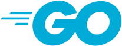
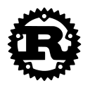
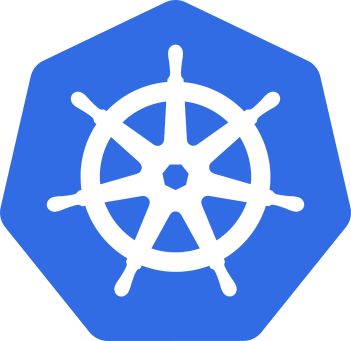

# SPDX-FileCopyrightText: 2026 hardenedlinux Linux Team and Contributors
#
# SPDX-License-Identifier: LGPL-2.1-or-later AND Apache-2.0

#+title: Weaver Diagram Brand Asset Sources
#+language: en
#+date: 2026-10-18
#+options: toc:1

* Use and provenance

The overview uses unmodified Go, Rust and Kubernetes marks for technology
identification. The Go wordmark comes from the official Go website; the other
two SVGs are exact decoded inline previews from the official D2 icon catalog
retrieved on 2026-10-18. The catalog's Kubernetes collection name does not
select Azure as a deployment. Marks remain with their respective owners;
this documentation implies no project endorsement.

Assets are local and bundled into generated SVGs for offline viewing.
Generic responsibilities use native D2 shapes rather than mixed illustration
styles. A logo does not establish installed or qualified implementation.
See D2's [[https://d2lang.com/tour/icons/][icon documentation]] and [[https://go.dev/brand][Go brand guidance]].

* Inventory

| Asset | Identity | Source URL | SHA-256 of vendored bytes |
|-------+----------+------------+---------------------------|
|  | Official Go wordmark | [[https://go.dev/images/go-logo-blue.svg][Source]] | =c89d8c4a31dd4f6487e69bc3bdb6585a52466a393f6e8d863bfc1a0189bc213c= |
|  | Rust mark from D2 catalog | [[https://icons.d2lang.com/dev%2Frust.svg][Source]] | =6fc2ce4862533b5c07c89c2c507172dd4bd1b3ea1efb6ad5553de4538a7e3787= |
|  | Kubernetes mark from D2 catalog | [[https://icons.d2lang.com/azure%2F_Companies%2FKubernetes.svg][Source]] | =aba51863e22903d8b44662ed9a7100b0d7b8977251662a608c8f8b71f5964279= |

* Embedded architecture views

** go.svg

** rust.svg

** kubernetes.svg

